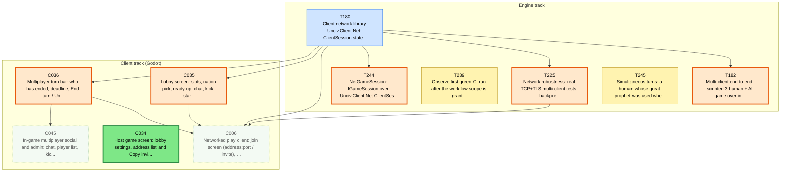
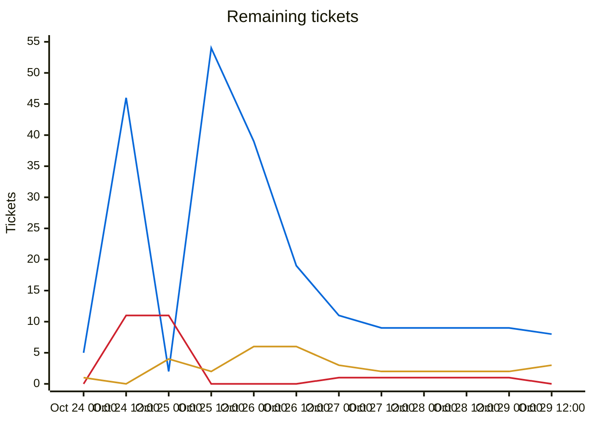
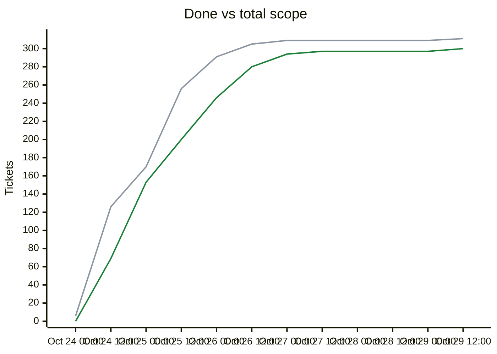

# Migration dependency map

## Delivery phases

Work is completed phase by phase (`phases.txt`; `ticket.py ready`/`next` list earlier phases first; later phases fill idle capacity).

| Phase | Done | Remaining | Ready | In flight | Remaining tickets |
|---|---|---|---|---|---|
| Phase 1: CLI (headless engine) | 219/222 | 3 | 0 | 2 | [T239](backlog/T239.md) [T244](backlog/T244.md) [T245](backlog/T245.md) |
| Phase 2: single player (Godot client) | 57/57 | 0 | 0 | 0 | complete |
| Phase 3: multiplayer | 21/29 | 8 | 1 | 1 | [C006](backlog/C006.md) [C034](backlog/C034.md) [C035](backlog/C035.md) [C036](backlog/C036.md) [C045](backlog/C045.md) [T180](backlog/T180.md) [T182](backlog/T182.md) [T225](backlog/T225.md) |

Generated by `tools/ticket.py` on every backlog change; do not edit by hand. Shows every incomplete ticket and the dependencies between them; completed tickets are hidden. An arrow `A --> B` means B depends on A.

| Colour | Meaning |
|---|---|
| bright green, thick border | Ready to start: Available and every dependency is Done |
| orange, thick border | On deck: Available, and every unfinished dependency is already in progress or in review, so it becomes ready when those finish |
| pale green, dotted border | Available but waiting on dependencies that are not started yet |
| yellow | In-Progress |
| blue | Needs-Review / In-Review |
| red | Blocked |

## Remaining tickets over time

Generated from the git history of `backlog/` (times are UTC; each point is the backlog as of that time, the last one the current backlog). Completed tickets (Done, Won't port) are not counted in this chart.

| Line | Meaning |
|---|---|
| blue (#0969da) | New: Available, not started yet |
| red (#cf222e) | Blocked |
| amber (#d29922) | Active: In-Progress, Needs-Review or In-Review |

## Progress and scope over time

| Line | Meaning |
|---|---|
| green (#1a7f37) | Done: Done or Won't port, cumulative |
| grey (#8c959f) | Total scope: every ticket that existed at that time; a rise here is new tickets, not lost progress |

## Incomplete tickets

| Ticket | State | Depends on | Unblocks | Title |
|---|---|---|---|---|
| C034 | **Ready to start** | C005, C010, C015, T204, T205 | 0 | Host game screen: lobby settings, address list and Copy invite, start hosting in-process, resume saved hosted game |
| C036 | **On deck** (after T180) | C010, C011, T180, T202, T175 | 2 | Multiplayer turn bar: who has ended, deadline, End turn / Undo end turn, turn-resolving overlay, connection markers |
| C035 | **On deck** (after T180) | C005, T180, T204 | 1 | Lobby screen: slots, nation pick, ready-up, chat, kick, start (host and joiner views) |
| T225 | **On deck** (after T180) | T179, T180 | 1 | Network robustness: real TCP+TLS multi-client tests, backpressure, ping timeout, large snapshots, resync rate limit, TLS platform matrix |
| T182 | **On deck** (after T180) | T178, T180, T204, T203 | 0 | Multi-client end-to-end: scripted 3-human + AI game over in-memory transport, kill/restart server, reconnect, hash agreement |
| T244 | **On deck** (after T180) | T180 | 0 | NetGameSession: IGameSession over Unciv.Client.Net ClientSession (replaces LocalHost per-command full snapshot; Desynchronized from session events) |
| T180 | In-Review [DeepSeek] | T172, T173, T174, T175, T179, T204, T223, T224 | 7 | Client network library Unciv.Client.Net: ClientSession state machine, mirror state, delta apply, command retry, reconnect/resume (no Godot types) |
| C006 | Available (waiting on T180, C035, C036, T225) | T012, C001, T164, T172, T173, T180, T179, C010, C016, T194, C035, C036, T225, C037 | 0 | Networked play client: join screen (address:port / invite), TOFU prompt, reconnect overlay, key storage |
| C045 | Available (waiting on C036) | C036, T178, T204 | 0 | In-game multiplayer social and admin: chat, player list, kick, rebind a slot to a new device key |
| T239 | In-Progress [Claude] | T169 | 0 | Observe first green CI run after the workflow scope is granted; remove continue-on-error from client-scenarios |
| T245 | In-Progress [Claude] | T203 | 0 | Simultaneous turns: a human whose great prophet was used when the last religion icon went to the other human is stuck in FoundingReligion |
