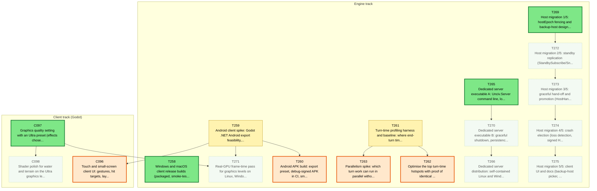
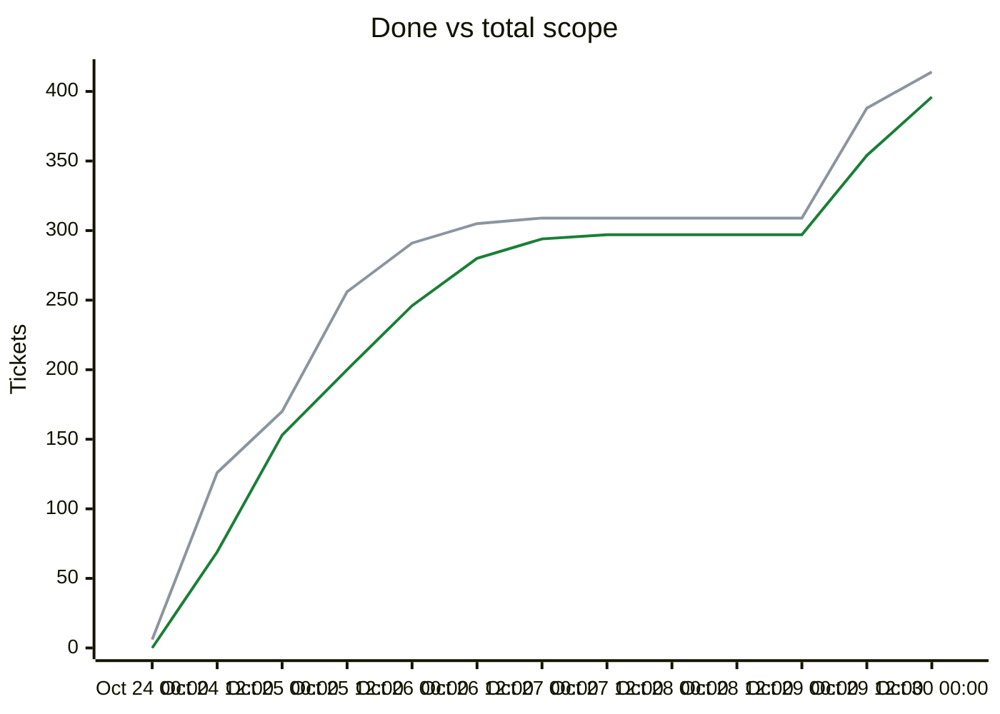

# Migration dependency map

<!-- toc -->
## Contents

- [Delivery phases](#delivery-phases)
- [Remaining tickets over time](#remaining-tickets-over-time)
- [Progress and scope over time](#progress-and-scope-over-time)
- [Incomplete tickets](#incomplete-tickets)
<!-- /toc -->

## Delivery phases

Work is completed phase by phase (`phases.txt`; `ticket.py ready`/`next` list earlier phases first; later phases fill idle capacity).

| Phase | Done | Remaining | Ready | In flight | Remaining tickets |
|---|---|---|---|---|---|
| Phase 1: CLI (headless engine) | 231/231 | 0 | 0 | 0 | complete |
| Phase 2: single player (Godot client) | 57/57 | 0 | 0 | 0 | complete |
| Phase 3: multiplayer | 29/29 | 0 | 0 | 0 | complete |
| Phase 4: queued plans (UI redesign, unit models, BNW) | 72/72 | 0 | 0 | 0 | complete |
| Phase 5: owner issue backlog (Android, performance, ultra graphics, dedicated server, resiliency) | 3/21 | 18 | 4 | 2 | [C096](backlog/C096.md) [C097](backlog/C097.md) [C098](backlog/C098.md) [T258](backlog/T258.md) [T259](backlog/T259.md) [T260](backlog/T260.md) [T261](backlog/T261.md) [T262](backlog/T262.md) [T263](backlog/T263.md) [T265](backlog/T265.md) [T266](backlog/T266.md) [T269](backlog/T269.md) [T270](backlog/T270.md) [T271](backlog/T271.md) [T272](backlog/T272.md) [T273](backlog/T273.md) [T274](backlog/T274.md) [T275](backlog/T275.md) |

Generated by `tools/ticket.py` on every backlog change; do not edit by hand. Shows every incomplete ticket and the dependencies between them; completed tickets are hidden. An arrow `A --> B` means B depends on A.

| Colour | Meaning |
|---|---|
| bright green, thick border | Ready to start: Available and every dependency is Done |
| orange, thick border | On deck: Available, and every unfinished dependency is already in progress or in review, so it becomes ready when those finish |
| pale green, dotted border | Available but waiting on dependencies that are not started yet |
| yellow | In-Progress |
| blue | Needs-Review / In-Review |
| red | Blocked |

## Remaining tickets over time

Generated from the git history of `backlog/` (times are UTC; each point is the backlog as of that time, the last one the current backlog). Completed tickets (Done, Won't port) are not counted in this chart.

| Line | Meaning |
|---|---|
| blue (#0969da) | New: Available, not started yet |
| red (#cf222e) | Blocked |
| amber (#d29922) | Active: In-Progress, Needs-Review or In-Review |

## Progress and scope over time

| Line | Meaning |
|---|---|
| green (#1a7f37) | Done: Done or Won't port, cumulative |
| grey (#8c959f) | Total scope: every ticket that existed at that time; a rise here is new tickets, not lost progress |

## Incomplete tickets

| Ticket | State | Depends on | Unblocks | Title |
|---|---|---|---|---|
| T269 | **Ready to start** | T268, T267, T179, T205 | 4 | Host migration 1/5: hostEpoch fencing and backup-host designation (StandbyOffer/Accept/Decline/Revoke, probe, HostSuccessor announcement) |
| C097 | **Ready to start** | T264, C043, C002 | 2 | Graphics quality setting with an Ultra preset (effects chosen by the ultra graphics spike) |
| T265 | **Ready to start** | T178, T179, T204, T205 | 2 | Dedicated server executable A: Unciv.Server command line, lobby and game hosting over TCP+TLS |
| T258 | **Ready to start** | C042, T169 | 0 | Windows and macOS client release builds (packaged, smoke-tested, released) |
| C096 | **On deck** (after T259) | T259, C043 | 0 | Touch and small-screen client UI: gestures, hit targets, layout for phone and tablet |
| T260 | **On deck** (after T259) | T259 | 0 | Android APK build: export preset, debug-signed APK in CI, smoke on an emulator or device |
| T262 | **On deck** (after T261) | T261 | 0 | Optimise the top turn-time hotspots with proof of identical game state |
| T263 | **On deck** (after T261) | T261 | 0 | Parallelism spike: which turn work can run in parallel without breaking determinism (go/no-go) |
| T259 | In-Progress [Claude-T259] | C042, T169, T249 | 3 | Android client spike: Godot .NET Android export feasibility, device requirements and the touch-UI gap list |
| T272 | Available (waiting on T269) | T269 | 3 | Host migration 2/5: standby replication (StandbySubscribe/Snapshot/Entry/Ack, standby store in the successor's data dir, lag handling) |
| T261 | In-Progress [Claude-T261] | T227, T178, T208, B026 | 2 | Turn-time profiling harness and baseline: where end-turn time goes (AI per civ, per phase, host delta build) |
| T273 | Available (waiting on T272) | T272, T267 | 2 | Host migration 3/5: graceful hand-off and promotion (HostHandoff, promote from standby store, client redirect, rolledBack resync) |
| T270 | Available (waiting on T265) | T265, T176, T254 | 1 | Dedicated server executable B: graceful shutdown, persistence and resume, exit codes, subprocess test |
| T274 | Available (waiting on T273) | T273 | 1 | Host migration 4/5: crash election (loss detection, signed HostLossVote quorum, split-brain refusal, superseded-host mode, forced take-over, kill-the-host scenarios) |
| C098 | Available (waiting on C097) | C097 | 0 | Shader polish for water and terrain on the Ultra graphics level |
| T266 | Available (waiting on T270) | T270 | 0 | Dedicated server distribution: self-contained Linux and Windows builds in releases and CI, run guide |
| T271 | Available (waiting on T259, C097) | T259, C097 | 0 | Real-GPU frame-time pass for graphics levels on Linux, Windows, macOS and a mid-range Android phone |
| T275 | Available (waiting on T274) | T274, C034, C035 | 0 | Host migration 5/5: client UI and docs (backup-host picker, trust notice, standby status, rollback and host-changed notices, superseded-host screen) |
