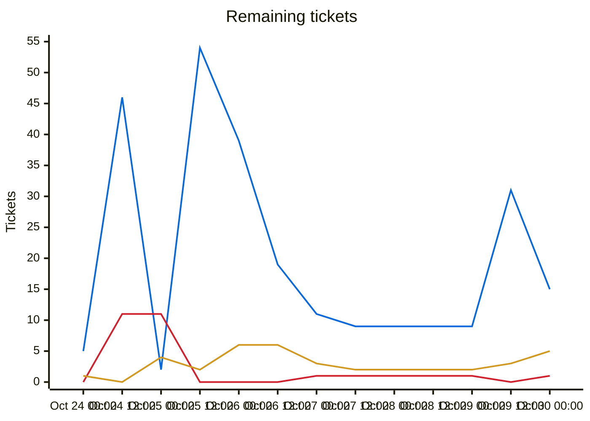
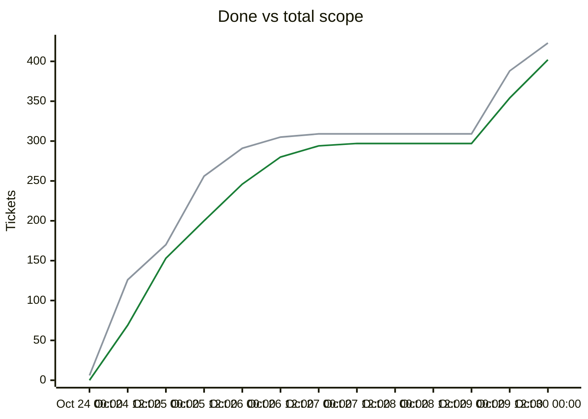

# Migration dependency map

<!-- toc -->
## Contents

- [Delivery phases](#delivery-phases)
- [Remaining tickets over time](#remaining-tickets-over-time)
- [Progress and scope over time](#progress-and-scope-over-time)
- [Incomplete tickets](#incomplete-tickets)
<!-- /toc -->

## Delivery phases

Work is completed phase by phase (`phases.txt`; `ticket.py ready`/`next` list earlier phases first; later phases fill idle capacity).

| Phase | Done | Remaining | Ready | In flight | Remaining tickets |
|---|---|---|---|---|---|
| Phase 1: CLI (headless engine) | 231/231 | 0 | 0 | 0 | complete |
| Phase 2: single player (Godot client) | 57/57 | 0 | 0 | 0 | complete |
| Phase 3: multiplayer | 29/29 | 0 | 0 | 0 | complete |
| Phase 4: queued plans (UI redesign, unit models, BNW) | 72/72 | 0 | 0 | 0 | complete |
| Phase 5: owner issue backlog (Android, performance, ultra graphics, dedicated server, resiliency) | 9/30 | 21 | 3 | 5 | [C096](backlog/C096.md) [C098](backlog/C098.md) [C099](backlog/C099.md) [C100](backlog/C100.md) [C101](backlog/C101.md) [T260](backlog/T260.md) [T262](backlog/T262.md) [T263](backlog/T263.md) [T265](backlog/T265.md) [T266](backlog/T266.md) [T270](backlog/T270.md) [T271](backlog/T271.md) [T272](backlog/T272.md) [T273](backlog/T273.md) [T274](backlog/T274.md) [T275](backlog/T275.md) [T277](backlog/T277.md) [T278](backlog/T278.md) [T279](backlog/T279.md) [T280](backlog/T280.md) [T281](backlog/T281.md) |

Generated by `tools/ticket.py` on every backlog change; do not edit by hand. Shows every incomplete ticket and the dependencies between them; completed tickets are hidden. An arrow `A --> B` means B depends on A.

| Colour | Meaning |
|---|---|
| bright green, thick border | Ready to start: Available and every dependency is Done |
| orange, thick border | On deck: Available, and every unfinished dependency is already in progress or in review, so it becomes ready when those finish |
| pale green, dotted border | Available but waiting on dependencies that are not started yet |
| yellow | In-Progress |
| blue | Needs-Review / In-Review |
| red | Blocked |

```mermaid
flowchart TD
  subgraph TTRACK["Engine track"]
    T260["T260<br/>Android APK build: unblock the .NET export (net9.0 target or..."]
    T262["T262<br/>Optimise the top turn-time hotspots with proof of identical ..."]
    T263["T263<br/>Parallelism spike: which turn work can run in parallel witho..."]
    T265["T265<br/>Dedicated server executable A: Unciv.Server command line, lo..."]
    T266["T266<br/>Dedicated server distribution: self-contained Linux and Wind..."]
    T270["T270<br/>Dedicated server executable B: graceful shutdown, persistenc..."]
    T271["T271<br/>Real-GPU frame-time pass for graphics levels on Linux, Windo..."]
    T272["T272<br/>Host migration 2/5: standby replication (StandbySubscribe/Sn..."]
    T273["T273<br/>Host migration 3/5: graceful hand-off and promotion (HostHan..."]
    T274["T274<br/>Host migration 4/5: crash election (loss detection, signed H..."]
    T275["T275<br/>Host migration 5/5: client UI and docs (backup-host picker, ..."]
    T277["T277<br/>Android CI: build the APK (arm64 plus x86_64) as an artifact..."]
    T278["T278<br/>Android on-device verification: TLS join, lifecycle reconnec..."]
    T279["T279<br/>GitHub release workflow on a version tag: draft release with..."]
    T280["T280<br/>Add the Android APK to the tagged GitHub release workflow"]
    T281["T281<br/>Host migration 1b/5: backup-host designation (LobbySettings...."]
  end
  subgraph CTRACK["Client track (Godot)"]
    C096["C096<br/>Touch map input and density-derived UI scale: pinch/pan, tap..."]
    C098["C098<br/>Shader polish for water and terrain on the Ultra graphics le..."]
    C099["C099<br/>Android shell behaviour: back button, safe area, orientation..."]
    C100["C100<br/>Touch replacements for mouse-only interaction: right-click m..."]
    C101["C101<br/>Phone layouts of the full screens (split by screen group whe..."]
  end
  T270 --> T266
  T265 --> T270
  T281 --> T272
  T272 --> T273
  T273 --> T274
  T274 --> T275
  T260 --> T277
  T260 --> T278
  T279 --> T280
  T260 --> T280
  T277 --> T280
  T260 --> C099
  C096 --> C099
  C096 --> C100
  C096 --> C101
  classDef waiting fill:#f3faf3,stroke:#9bc49b,color:#555,stroke-dasharray:2 2
  classDef ondeck fill:#ffe8cc,stroke:#e8590c,stroke-width:3px,color:#000
  classDef ready fill:#7ee787,stroke:#1a7f37,stroke-width:3px,color:#000
  classDef prog fill:#fff3b0,stroke:#b58900,color:#000
  classDef review fill:#cfe4ff,stroke:#1f6feb,color:#000
  classDef blocked fill:#ffd6d6,stroke:#c62828,color:#000
  classDef done fill:#eeeeee,stroke:#999999,color:#666,stroke-dasharray:4 3
  class C096 review
  class C098 review
  class C099 waiting
  class C100 ondeck
  class C101 ondeck
  class T260 blocked
  class T262 prog
  class T263 ready
  class T265 prog
  class T266 waiting
  class T270 ondeck
  class T271 ready
  class T272 waiting
  class T273 waiting
  class T274 waiting
  class T275 waiting
  class T277 waiting
  class T278 waiting
  class T279 prog
  class T280 waiting
  class T281 ready
```

## Remaining tickets over time

Generated from the git history of `backlog/` (times are UTC; each point is the backlog as of that time, the last one the current backlog). Completed tickets (Done, Won't port) are not counted in this chart.

| Line | Meaning |
|---|---|
| blue (#0969da) | New: Available, not started yet |
| red (#cf222e) | Blocked |
| amber (#d29922) | Active: In-Progress, Needs-Review or In-Review |

## Progress and scope over time

| Line | Meaning |
|---|---|
| green (#1a7f37) | Done: Done or Won't port, cumulative |
| grey (#8c959f) | Total scope: every ticket that existed at that time; a rise here is new tickets, not lost progress |

## Incomplete tickets

| Ticket | State | Depends on | Unblocks | Title |
|---|---|---|---|---|
| T281 | **Ready to start** | T269 | 4 | Host migration 1b/5: backup-host designation (LobbySettings.BackupHost, StandbyOffer/Accept/Decline/Revoke/Status, endpoint probe, HostSuccessor announcement, KnownHosts vouch) |
| T263 | **Ready to start** | T261 | 0 | Parallelism spike: which turn work can run in parallel without breaking determinism (go/no-go) |
| T271 | **Ready to start** | T259, C097 | 0 | Real-GPU frame-time pass for graphics levels on Linux, Windows, macOS and a mid-range Android phone |
| T270 | **On deck** (after T265) | T265, T176, T254 | 1 | Dedicated server executable B: graceful shutdown, persistence and resume, exit codes, subprocess test |
| C100 | **On deck** (after C096) | C096 | 0 | Touch replacements for mouse-only interaction: right-click move/attack, tap tooltips, modifier toggles, queue reorder |
| C101 | **On deck** (after C096) | C096 | 0 | Phone layouts of the full screens (split by screen group when claimed): HUD and menus, city, tech and policy, tables, pedia |
| T260 | Blocked | T259, C042 | 4 | Android APK build: unblock the .NET export (net9.0 target or Gradle), Android preset, debug-signed arm64 APK from tools/package.sh android |
| C096 | Needs-Review [Claude-C096] | T259, C043 | 3 | Touch map input and density-derived UI scale: pinch/pan, tap and long-press, 48 dp targets, phone-world scenario |
| T272 | Available (waiting on T281) | T281, T267 | 3 | Host migration 2/5: standby replication (StandbySubscribe/Snapshot/Entry/Ack, standby store in the successor's data dir, lag handling) |
| T265 | In-Progress [Claude-T265] | T178, T179, T204, T205 | 2 | Dedicated server executable A: Unciv.Server command line, lobby and game hosting over TCP+TLS |
| T273 | Available (waiting on T272) | T272, T267 | 2 | Host migration 3/5: graceful hand-off and promotion (HostHandoff, promote from standby store, client redirect, rolledBack resync) |
| T274 | Available (waiting on T273) | T273 | 1 | Host migration 4/5: crash election (loss detection, signed HostLossVote quorum, split-brain refusal, superseded-host mode, forced take-over, kill-the-host scenarios) |
| T277 | Available (waiting on T260) | T260, T276 | 1 | Android CI: build the APK (arm64 plus x86_64) as an artifact and smoke it on an emulator |
| T279 | In-Progress [Claude-T279] | T258, T169 | 1 | GitHub release workflow on a version tag: draft release with Linux, Windows, macOS clients and CLI archives |
| C098 | Needs-Review [Claude-C098] | C097 | 0 | Shader polish for water and terrain on the Ultra graphics level |
| C099 | Available (waiting on T260, C096) | T260, C096 | 0 | Android shell behaviour: back button, safe area, orientation, lifecycle autosave, virtual keyboard, hide Host, permissions |
| T262 | In-Progress [Claude-T262] | T261 | 0 | Optimise the top turn-time hotspots with proof of identical game state |
| T266 | Available (waiting on T270) | T270 | 0 | Dedicated server distribution: self-contained Linux and Windows builds in releases and CI, run guide |
| T275 | Available (waiting on T274) | T274, C034, C035 | 0 | Host migration 5/5: client UI and docs (backup-host picker, trust notice, standby status, rollback and host-changed notices, superseded-host screen) |
| T278 | Available (waiting on T260) | T260, T276 | 0 | Android on-device verification: TLS join, lifecycle reconnect, frame time and APK size on a mid-range phone |
| T280 | Available (waiting on T279, T260, T277) | T279, T260, T277 | 0 | Add the Android APK to the tagged GitHub release workflow |
