# Migration dependency map

Generated by `tools/ticket.py` on every backlog change; do not edit by hand. Shows every incomplete ticket and its direct dependencies (completed ones are grey and dashed). An arrow `A --> B` means B depends on A.

| Colour | Meaning |
|---|---|
| green | Available (workable once dependencies are done) |
| yellow | In-Progress |
| blue | Needs-Review / In-Review |
| red | Blocked |
| grey dashed | Done (shown as a direct dependency only) |

```mermaid
flowchart TD
  subgraph TTRACK["Engine track"]
    T006["T006<br/>HexMath"]
    T010["T010<br/>Seeded deterministic RNG"]
    T012["T012<br/>Command layer design"]
    T015["T015<br/>HexMath Tile/Map dependent functions"]
    T016["T016<br/>Kotlin random extensions (IntRange.random, Collection.random..."]
    T017["T017<br/>JVM hash codes and state-based randomness helpers"]
    T022["T022<br/>Map size and parameters: MapSize, MapParameters, NeighborDir..."]
    T028["T028<br/>Unique system: Conditionals and Countables"]
    T030["T030<br/>Ruleset base objects: RulesetObject, Specialist, Speed, Poli..."]
    T034["T034<br/>Ruleset and RulesetCache loader"]
    T035["T035<br/>Test-support port: TestGame helper and deferred fixtures"]
    T036["T036<br/>RulesetValidator"]
    T037["T037<br/>Golden test: load and validate Vanilla and bundled mod rules..."]
    T038["T038<br/>Tile core (part 1): TileHistory"]
    T039["T039<br/>TileMap"]
    T040["T040<br/>Pathfinding: BFS, AStar, MapPathing, CarrierSlotMatcher, Map..."]
    T041["T041<br/>MapGenerator pipeline (audit existing partial work first)"]
    T042["T042<br/>OdMap import/export"]
    T045["T045<br/>GameSetupInfo"]
    T046["T046<br/>GameInfo core and the hooks waiting for it"]
    T052["T052<br/>UniqueTriggerActivation and UniqueTriggerExecutors"]
    T053["T053<br/>Tile core (part 2a): Tile"]
    T054["T054<br/>Tile core (part 2b): TileStatFunctions, TileImprovementFunct..."]
    T055["T055<br/>Civilization core: Civilization, ExploredRegion, PopupAlert"]
    T056["T056<br/>Civilization managers: TechManager, PolicyManager, GoldenAge..."]
    T057["T057<br/>Civilization managers: ReligionManager (+Religion), RuinsMan..."]
    T058["T058<br/>Civilization transients: CivInfoTransientCache, CivInfoStats..."]
    T059["T059<br/>Diplomacy core: DiplomacyManager, DiplomacyFunctions, Demand..."]
    T060["T060<br/>City core: City, CityFocus, CityResources, CityEspionageMana..."]
    T061["T061<br/>City managers: CityPopulationManager, CityExpansionManager, ..."]
    T062["T062<br/>CityStats and GreatPersonPointsBreakdown"]
    T063["T063<br/>CityConstructions"]
    T064["T064<br/>City turn and conquest: CityTurnManager, CityConquestFunctio..."]
    T065["T065<br/>MapUnit core: MapUnit, MapUnitCache"]
    T066["T066<br/>MapUnit sub-objects and UnitManager: UnitPromotions, UnitTur..."]
    T067["T067<br/>Unit movement: MovementCost, UnitMovement"]
    T068["T068<br/>Diplomacy turn and city states: DiplomacyTurnManager, Declar..."]
    T069["T069<br/>QuestManager and quest helpers"]
    T070["T070<br/>Civilization TurnManager"]
    T071["T071<br/>GameInfo turn handling and BackwardCompatibility"]
    T072["T072<br/>Deferred TestGame-based fixtures sweep (Tile, Civilization, ..."]
  end
  subgraph CTRACK["Client track (Godot)"]
    C000["C000<br/>Headless Godot test & snapshot harness"]
    C001["C001<br/>Godot project skeleton"]
    C002["C002<br/>3D hex terrain rendering"]
    C003["C003<br/>Resource and improvement props"]
    C004["C004<br/>3D military units"]
    C005["C005<br/>Civ 5-style UI shell"]
    C006["C006<br/>Networked play client"]
  end
  subgraph ATRACK["Game AI track"]
    A001["A001<br/>AI defines & data tables loader"]
    A002["A002<br/>Leader flavor system & Grand Strategy evaluation"]
    A003["A003<br/>Victory scorers (BNW)"]
    A004["A004<br/>Target-centric Tactical AI: TacticalMoveQueue & recruitment"]
    A005["A005<br/>Tactical overkill assignment & coordinated multi-unit attack..."]
    A006["A006<br/>Homeland AI priority move queue"]
    A007["A007<br/>Operations and armies layer"]
  end
  T039 --> T015
  T022 --> T015
  T034 --> T046
  T039 --> T046
  T045 --> T046
  T055 --> T046
  T060 --> T046
  T065 --> T046
  T034 --> T035
  T038 --> T035
  T039 --> T035
  T046 --> T035
  T053 --> T035
  T054 --> T035
  T057 --> T035
  T061 --> T035
  T065 --> T035
  T036 --> T037
  T035 --> T037
  T039 --> T040
  T039 --> T041
  T010 --> T041
  T016 --> T041
  T017 --> T041
  T039 --> T042
  T028 --> T052
  T055 --> T052
  T056 --> T052
  T057 --> T052
  T060 --> T052
  T065 --> T052
  T066 --> T052
  T053 --> T054
  T034 --> T055
  T045 --> T055
  T039 --> T055
  T053 --> T055
  T055 --> T056
  T055 --> T057
  T055 --> T058
  T054 --> T058
  T055 --> T059
  T055 --> T060
  T056 --> T060
  T057 --> T060
  T058 --> T060
  T060 --> T061
  T060 --> T062
  T058 --> T062
  T060 --> T063
  T062 --> T063
  T060 --> T064
  T061 --> T064
  T063 --> T064
  T055 --> T065
  T056 --> T065
  T060 --> T065
  T065 --> T066
  T060 --> T066
  T065 --> T067
  T054 --> T067
  T059 --> T068
  T064 --> T068
  T066 --> T068
  T055 --> T069
  T060 --> T069
  T065 --> T069
  T068 --> T070
  T064 --> T070
  T066 --> T070
  T069 --> T070
  T046 --> T071
  T070 --> T071
  T035 --> T072
  T062 --> T072
  T063 --> T072
  T064 --> T072
  T067 --> T072
  T068 --> T072
  T069 --> T072
  T071 --> T072
  C000 --> C001
  T006 --> C001
  C001 --> C002
  C002 --> C003
  C002 --> C004
  C002 --> C005
  T012 --> C006
  C001 --> C006
  A002 --> A003
  T030 --> A003
  A001 --> A004
  T039 --> A004
  T040 --> A004
  A004 --> A005
  A004 --> A006
  A004 --> A007
  A005 --> A007
  classDef avail fill:#d4f8d4,stroke:#2a8a2a,color:#000
  classDef prog fill:#fff3b0,stroke:#b58900,color:#000
  classDef review fill:#cfe4ff,stroke:#1f6feb,color:#000
  classDef blocked fill:#ffd6d6,stroke:#c62828,color:#000
  classDef done fill:#eeeeee,stroke:#999999,color:#666,stroke-dasharray:4 3
  class A001 done
  class A002 done
  class A003 blocked
  class A004 blocked
  class A005 blocked
  class A006 blocked
  class A007 blocked
  class C000 done
  class C001 blocked
  class C002 blocked
  class C003 blocked
  class C004 blocked
  class C005 blocked
  class C006 blocked
  class T006 done
  class T010 done
  class T012 done
  class T015 avail
  class T016 done
  class T017 done
  class T022 done
  class T028 done
  class T030 done
  class T034 done
  class T035 avail
  class T036 done
  class T037 avail
  class T038 done
  class T039 done
  class T040 prog
  class T041 prog
  class T042 prog
  class T045 done
  class T046 avail
  class T052 avail
  class T053 done
  class T054 prog
  class T055 avail
  class T056 avail
  class T057 avail
  class T058 avail
  class T059 avail
  class T060 avail
  class T061 avail
  class T062 avail
  class T063 avail
  class T064 avail
  class T065 avail
  class T066 avail
  class T067 avail
  class T068 avail
  class T069 avail
  class T070 avail
  class T071 avail
  class T072 avail
```

## Incomplete tickets

| Ticket | State | Depends on | Title |
|---|---|---|---|
| T015 | Available | T039, T022 | HexMath Tile/Map dependent functions |
| T046 | Available | T034, T039, T045, T055, T060, T065 | GameInfo core and the hooks waiting for it |
| T035 | Available | T034, T038, T039, T046, T053, T054, T057, T061, T065 | Test-support port: TestGame helper and deferred fixtures |
| T037 | Available | T036, T035 | Golden test: load and validate Vanilla and bundled mod rulesets |
| T040 | In-Progress [Claude] | T039 | Pathfinding: BFS, AStar, MapPathing, CarrierSlotMatcher, MapVisualization |
| T041 | In-Progress [Claude] | T039, T010, T016, T017 | MapGenerator pipeline (audit existing partial work first) |
| T042 | In-Progress [Claude] | T039 | OdMap import/export |
| T052 | Available | T028, T055, T056, T057, T060, T065, T066 | UniqueTriggerActivation and UniqueTriggerExecutors |
| T054 | In-Progress [Claude] | T053 | Tile core (part 2b): TileStatFunctions, TileImprovementFunctions, TileNormalizer, ImprovementFunctions |
| T055 | Available | T034, T045, T039, T053 | Civilization core: Civilization, ExploredRegion, PopupAlert |
| T056 | Available | T055 | Civilization managers: TechManager, PolicyManager, GoldenAgeManager, GreatPersonManager |
| T057 | Available | T055 | Civilization managers: ReligionManager (+Religion), RuinsManager, VictoryManager, EspionageManager (+Spy) |
| T058 | Available | T055, T054 | Civilization transients: CivInfoTransientCache, CivInfoStatsForNextTurn, CapitalConnectionsFinder, CivConstructions |
| T059 | Available | T055 | Diplomacy core: DiplomacyManager, DiplomacyFunctions, Demand, Trade, TradeOffer, TradeOffersList |
| T060 | Available | T055, T056, T057, T058 | City core: City, CityFocus, CityResources, CityEspionageManager |
| T061 | Available | T060 | City managers: CityPopulationManager, CityExpansionManager, CityReligionManager, CityFounder |
| T062 | Available | T060, T058 | CityStats and GreatPersonPointsBreakdown |
| T063 | Available | T060, T062 | CityConstructions |
| T064 | Available | T060, T061, T063 | City turn and conquest: CityTurnManager, CityConquestFunctions |
| T065 | Available | T055, T056, T060 | MapUnit core: MapUnit, MapUnitCache |
| T066 | Available | T065, T060 | MapUnit sub-objects and UnitManager: UnitPromotions, UnitTurnManager, UnitUpgradeManager, UnitManager |
| T067 | Available | T065, T054 | Unit movement: MovementCost, UnitMovement |
| T068 | Available | T059, T064, T066 | Diplomacy turn and city states: DiplomacyTurnManager, DeclareWar, CityStateFunctions |
| T069 | Available | T055, T060, T065 | QuestManager and quest helpers |
| T070 | Available | T068, T064, T066, T069 | Civilization TurnManager |
| T071 | Available | T046, T070 | GameInfo turn handling and BackwardCompatibility |
| T072 | Available | T035, T062, T063, T064, T067, T068, T069, T071 | Deferred TestGame-based fixtures sweep (Tile, Civilization, City, MapUnit, Quest) |
| C001 | Blocked | C000, T006 | Godot project skeleton |
| C002 | Blocked | C001 | 3D hex terrain rendering |
| C003 | Blocked | C002 | Resource and improvement props |
| C004 | Blocked | C002 | 3D military units |
| C005 | Blocked | C002 | Civ 5-style UI shell |
| C006 | Blocked | T012, C001 | Networked play client |
| A003 | Blocked | A002, T030 | Victory scorers (BNW) |
| A004 | Blocked | A001, T039, T040 | Target-centric Tactical AI: TacticalMoveQueue & recruitment |
| A005 | Blocked | A004 | Tactical overkill assignment & coordinated multi-unit attacks |
| A006 | Blocked | A004 | Homeland AI priority move queue |
| A007 | Blocked | A004, A005 | Operations and armies layer |
