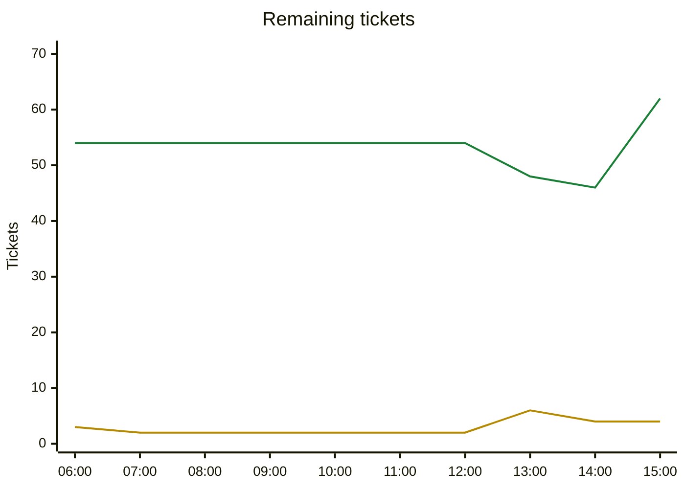

# Migration dependency map

## Delivery phases

Work is completed phase by phase (`phases.txt`; `ticket.py ready`/`next` offer only the lowest phase with ready work).

| Phase | Done | Remaining | Ready | In flight | Remaining tickets |
|---|---|---|---|---|---|
| Phase 1: CLI (headless engine) | 193/201 | 8 | 3 | 4 | [T160](backlog.md#t160-kotlin-golden-state-hashes-and-mod-ruleset-for-the-end-to-end-determinism-gate) [T194](backlog.md#t194-command-log-format-replay-verifier-and-scripted-human-replay-test-against-the-t102-state-hashes) [T208](backlog.md#t208-running-game-must-equal-its-own-save-load-make-transient-caches-vision-exploration-open-borders-flags--canonical-so-replayjoin-in-progress-cannot-desync) [T209](backlog.md#t209-game-events-follow-up-secondary-unit-movement-cargo-swap-withdrawal-teleports-unit-capture-city-destroyedtraded-priority-aware-sink-truncation) [T215](backlog.md#t215-loaded-mid-game-gameinfo-diverges-from-the-live-one-explore-automation-ai-turns-saveload-fidelity) [T216](backlog.md#t216-engine-queries-the-client-still-lacks-pending-decisions-with-alert-details-promotion-choices-spy-destinations-city-state-quests-diplomatic-vote-candidates) [T217](backlog.md#t217-cli-replayverify-a-command-log-play-scripted-human-commands-rulesetmod-and-saved-map-options) [T218](backlog.md#t218-hardening-sweep-3-findings-from-the-2026-10-25-migration-review) |
| Phase 2: single player (Godot client) | 6/42 | 36 | 0 | 0 | [C002](backlog.md#c002-3d-hex-terrain-rendering-elevation-materials-water-depth) [C003](backlog.md#c003-resource-and-improvement-props) [C004](backlog.md#c004-unit-visuals-per-type-models-formations-status-icons) [C005](backlog.md#c005-civ-5-style-ui-kit-theme-screen-stack-popups-tooltip-host) [C011](backlog.md#c011-hud-top-bar-yields-turn-banner-next-action-button) [C012](backlog.md#c012-unit-panel-and-orders-attack-fortify-found-city-workers-automate) [C013](backlog.md#c013-notifications-and-popup-alerts) [C014](backlog.md#c014-minimap) [C015](backlog.md#c015-main-menu-and-game-setup-screen-nations-difficulty-speed-map-options) [C016](backlog.md#c016-saveload-screen-and-autosave) [C017](backlog.md#c017-city-screen-a-info-tiles-specialists-focus) [C018](backlog.md#c018-city-screen-b-production-queue-purchase-buildings) [C019](backlog.md#c019-tech-screen) [C020](backlog.md#c020-policy-screen) [C021](backlog.md#c021-diplomacy-screen) [C022](backlog.md#c022-trade-screen) [C023](backlog.md#c023-overview-screens-empire-cities-units-resources-ranking-religion-espionage) [C024](backlog.md#c024-victory-and-defeat-screen-game-over) [C025](backlog.md#c025-localization-translations-in-the-client-language-picker-non-latin-fonts) [C026](backlog.md#c026-tutorials) [C027](backlog.md#c027-tooltips-and-civilopedia) [C028](backlog.md#c028-options-screen-hotkeys-edge-pan) [C029](backlog.md#c029-hotseat-player-switch-screen) [C030](backlog.md#c030-placeholder-audio-uncivsound-to-generated-tones) [C031](backlog.md#c031-terrain-blending-fog-of-war-polish-chunked-meshes) [C032](backlog.md#c032-improvements-roads-cities-borders-and-in-world-yield-icons) [C033](backlog.md#c033-unit-animation-and-combat-presentation) [C037](backlog.md#c037-igamesession-client-reads-and-writes-only-through-a-session-interface-localhost-implements-it) [C038](backlog.md#c038-decision-pickers-promotion-free-tech-free-great-person-pantheon-and-religion-foundenhancereform-spy-assignment-diplomatic-vote-and-vote-result) [C039](backlog.md#c039-incoming-proposal-popups-trade-peace-and-friendship-requests-from-ai-and-other-humans-proposers-pendingdeclinedwithdrawn-state) [C040](backlog.md#c040-run-end-turn-processing-and-ai-turns-off-the-ui-thread-with-a-next-turn-progress-overlay) [C041](backlog.md#c041-flat-map-cities-borders-roads-and-improvements-before-the-3d-chain) [C042](backlog.md#c042-client-packaging-bundle-rulesets-and-translations-user-mods-folder-export-presets-third-party-notices) [C043](backlog.md#c043-client-settings-model-persisted-under-user-language-key-bindings-ui-scale-asset-pack-autosave-tutorials-seen-player-name-and-the-engine-playersettings-options) [C044](backlog.md#c044-in-game-menu-save-load-new-game-resign-victory-status-options-main-menu) [T169](backlog.md#t169-ci-for-the-c-solution-and-uncivgodot-headless-build-format-tests-coverage-check-exportpackaging-notes) |
| Phase 3: multiplayer | 6/28 | 22 | 0 | 0 | [C006](backlog.md#c006-networked-play-client-join-screen-addressport--invite-tofu-prompt-reconnect-overlay-key-storage) [C034](backlog.md#c034-host-game-screen-lobby-settings-address-list-and-copy-invite-start-hosting-in-process-resume-saved-hosted-game) [C035](backlog.md#c035-lobby-screen-slots-nation-pick-ready-up-chat-kick-start-host-and-joiner-views) [C036](backlog.md#c036-multiplayer-turn-bar-who-has-ended-deadline-end-turn--undo-end-turn-turn-resolving-overlay-connection-markers) [C045](backlog.md#c045-in-game-multiplayer-social-and-admin-chat-player-list-kick-rebind-a-slot-to-a-new-device-key) [T176](backlog.md#t176-game-store-snapshot--append-only-command-log-hash-checkpoints-crash-recovery-resume-delta-ring-or-snapshot) [T177](backlog.md#t177-turn-policy-for-simultaneous-turns-injected-clock-turn-timer-forceendturn-order-disconnect-grace-ai-takeover-opt-in-resolve-pump) [T178](backlog.md#t178-headless-host-core-uncivserver-project-gamehost-actor-sessions-bound-to-civs-command-gate-requireactive-rate-size-dedup-existence-oracle-safe-errors) [T179](backlog.md#t179-direct-connect-transport-tcp--tls-13-frames-behind-itransport-self-signed-host-key-invite-code-hostport-fingerprint-token-tofu-known-hosts-port-forward-and-overlay-vpn-docs) [T180](backlog.md#t180-client-network-library-uncivclientnet-clientsession-state-machine-mirror-state-delta-apply-command-retry-reconnectresume-no-godot-types) [T182](backlog.md#t182-multi-client-end-to-end-scripted-3-human--ai-game-over-in-memory-transport-killrestart-server-reconnect-hash-agreement) [T201](backlog.md#t201-current-player-readers-make-rules-civ-explicit-reassignpopulationdeferred-gift-action-cityviewcivview-gating-tutorial-hooks) [T202](backlog.md#t202-simultaneous-turn-commands-endturnundoendturnforceendturn-semantics-processendturnstartnextturn-server-commands-setcontroller-requireactive-gate-and-codes) [T203](backlog.md#t203-two-human-determinism-and-conflict-tests-interleaved-scriptedhumans-same-tile-moveattackfound-city-war-vs-peace-trade-races-replay-and-visibility) [T204](backlog.md#t204-lobby-slots-nation-pick-ready-up-host-settings-lobbysettings-to-gamesetupinfo-ai-fill-ruleset-hash-check-join-password-start-game) [T205](backlog.md#t205-in-process-host-run-gamehost-inside-the-client-host-button-loopback--tcp-listener-clean-shutdown-saves-the-game-resume-saved-game) [T206](backlog.md#t206-optional-lan-discovery-udp-broadcast-beacon-games-on-your-network) [T207](backlog.md#t207-optional-upnpnat-pmp-automatic-port-mapping-for-the-host) [T219](backlog.md#t219-remote-queries-queryqueryresult-wire-messages-gamehost-dispatch-async-queries-in-clientsession-per-query-exposure-audit-rate-limits) [T220](backlog.md#t220-client-mirror-correctness-per-recipient-snapshot-diff-deltas-popup-alerts-and-pending-decisions-in-clientsnapshot) [T221](backlog.md#t221-network-robustness-real-tcptls-multi-client-tests-backpressure-ping-timeout-large-snapshots-resync-rate-limit-tls-platform-matrix) [T222](backlog.md#t222-multiplayer-game-over-and-forced-end-rules-one-more-turn-authority-defeated-humans-default-resolution-of-blocking-decisions-on-forceendturn) |

Generated by `tools/ticket.py` on every backlog change; do not edit by hand. Shows every incomplete ticket. A ticket that still has an incomplete dependency also shows all its direct dependencies (completed ones are grey and dashed); once every dependency is Done, they are hidden. An arrow `A --> B` means B depends on A.

| Colour | Meaning |
|---|---|
| bright green, thick border | Ready to start: Available and every dependency is Done |
| orange, thick border | On deck: Available, and every unfinished dependency is already in progress or in review, so it becomes ready when those finish |
| pale green, dotted border | Available but waiting on dependencies that are not started yet |
| yellow | In-Progress |
| blue | Needs-Review / In-Review |
| red | Blocked |
| grey dashed | Done (shown as a direct dependency only) |

```mermaid
flowchart TD
  subgraph TTRACK["Engine track"]
    T012["T012<br/>Command layer design"]
    T021["T021<br/>Metadata models: LocaleCode, GameParameters, GameSetupInfo, ..."]
    T023["T023<br/>Translation core (headless)"]
    T030["T030<br/>Ruleset base objects: RulesetObject, Specialist, Speed, Poli..."]
    T034["T034<br/>Ruleset and RulesetCache loader"]
    T040["T040<br/>Pathfinding: BFS, AStar, MapPathing, CarrierSlotMatcher, Map..."]
    T045["T045<br/>GameSetupInfo"]
    T049["T049<br/>Model leaves: ModConstants, UncivSound, TutorialTrigger"]
    T051["T051<br/>Serialization leaf models: LastSeenImprovement, CivRankingHi..."]
    T055["T055<br/>Civilization core: Civilization, ExploredRegion, PopupAlert"]
    T056["T056<br/>Civilization managers: TechManager, PolicyManager, GoldenAge..."]
    T057["T057<br/>Civilization managers: ReligionManager (+Religion), RuinsMan..."]
    T059["T059<br/>Diplomacy core: DiplomacyManager, DiplomacyFunctions, Demand..."]
    T060["T060<br/>City core: City, CityFocus, CityResources, CityEspionageMana..."]
    T062["T062<br/>CityStats and GreatPersonPointsBreakdown"]
    T063["T063<br/>CityConstructions"]
    T068["T068<br/>Diplomacy turn and city states: DiplomacyTurnManager, Declar..."]
    T080["T080<br/>Unit actions B: UnitActions, UnitActionsFromUniques"]
    T083["T083<br/>Battle C: Battle, Nuke"]
    T099["T099<br/>GameStarter"]
    T100["T100<br/>Save/load B: UncivFiles"]
    T140["T140<br/>Civilization and manager JSON wiring (full GameInfo save/loa..."]
    T160["T160<br/>Kotlin golden state hashes and mod ruleset for the end-to-en..."]
    T164["T164<br/>Command infrastructure over GameInfo: GameCommand base, asse..."]
    T166["T166<br/>Victory scorer game adapter (fills ConquestInputs/CultureInp..."]
    T168["T168<br/>Headless runner Unciv.Cli: new game, play N turns, save and ..."]
    T169["T169<br/>CI for the C# solution and Unciv.Godot (headless build, form..."]
    T170["T170<br/>Ruleset/mod folder loading and real translation file loading..."]
    T171["T171<br/>Event presentation types in UniqueTriggerActivation (replace..."]
    T172["T172<br/>Net protocol: message DTOs, versioning, ITransport and in-me..."]
    T173["T173<br/>Host identity and join auth: client ECDSA P-256 key bound to..."]
    T174["T174<br/>Visibility filter: ClientSnapshot builder from GameInfo via ..."]
    T175["T175<br/>Event stream: per-recipient event classifiers, TilesRevealed..."]
    T176["T176<br/>Game store: snapshot + append-only command log, hash checkpo..."]
    T177["T177<br/>Turn policy for simultaneous turns: injected clock, turn tim..."]
    T178["T178<br/>Headless host core: Unciv.Server project, GameHost actor, se..."]
    T179["T179<br/>Direct-connect transport: TCP + TLS 1.3 frames behind ITrans..."]
    T180["T180<br/>Client network library Unciv.Client.Net: ClientSession state..."]
    T182["T182<br/>Multi-client end-to-end: scripted 3-human + AI game over in-..."]
    T183["T183<br/>Engine player settings: per-civ state-affecting settings, he..."]
    T184["T184<br/>Human turn flow: phased turn API (EndPlayerTurn, RunAutoPlay..."]
    T185["T185<br/>Query infrastructure: serializable IQuery requests/results o..."]
    T187["T187<br/>Turn and decision commands: EndTurn, RunAiTurn, BeginTurn, M..."]
    T188["T188<br/>Movement and combat commands: MoveUnit, SetMoveOrder, SwapUn..."]
    T189["T189<br/>Unit actions A: serializable UnitActionDescriptor, GetUnitAc..."]
    T190["T190<br/>Unit actions B: unique-driven actions through descriptors (g..."]
    T191["T191<br/>City commands: production queue, purchase, buy tile, worked ..."]
    T192["T192<br/>Research, policy, religion, great person, espionage and worl..."]
    T193["T193<br/>Diplomacy, trade and city-state commands: war, peace, friend..."]
    T194["T194<br/>Command log format, replay verifier and scripted-human repla..."]
    T195["T195<br/>Query API: unit movement and combat previews (reachable tile..."]
    T196["T196<br/>Query API: city and tile panels (buildable lists with reject..."]
    T197["T197<br/>Query API: empire panels (tech tree and research queue, poli..."]
    T198["T198<br/>Query API: victory progress, scores, rankings and demographi..."]
    T199["T199<br/>Query API: new-game setup data (nations, difficulties, speed..."]
    T200["T200<br/>Concurrent human turns A: TurnState/TurnMode in GameInfo, ci..."]
    T201["T201<br/>Current-player readers: make rules civ-explicit (ReassignPop..."]
    T202["T202<br/>Simultaneous-turn commands: EndTurn/UndoEndTurn/ForceEndTurn..."]
    T203["T203<br/>Two-human determinism and conflict tests: interleaved Script..."]
    T204["T204<br/>Lobby: slots, nation pick, ready-up, host settings (LobbySet..."]
    T205["T205<br/>In-process host: run GameHost inside the client (Host button..."]
    T206["T206<br/>Optional: LAN discovery (UDP broadcast beacon, 'Games on you..."]
    T207["T207<br/>Optional: UPnP/NAT-PMP automatic port mapping for the host"]
    T208["T208<br/>Running game must equal its own save-)load: make transient c..."]
    T209["T209<br/>Game events follow-up: secondary unit movement (cargo, swap,..."]
    T215["T215<br/>Loaded mid-game GameInfo diverges from the live one (Explore..."]
    T216["T216<br/>Engine queries the client still lacks: pending decisions wit..."]
    T217["T217<br/>CLI: replay/verify a command log, play scripted human comman..."]
    T218["T218<br/>Hardening sweep 3: findings from the 2026-10-25 migration re..."]
    T219["T219<br/>Remote queries: Query/QueryResult wire messages, GameHost di..."]
    T220["T220<br/>Client mirror correctness: per-recipient snapshot-diff delta..."]
    T221["T221<br/>Network robustness: real TCP+TLS multi-client tests, backpre..."]
    T222["T222<br/>Multiplayer game-over and forced-end rules: One More Turn au..."]
  end
  subgraph CTRACK["Client track (Godot)"]
    C001["C001<br/>Godot project skeleton"]
    C002["C002<br/>3D hex terrain rendering (elevation, materials, water depth)"]
    C003["C003<br/>Resource and improvement props"]
    C004["C004<br/>Unit visuals: per-type models, formations, status icons"]
    C005["C005<br/>Civ 5-style UI kit: theme, screen stack, popups, tooltip hos..."]
    C006["C006<br/>Networked play client: join screen (address:port / invite), ..."]
    C010["C010<br/>V1 vertical slice: unit blocks, select, move, end turn, AI t..."]
    C011["C011<br/>HUD: top bar yields, turn banner, next-action button"]
    C012["C012<br/>Unit panel and orders: attack, fortify, found city, workers,..."]
    C013["C013<br/>Notifications and popup alerts"]
    C014["C014<br/>Minimap"]
    C015["C015<br/>Main menu and game setup screen: nations, difficulty, speed,..."]
    C016["C016<br/>Save/load screen and autosave"]
    C017["C017<br/>City screen A: info, tiles, specialists, focus"]
    C018["C018<br/>City screen B: production queue, purchase, buildings"]
    C019["C019<br/>Tech screen"]
    C020["C020<br/>Policy screen"]
    C021["C021<br/>Diplomacy screen"]
    C022["C022<br/>Trade screen"]
    C023["C023<br/>Overview screens: empire, cities, units, resources, ranking,..."]
    C024["C024<br/>Victory and defeat screen, game over"]
    C025["C025<br/>Localization: translations in the client, language picker, n..."]
    C026["C026<br/>Tutorials"]
    C027["C027<br/>Tooltips and Civilopedia"]
    C028["C028<br/>Options screen, hotkeys, edge-pan"]
    C029["C029<br/>Hotseat player switch screen"]
    C030["C030<br/>Placeholder audio: UncivSound to generated tones"]
    C031["C031<br/>Terrain blending, fog of war polish, chunked meshes"]
    C032["C032<br/>Improvements, roads, cities, borders and in-world yield icon..."]
    C033["C033<br/>Unit animation and combat presentation"]
    C034["C034<br/>Host game screen: lobby settings, address list and Copy invi..."]
    C035["C035<br/>Lobby screen: slots, nation pick, ready-up, chat, kick, star..."]
    C036["C036<br/>Multiplayer turn bar: who has ended, deadline, End turn / Un..."]
    C037["C037<br/>IGameSession: client reads and writes only through a session..."]
    C038["C038<br/>Decision pickers: promotion, free tech, free great person, p..."]
    C039["C039<br/>Incoming proposal popups: trade, peace and friendship reques..."]
    C040["C040<br/>Run end-turn processing and AI turns off the UI thread with ..."]
    C041["C041<br/>Flat-map cities, borders, roads and improvements (before the..."]
    C042["C042<br/>Client packaging: bundle rulesets and translations, user mod..."]
    C043["C043<br/>Client settings model persisted under user:// (language, key..."]
    C044["C044<br/>In-game menu: save, load, new game, resign, victory status, ..."]
    C045["C045<br/>In-game multiplayer social and admin: chat, player list, kic..."]
  end
  C001 --> T169
  C042 --> T169
  T172 --> T176
  T164 --> T176
  T140 --> T176
  T194 --> T176
  T208 --> T176
  T215 --> T176
  T172 --> T177
  T164 --> T177
  T184 --> T177
  T187 --> T177
  T200 --> T177
  T202 --> T177
  T222 --> T177
  T172 --> T178
  T173 --> T178
  T174 --> T178
  T175 --> T178
  T176 --> T178
  T177 --> T178
  T202 --> T178
  T219 --> T178
  T220 --> T178
  T172 --> T179
  T173 --> T179
  T178 --> T179
  T172 --> T180
  T173 --> T180
  T174 --> T180
  T175 --> T180
  T179 --> T180
  T204 --> T180
  T219 --> T180
  T220 --> T180
  T178 --> T182
  T180 --> T182
  T204 --> T182
  T203 --> T182
  T202 --> T203
  T188 --> T203
  T191 --> T203
  T192 --> T203
  T193 --> T203
  T194 --> T203
  T174 --> T203
  T172 --> T204
  T173 --> T204
  T178 --> T204
  T199 --> T204
  T178 --> T205
  T179 --> T205
  T204 --> T205
  T176 --> T205
  T179 --> T206
  T179 --> T207
  T168 --> T217
  T170 --> T217
  T194 --> T217
  T172 --> T219
  T174 --> T219
  T185 --> T219
  T216 --> T219
  T174 --> T220
  T175 --> T220
  T216 --> T220
  T179 --> T221
  T180 --> T221
  T202 --> T222
  C002 --> C003
  C002 --> C004
  C010 --> C004
  C012 --> C004
  T164 --> C004
  T012 --> C006
  C001 --> C006
  T164 --> C006
  T172 --> C006
  T173 --> C006
  T180 --> C006
  T179 --> C006
  C010 --> C006
  C016 --> C006
  T194 --> C006
  C035 --> C006
  C036 --> C006
  T221 --> C006
  C037 --> C006
  C005 --> C011
  C010 --> C011
  T164 --> C011
  T062 --> C011
  T174 --> C011
  T184 --> C011
  C037 --> C011
  C005 --> C012
  C010 --> C012
  T164 --> C012
  T080 --> C012
  T083 --> C012
  T040 --> C012
  T188 --> C012
  T189 --> C012
  T190 --> C012
  T195 --> C012
  C037 --> C012
  T216 --> C012
  C005 --> C013
  C010 --> C013
  T164 --> C013
  T051 --> C013
  T055 --> C013
  T171 --> C013
  T187 --> C013
  T175 --> C013
  C037 --> C013
  T216 --> C013
  C010 --> C014
  T164 --> C014
  T174 --> C014
  C037 --> C014
  C005 --> C015
  C010 --> C015
  T099 --> C015
  T045 --> C015
  T021 --> C015
  T034 --> C015
  T170 --> C015
  T199 --> C015
  C037 --> C015
  C005 --> C016
  C010 --> C016
  T100 --> C016
  C037 --> C016
  T208 --> C016
  T215 --> C016
  C043 --> C016
  C005 --> C017
  C010 --> C017
  T164 --> C017
  T060 --> C017
  T062 --> C017
  T191 --> C017
  T196 --> C017
  C037 --> C017
  C041 --> C017
  C017 --> C018
  T063 --> C018
  T191 --> C018
  T196 --> C018
  C005 --> C019
  C010 --> C019
  T164 --> C019
  T056 --> C019
  T192 --> C019
  T197 --> C019
  C037 --> C019
  C005 --> C020
  C010 --> C020
  T164 --> C020
  T056 --> C020
  T192 --> C020
  T197 --> C020
  C037 --> C020
  C005 --> C021
  C010 --> C021
  T164 --> C021
  T059 --> C021
  T068 --> C021
  T193 --> C021
  T197 --> C021
  C037 --> C021
  T216 --> C021
  C021 --> C022
  T164 --> C022
  T059 --> C022
  T193 --> C022
  T197 --> C022
  C005 --> C023
  C010 --> C023
  T164 --> C023
  T057 --> C023
  T197 --> C023
  T198 --> C023
  C037 --> C023
  T216 --> C023
  C005 --> C024
  C010 --> C024
  T166 --> C024
  T198 --> C024
  T187 --> C024
  C037 --> C024
  C005 --> C025
  T023 --> C025
  T170 --> C025
  C043 --> C025
  C005 --> C026
  C010 --> C026
  T030 --> C026
  T049 --> C026
  C043 --> C026
  C005 --> C027
  C025 --> C027
  C005 --> C028
  C043 --> C028
  C010 --> C029
  T164 --> C029
  T184 --> C029
  C037 --> C029
  C002 --> C031
  C003 --> C032
  C010 --> C032
  C004 --> C033
  C005 --> C034
  C010 --> C034
  C015 --> C034
  T204 --> C034
  T205 --> C034
  C005 --> C035
  T180 --> C035
  T204 --> C035
  C010 --> C036
  C011 --> C036
  T180 --> C036
  T202 --> C036
  T175 --> C036
  C005 --> C038
  C037 --> C038
  T216 --> C038
  T192 --> C038
  T197 --> C038
  C005 --> C039
  C037 --> C039
  C022 --> C039
  T193 --> C039
  C037 --> C040
  C011 --> C040
  C010 --> C041
  C037 --> C041
  C005 --> C043
  T183 --> C043
  C005 --> C044
  C016 --> C044
  C036 --> C045
  T178 --> C045
  T204 --> C045
  classDef waiting fill:#f3faf3,stroke:#9bc49b,color:#555,stroke-dasharray:2 2
  classDef ondeck fill:#ffe8cc,stroke:#e8590c,stroke-width:3px,color:#000
  classDef ready fill:#7ee787,stroke:#1a7f37,stroke-width:3px,color:#000
  classDef prog fill:#fff3b0,stroke:#b58900,color:#000
  classDef review fill:#cfe4ff,stroke:#1f6feb,color:#000
  classDef blocked fill:#ffd6d6,stroke:#c62828,color:#000
  classDef done fill:#eeeeee,stroke:#999999,color:#666,stroke-dasharray:4 3
  class C001 done
  class C002 waiting
  class C003 waiting
  class C004 waiting
  class C005 waiting
  class C006 waiting
  class C010 done
  class C011 waiting
  class C012 waiting
  class C013 waiting
  class C014 waiting
  class C015 waiting
  class C016 waiting
  class C017 waiting
  class C018 waiting
  class C019 waiting
  class C020 waiting
  class C021 waiting
  class C022 waiting
  class C023 waiting
  class C024 waiting
  class C025 waiting
  class C026 waiting
  class C027 waiting
  class C028 waiting
  class C029 waiting
  class C030 waiting
  class C031 waiting
  class C032 waiting
  class C033 waiting
  class C034 waiting
  class C035 waiting
  class C036 waiting
  class C037 waiting
  class C038 waiting
  class C039 waiting
  class C040 waiting
  class C041 waiting
  class C042 waiting
  class C043 waiting
  class C044 waiting
  class C045 waiting
  class T012 done
  class T021 done
  class T023 done
  class T030 done
  class T034 done
  class T040 done
  class T045 done
  class T049 done
  class T051 done
  class T055 done
  class T056 done
  class T057 done
  class T059 done
  class T060 done
  class T062 done
  class T063 done
  class T068 done
  class T080 done
  class T083 done
  class T099 done
  class T100 done
  class T140 done
  class T160 prog
  class T164 done
  class T166 done
  class T168 done
  class T169 waiting
  class T170 done
  class T171 done
  class T172 done
  class T173 done
  class T174 done
  class T175 done
  class T176 waiting
  class T177 waiting
  class T178 waiting
  class T179 waiting
  class T180 waiting
  class T182 waiting
  class T183 done
  class T184 done
  class T185 done
  class T187 done
  class T188 done
  class T189 done
  class T190 done
  class T191 done
  class T192 done
  class T193 done
  class T194 review
  class T195 done
  class T196 done
  class T197 done
  class T198 done
  class T199 done
  class T200 done
  class T201 waiting
  class T202 waiting
  class T203 waiting
  class T204 waiting
  class T205 waiting
  class T206 waiting
  class T207 waiting
  class T208 prog
  class T209 review
  class T215 ready
  class T216 ready
  class T217 ondeck
  class T218 ready
  class T219 waiting
  class T220 waiting
  class T221 waiting
  class T222 waiting
```

## Remaining tickets over time

Generated from the git history of `backlog.md` (UTC; each point is the backlog as of that time, the last one the current backlog). Completed tickets (Done, Won't port) are not counted.

| Line | Meaning |
|---|---|
| green | New: Available or Blocked, not started yet |
| yellow | Active: In-Progress, Needs-Review or In-Review |

## Incomplete tickets

| Ticket | State | Depends on | Unblocks | Title |
|---|---|---|---|---|
| T216 | **Ready to start** | T184, T185, T197, T192 | 25 | Engine queries the client still lacks: pending decisions with alert details, promotion choices, spy destinations, city-state quests, diplomatic vote candidates |
| T215 | **Ready to start** | T102 | 17 | Loaded mid-game GameInfo diverges from the live one (Explore automation, AI turns): save/load fidelity |
| T218 | **Ready to start** | none | 0 | Hardening sweep 3: findings from the 2026-10-25 migration review |
| T217 | **On deck** (after T194) | T168, T170, T194 | 0 | CLI: replay/verify a command log, play scripted human commands, ruleset/mod and saved-map options |
| C005 | Available (waiting on ) | C007, C010 | 29 | Civ 5-style UI kit: theme, screen stack, popups, tooltip host |
| C037 | Available (waiting on ) | C010, T185, T175, T174 | 26 | IGameSession: client reads and writes only through a session interface; LocalHost implements it |
| T194 | Needs-Review [Claude] | T187, T188, T189, T191, T192, T102, T011 | 17 | Command log format, replay verifier and scripted-human replay test against the T102 state hashes |
| T202 | Available (waiting on ) | T200, T187 | 17 | Simultaneous-turn commands: EndTurn/UndoEndTurn/ForceEndTurn semantics, ProcessEndTurn/StartNextTurn server commands, SetController, RequireActive gate and codes |
| T208 | In-Progress [Claude] | T167 | 17 | Running game must equal its own save->load: make transient caches (vision, exploration, open-borders flags, ...) canonical so replay/join-in-progress cannot desync |
| T222 | Available (waiting on T202) | T202 | 15 | Multiplayer game-over and forced-end rules: One More Turn authority, defeated humans, default resolution of blocking decisions on ForceEndTurn |
| T176 | Available (waiting on T194, T208, T215) | T172, T164, T140, T194, T208, T215 | 14 | Game store: snapshot + append-only command log, hash checkpoints, crash recovery, resume (delta ring or snapshot) |
| T177 | Available (waiting on T202, T222) | T172, T164, T184, T187, T200, T202, T222 | 14 | Turn policy for simultaneous turns: injected clock, turn timer, ForceEndTurn order, disconnect grace, AI takeover opt-in, resolve pump |
| T219 | Available (waiting on T216) | T172, T174, T185, T216 | 14 | Remote queries: Query/QueryResult wire messages, GameHost dispatch, async queries in ClientSession, per-query exposure audit, rate limits |
| T220 | Available (waiting on T216) | T174, T175, T216 | 14 | Client mirror correctness: per-recipient snapshot-diff deltas, popup alerts and pending decisions in ClientSnapshot |
| T178 | Available (waiting on T176, T177, T202, T219, T220) | T172, T173, T174, T175, T176, T177, T202, T219, T220 | 13 | Headless host core: Unciv.Server project, GameHost actor, sessions bound to civs, command gate (RequireActive, rate, size, dedup, existence-oracle-safe errors) |
| T179 | Available (waiting on T178) | T172, T173, T178 | 11 | Direct-connect transport: TCP + TLS 1.3 frames behind ITransport, self-signed host key, invite code (host:port, fingerprint, token), TOFU known-hosts, port-forward and overlay-VPN docs |
| T204 | Available (waiting on T178) | T172, T173, T178, T199 | 9 | Lobby: slots, nation pick, ready-up, host settings (LobbySettings to GameSetupInfo), AI fill, ruleset hash check, join password, start game |
| C043 | Available (waiting on C005) | C005, T183 | 7 | Client settings model persisted under user:// (language, key bindings, UI scale, asset pack, autosave, tutorials seen, player name) and the engine PlayerSettings options |
| T180 | Available (waiting on T179, T204, T219, T220) | T172, T173, T174, T175, T179, T204, T219, T220 | 6 | Client network library Unciv.Client.Net: ClientSession state machine, mirror state, delta apply, command retry, reconnect/resume (no Godot types) |
| C002 | Available (waiting on ) | C001, A003, A004, A005, A006, A007, C009 | 5 | 3D hex terrain rendering (elevation, materials, water depth) |
| C011 | Available (waiting on C005, C037) | C005, C010, T164, T062, T174, T184, C037 | 4 | HUD: top bar yields, turn banner, next-action button |
| C012 | Available (waiting on C005, C037, T216) | C005, C010, T164, T080, T083, T040, T188, T189, T190, T195, C037, T216 | 2 | Unit panel and orders: attack, fortify, found city, workers, automate |
| C016 | Available (waiting on C005, C037, T208, T215, C043) | C005, C010, T100, C037, T208, T215, C043 | 2 | Save/load screen and autosave |
| C021 | Available (waiting on C005, C037, T216) | C005, C010, T164, T059, T068, T193, T197, C037, T216 | 2 | Diplomacy screen |
| C036 | Available (waiting on C011, T180, T202) | C010, C011, T180, T202, T175 | 2 | Multiplayer turn bar: who has ended, deadline, End turn / Undo end turn, turn-resolving overlay, connection markers |
| C041 | Available (waiting on C037) | C010, C037 | 2 | Flat-map cities, borders, roads and improvements (before the 3D chain) |
| C003 | Available (waiting on C002) | C002 | 1 | Resource and improvement props |
| C004 | Available (waiting on C002, C012) | C002, C010, C012, T164 | 1 | Unit visuals: per-type models, formations, status icons |
| C015 | Available (waiting on C005, C037) | C005, C010, T099, T045, T021, T034, T170, T199, C037 | 1 | Main menu and game setup screen: nations, difficulty, speed, map options |
| C017 | Available (waiting on C005, C037, C041) | C005, C010, T164, T060, T062, T191, T196, C037, C041 | 1 | City screen A: info, tiles, specialists, focus |
| C022 | Available (waiting on C021) | C021, T164, T059, T193, T197 | 1 | Trade screen |
| C025 | Available (waiting on C005, C043) | C005, T023, T170, C043 | 1 | Localization: translations in the client, language picker, non-Latin fonts |
| C035 | Available (waiting on C005, T180, T204) | C005, T180, T204 | 1 | Lobby screen: slots, nation pick, ready-up, chat, kick, start (host and joiner views) |
| C042 | Available (waiting on ) | C001, T170 | 1 | Client packaging: bundle rulesets and translations, user mods folder, export presets, third-party notices |
| T203 | Available (waiting on T202, T194) | T202, T188, T191, T192, T193, T194, T174 | 1 | Two-human determinism and conflict tests: interleaved ScriptedHumans, same-tile move/attack/found-city, war vs peace, trade races, replay and visibility |
| T205 | Available (waiting on T178, T179, T204, T176) | T178, T179, T204, T176 | 1 | In-process host: run GameHost inside the client (Host button), loopback + TCP listener, clean shutdown saves the game, resume saved game |
| T221 | Available (waiting on T179, T180) | T179, T180 | 1 | Network robustness: real TCP+TLS multi-client tests, backpressure, ping timeout, large snapshots, resync rate limit, TLS platform matrix |
| C006 | Available (waiting on T180, T179, C016, T194, C035, C036, T221, C037) | T012, C001, T164, T172, T173, T180, T179, C010, C016, T194, C035, C036, T221, C037 | 0 | Networked play client: join screen (address:port / invite), TOFU prompt, reconnect overlay, key storage |
| C013 | Available (waiting on C005, C037, T216) | C005, C010, T164, T051, T055, T171, T187, T175, C037, T216 | 0 | Notifications and popup alerts |
| C014 | Available (waiting on C037) | C010, T164, T174, C037 | 0 | Minimap |
| C018 | Available (waiting on C017) | C017, T063, T191, T196 | 0 | City screen B: production queue, purchase, buildings |
| C019 | Available (waiting on C005, C037) | C005, C010, T164, T056, T192, T197, C037 | 0 | Tech screen |
| C020 | Available (waiting on C005, C037) | C005, C010, T164, T056, T192, T197, C037 | 0 | Policy screen |
| C023 | Available (waiting on C005, C037, T216) | C005, C010, T164, T057, T197, T198, C037, T216 | 0 | Overview screens: empire, cities, units, resources, ranking, religion, espionage |
| C024 | Available (waiting on C005, C037) | C005, C010, T166, T198, T187, C037 | 0 | Victory and defeat screen, game over |
| C026 | Available (waiting on C005, C043) | C005, C010, T030, T049, C043 | 0 | Tutorials |
| C027 | Available (waiting on C005, C025) | C005, C025 | 0 | Tooltips and Civilopedia |
| C028 | Available (waiting on C005, C043) | C005, C043 | 0 | Options screen, hotkeys, edge-pan |
| C029 | Available (waiting on C037) | C010, T164, T184, C037 | 0 | Hotseat player switch screen |
| C030 | Available (waiting on ) | C007, T049 | 0 | Placeholder audio: UncivSound to generated tones |
| C031 | Available (waiting on C002) | C002 | 0 | Terrain blending, fog of war polish, chunked meshes |
| C032 | Available (waiting on C003) | C003, C010 | 0 | Improvements, roads, cities, borders and in-world yield icons |
| C033 | Available (waiting on C004) | C004 | 0 | Unit animation and combat presentation |
| C034 | Available (waiting on C005, C015, T204, T205) | C005, C010, C015, T204, T205 | 0 | Host game screen: lobby settings, address list and Copy invite, start hosting in-process, resume saved hosted game |
| C038 | Available (waiting on C005, C037, T216) | C005, C037, T216, T192, T197 | 0 | Decision pickers: promotion, free tech, free great person, pantheon and religion found/enhance/reform, spy assignment, diplomatic vote and vote result |
| C039 | Available (waiting on C005, C037, C022) | C005, C037, C022, T193 | 0 | Incoming proposal popups: trade, peace and friendship requests from AI (and other humans), proposer's pending/declined/withdrawn state |
| C040 | Available (waiting on C037, C011) | C037, C011 | 0 | Run end-turn processing and AI turns off the UI thread with a next-turn progress overlay |
| C044 | Available (waiting on C005, C016) | C005, C016 | 0 | In-game menu: save, load, new game, resign, victory status, options, main menu |
| C045 | Available (waiting on C036, T178, T204) | C036, T178, T204 | 0 | In-game multiplayer social and admin: chat, player list, kick, rebind a slot to a new device key |
| T160 | In-Progress [Claude] | T102 | 0 | Kotlin golden state hashes and mod ruleset for the end-to-end determinism gate |
| T169 | Available (waiting on C042) | C001, C042 | 0 | CI for the C# solution and Unciv.Godot (headless build, format, tests, coverage check); export/packaging notes |
| T182 | Available (waiting on T178, T180, T204, T203) | T178, T180, T204, T203 | 0 | Multi-client end-to-end: scripted 3-human + AI game over in-memory transport, kill/restart server, reconnect, hash agreement |
| T201 | Available (waiting on ) | T183, T200 | 0 | Current-player readers: make rules civ-explicit (ReassignPopulationDeferred, gift action, CityView/CivView gating, tutorial hooks) |
| T206 | Available (waiting on T179) | T179 | 0 | Optional: LAN discovery (UDP broadcast beacon, 'Games on your network') |
| T207 | Available (waiting on T179) | T179 | 0 | Optional: UPnP/NAT-PMP automatic port mapping for the host |
| T209 | Needs-Review [Claude] | T186 | 0 | Game events follow-up: secondary unit movement (cargo, swap, withdrawal, teleports), unit capture, city destroyed/traded, priority-aware sink truncation |
