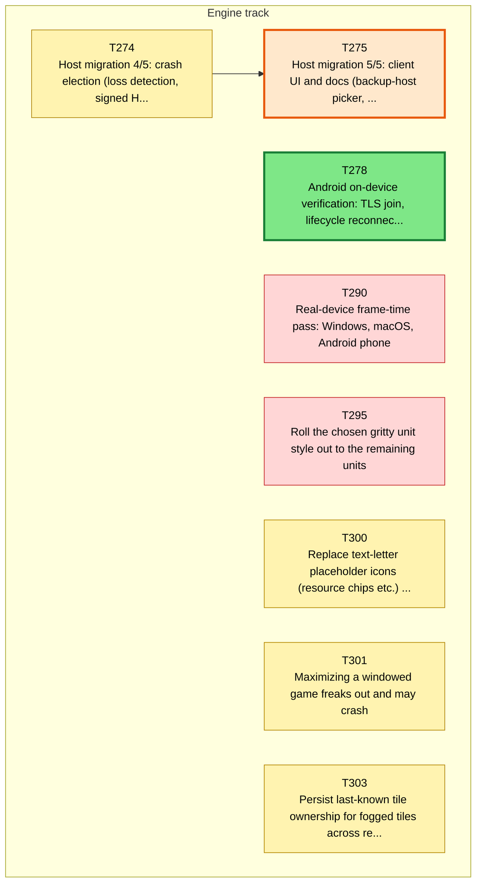
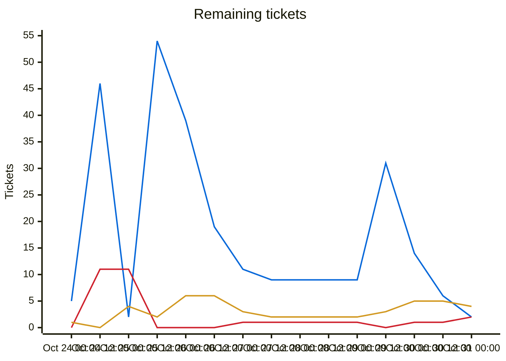
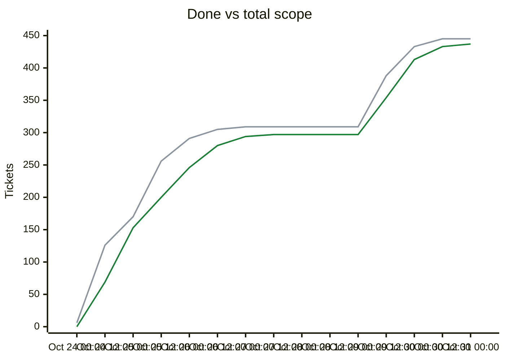

# Migration dependency map

<!-- toc -->
## Contents

- [Delivery phases](#delivery-phases)
- [Remaining tickets over time](#remaining-tickets-over-time)
- [Progress and scope over time](#progress-and-scope-over-time)
- [Incomplete tickets](#incomplete-tickets)
<!-- /toc -->

## Delivery phases

Work is completed phase by phase (`phases.txt`; `ticket.py ready`/`next` list earlier phases first; later phases fill idle capacity).

| Phase | Done | Remaining | Ready | In flight | Remaining tickets |
|---|---|---|---|---|---|
| Phase 1: CLI (headless engine) | 231/231 | 0 | 0 | 0 | complete |
| Phase 2: single player (Godot client) | 57/57 | 0 | 0 | 0 | complete |
| Phase 3: multiplayer | 29/29 | 0 | 0 | 0 | complete |
| Phase 4: queued plans (UI redesign, unit models, BNW) | 72/72 | 0 | 0 | 0 | complete |
| Phase 5: owner issue backlog (Android, performance, ultra graphics, dedicated server, resiliency) | 44/52 | 8 | 1 | 4 | [T274](backlog/T274.md) [T275](backlog/T275.md) [T278](backlog/T278.md) [T290](backlog/T290.md) [T295](backlog/T295.md) [T300](backlog/T300.md) [T301](backlog/T301.md) [T303](backlog/T303.md) |

Generated by `tools/ticket.py` on every backlog change; do not edit by hand. Shows every incomplete ticket and the dependencies between them; completed tickets are hidden. An arrow `A --> B` means B depends on A.

| Colour | Meaning |
|---|---|
| bright green, thick border | Ready to start: Available and every dependency is Done |
| orange, thick border | On deck: Available, and every unfinished dependency is already in progress or in review, so it becomes ready when those finish |
| pale green, dotted border | Available but waiting on dependencies that are not started yet |
| yellow | In-Progress |
| blue | Needs-Review / In-Review |
| red | Blocked |

## Remaining tickets over time

Generated from the git history of `backlog/` (times are UTC; each point is the backlog as of that time, the last one the current backlog). Completed tickets (Done, Won't port) are not counted in this chart.

| Line | Meaning |
|---|---|
| blue (#0969da) | New: Available, not started yet |
| red (#cf222e) | Blocked |
| amber (#d29922) | Active: In-Progress, Needs-Review or In-Review |

## Progress and scope over time

| Line | Meaning |
|---|---|
| green (#1a7f37) | Done: Done or Won't port, cumulative |
| grey (#8c959f) | Total scope: every ticket that existed at that time; a rise here is new tickets, not lost progress |

## Incomplete tickets

| Ticket | State | Depends on | Unblocks | Title |
|---|---|---|---|---|
| T278 | **Ready to start** | T260, T276 | 0 | Android on-device verification: TLS join, lifecycle reconnect, frame time and APK size on a mid-range phone |
| T275 | **On deck** (after T274) | T274, C034, C035 | 0 | Host migration 5/5: client UI and docs (backup-host picker, trust notice, standby status, rollback and host-changed notices, superseded-host screen) |
| T274 | In-Progress [Claude-T274] | T273 | 1 | Host migration 4/5: crash election (loss detection, signed HostLossVote quorum, split-brain refusal, superseded-host mode, forced take-over, kill-the-host scenarios) |
| T290 | Blocked | T271 | 0 | Real-device frame-time pass: Windows, macOS, Android phone |
| T295 | Blocked | T294 | 0 | Roll the chosen gritty unit style out to the remaining units |
| T300 | In-Progress [Claude] | none | 0 | Replace text-letter placeholder icons (resource chips etc.) with real pictorial icons |
| T301 | In-Progress [Claude] | none | 0 | Maximizing a windowed game freaks out and may crash |
| T303 | In-Progress [Claude] | T298 | 0 | Persist last-known tile ownership for fogged tiles across reconnect and load (server-side per-civ memory) |
