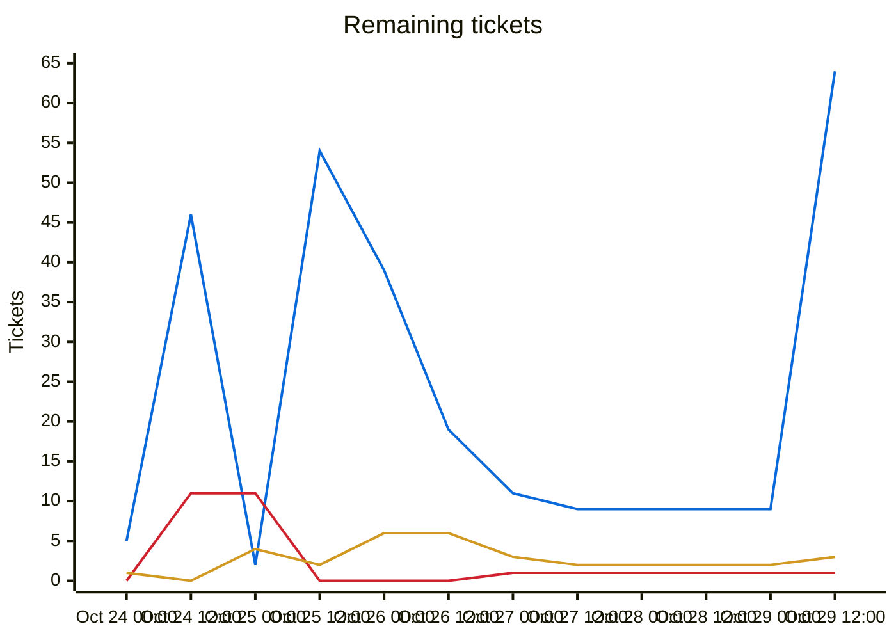
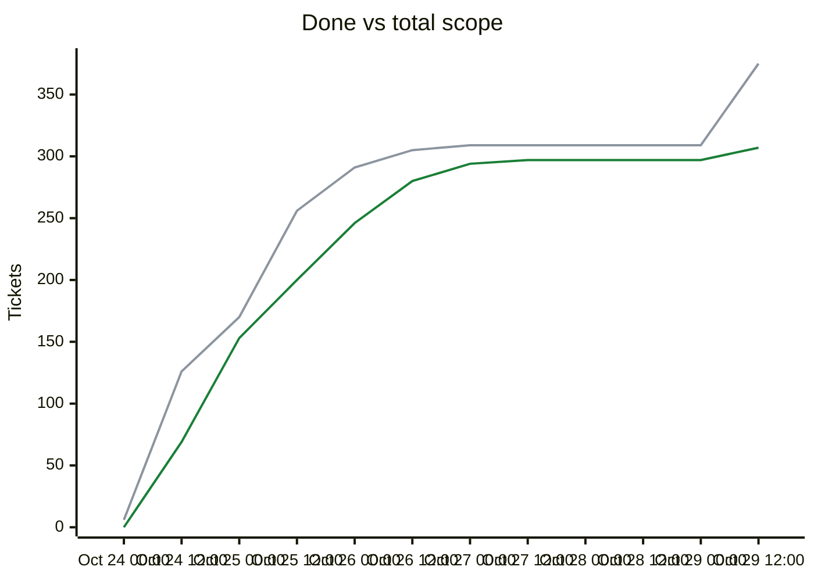

# Migration dependency map

## Delivery phases

Work is completed phase by phase (`phases.txt`; `ticket.py ready`/`next` list earlier phases first; later phases fill idle capacity).

| Phase | Done | Remaining | Ready | In flight | Remaining tickets |
|---|---|---|---|---|---|
| Phase 1: CLI (headless engine) | 221/224 | 3 | 0 | 2 | [T239](backlog/T239.md) [T246](backlog/T246.md) [T249](backlog/T249.md) |
| Phase 2: single player (Godot client) | 57/57 | 0 | 0 | 0 | complete |
| Phase 3: multiplayer | 26/29 | 3 | 2 | 1 | [C006](backlog/C006.md) [C045](backlog/C045.md) [T182](backlog/T182.md) |
| Phase 4: queued plans (UI redesign, unit models, BNW) | 0/62 | 62 | 0 | 0 | [B001](backlog/B001.md) [B002](backlog/B002.md) [B003](backlog/B003.md) [B004](backlog/B004.md) [B005](backlog/B005.md) [B006](backlog/B006.md) [B007](backlog/B007.md) [B008](backlog/B008.md) [B009](backlog/B009.md) [B010](backlog/B010.md) [B011](backlog/B011.md) [B012](backlog/B012.md) [B013](backlog/B013.md) [B014](backlog/B014.md) [B015](backlog/B015.md) [B016](backlog/B016.md) [B017](backlog/B017.md) [B018](backlog/B018.md) [B019](backlog/B019.md) [B020](backlog/B020.md) [B021](backlog/B021.md) [B022](backlog/B022.md) [B023](backlog/B023.md) [B024](backlog/B024.md) [B025](backlog/B025.md) [B026](backlog/B026.md) [C061](backlog/C061.md) [C062](backlog/C062.md) [C063](backlog/C063.md) [C064](backlog/C064.md) [C065](backlog/C065.md) [C066](backlog/C066.md) [C067](backlog/C067.md) [C068](backlog/C068.md) [C069](backlog/C069.md) [C070](backlog/C070.md) [C071](backlog/C071.md) [C072](backlog/C072.md) [C073](backlog/C073.md) [C074](backlog/C074.md) [C075](backlog/C075.md) [C076](backlog/C076.md) [C077](backlog/C077.md) [C078](backlog/C078.md) [C079](backlog/C079.md) [C080](backlog/C080.md) [C081](backlog/C081.md) [C082](backlog/C082.md) [C083](backlog/C083.md) [C084](backlog/C084.md) [C085](backlog/C085.md) [C086](backlog/C086.md) [C087](backlog/C087.md) [C088](backlog/C088.md) [C089](backlog/C089.md) [C090](backlog/C090.md) [C091](backlog/C091.md) [C092](backlog/C092.md) [C093](backlog/C093.md) [C094](backlog/C094.md) [T247](backlog/T247.md) [T248](backlog/T248.md) |

Generated by `tools/ticket.py` on every backlog change; do not edit by hand. Shows every incomplete ticket and the dependencies between them; completed tickets are hidden. An arrow `A --> B` means B depends on A.

| Colour | Meaning |
|---|---|
| bright green, thick border | Ready to start: Available and every dependency is Done |
| orange, thick border | On deck: Available, and every unfinished dependency is already in progress or in review, so it becomes ready when those finish |
| pale green, dotted border | Available but waiting on dependencies that are not started yet |
| yellow | In-Progress |
| blue | Needs-Review / In-Review |
| red | Blocked |

```mermaid
flowchart TD
  subgraph TTRACK["Engine track"]
    T182["T182<br/>Multi-client end-to-end: scripted 3-human + AI game over in-..."]
    T239["T239<br/>Observe first green CI run after the workflow scope is grant..."]
    T246["T246<br/>CI client-scenarios: goldens recorded on Fedora llvmpipe mis..."]
    T247["T247<br/>Mod sync in the lobby: checksum diff, transfer and hot-load"]
    T248["T248<br/>Dynamic turn timer from era, unit count and war state"]
    T249["T249<br/>Network robustness leftovers: frame-loss injection, lobby jo..."]
  end
  subgraph CTRACK["Client track (Godot)"]
    C006["C006<br/>Networked play client: join screen (address:port / invite), ..."]
    C045["C045<br/>In-game multiplayer social and admin: chat, player list, kic..."]
    C061["C061<br/>Harness: label-based Press and multi-resolution captures"]
    C062["C062<br/>UI design tokens and theme builder v2"]
    C063["C063<br/>Unciv icon pack and icon keys"]
    C064["C064<br/>Unique display text and hidden uniques in UI models"]
    C065["C065<br/>UI shared components"]
    C066["C066<br/>ScreenFrame, Modal and Tooltip"]
    C067["C067<br/>World HUD layout"]
    C068["C068<br/>Unit panel and action bar"]
    C069["C069<br/>City screen redesign"]
    C070["C070<br/>Tech tree redesign"]
    C071["C071<br/>Policies screen redesign"]
    C072["C072<br/>Setup, nation picker and main menu redesign"]
    C073["C073<br/>Diplomacy and trade redesign"]
    C074["C074<br/>Overview and espionage on DataTable"]
    C075["C075<br/>Game menu, save/load and options"]
    C076["C076<br/>Civilopedia and tooltip content"]
    C077["C077<br/>Victory, defeat and vote result screens"]
    C078["C078<br/>Hotkeys v2 and key hints"]
    C079["C079<br/>Responsive and localization pass"]
    C080["C080<br/>Unit model loader and contract"]
    C081["C081<br/>UnitAnimator, facing and re-timed combat cues"]
    C082["C082<br/>Articulated placeholder unit with code-built clips"]
    C083["C083<br/>Unit art pipeline"]
    C084["C084<br/>Unit art by era: ancient and classical"]
    C085["C085<br/>Unit model LOD and performance caps"]
    C086["C086<br/>Unit combat polish: effects and sounds"]
    C087["C087<br/>Rival stats ribbon in the HUD"]
    C088["C088<br/>City-site preview: yields at a candidate settle tile"]
    C089["C089<br/>Map markers: private client-side tacks"]
    C090["C090<br/>Shared map pings and team markers (multiplayer)"]
    C091["C091<br/>Group move and escort macro (client-side)"]
    C092["C092<br/>City management at scale: bulk actions and reusable build qu..."]
    C093["C093<br/>Unit art by era: medieval and renaissance"]
    C094["C094<br/>Unit art by era: industrial, modern and naval/air"]
  end
  subgraph BTRACK["Brave New World track"]
    B001["B001<br/>BNW: BaseRuleset.Civ_V_BNW, ModOptions gates, ModConstants, ..."]
    B002["B002<br/>BNW: Ruleset generator gen_ruleset.py, overrides.json and ge..."]
    B003["B003<br/>BNW: New UniqueTypes (declarations, parameter types, docs on..."]
    B004["B004<br/>BNW: Content uniques needing no new subsystem"]
    B005["B005<br/>BNW: Trade routes: model, slots, range, yields, lifecycle, p..."]
    B006["B006<br/>BNW: Trade units: Caravan, Cargo Ship, rebasing, build restr..."]
    B007["B007<br/>BNW: Great Works: instances, slots, creation, theming, movin..."]
    B008["B008<br/>BNW: Tourism and influence: city tourism, modifiers, influen..."]
    B009["B009<br/>BNW: Culture victory and Victory milestone kinds"]
    B010["B010<br/>BNW: Archaeology: historical records, site spawning, Archaeo..."]
    B011["B011<br/>BNW: Great Writer/Musician/Artist actions, guild specialists..."]
    B012["B012<br/>BNW: Policy tree: branch era gates, branch-gated wonders, fi..."]
    B013["B013<br/>BNW: Ideologies: unlock, adopter bonuses, tenet levels"]
    B014["B014<br/>BNW: Public opinion, opinion unhappiness, switching, anarchy"]
    B015["B015<br/>BNW: World Congress: founding, sessions, delegates, proposal..."]
    B016["B016<br/>BNW: Resolution effects (all 18)"]
    B017["B017<br/>BNW: League projects and rewards"]
    B018["B018<br/>BNW: Diplomatic victory (UN)"]
    B019["B019<br/>BNW: happiness: graded penalties, uprisings, rebels, city re..."]
    B020["B020<br/>BNW: Espionage: diplomats, coup levels, influence spy bonus"]
    B021["B021<br/>BNW: City-state BNW changes, Merchant of Venice purchase, Ve..."]
    B022["B022<br/>BNW: Religion BNW constants, belief effects, trade-route pre..."]
    B023["B023<br/>BNW: Warmonger, Sapper and other military data effects"]
    B024["B024<br/>BNW: Map: Indonesia luxuries, new resources, start along oce..."]
    B025["B025<br/>BNW: Score changes"]
    B026["B026<br/>BNW: Headless 300-turn BNW soak with replay/save equality"]
  end
  T246 --> T239
  C090 --> T247
  C061 --> C062
  C062 --> C063
  C062 --> C064
  C062 --> C065
  C063 --> C065
  C064 --> C065
  C065 --> C066
  C066 --> C067
  C066 --> C068
  C067 --> C068
  C066 --> C069
  C066 --> C070
  C069 --> C070
  C066 --> C071
  C070 --> C071
  C066 --> C072
  C066 --> C073
  C066 --> C074
  C066 --> C075
  C067 --> C075
  C066 --> C076
  C066 --> C077
  C067 --> C077
  C067 --> C078
  C068 --> C078
  C069 --> C078
  C070 --> C078
  C071 --> C078
  C072 --> C078
  C073 --> C078
  C074 --> C078
  C075 --> C078
  C076 --> C078
  C077 --> C078
  C078 --> C079
  C080 --> C081
  C081 --> C082
  C081 --> C083
  C083 --> C084
  C094 --> C085
  C094 --> C086
  C067 --> C087
  C068 --> C088
  C067 --> C089
  C078 --> C089
  C089 --> C090
  C045 --> C090
  C068 --> C091
  C078 --> C091
  C074 --> C092
  C084 --> C093
  C093 --> C094
  B001 --> B002
  B001 --> B003
  B002 --> B004
  B003 --> B004
  B003 --> B005
  B005 --> B006
  B003 --> B007
  B007 --> B008
  B005 --> B008
  B008 --> B009
  B007 --> B010
  B007 --> B011
  B008 --> B011
  B002 --> B012
  B012 --> B013
  B013 --> B014
  B008 --> B014
  B003 --> B015
  B013 --> B015
  B015 --> B016
  B015 --> B017
  B015 --> B018
  B014 --> B019
  B008 --> B020
  B015 --> B020
  B005 --> B021
  B004 --> B021
  B005 --> B022
  B004 --> B022
  B004 --> B023
  B002 --> B024
  B007 --> B025
  B013 --> B025
  B001 --> B026
  B002 --> B026
  B003 --> B026
  B004 --> B026
  B005 --> B026
  B006 --> B026
  B007 --> B026
  B008 --> B026
  B009 --> B026
  B010 --> B026
  B011 --> B026
  B012 --> B026
  B013 --> B026
  B014 --> B026
  B015 --> B026
  B016 --> B026
  B017 --> B026
  B018 --> B026
  B019 --> B026
  B020 --> B026
  B021 --> B026
  B022 --> B026
  B023 --> B026
  B024 --> B026
  B025 --> B026
  classDef waiting fill:#f3faf3,stroke:#9bc49b,color:#555,stroke-dasharray:2 2
  classDef ondeck fill:#ffe8cc,stroke:#e8590c,stroke-width:3px,color:#000
  classDef ready fill:#7ee787,stroke:#1a7f37,stroke-width:3px,color:#000
  classDef prog fill:#fff3b0,stroke:#b58900,color:#000
  classDef review fill:#cfe4ff,stroke:#1f6feb,color:#000
  classDef blocked fill:#ffd6d6,stroke:#c62828,color:#000
  classDef done fill:#eeeeee,stroke:#999999,color:#666,stroke-dasharray:4 3
  class B001 waiting
  class B002 waiting
  class B003 waiting
  class B004 waiting
  class B005 waiting
  class B006 waiting
  class B007 waiting
  class B008 waiting
  class B009 waiting
  class B010 waiting
  class B011 waiting
  class B012 waiting
  class B013 waiting
  class B014 waiting
  class B015 waiting
  class B016 waiting
  class B017 waiting
  class B018 waiting
  class B019 waiting
  class B020 waiting
  class B021 waiting
  class B022 waiting
  class B023 waiting
  class B024 waiting
  class B025 waiting
  class B026 waiting
  class C006 ready
  class C045 ready
  class C061 waiting
  class C062 waiting
  class C063 waiting
  class C064 waiting
  class C065 waiting
  class C066 waiting
  class C067 waiting
  class C068 waiting
  class C069 waiting
  class C070 waiting
  class C071 waiting
  class C072 waiting
  class C073 waiting
  class C074 waiting
  class C075 waiting
  class C076 waiting
  class C077 waiting
  class C078 waiting
  class C079 waiting
  class C080 waiting
  class C081 waiting
  class C082 waiting
  class C083 waiting
  class C084 waiting
  class C085 waiting
  class C086 waiting
  class C087 waiting
  class C088 waiting
  class C089 waiting
  class C090 waiting
  class C091 waiting
  class C092 waiting
  class C093 waiting
  class C094 waiting
  class T182 prog
  class T239 blocked
  class T246 prog
  class T247 waiting
  class T248 waiting
  class T249 prog
```

## Remaining tickets over time

Generated from the git history of `backlog/` (times are UTC; each point is the backlog as of that time, the last one the current backlog). Completed tickets (Done, Won't port) are not counted in this chart.

| Line | Meaning |
|---|---|
| blue (#0969da) | New: Available, not started yet |
| red (#cf222e) | Blocked |
| amber (#d29922) | Active: In-Progress, Needs-Review or In-Review |

## Progress and scope over time

| Line | Meaning |
|---|---|
| green (#1a7f37) | Done: Done or Won't port, cumulative |
| grey (#8c959f) | Total scope: every ticket that existed at that time; a rise here is new tickets, not lost progress |

## Incomplete tickets

| Ticket | State | Depends on | Unblocks | Title |
|---|---|---|---|---|
| C045 | **Ready to start** | C036, T178, T204 | 2 | In-game multiplayer social and admin: chat, player list, kick, rebind a slot to a new device key |
| C006 | **Ready to start** | T012, C001, T164, T172, T173, T180, T179, C010, C016, T194, C035, C036, T225, C037 | 0 | Networked play client: join screen (address:port / invite), TOFU prompt, reconnect overlay, key storage |
| B001 | Available (waiting on ) | none | 25 | BNW: BaseRuleset.Civ_V_BNW, ModOptions gates, ModConstants, CompatibilityVersion bump |
| C061 | Available (waiting on ) | none | 25 | Harness: label-based Press and multi-resolution captures |
| C062 | Available (waiting on C061) | C061 | 24 | UI design tokens and theme builder v2 |
| C063 | Available (waiting on C062) | C062 | 22 | Unciv icon pack and icon keys |
| C064 | Available (waiting on C062) | C062 | 22 | Unique display text and hidden uniques in UI models |
| C065 | Available (waiting on C062, C063, C064) | C062, C063, C064 | 21 | UI shared components |
| B003 | Available (waiting on B001) | B001 | 20 | BNW: New UniqueTypes (declarations, parameter types, docs only) |
| C066 | Available (waiting on C065) | C065 | 20 | ScreenFrame, Modal and Tooltip |
| B002 | Available (waiting on B001) | B001 | 16 | BNW: Ruleset generator gen_ruleset.py, overrides.json and generated JSON |
| C067 | Available (waiting on C066) | C066 | 11 | World HUD layout |
| B005 | Available (waiting on B003) | B003 | 10 | BNW: Trade routes: model, slots, range, yields, lifecycle, plunder, commands, queries |
| B012 | Available (waiting on B002) | B002 | 10 | BNW: Policy tree: branch era gates, branch-gated wonders, finishers |
| B007 | Available (waiting on B003) | B003 | 9 | BNW: Great Works: instances, slots, creation, theming, moving, swapping |
| B013 | Available (waiting on B012) | B012 | 9 | BNW: Ideologies: unlock, adopter bonuses, tenet levels |
| C069 | Available (waiting on C066) | C066 | 8 | City screen redesign |
| C080 | Available (waiting on ) | none | 8 | Unit model loader and contract |
| C068 | Available (waiting on C066, C067) | C066, C067 | 7 | Unit panel and action bar |
| C070 | Available (waiting on C066, C069) | C066, C069 | 7 | Tech tree redesign |
| C074 | Available (waiting on C066) | C066 | 7 | Overview and espionage on DataTable |
| C081 | Available (waiting on C080) | C080 | 7 | UnitAnimator, facing and re-timed combat cues |
| B008 | Available (waiting on B007, B005) | B007, B005 | 6 | BNW: Tourism and influence: city tourism, modifiers, influence, levels, trend, blast, level bonuses |
| C071 | Available (waiting on C066, C070) | C066, C070 | 6 | Policies screen redesign |
| C072 | Available (waiting on C066) | C066 | 6 | Setup, nation picker and main menu redesign |
| C073 | Available (waiting on C066) | C066 | 6 | Diplomacy and trade redesign |
| C075 | Available (waiting on C066, C067) | C066, C067 | 6 | Game menu, save/load and options |
| C076 | Available (waiting on C066) | C066 | 6 | Civilopedia and tooltip content |
| C077 | Available (waiting on C066, C067) | C066, C067 | 6 | Victory, defeat and vote result screens |
| B015 | Available (waiting on B003, B013) | B003, B013 | 5 | BNW: World Congress: founding, sessions, delegates, proposals, voting |
| C078 | Available (waiting on C067, C068, C069, C070, C071, C072, C073, C074, C075, C076, C077) | C067, C068, C069, C070, C071, C072, C073, C074, C075, C076, C077 | 5 | Hotkeys v2 and key hints |
| C083 | Available (waiting on C081) | C081 | 5 | Unit art pipeline |
| B004 | Available (waiting on B002, B003) | B002, B003 | 4 | BNW: Content uniques needing no new subsystem |
| C084 | Available (waiting on C083) | C083 | 4 | Unit art by era: ancient and classical |
| C093 | Available (waiting on C084) | C084 | 3 | Unit art by era: medieval and renaissance |
| B014 | Available (waiting on B013, B008) | B013, B008 | 2 | BNW: Public opinion, opinion unhappiness, switching, anarchy |
| C089 | Available (waiting on C067, C078) | C067, C078 | 2 | Map markers: private client-side tacks |
| C094 | Available (waiting on C093) | C093 | 2 | Unit art by era: industrial, modern and naval/air |
| B006 | Available (waiting on B005) | B005 | 1 | BNW: Trade units: Caravan, Cargo Ship, rebasing, build restrictions, exotic goods |
| B009 | Available (waiting on B008) | B008 | 1 | BNW: Culture victory and Victory milestone kinds |
| B010 | Available (waiting on B007) | B007 | 1 | BNW: Archaeology: historical records, site spawning, Archaeologist, dig choices, Landmark |
| B011 | Available (waiting on B007, B008) | B007, B008 | 1 | BNW: Great Writer/Musician/Artist actions, guild specialists, GP faith purchase |
| B016 | Available (waiting on B015) | B015 | 1 | BNW: Resolution effects (all 18) |
| B017 | Available (waiting on B015) | B015 | 1 | BNW: League projects and rewards |
| B018 | Available (waiting on B015) | B015 | 1 | BNW: Diplomatic victory (UN) |
| B019 | Available (waiting on B014) | B014 | 1 | BNW: happiness: graded penalties, uprisings, rebels, city revolt |
| B020 | Available (waiting on B008, B015) | B008, B015 | 1 | BNW: Espionage: diplomats, coup levels, influence spy bonus |
| B021 | Available (waiting on B005, B004) | B005, B004 | 1 | BNW: City-state BNW changes, Merchant of Venice purchase, Venice restrictions |
| B022 | Available (waiting on B005, B004) | B005, B004 | 1 | BNW: Religion BNW constants, belief effects, trade-route pressure |
| B023 | Available (waiting on B004) | B004 | 1 | BNW: Warmonger, Sapper and other military data effects |
| B024 | Available (waiting on B002) | B002 | 1 | BNW: Map: Indonesia luxuries, new resources, start along ocean |
| B025 | Available (waiting on B007, B013) | B007, B013 | 1 | BNW: Score changes |
| C090 | Available (waiting on C089, C045) | C089, T181, T244, C045 | 1 | Shared map pings and team markers (multiplayer) |
| T246 | In-Progress [Claude] | none | 1 | CI client-scenarios: goldens recorded on Fedora llvmpipe mismatch on ubuntu-24.04 (all rendered scenarios fail); make scenarios CI-stable |
| B026 | Available (waiting on B001, B002, B003, B004, B005, B006, B007, B008, B009, B010, B011, B012, B013, B014, B015, B016, B017, B018, B019, B020, B021, B022, B023, B024, B025) | B001, B002, B003, B004, B005, B006, B007, B008, B009, B010, B011, B012, B013, B014, B015, B016, B017, B018, B019, B020, B021, B022, B023, B024, B025 | 0 | BNW: Headless 300-turn BNW soak with replay/save equality |
| C079 | Available (waiting on C078) | C078 | 0 | Responsive and localization pass |
| C082 | Available (waiting on C081) | C081 | 0 | Articulated placeholder unit with code-built clips |
| C085 | Available (waiting on C094) | C094 | 0 | Unit model LOD and performance caps |
| C086 | Available (waiting on C094) | C094 | 0 | Unit combat polish: effects and sounds |
| C087 | Available (waiting on C067) | C067, T181 | 0 | Rival stats ribbon in the HUD |
| C088 | Available (waiting on C068) | C068 | 0 | City-site preview: yields at a candidate settle tile |
| C091 | Available (waiting on C068, C078) | C068, C078 | 0 | Group move and escort macro (client-side) |
| C092 | Available (waiting on C074) | C074 | 0 | City management at scale: bulk actions and reusable build queues |
| T182 | In-Progress [Claude] | T178, T180, T204, T203 | 0 | Multi-client end-to-end: scripted 3-human + AI game over in-memory transport, kill/restart server, reconnect, hash agreement |
| T239 | Blocked | T169, T246 | 0 | Observe first green CI run after the workflow scope is granted; remove continue-on-error from client-scenarios |
| T247 | Available (waiting on C090) | T170, T181, C035, T244, C090 | 0 | Mod sync in the lobby: checksum diff, transfer and hot-load |
| T248 | Available (waiting on ) | T177, C035, C036 | 0 | Dynamic turn timer from era, unit count and war state |
| T249 | In-Progress [Claude] | T225 | 0 | Network robustness leftovers: frame-loss injection, lobby join/ping during AI turn, macOS/Android/WASM TLS verification |
