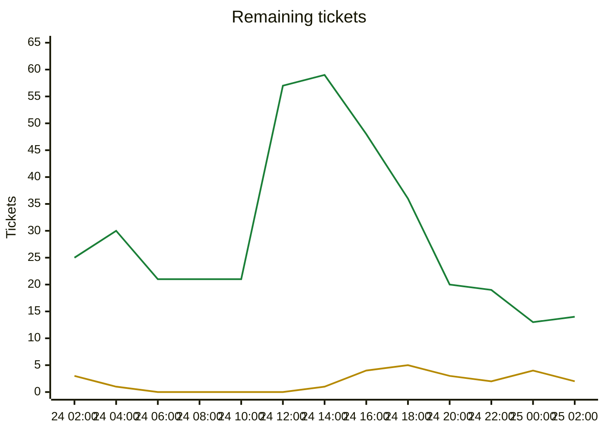

# Migration dependency map

Generated by `tools/ticket.py` on every backlog change; do not edit by hand. Shows every incomplete ticket. A ticket that still has an incomplete dependency also shows all its direct dependencies (completed ones are grey and dashed); once every dependency is Done, they are hidden. An arrow `A --> B` means B depends on A.

| Colour | Meaning |
|---|---|
| bright green, thick border | Ready to start: Available and every dependency is Done |
| orange, thick border | On deck: Available, and every unfinished dependency is already in progress or in review, so it becomes ready when those finish |
| pale green, dotted border | Available but waiting on dependencies that are not started yet |
| yellow | In-Progress |
| blue | Needs-Review / In-Review |
| red | Blocked |
| grey dashed | Done (shown as a direct dependency only) |

```mermaid
flowchart TD
  subgraph TTRACK["Engine track"]
    T012["T012<br/>Command layer design"]
    T091["T091<br/>Civilian automation: CivilianUnitAutomation, SpecificUnitAut..."]
    T092["T092<br/>Worker and road automation: WorkerAutomation, RoadBetweenCit..."]
    T104["T104<br/>Marker, seam and stale-comment sweep (final)"]
    T160["T160<br/>Kotlin golden state hashes and mod ruleset for the end-to-en..."]
    T161["T161<br/>Close known coverage gaps: UnitAutomation TryRetreat swap an..."]
    T162["T162<br/>Coverage baselines for Era.cs, Terrain.cs, CollectionExtensi..."]
    T163["T163<br/>ticket.py: refuse Done unless the tip builds, tests pass and..."]
  end
  subgraph CTRACK["Client track (Godot)"]
    C001["C001<br/>Godot project skeleton"]
    C002["C002<br/>3D hex terrain rendering"]
    C003["C003<br/>Resource and improvement props"]
    C004["C004<br/>3D military units"]
    C005["C005<br/>Civ 5-style UI shell"]
    C006["C006<br/>Networked play client"]
  end
  subgraph ATRACK["Game AI track"]
    A003["A003<br/>Victory scorers (BNW)"]
    A004["A004<br/>Target-centric Tactical AI: TacticalMoveQueue & recruitment"]
    A005["A005<br/>Tactical overkill assignment & coordinated multi-unit attack..."]
    A006["A006<br/>Homeland AI priority move queue"]
    A007["A007<br/>Operations and armies layer"]
  end
  T104 --> T163
  C001 --> C002
  C002 --> C003
  C002 --> C004
  C002 --> C005
  T012 --> C006
  C001 --> C006
  A004 --> A005
  A004 --> A006
  T091 --> A006
  T092 --> A006
  A004 --> A007
  A005 --> A007
  classDef waiting fill:#f3faf3,stroke:#9bc49b,color:#555,stroke-dasharray:2 2
  classDef ondeck fill:#ffe8cc,stroke:#e8590c,stroke-width:3px,color:#000
  classDef ready fill:#7ee787,stroke:#1a7f37,stroke-width:3px,color:#000
  classDef prog fill:#fff3b0,stroke:#b58900,color:#000
  classDef review fill:#cfe4ff,stroke:#1f6feb,color:#000
  classDef blocked fill:#ffd6d6,stroke:#c62828,color:#000
  classDef done fill:#eeeeee,stroke:#999999,color:#666,stroke-dasharray:4 3
  class A003 prog
  class A004 ready
  class A005 waiting
  class A006 waiting
  class A007 waiting
  class C001 ready
  class C002 blocked
  class C003 blocked
  class C004 blocked
  class C005 blocked
  class C006 blocked
  class T012 done
  class T091 done
  class T092 done
  class T104 prog
  class T160 ready
  class T161 ready
  class T162 ready
  class T163 ondeck
```

## Remaining tickets over time

Generated from the git history of `backlog.md` (UTC; each point is the backlog as of that time, the last one the current backlog). Completed tickets (Done, Won't port) are not counted.

| Line | Meaning |
|---|---|
| green | New: Available or Blocked, not started yet |
| yellow | Active: In-Progress, Needs-Review or In-Review |

## Incomplete tickets

| Ticket | State | Depends on | Unblocks | Title |
|---|---|---|---|---|
| C001 | **Ready to start** | C000, T006, T099, T100 | 5 | Godot project skeleton |
| A004 | **Ready to start** | A001, T039, T040, T065, T067, T081, T090 | 3 | Target-centric Tactical AI: TacticalMoveQueue & recruitment |
| T160 | **Ready to start** | T102 | 0 | Kotlin golden state hashes and mod ruleset for the end-to-end determinism gate |
| T161 | **Ready to start** | T093, T159 | 0 | Close known coverage gaps: UnitAutomation TryRetreat swap and air-unit heal, damage-aware A* branches, MaxByScore NaN/tie handling, SpecificUnitAutomation uncovered branches |
| T162 | **Ready to start** | T159 | 0 | Coverage baselines for Era.cs, Terrain.cs, CollectionExtensions.cs (coverage.py --check --all fails on them) |
| T163 | **On deck** (after T104) | T104 | 0 | ticket.py: refuse Done unless the tip builds, tests pass and coverage --check passes (automates the Green-before-Done rule) |
| C002 | Blocked | C001 | 3 | 3D hex terrain rendering |
| A005 | Available (waiting on A004) | A004 | 1 | Tactical overkill assignment & coordinated multi-unit attacks |
| T104 | In-Progress [Claude] | T102, T103, T106, T097, T093, T089, T094, T100 | 1 | Marker, seam and stale-comment sweep (final) |
| A003 | In-Progress [Claude] | A002, T030, T055, T057, T059 | 0 | Victory scorers (BNW) |
| A006 | Available (waiting on A004) | A004, T091, T092 | 0 | Homeland AI priority move queue |
| A007 | Available (waiting on A004, A005) | A004, A005 | 0 | Operations and armies layer |
| C003 | Blocked | C002 | 0 | Resource and improvement props |
| C004 | Blocked | C002 | 0 | 3D military units |
| C005 | Blocked | C002 | 0 | Civ 5-style UI shell |
| C006 | Blocked | T012, C001 | 0 | Networked play client |
