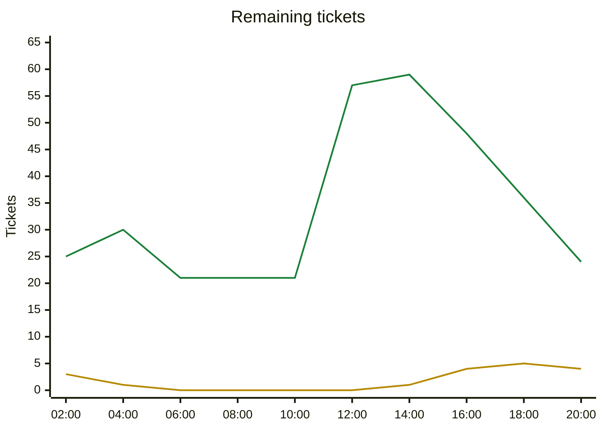

# Migration dependency map

Generated by `tools/ticket.py` on every backlog change; do not edit by hand. Shows every incomplete ticket. A ticket that still has an incomplete dependency also shows all its direct dependencies (completed ones are grey and dashed); once every dependency is Done, they are hidden. An arrow `A --> B` means B depends on A.

| Colour | Meaning |
|---|---|
| bright green, thick border | Ready to start: Available and every dependency is Done |
| orange, thick border | On deck: Available, and every unfinished dependency is already in progress or in review, so it becomes ready when those finish |
| pale green, dotted border | Available but waiting on dependencies that are not started yet |
| yellow | In-Progress |
| blue | Needs-Review / In-Review |
| red | Blocked |
| grey dashed | Done (shown as a direct dependency only) |

```mermaid
flowchart TD
  subgraph TTRACK["Engine track"]
    T011["T011<br/>State-hash determinism harness"]
    T012["T012<br/>Command layer design"]
    T035["T035<br/>Test-support port: TestGame helper and deferred fixtures"]
    T067["T067<br/>Unit movement: MovementCost, UnitMovement"]
    T071["T071<br/>GameInfo turn handling and BackwardCompatibility"]
    T072["T072<br/>Deferred TestGame-based fixtures sweep (Tile, Civilization, ..."]
    T078["T078<br/>Barbarians: BarbarianManager, BarbarianEncampment"]
    T080["T080<br/>Unit actions B: UnitActions, UnitActionsFromUniques"]
    T083["T083<br/>Battle C: Battle, Nuke"]
    T088["T088<br/>Diplomacy AI: MotivationToAttackAutomation, DeclareWarPlanEv..."]
    T089["T089<br/>TradeEvaluation"]
    T090["T090<br/>Unit automation core A: BattleHelper, HeadTowardsEnemyCityAu..."]
    T091["T091<br/>Civilian automation: CivilianUnitAutomation, SpecificUnitAut..."]
    T092["T092<br/>Worker and road automation: WorkerAutomation, RoadBetweenCit..."]
    T093["T093<br/>PathingMap: PathingMap, PathingMapCache, PathingMapAStarPath..."]
    T094["T094<br/>NextTurnAutomation and BarbarianAutomation (automation integ..."]
    T097["T097<br/>Civilopedia text model C: BaseUnit, Nation, Technology descr..."]
    T099["T099<br/>GameStarter"]
    T100["T100<br/>Save/load B: UncivFiles"]
    T101["T101<br/>Simulation: Simulation, SimulationStep, MutableInt"]
    T102["T102<br/>End-to-end determinism over N turns"]
    T103["T103<br/>Remaining Kotlin tests sweep: uniques, filters, tutorials"]
    T104["T104<br/>Marker, seam and stale-comment sweep (final)"]
    T106["T106<br/>Deferred ruleset-object members (T030-T033 leftovers)"]
    T107["T107<br/>TileMap and Tile JSON wiring, MapSaver round trips"]
    T115["T115<br/>Retype Tile city seams to City and move the Tile/Pathfinding..."]
    T123["T123<br/>Policy follow-up: eliminate allowlisted mutable statics (Eve..."]
    T125["T125<br/>Policy: harden NullForgivingTests scanner (interpolation hol..."]
    T127["T127<br/>Lower size-ratchet baseline for Tile.cs and Civilization.cs ..."]
    T128["T128<br/>Decouple City.cs from the MapUnits namespace and lower its c..."]
    T143["T143<br/>Port GlobalUniquesTests + deferred TestGame fixtures (split ..."]
    T152["T152<br/>Deferred civilization fixture: GreatPersonSelectionTest"]
    T154["T154<br/>Deferred TestGame cases: CountableTests, EducatedElite gifti..."]
    T155["T155<br/>Air unit automation: AirUnitAutomation"]
    T156["T156<br/>Unit automation: UnitAutomation (all but tryUpgradeUnit)"]
    T157["T157<br/>Deferred automation fixture: GreatPersonSelectionTest automa..."]
    T158["T158<br/>ConstructionAutomation (split from T091)"]
  end
  subgraph CTRACK["Client track (Godot)"]
    C001["C001<br/>Godot project skeleton"]
    C002["C002<br/>3D hex terrain rendering"]
    C003["C003<br/>Resource and improvement props"]
    C004["C004<br/>3D military units"]
    C005["C005<br/>Civ 5-style UI shell"]
    C006["C006<br/>Networked play client"]
  end
  subgraph ATRACK["Game AI track"]
    A003["A003<br/>Victory scorers (BNW)"]
    A004["A004<br/>Target-centric Tactical AI: TacticalMoveQueue & recruitment"]
    A005["A005<br/>Tactical overkill assignment & coordinated multi-unit attack..."]
    A006["A006<br/>Homeland AI priority move queue"]
    A007["A007<br/>Operations and armies layer"]
  end
  T091 --> T092
  T080 --> T092
  T035 --> T092
  T067 --> T093
  T088 --> T093
  T090 --> T093
  T092 --> T093
  T156 --> T093
  T088 --> T094
  T090 --> T094
  T091 --> T094
  T092 --> T094
  T078 --> T094
  T083 --> T094
  T035 --> T094
  T156 --> T094
  T099 --> T101
  T094 --> T101
  T071 --> T101
  T011 --> T101
  T101 --> T102
  T100 --> T102
  T072 --> T102
  T011 --> T102
  T107 --> T102
  T102 --> T104
  T103 --> T104
  T106 --> T104
  T097 --> T104
  T093 --> T104
  T089 --> T104
  T094 --> T104
  T100 --> T104
  T143 --> T154
  T094 --> T154
  T090 --> T156
  T155 --> T156
  T094 --> T157
  T152 --> T157
  C001 --> C002
  C002 --> C003
  C002 --> C004
  C002 --> C005
  T012 --> C006
  C001 --> C006
  A004 --> A005
  A004 --> A006
  T091 --> A006
  T092 --> A006
  A004 --> A007
  A005 --> A007
  classDef waiting fill:#f3faf3,stroke:#9bc49b,color:#555,stroke-dasharray:2 2
  classDef ondeck fill:#ffe8cc,stroke:#e8590c,stroke-width:3px,color:#000
  classDef ready fill:#7ee787,stroke:#1a7f37,stroke-width:3px,color:#000
  classDef prog fill:#fff3b0,stroke:#b58900,color:#000
  classDef review fill:#cfe4ff,stroke:#1f6feb,color:#000
  classDef blocked fill:#ffd6d6,stroke:#c62828,color:#000
  classDef done fill:#eeeeee,stroke:#999999,color:#666,stroke-dasharray:4 3
  class A003 blocked
  class A004 blocked
  class A005 blocked
  class A006 blocked
  class A007 blocked
  class C001 blocked
  class C002 blocked
  class C003 blocked
  class C004 blocked
  class C005 blocked
  class C006 blocked
  class T011 done
  class T012 done
  class T035 done
  class T067 done
  class T071 done
  class T072 done
  class T078 done
  class T080 done
  class T083 done
  class T088 done
  class T089 done
  class T090 done
  class T091 prog
  class T092 ondeck
  class T093 waiting
  class T094 waiting
  class T097 done
  class T099 done
  class T100 done
  class T101 waiting
  class T102 waiting
  class T103 done
  class T104 waiting
  class T106 done
  class T107 done
  class T115 prog
  class T123 ready
  class T125 ready
  class T127 ready
  class T128 review
  class T143 done
  class T152 done
  class T154 waiting
  class T155 prog
  class T156 ondeck
  class T157 waiting
  class T158 ready
```

## Remaining tickets over time

Generated from the git history of `backlog.md` (UTC; each point is the backlog as of that time, the last one the current backlog). Completed tickets (Done, Won't port) are not counted.

| Line | Meaning |
|---|---|
| green | New: Available or Blocked, not started yet |
| yellow | Active: In-Progress, Needs-Review or In-Review |

## Incomplete tickets

| Ticket | State | Depends on | Unblocks | Title |
|---|---|---|---|---|
| T123 | **Ready to start** | T117 | 0 | Policy follow-up: eliminate allowlisted mutable statics (EventBus, Log, RulesetCache, Translations.Current, host hooks) in Unciv.Core |
| T125 | **Ready to start** | T119 | 0 | Policy: harden NullForgivingTests scanner (interpolation holes, cast false positive, JUSTIFY binding) |
| T127 | **Ready to start** | T061, T063, T065, T120 | 0 | Lower size-ratchet baseline for Tile.cs and Civilization.cs after T061/T063/T065 land |
| T158 | **Ready to start** | T085, T063 | 0 | ConstructionAutomation (split from T091) |
| T092 | **On deck** (after T091) | T091, T080, T035 | 8 | Worker and road automation: WorkerAutomation, RoadBetweenCitiesAutomation, RoadToAutomation |
| T156 | **On deck** (after T155) | T090, T155 | 7 | Unit automation: UnitAutomation (all but tryUpgradeUnit) |
| T091 | In-Progress [Claude] | T090, T080, T063 | 9 | Civilian automation: CivilianUnitAutomation, SpecificUnitAutomation, ReligiousUnitAutomation |
| T155 | In-Progress [Claude] | T090 | 8 | Air unit automation: AirUnitAutomation |
| C001 | Blocked | C000, T006, T099, T100 | 5 | Godot project skeleton |
| T094 | Available (waiting on T091, T092, T156) | T088, T090, T091, T092, T078, T083, T035, T156 | 5 | NextTurnAutomation and BarbarianAutomation (automation integration) |
| A004 | Blocked | A001, T039, T040, T065, T067, T081, T090 | 3 | Target-centric Tactical AI: TacticalMoveQueue & recruitment |
| C002 | Blocked | C001 | 3 | 3D hex terrain rendering |
| T101 | Available (waiting on T094) | T099, T094, T071, T011 | 2 | Simulation: Simulation, SimulationStep, MutableInt |
| A005 | Blocked | A004 | 1 | Tactical overkill assignment & coordinated multi-unit attacks |
| T093 | Available (waiting on T092, T156) | T067, T088, T090, T092, T156 | 1 | PathingMap: PathingMap, PathingMapCache, PathingMapAStarPathfinder, RouteNode, PrioritizedNode |
| T102 | Available (waiting on T101) | T101, T100, T072, T011, T107 | 1 | End-to-end determinism over N turns |
| A003 | Blocked | A002, T030, T055, T057, T059 | 0 | Victory scorers (BNW) |
| A006 | Blocked | A004, T091, T092 | 0 | Homeland AI priority move queue |
| A007 | Blocked | A004, A005 | 0 | Operations and armies layer |
| C003 | Blocked | C002 | 0 | Resource and improvement props |
| C004 | Blocked | C002 | 0 | 3D military units |
| C005 | Blocked | C002 | 0 | Civ 5-style UI shell |
| C006 | Blocked | T012, C001 | 0 | Networked play client |
| T104 | Available (waiting on T102, T093, T094) | T102, T103, T106, T097, T093, T089, T094, T100 | 0 | Marker, seam and stale-comment sweep (final) |
| T115 | In-Progress [Antigravity] | T060, T035 | 0 | Retype Tile city seams to City and move the Tile/Pathfinding test fakes onto real City objects |
| T128 | Needs-Review [Claude] | T065 | 0 | Decouple City.cs from the MapUnits namespace and lower its coupling baseline (13 -> 12) |
| T154 | Available (waiting on T094) | T143, T094 | 0 | Deferred TestGame cases: CountableTests, EducatedElite gifting, Victory fixtures (split from T143) |
| T157 | Available (waiting on T094) | T094, T152 | 0 | Deferred automation fixture: GreatPersonSelectionTest automation cases |
