# Migration dependency map

Generated by `tools/ticket.py` on every backlog change; do not edit by hand. Shows every incomplete ticket. A ticket that still has an incomplete dependency also shows all its direct dependencies (completed ones are grey and dashed); once every dependency is Done, they are hidden. An arrow `A --> B` means B depends on A.

| Colour | Meaning |
|---|---|
| bright green, thick border | Ready to start: Available and every dependency is Done |
| orange, thick border | On deck: Available, and every unfinished dependency is already in progress or in review, so it becomes ready when those finish |
| pale green, dotted border | Available but waiting on dependencies that are not started yet |
| yellow | In-Progress |
| blue | Needs-Review / In-Review |
| red | Blocked |
| grey dashed | Done (shown as a direct dependency only) |

```mermaid
flowchart TD
  subgraph TTRACK["Engine track"]
    T006["T006<br/>HexMath"]
    T011["T011<br/>State-hash determinism harness"]
    T012["T012<br/>Command layer design"]
    T028["T028<br/>Unique system: Conditionals and Countables"]
    T035["T035<br/>Test-support port: TestGame helper and deferred fixtures"]
    T036["T036<br/>RulesetValidator"]
    T037["T037<br/>Golden test: load and validate Vanilla and bundled mod rules..."]
    T039["T039<br/>TileMap"]
    T040["T040<br/>Pathfinding: BFS, AStar, MapPathing, CarrierSlotMatcher, Map..."]
    T046["T046<br/>GameInfo core and the hooks waiting for it"]
    T052["T052<br/>UniqueTriggerActivation and UniqueTriggerExecutors"]
    T055["T055<br/>Civilization core: Civilization, ExploredRegion, PopupAlert"]
    T056["T056<br/>Civilization managers: TechManager, PolicyManager, GoldenAge..."]
    T057["T057<br/>Civilization managers: ReligionManager (+Religion), RuinsMan..."]
    T059["T059<br/>Diplomacy core: DiplomacyManager, DiplomacyFunctions, Demand..."]
    T060["T060<br/>City core: City, CityFocus, CityResources, CityEspionageMana..."]
    T061["T061<br/>City managers: CityPopulationManager, CityExpansionManager, ..."]
    T062["T062<br/>CityStats and GreatPersonPointsBreakdown"]
    T063["T063<br/>CityConstructions"]
    T064["T064<br/>City turn and conquest: CityTurnManager, CityConquestFunctio..."]
    T065["T065<br/>MapUnit core: MapUnit, MapUnitCache"]
    T066["T066<br/>MapUnit sub-objects and UnitManager: UnitPromotions, UnitTur..."]
    T067["T067<br/>Unit movement: MovementCost, UnitMovement"]
    T068["T068<br/>Diplomacy turn and city states: DiplomacyTurnManager, Declar..."]
    T069["T069<br/>QuestManager and quest helpers"]
    T070["T070<br/>Civilization TurnManager"]
    T071["T071<br/>GameInfo turn handling and BackwardCompatibility"]
    T072["T072<br/>Deferred TestGame-based fixtures sweep (Tile, Civilization, ..."]
    T078["T078<br/>Barbarians: BarbarianManager, BarbarianEncampment"]
    T079["T079<br/>UnitAction model and unit actions A: UnitAction, UnitActionM..."]
    T080["T080<br/>Unit actions B: UnitActions, UnitActionsFromUniques"]
    T081["T081<br/>Battle A: ICombatant, MapUnitCombatant, CityCombatant, Battl..."]
    T082["T082<br/>Battle B: attack recording, TargetHelper, BattleUnitCapture,..."]
    T083["T083<br/>Battle C: Battle, Nuke"]
    T084["T084<br/>Views A: View, GameView, OwnedView, CivView, ForeignCivView,..."]
    T085["T085<br/>Views B: CityView, ForeignCityView, CityConstructionsView, M..."]
    T086["T086<br/>TradeLogic"]
    T087["T087<br/>Automation core: Automation, AutomationCache, ThreatManager,..."]
    T088["T088<br/>Diplomacy AI: MotivationToAttackAutomation, DeclareWarPlanEv..."]
    T089["T089<br/>TradeEvaluation"]
    T090["T090<br/>Unit automation core: UnitAutomation, BattleHelper, HeadTowa..."]
    T091["T091<br/>Civilian automation: CivilianUnitAutomation, SpecificUnitAut..."]
    T092["T092<br/>Worker and road automation: WorkerAutomation, RoadBetweenCit..."]
    T093["T093<br/>PathingMap: PathingMap, PathingMapCache, PathingMapAStarPath..."]
    T094["T094<br/>NextTurnAutomation and BarbarianAutomation (automation integ..."]
    T097["T097<br/>Civilopedia text model C: BaseUnit, Nation, Technology descr..."]
    T098["T098<br/>Save/load A: FileConversions, MapSaver, IMediaFinder"]
    T099["T099<br/>GameStarter"]
    T100["T100<br/>Save/load B: UncivFiles"]
    T101["T101<br/>Simulation: Simulation, SimulationStep, MutableInt"]
    T102["T102<br/>End-to-end determinism over N turns"]
    T103["T103<br/>Remaining Kotlin tests sweep: uniques, filters, tutorials"]
    T104["T104<br/>Marker, seam and stale-comment sweep (final)"]
    T106["T106<br/>Deferred ruleset-object members (T030-T033 leftovers)"]
    T107["T107<br/>TileMap and Tile JSON wiring, MapSaver round trips"]
    T110["T110<br/>Tile unit JSON wiring (militaryUnit, civilianUnit, airUnits)"]
    T111["T111<br/>T057 review follow-ups: vote map order, unchecked sums, Beli..."]
    T115["T115<br/>Retype Tile city seams to City and move the Tile/Pathfinding..."]
    T123["T123<br/>Policy follow-up: eliminate allowlisted mutable statics (Eve..."]
    T124["T124<br/>Hardening: CityStats test coverage gaps from T062 review"]
    T125["T125<br/>Policy: harden NullForgivingTests scanner (interpolation hol..."]
    T126["T126<br/>PromotionTree port (IPromotionTree seam, CityConstructions s..."]
    T127["T127<br/>Lower size-ratchet baseline for Tile.cs and Civilization.cs ..."]
    T128["T128<br/>Decouple City.cs from the MapUnits namespace and lower its c..."]
    T129["T129<br/>Civilopedia text model C2: Building/Improvement sections of ..."]
    T130["T130<br/>Tests: restore coverage on BaseUnit, Building, PerpetualCons..."]
    T131["T131<br/>Hardening: T063 review follow-ups (CityConstructions test ga..."]
    T137["T137<br/>TranslationCache.ActiveMods from the running GameInfo"]
  end
  subgraph CTRACK["Client track (Godot)"]
    C000["C000<br/>Headless Godot test & snapshot harness"]
    C001["C001<br/>Godot project skeleton"]
    C002["C002<br/>3D hex terrain rendering"]
    C003["C003<br/>Resource and improvement props"]
    C004["C004<br/>3D military units"]
    C005["C005<br/>Civ 5-style UI shell"]
    C006["C006<br/>Networked play client"]
  end
  subgraph ATRACK["Game AI track"]
    A001["A001<br/>AI defines & data tables loader"]
    A003["A003<br/>Victory scorers (BNW)"]
    A004["A004<br/>Target-centric Tactical AI: TacticalMoveQueue & recruitment"]
    A005["A005<br/>Tactical overkill assignment & coordinated multi-unit attack..."]
    A006["A006<br/>Homeland AI priority move queue"]
    A007["A007<br/>Operations and armies layer"]
  end
  T036 --> T037
  T035 --> T037
  T028 --> T052
  T046 --> T052
  T055 --> T052
  T056 --> T052
  T057 --> T052
  T060 --> T052
  T061 --> T052
  T063 --> T052
  T064 --> T052
  T065 --> T052
  T066 --> T052
  T068 --> T052
  T070 --> T052
  T068 --> T070
  T064 --> T070
  T066 --> T070
  T069 --> T070
  T046 --> T071
  T070 --> T071
  T035 --> T072
  T052 --> T072
  T062 --> T072
  T063 --> T072
  T064 --> T072
  T067 --> T072
  T068 --> T072
  T069 --> T072
  T071 --> T072
  T052 --> T079
  T057 --> T079
  T063 --> T079
  T066 --> T079
  T067 --> T079
  T079 --> T080
  T061 --> T080
  T068 --> T080
  T060 --> T081
  T065 --> T081
  T067 --> T081
  T062 --> T081
  T035 --> T081
  T081 --> T082
  T046 --> T082
  T067 --> T082
  T035 --> T082
  T081 --> T083
  T082 --> T083
  T052 --> T083
  T064 --> T083
  T068 --> T083
  T079 --> T083
  T035 --> T083
  T084 --> T085
  T081 --> T085
  T062 --> T085
  T063 --> T085
  T066 --> T085
  T067 --> T085
  T059 --> T086
  T068 --> T086
  T057 --> T086
  T085 --> T087
  T057 --> T087
  T087 --> T088
  T086 --> T088
  T081 --> T088
  T068 --> T088
  T086 --> T089
  T088 --> T089
  T085 --> T089
  T087 --> T090
  T088 --> T090
  T082 --> T090
  T083 --> T090
  T090 --> T091
  T080 --> T091
  T063 --> T091
  T091 --> T092
  T080 --> T092
  T035 --> T092
  T067 --> T093
  T088 --> T093
  T090 --> T093
  T092 --> T093
  T088 --> T094
  T090 --> T094
  T091 --> T094
  T092 --> T094
  T078 --> T094
  T083 --> T094
  T035 --> T094
  T071 --> T100
  T098 --> T100
  T107 --> T100
  T099 --> T101
  T094 --> T101
  T071 --> T101
  T011 --> T101
  T101 --> T102
  T100 --> T102
  T072 --> T102
  T011 --> T102
  T107 --> T102
  T072 --> T103
  T052 --> T103
  T098 --> T103
  T097 --> T103
  T102 --> T104
  T103 --> T104
  T106 --> T104
  T097 --> T104
  T093 --> T104
  T089 --> T104
  T094 --> T104
  T100 --> T104
  T063 --> T106
  T066 --> T106
  T052 --> T106
  T057 --> T106
  T062 --> T106
  T057 --> T111
  T052 --> T111
  T060 --> T111
  T065 --> T111
  T060 --> T115
  T035 --> T115
  C000 --> C001
  T006 --> C001
  T099 --> C001
  T100 --> C001
  C001 --> C002
  C002 --> C003
  C002 --> C004
  C002 --> C005
  T012 --> C006
  C001 --> C006
  A001 --> A004
  T039 --> A004
  T040 --> A004
  T065 --> A004
  T067 --> A004
  T081 --> A004
  T090 --> A004
  A004 --> A005
  A004 --> A006
  T091 --> A006
  T092 --> A006
  A004 --> A007
  A005 --> A007
  classDef waiting fill:#f3faf3,stroke:#9bc49b,color:#555,stroke-dasharray:2 2
  classDef ondeck fill:#ffe8cc,stroke:#e8590c,stroke-width:3px,color:#000
  classDef ready fill:#7ee787,stroke:#1a7f37,stroke-width:3px,color:#000
  classDef prog fill:#fff3b0,stroke:#b58900,color:#000
  classDef review fill:#cfe4ff,stroke:#1f6feb,color:#000
  classDef blocked fill:#ffd6d6,stroke:#c62828,color:#000
  classDef done fill:#eeeeee,stroke:#999999,color:#666,stroke-dasharray:4 3
  class A001 done
  class A003 blocked
  class A004 blocked
  class A005 blocked
  class A006 blocked
  class A007 blocked
  class C000 done
  class C001 blocked
  class C002 blocked
  class C003 blocked
  class C004 blocked
  class C005 blocked
  class C006 blocked
  class T006 done
  class T011 done
  class T012 done
  class T028 done
  class T035 prog
  class T036 done
  class T037 ondeck
  class T039 done
  class T040 done
  class T046 done
  class T052 waiting
  class T055 done
  class T056 done
  class T057 done
  class T059 done
  class T060 done
  class T061 done
  class T062 done
  class T063 done
  class T064 done
  class T065 done
  class T066 done
  class T067 done
  class T068 review
  class T069 prog
  class T070 ondeck
  class T071 waiting
  class T072 waiting
  class T078 done
  class T079 waiting
  class T080 waiting
  class T081 ondeck
  class T082 waiting
  class T083 waiting
  class T084 prog
  class T085 waiting
  class T086 ondeck
  class T087 waiting
  class T088 waiting
  class T089 waiting
  class T090 waiting
  class T091 waiting
  class T092 waiting
  class T093 waiting
  class T094 waiting
  class T097 done
  class T098 done
  class T099 done
  class T100 waiting
  class T101 waiting
  class T102 waiting
  class T103 waiting
  class T104 waiting
  class T106 waiting
  class T107 done
  class T110 ready
  class T111 waiting
  class T115 ondeck
  class T123 ready
  class T124 ready
  class T125 ready
  class T126 ready
  class T127 ready
  class T128 ready
  class T129 ready
  class T130 ready
  class T131 prog
  class T137 ready
```

## Incomplete tickets

| Ticket | State | Depends on | Unblocks | Title |
|---|---|---|---|---|
| T110 | **Ready to start** | T107, T065 | 0 | Tile unit JSON wiring (militaryUnit, civilianUnit, airUnits) |
| T123 | **Ready to start** | T117 | 0 | Policy follow-up: eliminate allowlisted mutable statics (EventBus, Log, RulesetCache, Translations.Current, host hooks) in Unciv.Core |
| T124 | **Ready to start** | T062 | 0 | Hardening: CityStats test coverage gaps from T062 review |
| T125 | **Ready to start** | T119 | 0 | Policy: harden NullForgivingTests scanner (interpolation holes, cast false positive, JUSTIFY binding) |
| T126 | **Ready to start** | T063, T066 | 0 | PromotionTree port (IPromotionTree seam, CityConstructions saved promotions) |
| T127 | **Ready to start** | T061, T063, T065, T120 | 0 | Lower size-ratchet baseline for Tile.cs and Civilization.cs after T061/T063/T065 land |
| T128 | **Ready to start** | T065 | 0 | Decouple City.cs from the MapUnits namespace and lower its coupling baseline (13 -> 12) |
| T129 | **Ready to start** | T096, T097 | 0 | Civilopedia text model C2: Building/Improvement sections of Nation and Technology descriptions |
| T130 | **Ready to start** | T122 | 0 | Tests: restore coverage on BaseUnit, Building, PerpetualConstruction, CityConstructions, CityFounder, CityReligionManager, ReadOnlyJavaHashSet |
| T137 | **Ready to start** | T046 | 0 | TranslationCache.ActiveMods from the running GameInfo |
| T070 | **On deck** (after T068, T069) | T068, T064, T066, T069 | 28 | Civilization TurnManager |
| T081 | **On deck** (after T035) | T060, T065, T067, T062, T035 | 18 | Battle A: ICombatant, MapUnitCombatant, CityCombatant, BattleConstants, AttackableTile, BattleDamage |
| T086 | **On deck** (after T068) | T059, T068, T057 | 14 | TradeLogic |
| T037 | **On deck** (after T035) | T036, T035 | 0 | Golden test: load and validate Vanilla and bundled mod rulesets |
| T115 | **On deck** (after T035) | T060, T035 | 0 | Retype Tile city seams to City and move the Tile/Pathfinding test fakes onto real City objects |
| T068 | Needs-Review [Claude] | T059, T064, T066 | 32 | Diplomacy turn and city states: DiplomacyTurnManager, DeclareWar, CityStateFunctions |
| T069 | In-Progress [Claude] | T055, T060, T065, T078 | 29 | QuestManager and quest helpers |
| T035 | In-Progress [Claude] | T034, T038, T039, T046, T053, T054, T057, T061, T065 | 23 | Test-support port: TestGame helper and deferred fixtures |
| T052 | Available (waiting on T068, T070) | T028, T046, T055, T056, T057, T060, T061, T063, T064, T065, T066, T068, T070 | 19 | UniqueTriggerActivation and UniqueTriggerExecutors |
| T084 | In-Progress [Claude] | T046, T057, T059 | 16 | Views A: View, GameView, OwnedView, CivView, ForeignCivView, TileView, TileMapView, DiplomacyManagerView, TradeView, SpyView |
| T085 | Available (waiting on T084, T081) | T084, T081, T062, T063, T066, T067 | 15 | Views B: CityView, ForeignCityView, CityConstructionsView, MapUnitView, ForeignMapUnitView, CombatantView, AttackableTileView |
| T079 | Available (waiting on T052) | T052, T057, T063, T066, T067 | 14 | UnitAction model and unit actions A: UnitAction, UnitActionModifiers, UnitActionsPillage, UnitActionsUpgrade, UnitActionsGreatPerson, UnitActionsReligion |
| T087 | Available (waiting on T085) | T085, T057 | 14 | Automation core: Automation, AutomationCache, ThreatManager, CityLocationTileRanker, ReligionAutomation, EspionageAutomation |
| T082 | Available (waiting on T081, T035) | T081, T046, T067, T035 | 13 | Battle B: attack recording, TargetHelper, BattleUnitCapture, AirInterception, GreatGeneralImplementation |
| T088 | Available (waiting on T087, T086, T081, T068) | T087, T086, T081, T068 | 13 | Diplomacy AI: MotivationToAttackAutomation, DeclareWarPlanEvaluator, DeclareWarTargetAutomation, DiplomacyAutomation, TradeAutomation |
| T071 | Available (waiting on T070) | T046, T070 | 12 | GameInfo turn handling and BackwardCompatibility |
| T083 | Available (waiting on T081, T082, T052, T068, T079, T035) | T081, T082, T052, T064, T068, T079, T035 | 12 | Battle C: Battle, Nuke |
| T090 | Available (waiting on T087, T088, T082, T083) | T087, T088, T082, T083 | 11 | Unit automation core: UnitAutomation, BattleHelper, HeadTowardsEnemyCityAutomation, AirUnitAutomation, UseGoldAutomation |
| T080 | Available (waiting on T079, T068) | T079, T061, T068 | 8 | Unit actions B: UnitActions, UnitActionsFromUniques |
| T100 | Available (waiting on T071) | T071, T098, T107 | 8 | Save/load B: UncivFiles |
| T091 | Available (waiting on T090, T080) | T090, T080, T063 | 7 | Civilian automation: CivilianUnitAutomation, SpecificUnitAutomation, ReligiousUnitAutomation, ConstructionAutomation |
| T092 | Available (waiting on T091, T080, T035) | T091, T080, T035 | 6 | Worker and road automation: WorkerAutomation, RoadBetweenCitiesAutomation, RoadToAutomation |
| C001 | Blocked | C000, T006, T099, T100 | 5 | Godot project skeleton |
| A004 | Blocked | A001, T039, T040, T065, T067, T081, T090 | 3 | Target-centric Tactical AI: TacticalMoveQueue & recruitment |
| C002 | Blocked | C001 | 3 | 3D hex terrain rendering |
| T072 | Available (waiting on T035, T052, T068, T069, T071) | T035, T052, T062, T063, T064, T067, T068, T069, T071 | 3 | Deferred TestGame-based fixtures sweep (Tile, Civilization, City, MapUnit, Quest) |
| T094 | Available (waiting on T088, T090, T091, T092, T083, T035) | T088, T090, T091, T092, T078, T083, T035 | 3 | NextTurnAutomation and BarbarianAutomation (automation integration) |
| T101 | Available (waiting on T094, T071) | T099, T094, T071, T011 | 2 | Simulation: Simulation, SimulationStep, MutableInt |
| A005 | Blocked | A004 | 1 | Tactical overkill assignment & coordinated multi-unit attacks |
| T089 | Available (waiting on T086, T088, T085) | T086, T088, T085 | 1 | TradeEvaluation |
| T093 | Available (waiting on T088, T090, T092) | T067, T088, T090, T092 | 1 | PathingMap: PathingMap, PathingMapCache, PathingMapAStarPathfinder, RouteNode, PrioritizedNode |
| T102 | Available (waiting on T101, T100, T072) | T101, T100, T072, T011, T107 | 1 | End-to-end determinism over N turns |
| T103 | Available (waiting on T072, T052) | T072, T052, T098, T097 | 1 | Remaining Kotlin tests sweep: uniques, filters, tutorials |
| T106 | Available (waiting on T052) | T063, T066, T052, T057, T062 | 1 | Deferred ruleset-object members (T030-T033 leftovers) |
| A003 | Blocked | A002, T030, T055, T057, T059 | 0 | Victory scorers (BNW) |
| A006 | Blocked | A004, T091, T092 | 0 | Homeland AI priority move queue |
| A007 | Blocked | A004, A005 | 0 | Operations and armies layer |
| C003 | Blocked | C002 | 0 | Resource and improvement props |
| C004 | Blocked | C002 | 0 | 3D military units |
| C005 | Blocked | C002 | 0 | Civ 5-style UI shell |
| C006 | Blocked | T012, C001 | 0 | Networked play client |
| T104 | Available (waiting on T102, T103, T106, T093, T089, T094, T100) | T102, T103, T106, T097, T093, T089, T094, T100 | 0 | Marker, seam and stale-comment sweep (final) |
| T111 | Available (waiting on T052) | T057, T052, T060, T065 | 0 | T057 review follow-ups: vote map order, unchecked sums, BeliefType parsing, seeded-path tests |
| T131 | In-Progress [Antigravity] | T063 | 0 | Hardening: T063 review follow-ups (CityConstructions test gaps, Java-order freeBuildingsProvidedFromThisCity, IConstructionCity cast) |
