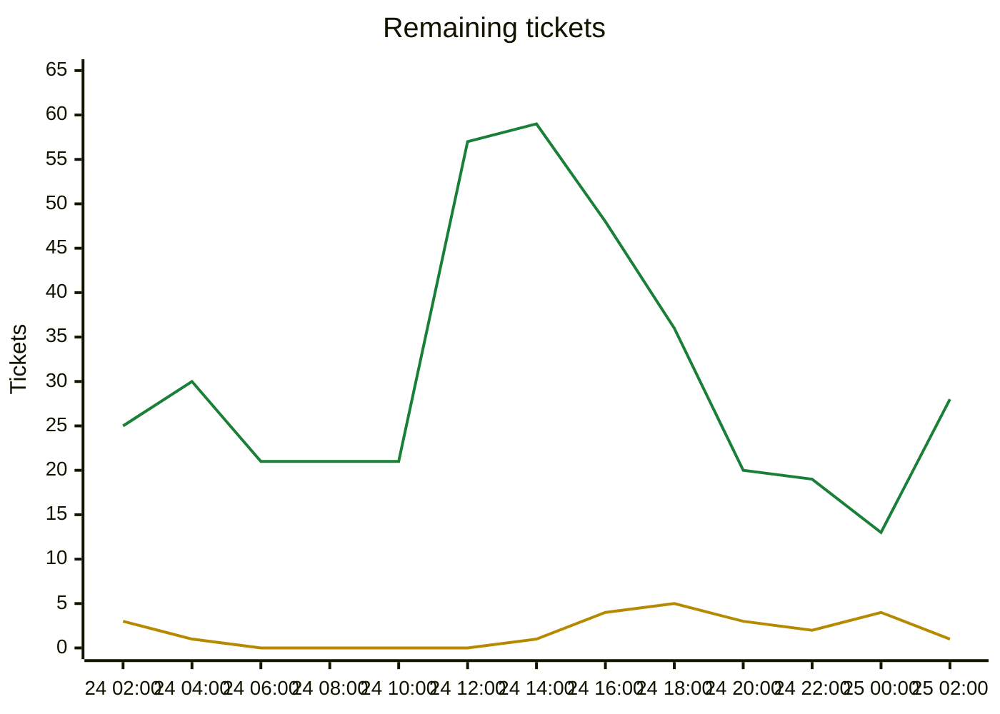

# Migration dependency map

Generated by `tools/ticket.py` on every backlog change; do not edit by hand. Shows every incomplete ticket. A ticket that still has an incomplete dependency also shows all its direct dependencies (completed ones are grey and dashed); once every dependency is Done, they are hidden. An arrow `A --> B` means B depends on A.

| Colour | Meaning |
|---|---|
| bright green, thick border | Ready to start: Available and every dependency is Done |
| orange, thick border | On deck: Available, and every unfinished dependency is already in progress or in review, so it becomes ready when those finish |
| pale green, dotted border | Available but waiting on dependencies that are not started yet |
| yellow | In-Progress |
| blue | Needs-Review / In-Review |
| red | Blocked |
| grey dashed | Done (shown as a direct dependency only) |

```mermaid
flowchart TD
  subgraph TTRACK["Engine track"]
    T012["T012<br/>Command layer design"]
    T084["T084<br/>Views A: View, GameView, OwnedView, CivView, ForeignCivView,..."]
    T085["T085<br/>Views B: CityView, ForeignCityView, CityConstructionsView, M..."]
    T091["T091<br/>Civilian automation: CivilianUnitAutomation, SpecificUnitAut..."]
    T092["T092<br/>Worker and road automation: WorkerAutomation, RoadBetweenCit..."]
    T138["T138<br/>Views A leftovers: TradeView and CivView.getTradeView"]
    T140["T140<br/>Civilization and manager JSON wiring (full GameInfo save/loa..."]
    T160["T160<br/>Kotlin golden state hashes and mod ruleset for the end-to-en..."]
    T161["T161<br/>Close known coverage gaps: UnitAutomation TryRetreat swap an..."]
    T162["T162<br/>Coverage baselines for Era.cs, Terrain.cs, CollectionExtensi..."]
    T163["T163<br/>ticket.py: refuse Done unless the tip builds, tests pass and..."]
    T164["T164<br/>Command layer implementation over GameInfo (move, attack, fo..."]
    T165["T165<br/>Authoritative game server: protocol, lobby, turn notificatio..."]
    T166["T166<br/>Victory scorer game adapter (fills ConquestInputs/CultureInp..."]
    T167["T167<br/>L1 acceptance soak: 300+ turn headless games on Small and St..."]
    T168["T168<br/>Headless runner Unciv.Cli: new game, play N turns, save and ..."]
    T169["T169<br/>CI for the C# solution and Unciv.Godot (headless build, form..."]
    T170["T170<br/>Ruleset/mod folder loading and real translation file loading..."]
    T171["T171<br/>Event presentation types in UniqueTriggerActivation (replace..."]
    T172["T172<br/>Net protocol: message DTOs, versioning, ITransport and in-me..."]
    T173["T173<br/>Server identity and auth: ECDSA P-256 keypair, invite tokens..."]
    T174["T174<br/>Visibility filter: ClientSnapshot builder from GameInfo via ..."]
    T175["T175<br/>Event stream: per-recipient event classifiers, TilesRevealed..."]
    T176["T176<br/>Game store: snapshot + append-only command log, hash checkpo..."]
    T177["T177<br/>Turn policy: sequential phase machine, injected clock, turn ..."]
    T178["T178<br/>Headless host and lobby: Unciv.Server project, GameHost acto..."]
    T179["T179<br/>Server transport: WebSocket over TLS (Kestrel) behind ITrans..."]
  end
  subgraph CTRACK["Client track (Godot)"]
    C001["C001<br/>Godot project skeleton"]
    C002["C002<br/>3D hex terrain rendering"]
    C003["C003<br/>Resource and improvement props"]
    C004["C004<br/>3D military units"]
    C005["C005<br/>Civ 5-style UI shell"]
    C006["C006<br/>Networked play client"]
  end
  subgraph ATRACK["Game AI track"]
    A003["A003<br/>Victory scorers (BNW)"]
    A004["A004<br/>Target-centric Tactical AI: TacticalMoveQueue & recruitment"]
    A005["A005<br/>Tactical overkill assignment & coordinated multi-unit attack..."]
    A006["A006<br/>Homeland AI priority move queue"]
    A007["A007<br/>Operations and armies layer"]
  end
  T172 --> T173
  T172 --> T174
  T084 --> T174
  T085 --> T174
  T138 --> T174
  T140 --> T174
  T172 --> T175
  T174 --> T175
  T164 --> T175
  T172 --> T176
  T164 --> T176
  T140 --> T176
  T172 --> T177
  T164 --> T177
  T172 --> T178
  T173 --> T178
  T174 --> T178
  T175 --> T178
  T176 --> T178
  T177 --> T178
  T178 --> T179
  C001 --> C002
  A003 --> C002
  A004 --> C002
  A005 --> C002
  A006 --> C002
  A007 --> C002
  C002 --> C003
  C002 --> C004
  T164 --> C004
  C002 --> C005
  T164 --> C005
  T012 --> C006
  C001 --> C006
  T164 --> C006
  T165 --> C006
  A004 --> A005
  A004 --> A006
  T091 --> A006
  T092 --> A006
  A004 --> A007
  A005 --> A007
  classDef waiting fill:#f3faf3,stroke:#9bc49b,color:#555,stroke-dasharray:2 2
  classDef ondeck fill:#ffe8cc,stroke:#e8590c,stroke-width:3px,color:#000
  classDef ready fill:#7ee787,stroke:#1a7f37,stroke-width:3px,color:#000
  classDef prog fill:#fff3b0,stroke:#b58900,color:#000
  classDef review fill:#cfe4ff,stroke:#1f6feb,color:#000
  classDef blocked fill:#ffd6d6,stroke:#c62828,color:#000
  classDef done fill:#eeeeee,stroke:#999999,color:#666,stroke-dasharray:4 3
  class A003 done
  class A004 prog
  class A005 ondeck
  class A006 ondeck
  class A007 waiting
  class C001 done
  class C002 waiting
  class C003 waiting
  class C004 waiting
  class C005 waiting
  class C006 waiting
  class T012 done
  class T084 done
  class T085 done
  class T091 done
  class T092 done
  class T138 done
  class T140 done
  class T160 ready
  class T161 ready
  class T162 ready
  class T163 ready
  class T164 blocked
  class T165 blocked
  class T166 ready
  class T167 ready
  class T168 ready
  class T169 ready
  class T170 ready
  class T171 ready
  class T172 ready
  class T173 waiting
  class T174 waiting
  class T175 waiting
  class T176 waiting
  class T177 waiting
  class T178 waiting
  class T179 blocked
```

## Remaining tickets over time

Generated from the git history of `backlog.md` (UTC; each point is the backlog as of that time, the last one the current backlog). Completed tickets (Done, Won't port) are not counted.

| Line | Meaning |
|---|---|
| green | New: Available or Blocked, not started yet |
| yellow | Active: In-Progress, Needs-Review or In-Review |

## Incomplete tickets

| Ticket | State | Depends on | Unblocks | Title |
|---|---|---|---|---|
| T172 | **Ready to start** | T012 | 7 | Net protocol: message DTOs, versioning, ITransport and in-memory transport (Unciv.Core/Net) |
| T160 | **Ready to start** | T102 | 0 | Kotlin golden state hashes and mod ruleset for the end-to-end determinism gate |
| T161 | **Ready to start** | T093, T159 | 0 | Close known coverage gaps: UnitAutomation TryRetreat swap and air-unit heal, damage-aware A* branches, MaxByScore NaN/tie handling, SpecificUnitAutomation uncovered branches |
| T162 | **Ready to start** | T159 | 0 | Coverage baselines for Era.cs, Terrain.cs, CollectionExtensions.cs (coverage.py --check --all fails on them) |
| T163 | **Ready to start** | T104 | 0 | ticket.py: refuse Done unless the tip builds, tests pass and coverage --check passes (automates the Green-before-Done rule) |
| T166 | **Ready to start** | A003 | 0 | Victory scorer game adapter (fills ConquestInputs/CultureInputs/DiplomaticInputs/SpaceshipInputs from Civilization) |
| T167 | **Ready to start** | T102 | 0 | L1 acceptance soak: 300+ turn headless games on Small and Standard maps with 6+ civs, city states, barbarians, religion, trade, espionage |
| T168 | **Ready to start** | T099, T100, T102 | 0 | Headless runner Unciv.Cli: new game, play N turns, save and load, with build/run docs |
| T169 | **Ready to start** | C001 | 0 | CI for the C# solution and Unciv.Godot (headless build, format, tests, coverage check); export/packaging notes |
| T170 | **Ready to start** | T104 | 0 | Ruleset/mod folder loading and real translation file loading wiring (Translations.cs TODO, RulesetCache mods) |
| T171 | **Ready to start** | T104 | 0 | Event presentation types in UniqueTriggerActivation (replace the NotImplementedException at the event trigger) |
| A005 | **On deck** (after A004) | A004 | 5 | Tactical overkill assignment & coordinated multi-unit attacks |
| A006 | **On deck** (after A004) | A004, T091, T092 | 4 | Homeland AI priority move queue |
| T164 | Blocked | T012, T071, T083, T080, T100 | 8 | Command layer implementation over GameInfo (move, attack, found city, production queue and purchase, research, policies, diplomacy, end turn) with replayable log |
| A004 | In-Progress [Claude] | A001, T039, T040, T065, T067, T081, T090 | 7 | Target-centric Tactical AI: TacticalMoveQueue & recruitment |
| A007 | Available (waiting on A004, A005) | A004, A005 | 4 | Operations and armies layer |
| C002 | Available (waiting on A004, A005, A006, A007) | C001, A003, A004, A005, A006, A007 | 3 | 3D hex terrain rendering |
| T174 | Available (waiting on T172) | T172, T084, T085, T138, T140 | 3 | Visibility filter: ClientSnapshot builder from GameInfo via View classes, default-deny whitelist DTOs |
| T173 | Available (waiting on T172) | T172 | 2 | Server identity and auth: ECDSA P-256 keypair, invite tokens, challenge-response, allow-list (friends-only) |
| T175 | Available (waiting on T172, T174, T164) | T172, T174, T164 | 2 | Event stream: per-recipient event classifiers, TilesRevealed/StatsChanged deltas, notification and popup delivery |
| T176 | Available (waiting on T172, T164) | T172, T164, T140 | 2 | Game store: snapshot + append-only command log, hash checkpoints, crash recovery, resume (delta ring or snapshot) |
| T177 | Available (waiting on T172, T164) | T172, T164 | 2 | Turn policy: sequential phase machine, injected clock, turn timer, AFK skip, drop and AI replacement |
| T165 | Blocked | T012, T100 | 1 | Authoritative game server: protocol, lobby, turn notification, reconnect/resume (our own multiplayer, no upstream Unciv servers) |
| T178 | Available (waiting on T172, T173, T174, T175, T176, T177) | T172, T173, T174, T175, T176, T177 | 1 | Headless host and lobby: Unciv.Server project, GameHost actor, sessions bound to civs, command gate (rate, size, dedup, existence-oracle-safe errors) |
| C003 | Available (waiting on C002) | C002 | 0 | Resource and improvement props |
| C004 | Available (waiting on C002, T164) | C002, T164 | 0 | 3D military units |
| C005 | Available (waiting on C002, T164) | C002, T164 | 0 | Civ 5-style UI shell |
| C006 | Available (waiting on T164, T165) | T012, C001, T164, T165 | 0 | Networked play client |
| T179 | Blocked | T178 | 0 | Server transport: WebSocket over TLS (Kestrel) behind ITransport, invite code with host:port and cert fingerprint pinning, deployment notes |
