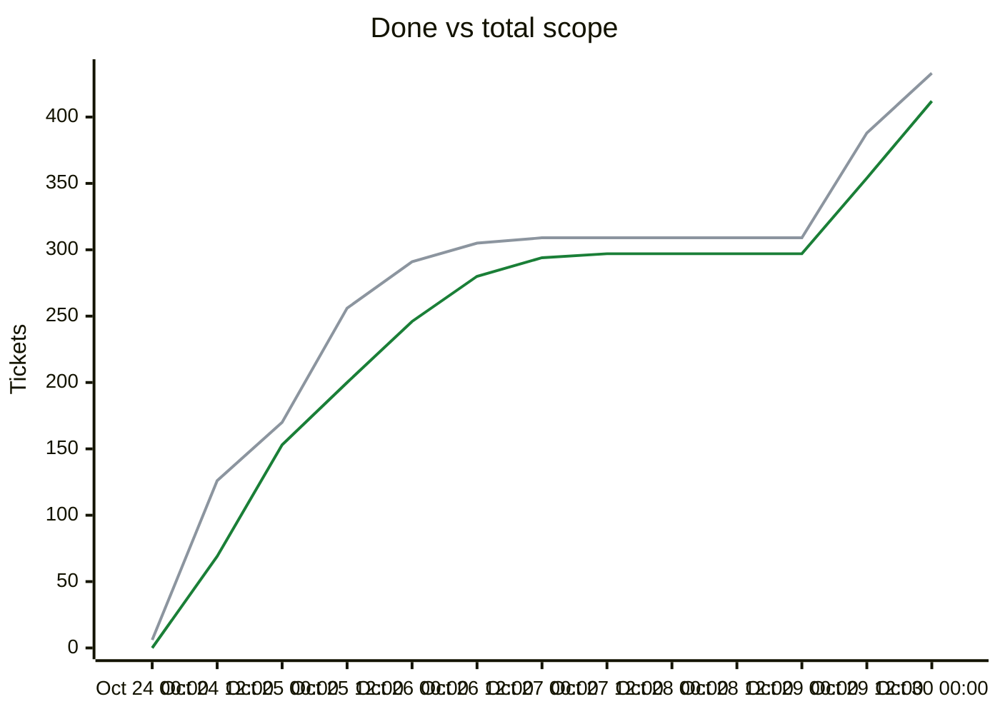

# Migration dependency map

<!-- toc -->
## Contents

- [Delivery phases](#delivery-phases)
- [Remaining tickets over time](#remaining-tickets-over-time)
- [Progress and scope over time](#progress-and-scope-over-time)
- [Incomplete tickets](#incomplete-tickets)
<!-- /toc -->

## Delivery phases

Work is completed phase by phase (`phases.txt`; `ticket.py ready`/`next` list earlier phases first; later phases fill idle capacity).

| Phase | Done | Remaining | Ready | In flight | Remaining tickets |
|---|---|---|---|---|---|
| Phase 1: CLI (headless engine) | 231/231 | 0 | 0 | 0 | complete |
| Phase 2: single player (Godot client) | 57/57 | 0 | 0 | 0 | complete |
| Phase 3: multiplayer | 29/29 | 0 | 0 | 0 | complete |
| Phase 4: queued plans (UI redesign, unit models, BNW) | 72/72 | 0 | 0 | 0 | complete |
| Phase 5: owner issue backlog (Android, performance, ultra graphics, dedicated server, resiliency) | 19/40 | 21 | 6 | 6 | [C099](backlog/C099.md) [T260](backlog/T260.md) [T262](backlog/T262.md) [T263](backlog/T263.md) [T266](backlog/T266.md) [T270](backlog/T270.md) [T272](backlog/T272.md) [T273](backlog/T273.md) [T274](backlog/T274.md) [T275](backlog/T275.md) [T277](backlog/T277.md) [T278](backlog/T278.md) [T280](backlog/T280.md) [T282](backlog/T282.md) [T283](backlog/T283.md) [T285](backlog/T285.md) [T287](backlog/T287.md) [T288](backlog/T288.md) [T289](backlog/T289.md) [T290](backlog/T290.md) [T291](backlog/T291.md) |

Generated by `tools/ticket.py` on every backlog change; do not edit by hand. Shows every incomplete ticket and the dependencies between them; completed tickets are hidden. An arrow `A --> B` means B depends on A.

| Colour | Meaning |
|---|---|
| bright green, thick border | Ready to start: Available and every dependency is Done |
| orange, thick border | On deck: Available, and every unfinished dependency is already in progress or in review, so it becomes ready when those finish |
| pale green, dotted border | Available but waiting on dependencies that are not started yet |
| yellow | In-Progress |
| blue | Needs-Review / In-Review |
| red | Blocked |

```mermaid
flowchart TD
  subgraph TTRACK["Engine track"]
    T260["T260<br/>Android APK build: unblock the .NET export (net9.0 target or..."]
    T262["T262<br/>Optimise the top turn-time hotspots with proof of identical ..."]
    T263["T263<br/>Parallelism spike: which turn work can run in parallel witho..."]
    T266["T266<br/>Dedicated server distribution: self-contained Linux and Wind..."]
    T270["T270<br/>Dedicated server executable B: graceful shutdown, persistenc..."]
    T272["T272<br/>Host migration 2/5: standby replication (StandbySubscribe/Sn..."]
    T273["T273<br/>Host migration 3/5: graceful hand-off and promotion (HostHan..."]
    T274["T274<br/>Host migration 4/5: crash election (loss detection, signed H..."]
    T275["T275<br/>Host migration 5/5: client UI and docs (backup-host picker, ..."]
    T277["T277<br/>Android CI: build the APK (arm64 plus x86_64) as an artifact..."]
    T278["T278<br/>Android on-device verification: TLS join, lifecycle reconnec..."]
    T280["T280<br/>Add the Android APK to the tagged GitHub release workflow"]
    T282["T282<br/>Host migration 1c: periodic standby re-probe and the standby..."]
    T283["T283<br/>Phone layout: Tech and policy screens (C101 follow-up)"]
    T285["T285<br/>Phone layout: Civilopedia (C101 follow-up)"]
    T287["T287<br/>Far-zoom draw-call reduction"]
    T288["T288<br/>Ultra on integrated GPUs: note or fallback"]
    T289["T289<br/>Ultra water ripple and sun glint tuning"]
    T290["T290<br/>Real-device frame-time pass: Windows, macOS, Android phone"]
    T291["T291<br/>Publish curated real-GPU Ultra graphics screenshots as docs ..."]
  end
  subgraph CTRACK["Client track (Godot)"]
    C099["C099<br/>Android shell behaviour: back button, safe area, orientation..."]
  end
  T270 --> T266
  T272 --> T273
  T273 --> T274
  T274 --> T275
  T260 --> T277
  T260 --> T278
  T260 --> T280
  T277 --> T280
  T260 --> C099
  classDef waiting fill:#f3faf3,stroke:#9bc49b,color:#555,stroke-dasharray:2 2
  classDef ondeck fill:#ffe8cc,stroke:#e8590c,stroke-width:3px,color:#000
  classDef ready fill:#7ee787,stroke:#1a7f37,stroke-width:3px,color:#000
  classDef prog fill:#fff3b0,stroke:#b58900,color:#000
  classDef review fill:#cfe4ff,stroke:#1f6feb,color:#000
  classDef blocked fill:#ffd6d6,stroke:#c62828,color:#000
  classDef done fill:#eeeeee,stroke:#999999,color:#666,stroke-dasharray:4 3
  class C099 waiting
  class T260 blocked
  class T262 review
  class T263 ready
  class T266 ondeck
  class T270 prog
  class T272 review
  class T273 ondeck
  class T274 waiting
  class T275 waiting
  class T277 waiting
  class T278 waiting
  class T280 waiting
  class T282 ready
  class T283 prog
  class T285 ready
  class T287 prog
  class T288 ready
  class T289 ready
  class T290 ready
  class T291 review
```

## Remaining tickets over time

Generated from the git history of `backlog/` (times are UTC; each point is the backlog as of that time, the last one the current backlog). Completed tickets (Done, Won't port) are not counted in this chart.

| Line | Meaning |
|---|---|
| blue (#0969da) | New: Available, not started yet |
| red (#cf222e) | Blocked |
| amber (#d29922) | Active: In-Progress, Needs-Review or In-Review |

## Progress and scope over time

| Line | Meaning |
|---|---|
| green (#1a7f37) | Done: Done or Won't port, cumulative |
| grey (#8c959f) | Total scope: every ticket that existed at that time; a rise here is new tickets, not lost progress |

## Incomplete tickets

| Ticket | State | Depends on | Unblocks | Title |
|---|---|---|---|---|
| T263 | **Ready to start** | T261 | 0 | Parallelism spike: which turn work can run in parallel without breaking determinism (go/no-go) |
| T282 | **Ready to start** | T281 | 0 | Host migration 1c: periodic standby re-probe and the standby-mode Welcome answer (probe beyond the TLS handshake) |
| T285 | **Ready to start** | C101 | 0 | Phone layout: Civilopedia (C101 follow-up) |
| T288 | **Ready to start** | T271 | 0 | Ultra on integrated GPUs: note or fallback |
| T289 | **Ready to start** | T271 | 0 | Ultra water ripple and sun glint tuning |
| T290 | **Ready to start** | T271 | 0 | Real-device frame-time pass: Windows, macOS, Android phone |
| T273 | **On deck** (after T272) | T272, T267 | 2 | Host migration 3/5: graceful hand-off and promotion (HostHandoff, promote from standby store, client redirect, rolledBack resync) |
| T266 | **On deck** (after T270) | T270 | 0 | Dedicated server distribution: self-contained Linux and Windows builds in releases and CI, run guide |
| T260 | Blocked | T259, C042 | 4 | Android APK build: unblock the .NET export (net9.0 target or Gradle), Android preset, debug-signed arm64 APK from tools/package.sh android |
| T272 | Needs-Review [Claude-T272] | T281, T267 | 3 | Host migration 2/5: standby replication (StandbySubscribe/Snapshot/Entry/Ack, standby store in the successor's data dir, lag handling) |
| T270 | In-Progress [Claude-T270] | T265, T176, T254 | 1 | Dedicated server executable B: graceful shutdown, persistence and resume, exit codes, subprocess test |
| T274 | Available (waiting on T273) | T273 | 1 | Host migration 4/5: crash election (loss detection, signed HostLossVote quorum, split-brain refusal, superseded-host mode, forced take-over, kill-the-host scenarios) |
| T277 | Available (waiting on T260) | T260, T276 | 1 | Android CI: build the APK (arm64 plus x86_64) as an artifact and smoke it on an emulator |
| C099 | Available (waiting on T260) | T260, C096 | 0 | Android shell behaviour: back button, safe area, orientation, lifecycle autosave, virtual keyboard, hide Host, permissions |
| T262 | Needs-Review [Claude-T262] | T261 | 0 | Optimise the top turn-time hotspots with proof of identical game state |
| T275 | Available (waiting on T274) | T274, C034, C035 | 0 | Host migration 5/5: client UI and docs (backup-host picker, trust notice, standby status, rollback and host-changed notices, superseded-host screen) |
| T278 | Available (waiting on T260) | T260, T276 | 0 | Android on-device verification: TLS join, lifecycle reconnect, frame time and APK size on a mid-range phone |
| T280 | Available (waiting on T260, T277) | T279, T260, T277 | 0 | Add the Android APK to the tagged GitHub release workflow |
| T283 | In-Progress [Claude-T283] | C101 | 0 | Phone layout: Tech and policy screens (C101 follow-up) |
| T287 | In-Progress [Claude-T287] | T271 | 0 | Far-zoom draw-call reduction |
| T291 | In-Review [Claude-shots] | none | 0 | Publish curated real-GPU Ultra graphics screenshots as docs images (not goldens) |
