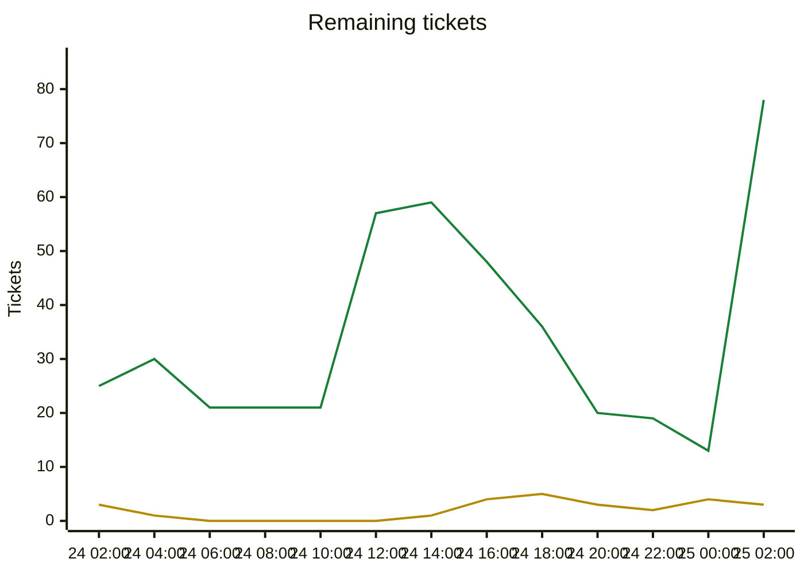

# Migration dependency map

Generated by `tools/ticket.py` on every backlog change; do not edit by hand. Shows every incomplete ticket. A ticket that still has an incomplete dependency also shows all its direct dependencies (completed ones are grey and dashed); once every dependency is Done, they are hidden. An arrow `A --> B` means B depends on A.

| Colour | Meaning |
|---|---|
| bright green, thick border | Ready to start: Available and every dependency is Done |
| orange, thick border | On deck: Available, and every unfinished dependency is already in progress or in review, so it becomes ready when those finish |
| pale green, dotted border | Available but waiting on dependencies that are not started yet |
| yellow | In-Progress |
| blue | Needs-Review / In-Review |
| red | Blocked |
| grey dashed | Done (shown as a direct dependency only) |

```mermaid
flowchart TD
  subgraph TTRACK["Engine track"]
    T011["T011<br/>State-hash determinism harness"]
    T012["T012<br/>Command layer design"]
    T021["T021<br/>Metadata models: LocaleCode, GameParameters, GameSetupInfo, ..."]
    T023["T023<br/>Translation core (headless)"]
    T030["T030<br/>Ruleset base objects: RulesetObject, Specialist, Speed, Poli..."]
    T034["T034<br/>Ruleset and RulesetCache loader"]
    T040["T040<br/>Pathfinding: BFS, AStar, MapPathing, CarrierSlotMatcher, Map..."]
    T045["T045<br/>GameSetupInfo"]
    T049["T049<br/>Model leaves: ModConstants, UncivSound, TutorialTrigger"]
    T051["T051<br/>Serialization leaf models: LastSeenImprovement, CivRankingHi..."]
    T055["T055<br/>Civilization core: Civilization, ExploredRegion, PopupAlert"]
    T056["T056<br/>Civilization managers: TechManager, PolicyManager, GoldenAge..."]
    T057["T057<br/>Civilization managers: ReligionManager (+Religion), RuinsMan..."]
    T059["T059<br/>Diplomacy core: DiplomacyManager, DiplomacyFunctions, Demand..."]
    T060["T060<br/>City core: City, CityFocus, CityResources, CityEspionageMana..."]
    T062["T062<br/>CityStats and GreatPersonPointsBreakdown"]
    T063["T063<br/>CityConstructions"]
    T068["T068<br/>Diplomacy turn and city states: DiplomacyTurnManager, Declar..."]
    T080["T080<br/>Unit actions B: UnitActions, UnitActionsFromUniques"]
    T083["T083<br/>Battle C: Battle, Nuke"]
    T084["T084<br/>Views A: View, GameView, OwnedView, CivView, ForeignCivView,..."]
    T085["T085<br/>Views B: CityView, ForeignCityView, CityConstructionsView, M..."]
    T086["T086<br/>TradeLogic"]
    T089["T089<br/>TradeEvaluation"]
    T099["T099<br/>GameStarter"]
    T100["T100<br/>Save/load B: UncivFiles"]
    T102["T102<br/>End-to-end determinism over N turns"]
    T138["T138<br/>Views A leftovers: TradeView and CivView.getTradeView"]
    T139["T139<br/>Views B leftovers: members blocked on unported engine code (..."]
    T140["T140<br/>Civilization and manager JSON wiring (full GameInfo save/loa..."]
    T160["T160<br/>Kotlin golden state hashes and mod ruleset for the end-to-en..."]
    T161["T161<br/>Close known coverage gaps: UnitAutomation TryRetreat swap an..."]
    T162["T162<br/>Coverage baselines for Era.cs, Terrain.cs, CollectionExtensi..."]
    T163["T163<br/>ticket.py: refuse Done unless the tip builds, tests pass and..."]
    T164["T164<br/>Command infrastructure over GameInfo: GameCommand base, asse..."]
    T166["T166<br/>Victory scorer game adapter (fills ConquestInputs/CultureInp..."]
    T167["T167<br/>L1 acceptance soak: 300+ turn headless games on Small and St..."]
    T169["T169<br/>CI for the C# solution and Unciv.Godot (headless build, form..."]
    T170["T170<br/>Ruleset/mod folder loading and real translation file loading..."]
    T171["T171<br/>Event presentation types in UniqueTriggerActivation (replace..."]
    T172["T172<br/>Net protocol: message DTOs, versioning, ITransport and in-me..."]
    T173["T173<br/>Host identity and join auth: client ECDSA P-256 key bound to..."]
    T174["T174<br/>Visibility filter: ClientSnapshot builder from GameInfo via ..."]
    T175["T175<br/>Event stream: per-recipient event classifiers, TilesRevealed..."]
    T176["T176<br/>Game store: snapshot + append-only command log, hash checkpo..."]
    T177["T177<br/>Turn policy for simultaneous turns: injected clock, turn tim..."]
    T178["T178<br/>Headless host core: Unciv.Server project, GameHost actor, se..."]
    T179["T179<br/>Direct-connect transport: TCP + TLS 1.3 frames behind ITrans..."]
    T180["T180<br/>Client network library Unciv.Client.Net: ClientSession state..."]
    T181["T181<br/>Private-channel filtering: trade offers, diplomacy and espio..."]
    T182["T182<br/>Multi-client end-to-end: scripted 3-human + AI game over in-..."]
    T183["T183<br/>Engine player settings: per-civ state-affecting settings, he..."]
    T184["T184<br/>Human turn flow: phased turn API (EndPlayerTurn, RunAutoPlay..."]
    T185["T185<br/>Query infrastructure: serializable IQuery requests/results o..."]
    T186["T186<br/>Game events: GameEvent registry and JSON, event sink in the ..."]
    T187["T187<br/>Turn and decision commands: EndTurn, RunAiTurn, BeginTurn, M..."]
    T188["T188<br/>Movement and combat commands: MoveUnit, SetMoveOrder, SwapUn..."]
    T189["T189<br/>Unit actions A: serializable UnitActionDescriptor, GetUnitAc..."]
    T190["T190<br/>Unit actions B: unique-driven actions through descriptors (g..."]
    T191["T191<br/>City commands: production queue, purchase, buy tile, worked ..."]
    T192["T192<br/>Research, policy, religion, great person, espionage and worl..."]
    T193["T193<br/>Diplomacy, trade and city-state commands: war, peace, friend..."]
    T194["T194<br/>Command log format, replay verifier and scripted-human repla..."]
    T195["T195<br/>Query API: unit movement and combat previews (reachable tile..."]
    T196["T196<br/>Query API: city and tile panels (buildable lists with reject..."]
    T197["T197<br/>Query API: empire panels (tech tree and research queue, poli..."]
    T198["T198<br/>Query API: victory progress, scores, rankings and demographi..."]
    T199["T199<br/>Query API: new-game setup data (nations, difficulties, speed..."]
    T200["T200<br/>Concurrent human turns A: TurnState/TurnMode in GameInfo, ci..."]
    T201["T201<br/>Current-player readers: make rules civ-explicit (ReassignPop..."]
    T202["T202<br/>Simultaneous-turn commands: EndTurn/UndoEndTurn/ForceEndTurn..."]
    T203["T203<br/>Two-human determinism and conflict tests: interleaved Script..."]
    T204["T204<br/>Lobby: slots, nation pick, ready-up, host settings (LobbySet..."]
    T205["T205<br/>In-process host: run GameHost inside the client (Host button..."]
    T206["T206<br/>Optional: LAN discovery (UDP broadcast beacon, 'Games on you..."]
    T207["T207<br/>Optional: UPnP/NAT-PMP automatic port mapping for the host"]
    T208["T208<br/>Running game must equal its own save-)load: make transient c..."]
  end
  subgraph CTRACK["Client track (Godot)"]
    C001["C001<br/>Godot project skeleton"]
    C002["C002<br/>3D hex terrain rendering (elevation, materials, water depth)"]
    C003["C003<br/>Resource and improvement props"]
    C004["C004<br/>Unit visuals: per-type models, formations, status icons"]
    C005["C005<br/>Civ 5-style UI kit: theme, screen stack, popups, tooltip hos..."]
    C006["C006<br/>Networked play client: join screen (address:port / invite), ..."]
    C007["C007<br/>Asset registry and procedural placeholder generator"]
    C008["C008<br/>Client scenario runner and owner review sheet"]
    C009["C009<br/>Map view v1: flat hex map from queries, camera, tile picking..."]
    C010["C010<br/>V1 vertical slice: unit blocks, select, move, end turn, AI t..."]
    C011["C011<br/>HUD: top bar yields, turn banner, next-action button"]
    C012["C012<br/>Unit panel and orders: attack, fortify, found city, workers,..."]
    C013["C013<br/>Notifications and popup alerts"]
    C014["C014<br/>Minimap"]
    C015["C015<br/>Main menu and game setup screen: nations, difficulty, speed,..."]
    C016["C016<br/>Save/load screen and autosave"]
    C017["C017<br/>City screen A: info, tiles, specialists, focus"]
    C018["C018<br/>City screen B: production queue, purchase, buildings"]
    C019["C019<br/>Tech screen"]
    C020["C020<br/>Policy screen"]
    C021["C021<br/>Diplomacy screen"]
    C022["C022<br/>Trade screen"]
    C023["C023<br/>Overview screens: empire, cities, units, resources, ranking,..."]
    C024["C024<br/>Victory and defeat screen, game over"]
    C025["C025<br/>Localization: translations in the client, language picker, n..."]
    C026["C026<br/>Tutorials"]
    C027["C027<br/>Tooltips and Civilopedia"]
    C028["C028<br/>Options screen, hotkeys, edge-pan"]
    C029["C029<br/>Hotseat player switch screen"]
    C030["C030<br/>Placeholder audio: UncivSound to generated tones"]
    C031["C031<br/>Terrain blending, fog of war polish, chunked meshes"]
    C032["C032<br/>Improvements, roads, cities, borders and in-world yield icon..."]
    C033["C033<br/>Unit animation and combat presentation"]
    C034["C034<br/>Host game screen: lobby settings, address list and Copy invi..."]
    C035["C035<br/>Lobby screen: slots, nation pick, ready-up, chat, kick, star..."]
    C036["C036<br/>Multiplayer turn bar: who has ended, deadline, End turn / Un..."]
  end
  subgraph ATRACK["Game AI track"]
    A003["A003<br/>Victory scorers (BNW)"]
    A004["A004<br/>Target-centric Tactical AI: TacticalMoveQueue & recruitment"]
    A005["A005<br/>Tactical overkill assignment & coordinated multi-unit attack..."]
    A006["A006<br/>Homeland AI priority move queue"]
    A007["A007<br/>Operations and armies layer"]
    A008["A008<br/>Tactical AI engine adapter: scan Civilization/TileMap into T..."]
  end
  T172 --> T173
  T172 --> T174
  T084 --> T174
  T085 --> T174
  T138 --> T174
  T140 --> T174
  T172 --> T175
  T174 --> T175
  T164 --> T175
  T186 --> T175
  T172 --> T176
  T164 --> T176
  T140 --> T176
  T194 --> T176
  T172 --> T177
  T164 --> T177
  T184 --> T177
  T187 --> T177
  T200 --> T177
  T202 --> T177
  T172 --> T178
  T173 --> T178
  T174 --> T178
  T175 --> T178
  T176 --> T178
  T177 --> T178
  T202 --> T178
  T172 --> T179
  T173 --> T179
  T178 --> T179
  T172 --> T180
  T173 --> T180
  T174 --> T180
  T175 --> T180
  T179 --> T180
  T204 --> T180
  T174 --> T181
  T175 --> T181
  T164 --> T181
  T193 --> T181
  T178 --> T182
  T180 --> T182
  T204 --> T182
  T203 --> T182
  T183 --> T184
  T102 --> T184
  T084 --> T184
  T164 --> T187
  T186 --> T187
  T184 --> T187
  T183 --> T187
  T164 --> T188
  T186 --> T188
  T083 --> T188
  T164 --> T189
  T186 --> T189
  T080 --> T189
  T185 --> T189
  T189 --> T190
  T164 --> T191
  T186 --> T191
  T164 --> T192
  T186 --> T192
  T164 --> T193
  T186 --> T193
  T086 --> T193
  T089 --> T193
  T187 --> T194
  T188 --> T194
  T189 --> T194
  T191 --> T194
  T192 --> T194
  T102 --> T194
  T011 --> T194
  T185 --> T195
  T139 --> T195
  T185 --> T196
  T139 --> T196
  T185 --> T197
  T138 --> T197
  T185 --> T198
  T166 --> T198
  A003 --> T198
  T185 --> T199
  T099 --> T199
  T045 --> T199
  T170 --> T199
  T184 --> T200
  T183 --> T201
  T200 --> T201
  T200 --> T202
  T187 --> T202
  T202 --> T203
  T188 --> T203
  T191 --> T203
  T192 --> T203
  T193 --> T203
  T194 --> T203
  T174 --> T203
  T172 --> T204
  T173 --> T204
  T178 --> T204
  T199 --> T204
  T178 --> T205
  T179 --> T205
  T204 --> T205
  T176 --> T205
  T179 --> T206
  T179 --> T207
  T167 --> T208
  C001 --> C002
  A003 --> C002
  A004 --> C002
  A005 --> C002
  A006 --> C002
  A007 --> C002
  C009 --> C002
  C002 --> C003
  C002 --> C004
  C010 --> C004
  C012 --> C004
  T164 --> C004
  C007 --> C005
  C010 --> C005
  T012 --> C006
  C001 --> C006
  T164 --> C006
  T172 --> C006
  T173 --> C006
  T180 --> C006
  T179 --> C006
  C010 --> C006
  C016 --> C006
  T194 --> C006
  C035 --> C006
  C036 --> C006
  C001 --> C007
  A003 --> C007
  A004 --> C007
  A005 --> C007
  A006 --> C007
  A007 --> C007
  C001 --> C008
  A003 --> C008
  A004 --> C008
  A005 --> C008
  A006 --> C008
  A007 --> C008
  C007 --> C009
  C008 --> C009
  T164 --> C009
  T099 --> C009
  T174 --> C009
  T185 --> C009
  C009 --> C010
  T164 --> C010
  T184 --> C010
  T187 --> C010
  T188 --> C010
  T174 --> C010
  T175 --> C010
  C005 --> C011
  C010 --> C011
  T164 --> C011
  T062 --> C011
  T174 --> C011
  T184 --> C011
  C005 --> C012
  C010 --> C012
  T164 --> C012
  T080 --> C012
  T083 --> C012
  T040 --> C012
  T188 --> C012
  T189 --> C012
  T190 --> C012
  T195 --> C012
  C005 --> C013
  C010 --> C013
  T164 --> C013
  T051 --> C013
  T055 --> C013
  T171 --> C013
  T187 --> C013
  T175 --> C013
  C010 --> C014
  T164 --> C014
  T174 --> C014
  C005 --> C015
  C010 --> C015
  T099 --> C015
  T045 --> C015
  T021 --> C015
  T034 --> C015
  T170 --> C015
  T199 --> C015
  C005 --> C016
  C010 --> C016
  T100 --> C016
  C005 --> C017
  C010 --> C017
  T164 --> C017
  T060 --> C017
  T062 --> C017
  T191 --> C017
  T196 --> C017
  C017 --> C018
  T063 --> C018
  T191 --> C018
  T196 --> C018
  C005 --> C019
  C010 --> C019
  T164 --> C019
  T056 --> C019
  T192 --> C019
  T197 --> C019
  C005 --> C020
  C010 --> C020
  T164 --> C020
  T056 --> C020
  T192 --> C020
  T197 --> C020
  C005 --> C021
  C010 --> C021
  T164 --> C021
  T059 --> C021
  T068 --> C021
  T193 --> C021
  T197 --> C021
  C021 --> C022
  T164 --> C022
  T059 --> C022
  T193 --> C022
  T197 --> C022
  C005 --> C023
  C010 --> C023
  T164 --> C023
  T057 --> C023
  T197 --> C023
  T198 --> C023
  C005 --> C024
  C010 --> C024
  T166 --> C024
  T198 --> C024
  T187 --> C024
  C005 --> C025
  T023 --> C025
  T170 --> C025
  C005 --> C026
  C010 --> C026
  T030 --> C026
  T049 --> C026
  C005 --> C027
  C025 --> C027
  C005 --> C028
  C010 --> C029
  T164 --> C029
  T184 --> C029
  C007 --> C030
  T049 --> C030
  C002 --> C031
  C003 --> C032
  C010 --> C032
  C004 --> C033
  C005 --> C034
  C010 --> C034
  C015 --> C034
  T204 --> C034
  T205 --> C034
  C005 --> C035
  T180 --> C035
  T204 --> C035
  C010 --> C036
  C011 --> C036
  T180 --> C036
  T202 --> C036
  T175 --> C036
  classDef waiting fill:#f3faf3,stroke:#9bc49b,color:#555,stroke-dasharray:2 2
  classDef ondeck fill:#ffe8cc,stroke:#e8590c,stroke-width:3px,color:#000
  classDef ready fill:#7ee787,stroke:#1a7f37,stroke-width:3px,color:#000
  classDef prog fill:#fff3b0,stroke:#b58900,color:#000
  classDef review fill:#cfe4ff,stroke:#1f6feb,color:#000
  classDef blocked fill:#ffd6d6,stroke:#c62828,color:#000
  classDef done fill:#eeeeee,stroke:#999999,color:#666,stroke-dasharray:4 3
  class A003 done
  class A004 done
  class A005 done
  class A006 done
  class A007 prog
  class A008 ready
  class C001 done
  class C002 waiting
  class C003 waiting
  class C004 waiting
  class C005 waiting
  class C006 waiting
  class C007 ondeck
  class C008 ondeck
  class C009 waiting
  class C010 waiting
  class C011 waiting
  class C012 waiting
  class C013 waiting
  class C014 waiting
  class C015 waiting
  class C016 waiting
  class C017 waiting
  class C018 waiting
  class C019 waiting
  class C020 waiting
  class C021 waiting
  class C022 waiting
  class C023 waiting
  class C024 waiting
  class C025 waiting
  class C026 waiting
  class C027 waiting
  class C028 waiting
  class C029 waiting
  class C030 waiting
  class C031 waiting
  class C032 waiting
  class C033 waiting
  class C034 waiting
  class C035 waiting
  class C036 waiting
  class T011 done
  class T012 done
  class T021 done
  class T023 done
  class T030 done
  class T034 done
  class T040 done
  class T045 done
  class T049 done
  class T051 done
  class T055 done
  class T056 done
  class T057 done
  class T059 done
  class T060 done
  class T062 done
  class T063 done
  class T068 done
  class T080 done
  class T083 done
  class T084 done
  class T085 done
  class T086 done
  class T089 done
  class T099 done
  class T100 done
  class T102 done
  class T138 done
  class T139 done
  class T140 done
  class T160 ready
  class T161 ready
  class T162 ready
  class T163 ready
  class T164 done
  class T166 ready
  class T167 review
  class T169 ready
  class T170 done
  class T171 done
  class T172 ready
  class T173 waiting
  class T174 waiting
  class T175 waiting
  class T176 waiting
  class T177 waiting
  class T178 waiting
  class T179 waiting
  class T180 waiting
  class T181 waiting
  class T182 waiting
  class T183 ready
  class T184 waiting
  class T185 review
  class T186 ready
  class T187 waiting
  class T188 waiting
  class T189 waiting
  class T190 waiting
  class T191 waiting
  class T192 waiting
  class T193 waiting
  class T194 waiting
  class T195 ondeck
  class T196 ondeck
  class T197 ondeck
  class T198 waiting
  class T199 ondeck
  class T200 waiting
  class T201 waiting
  class T202 waiting
  class T203 waiting
  class T204 waiting
  class T205 waiting
  class T206 waiting
  class T207 waiting
  class T208 ondeck
```

## Remaining tickets over time

Generated from the git history of `backlog.md` (UTC; each point is the backlog as of that time, the last one the current backlog). Completed tickets (Done, Won't port) are not counted.

| Line | Meaning |
|---|---|
| green | New: Available or Blocked, not started yet |
| yellow | Active: In-Progress, Needs-Review or In-Review |

## Incomplete tickets

| Ticket | State | Depends on | Unblocks | Title |
|---|---|---|---|---|
| T186 | **Ready to start** | T164 | 50 | Game events: GameEvent registry and JSON, event sink in the engine, common events (turn, notification, popup alert, unit/city/tile facts) |
| T172 | **Ready to start** | T012 | 47 | Net protocol: message DTOs, versioning, ITransport and in-memory transport (Unciv.Core/Net) |
| T183 | **Ready to start** | T071, T046 | 45 | Engine player settings: per-civ state-affecting settings, headless human conquest alert, no UserId in game rules |
| T166 | **Ready to start** | A003 | 3 | Victory scorer game adapter (fills ConquestInputs/CultureInputs/DiplomaticInputs/SpaceshipInputs from Civilization) |
| A008 | **Ready to start** | A004 | 0 | Tactical AI engine adapter: scan Civilization/TileMap into TacticalTargetList and TacticalUnit, execute recruited attacks |
| T160 | **Ready to start** | T102 | 0 | Kotlin golden state hashes and mod ruleset for the end-to-end determinism gate |
| T161 | **Ready to start** | T093, T159 | 0 | Close known coverage gaps: UnitAutomation TryRetreat swap and air-unit heal, damage-aware A* branches, MaxByScore NaN/tie handling, SpecificUnitAutomation uncovered branches |
| T162 | **Ready to start** | T159 | 0 | Coverage baselines for Era.cs, Terrain.cs, CollectionExtensions.cs (coverage.py --check --all fails on them) |
| T163 | **Ready to start** | T104 | 0 | ticket.py: refuse Done unless the tip builds, tests pass and coverage --check passes (automates the Green-before-Done rule) |
| T169 | **Ready to start** | C001 | 0 | CI for the C# solution and Unciv.Godot (headless build, format, tests, coverage check); export/packaging notes |
| C007 | **On deck** (after A007) | C001, A003, A004, A005, A006, A007 | 33 | Asset registry and procedural placeholder generator |
| C008 | **On deck** (after A007) | C001, A003, A004, A005, A006, A007 | 32 | Client scenario runner and owner review sheet |
| T199 | **On deck** (after T185) | T185, T099, T045, T170 | 9 | Query API: new-game setup data (nations, difficulties, speeds, victories, map options, mods) and NewGame(setup, seed, clock) entry point |
| T197 | **On deck** (after T185) | T185, T138 | 5 | Query API: empire panels (tech tree and research queue, policy tree, religion beliefs, great people, diplomacy and trade panels incl. optional AI would-accept hint, notifications, empire overview) |
| T195 | **On deck** (after T185) | T185, T139 | 3 | Query API: unit movement and combat previews (reachable tiles with costs, path preview with turns per leg, attackable tiles, attack odds and damage ranges, nuke/air/bombard targets) |
| T196 | **On deck** (after T185) | T185, T139 | 2 | Query API: city and tile panels (buildable lists with rejection reasons and costs, tile purchase costs, worked tiles and specialists, improvement placement problems, tile yields) |
| T208 | **On deck** (after T167) | T167 | 0 | Running game must equal its own save->load: make transient caches (vision, exploration, open-borders flags, ...) canonical so replay/join-in-progress cannot desync |
| T185 | Needs-Review [Claude] | T084, T085, T138, T139, T012 | 50 | Query infrastructure: serializable IQuery requests/results over GameView (viewer-filtered), registry, purity test |
| T184 | Available (waiting on T183) | T183, T102, T084 | 44 | Human turn flow: phased turn API (EndPlayerTurn, RunAutoPlayers, BeginPlayerTurn), TurnPhase and PendingDecisions query; NextTurn re-expressed on the phases |
| T174 | Available (waiting on T172) | T172, T084, T085, T138, T140 | 43 | Visibility filter: ClientSnapshot builder from GameInfo via View classes, default-deny whitelist DTOs |
| T187 | Available (waiting on T186, T184, T183) | T164, T186, T184, T183 | 41 | Turn and decision commands: EndTurn, RunAiTurn, BeginTurn, MoveAutomatedUnits, SetPlayerSettings, alert responses, picker dismissals, resign |
| T188 | Available (waiting on T186) | T164, T186, T083 | 39 | Movement and combat commands: MoveUnit, SetMoveOrder, SwapUnits, AttackWithUnit (MoveAndAttack), BombardWithCity, Nuke, AirSweep, Disband, SetUnitDue |
| T175 | Available (waiting on T172, T174, T186) | T172, T174, T164, T186 | 37 | Event stream: per-recipient event classifiers, TilesRevealed/StatsChanged deltas, notification and popup delivery |
| A007 | In-Progress [Claude] | A004, A005 | 35 | Operations and armies layer |
| C009 | Available (waiting on C007, C008, T174, T185) | C007, C008, T164, T099, T174, T185 | 31 | Map view v1: flat hex map from queries, camera, tile picking, fog tint |
| C010 | Available (waiting on C009, T184, T187, T188, T174, T175) | C009, T164, T184, T187, T188, T174, T175 | 27 | V1 vertical slice: unit blocks, select, move, end turn, AI turns |
| C005 | Available (waiting on C007, C010) | C007, C010 | 23 | Civ 5-style UI kit: theme, screen stack, popups, tooltip host |
| T189 | Available (waiting on T186, T185) | T164, T186, T080, T185 | 19 | Unit actions A: serializable UnitActionDescriptor, GetUnitActionDescriptors query, ExecuteUnitAction command; orders (fortify, sleep, explore, automate, found city, build/repair improvement, pillage, upgrade, promote, set up, skip, stop) |
| T191 | Available (waiting on T186) | T164, T186 | 17 | City commands: production queue, purchase, buy tile, worked tiles and specialists, focus, annex/puppet/raze, sell building, rename |
| T192 | Available (waiting on T186) | T164, T186 | 17 | Research, policy, religion, great person, espionage and world congress commands (+ GodMode debug commands gated by GameParameters.godMode) |
| T200 | Available (waiting on T184) | T184 | 16 | Concurrent human turns A: TurnState/TurnMode in GameInfo, civ-parameterised phases composed into the simultaneous sequence, NextResolveStep |
| T194 | Available (waiting on T187, T188, T189, T191, T192) | T187, T188, T189, T191, T192, T102, T011 | 14 | Command log format, replay verifier and scripted-human replay test against the T102 state hashes |
| T202 | Available (waiting on T200, T187) | T200, T187 | 14 | Simultaneous-turn commands: EndTurn/UndoEndTurn/ForceEndTurn semantics, ProcessEndTurn/StartNextTurn server commands, SetController, RequireActive gate and codes |
| T173 | Available (waiting on T172) | T172 | 12 | Host identity and join auth: client ECDSA P-256 key bound to a slot (TOFU), lobby password / single-use invite token for admission, host key fingerprint |
| T176 | Available (waiting on T172, T194) | T172, T164, T140, T194 | 12 | Game store: snapshot + append-only command log, hash checkpoints, crash recovery, resume (delta ring or snapshot) |
| T177 | Available (waiting on T172, T184, T187, T200, T202) | T172, T164, T184, T187, T200, T202 | 12 | Turn policy for simultaneous turns: injected clock, turn timer, ForceEndTurn order, disconnect grace, AI takeover opt-in, resolve pump |
| T178 | Available (waiting on T172, T173, T174, T175, T176, T177, T202) | T172, T173, T174, T175, T176, T177, T202 | 11 | Headless host core: Unciv.Server project, GameHost actor, sessions bound to civs, command gate (RequireActive, rate, size, dedup, existence-oracle-safe errors) |
| T179 | Available (waiting on T172, T173, T178) | T172, T173, T178 | 9 | Direct-connect transport: TCP + TLS 1.3 frames behind ITransport, self-signed host key, invite code (host:port, fingerprint, token), TOFU known-hosts, port-forward and overlay-VPN docs |
| T204 | Available (waiting on T172, T173, T178, T199) | T172, T173, T178, T199 | 7 | Lobby: slots, nation pick, ready-up, host settings (LobbySettings to GameSetupInfo), AI fill, ruleset hash check, join password, start game |
| C002 | Available (waiting on A007, C009) | C001, A003, A004, A005, A006, A007, C009 | 5 | 3D hex terrain rendering (elevation, materials, water depth) |
| T193 | Available (waiting on T186) | T164, T186, T086, T089 | 5 | Diplomacy, trade and city-state commands: war, peace, friendship, denounce, trade proposals and responses, demands, tribute/gift/protection/marriage |
| T180 | Available (waiting on T172, T173, T174, T175, T179, T204) | T172, T173, T174, T175, T179, T204 | 4 | Client network library Unciv.Client.Net: ClientSession state machine, mirror state, delta apply, command retry, reconnect/resume (no Godot types) |
| T190 | Available (waiting on T189) | T189 | 3 | Unit actions B: unique-driven actions through descriptors (great person improvements and hurry, religion, trade mission, paradrop, transform, gift unit, trigger unique, add in capital, air/set-up, stockpile) |
| C011 | Available (waiting on C005, C010, T174, T184) | C005, C010, T164, T062, T174, T184 | 2 | HUD: top bar yields, turn banner, next-action button |
| C012 | Available (waiting on C005, C010, T188, T189, T190, T195) | C005, C010, T164, T080, T083, T040, T188, T189, T190, T195 | 2 | Unit panel and orders: attack, fortify, found city, workers, automate |
| T198 | Available (waiting on T185, T166) | T185, T166, A003 | 2 | Query API: victory progress, scores, rankings and demographics |
| C003 | Available (waiting on C002) | C002 | 1 | Resource and improvement props |
| C004 | Available (waiting on C002, C010, C012) | C002, C010, C012, T164 | 1 | Unit visuals: per-type models, formations, status icons |
| C015 | Available (waiting on C005, C010, T199) | C005, C010, T099, T045, T021, T034, T170, T199 | 1 | Main menu and game setup screen: nations, difficulty, speed, map options |
| C016 | Available (waiting on C005, C010) | C005, C010, T100 | 1 | Save/load screen and autosave |
| C017 | Available (waiting on C005, C010, T191, T196) | C005, C010, T164, T060, T062, T191, T196 | 1 | City screen A: info, tiles, specialists, focus |
| C021 | Available (waiting on C005, C010, T193, T197) | C005, C010, T164, T059, T068, T193, T197 | 1 | Diplomacy screen |
| C025 | Available (waiting on C005) | C005, T023, T170 | 1 | Localization: translations in the client, language picker, non-Latin fonts |
| C035 | Available (waiting on C005, T180, T204) | C005, T180, T204 | 1 | Lobby screen: slots, nation pick, ready-up, chat, kick, start (host and joiner views) |
| C036 | Available (waiting on C010, C011, T180, T202, T175) | C010, C011, T180, T202, T175 | 1 | Multiplayer turn bar: who has ended, deadline, End turn / Undo end turn, turn-resolving overlay, connection markers |
| T167 | Needs-Review [Claude] | T102 | 1 | L1 acceptance soak: 300+ turn headless games on Small and Standard maps with 6+ civs, city states, barbarians, religion, trade, espionage |
| T203 | Available (waiting on T202, T188, T191, T192, T193, T194, T174) | T202, T188, T191, T192, T193, T194, T174 | 1 | Two-human determinism and conflict tests: interleaved ScriptedHumans, same-tile move/attack/found-city, war vs peace, trade races, replay and visibility |
| T205 | Available (waiting on T178, T179, T204, T176) | T178, T179, T204, T176 | 1 | In-process host: run GameHost inside the client (Host button), loopback + TCP listener, clean shutdown saves the game, resume saved game |
| C006 | Available (waiting on T172, T173, T180, T179, C010, C016, T194, C035, C036) | T012, C001, T164, T172, T173, T180, T179, C010, C016, T194, C035, C036 | 0 | Networked play client: join screen (address:port / invite), TOFU prompt, reconnect overlay, key storage |
| C013 | Available (waiting on C005, C010, T187, T175) | C005, C010, T164, T051, T055, T171, T187, T175 | 0 | Notifications and popup alerts |
| C014 | Available (waiting on C010, T174) | C010, T164, T174 | 0 | Minimap |
| C018 | Available (waiting on C017, T191, T196) | C017, T063, T191, T196 | 0 | City screen B: production queue, purchase, buildings |
| C019 | Available (waiting on C005, C010, T192, T197) | C005, C010, T164, T056, T192, T197 | 0 | Tech screen |
| C020 | Available (waiting on C005, C010, T192, T197) | C005, C010, T164, T056, T192, T197 | 0 | Policy screen |
| C022 | Available (waiting on C021, T193, T197) | C021, T164, T059, T193, T197 | 0 | Trade screen |
| C023 | Available (waiting on C005, C010, T197, T198) | C005, C010, T164, T057, T197, T198 | 0 | Overview screens: empire, cities, units, resources, ranking, religion, espionage |
| C024 | Available (waiting on C005, C010, T166, T198, T187) | C005, C010, T166, T198, T187 | 0 | Victory and defeat screen, game over |
| C026 | Available (waiting on C005, C010) | C005, C010, T030, T049 | 0 | Tutorials |
| C027 | Available (waiting on C005, C025) | C005, C025 | 0 | Tooltips and Civilopedia |
| C028 | Available (waiting on C005) | C005 | 0 | Options screen, hotkeys, edge-pan |
| C029 | Available (waiting on C010, T184) | C010, T164, T184 | 0 | Hotseat player switch screen |
| C030 | Available (waiting on C007) | C007, T049 | 0 | Placeholder audio: UncivSound to generated tones |
| C031 | Available (waiting on C002) | C002 | 0 | Terrain blending, fog of war polish, chunked meshes |
| C032 | Available (waiting on C003, C010) | C003, C010 | 0 | Improvements, roads, cities, borders and in-world yield icons |
| C033 | Available (waiting on C004) | C004 | 0 | Unit animation and combat presentation |
| C034 | Available (waiting on C005, C010, C015, T204, T205) | C005, C010, C015, T204, T205 | 0 | Host game screen: lobby settings, address list and Copy invite, start hosting in-process, resume saved hosted game |
| T181 | Available (waiting on T174, T175, T193) | T174, T175, T164, T193 | 0 | Private-channel filtering: trade offers, diplomacy and espionage visibility (server side) |
| T182 | Available (waiting on T178, T180, T204, T203) | T178, T180, T204, T203 | 0 | Multi-client end-to-end: scripted 3-human + AI game over in-memory transport, kill/restart server, reconnect, hash agreement |
| T201 | Available (waiting on T183, T200) | T183, T200 | 0 | Current-player readers: make rules civ-explicit (ReassignPopulationDeferred, gift action, CityView/CivView gating, tutorial hooks) |
| T206 | Available (waiting on T179) | T179 | 0 | Optional: LAN discovery (UDP broadcast beacon, 'Games on your network') |
| T207 | Available (waiting on T179) | T179 | 0 | Optional: UPnP/NAT-PMP automatic port mapping for the host |
