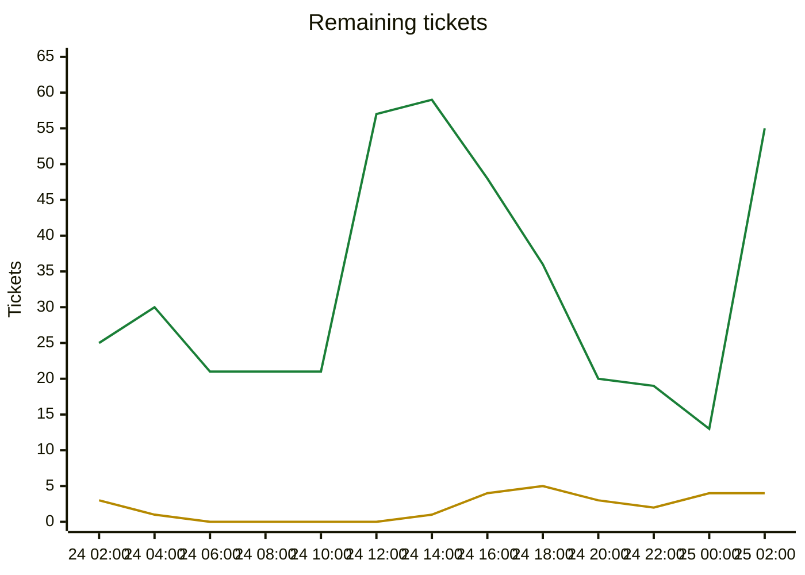

# Migration dependency map

Generated by `tools/ticket.py` on every backlog change; do not edit by hand. Shows every incomplete ticket. A ticket that still has an incomplete dependency also shows all its direct dependencies (completed ones are grey and dashed); once every dependency is Done, they are hidden. An arrow `A --> B` means B depends on A.

| Colour | Meaning |
|---|---|
| bright green, thick border | Ready to start: Available and every dependency is Done |
| orange, thick border | On deck: Available, and every unfinished dependency is already in progress or in review, so it becomes ready when those finish |
| pale green, dotted border | Available but waiting on dependencies that are not started yet |
| yellow | In-Progress |
| blue | Needs-Review / In-Review |
| red | Blocked |
| grey dashed | Done (shown as a direct dependency only) |

```mermaid
flowchart TD
  subgraph TTRACK["Engine track"]
    T012["T012<br/>Command layer design"]
    T021["T021<br/>Metadata models: LocaleCode, GameParameters, GameSetupInfo, ..."]
    T023["T023<br/>Translation core (headless)"]
    T030["T030<br/>Ruleset base objects: RulesetObject, Specialist, Speed, Poli..."]
    T034["T034<br/>Ruleset and RulesetCache loader"]
    T040["T040<br/>Pathfinding: BFS, AStar, MapPathing, CarrierSlotMatcher, Map..."]
    T045["T045<br/>GameSetupInfo"]
    T049["T049<br/>Model leaves: ModConstants, UncivSound, TutorialTrigger"]
    T051["T051<br/>Serialization leaf models: LastSeenImprovement, CivRankingHi..."]
    T055["T055<br/>Civilization core: Civilization, ExploredRegion, PopupAlert"]
    T056["T056<br/>Civilization managers: TechManager, PolicyManager, GoldenAge..."]
    T057["T057<br/>Civilization managers: ReligionManager (+Religion), RuinsMan..."]
    T059["T059<br/>Diplomacy core: DiplomacyManager, DiplomacyFunctions, Demand..."]
    T060["T060<br/>City core: City, CityFocus, CityResources, CityEspionageMana..."]
    T062["T062<br/>CityStats and GreatPersonPointsBreakdown"]
    T063["T063<br/>CityConstructions"]
    T068["T068<br/>Diplomacy turn and city states: DiplomacyTurnManager, Declar..."]
    T080["T080<br/>Unit actions B: UnitActions, UnitActionsFromUniques"]
    T083["T083<br/>Battle C: Battle, Nuke"]
    T084["T084<br/>Views A: View, GameView, OwnedView, CivView, ForeignCivView,..."]
    T085["T085<br/>Views B: CityView, ForeignCityView, CityConstructionsView, M..."]
    T091["T091<br/>Civilian automation: CivilianUnitAutomation, SpecificUnitAut..."]
    T092["T092<br/>Worker and road automation: WorkerAutomation, RoadBetweenCit..."]
    T099["T099<br/>GameStarter"]
    T100["T100<br/>Save/load B: UncivFiles"]
    T138["T138<br/>Views A leftovers: TradeView and CivView.getTradeView"]
    T140["T140<br/>Civilization and manager JSON wiring (full GameInfo save/loa..."]
    T160["T160<br/>Kotlin golden state hashes and mod ruleset for the end-to-en..."]
    T161["T161<br/>Close known coverage gaps: UnitAutomation TryRetreat swap an..."]
    T162["T162<br/>Coverage baselines for Era.cs, Terrain.cs, CollectionExtensi..."]
    T163["T163<br/>ticket.py: refuse Done unless the tip builds, tests pass and..."]
    T164["T164<br/>Command layer implementation over GameInfo (move, attack, fo..."]
    T166["T166<br/>Victory scorer game adapter (fills ConquestInputs/CultureInp..."]
    T167["T167<br/>L1 acceptance soak: 300+ turn headless games on Small and St..."]
    T168["T168<br/>Headless runner Unciv.Cli: new game, play N turns, save and ..."]
    T169["T169<br/>CI for the C# solution and Unciv.Godot (headless build, form..."]
    T170["T170<br/>Ruleset/mod folder loading and real translation file loading..."]
    T171["T171<br/>Event presentation types in UniqueTriggerActivation (replace..."]
    T172["T172<br/>Net protocol: message DTOs, versioning, ITransport and in-me..."]
    T173["T173<br/>Server identity and auth: ECDSA P-256 keypair, invite tokens..."]
    T174["T174<br/>Visibility filter: ClientSnapshot builder from GameInfo via ..."]
    T175["T175<br/>Event stream: per-recipient event classifiers, TilesRevealed..."]
    T176["T176<br/>Game store: snapshot + append-only command log, hash checkpo..."]
    T177["T177<br/>Turn policy: sequential phase machine, injected clock, turn ..."]
    T178["T178<br/>Headless host and lobby: Unciv.Server project, GameHost acto..."]
    T179["T179<br/>Server transport: WebSocket over TLS (Kestrel) behind ITrans..."]
    T180["T180<br/>Client network library Unciv.Client.Net: ClientSession state..."]
    T181["T181<br/>Private-channel filtering: trade offers, diplomacy and espio..."]
    T182["T182<br/>Multi-client end-to-end: scripted 3-human + AI game over in-..."]
  end
  subgraph CTRACK["Client track (Godot)"]
    C001["C001<br/>Godot project skeleton"]
    C002["C002<br/>3D hex terrain rendering (elevation, materials, water depth)"]
    C003["C003<br/>Resource and improvement props"]
    C004["C004<br/>Unit visuals: per-type models, formations, status icons"]
    C005["C005<br/>Civ 5-style UI kit: theme, screen stack, popups, tooltip hos..."]
    C006["C006<br/>Networked play client"]
    C007["C007<br/>Asset registry and procedural placeholder generator"]
    C008["C008<br/>Client scenario runner and owner review sheet"]
    C009["C009<br/>Map view v1: flat hex map from queries, camera, tile picking..."]
    C010["C010<br/>V1 vertical slice: unit blocks, select, move, end turn, AI t..."]
    C011["C011<br/>HUD: top bar yields, turn banner, next-action button"]
    C012["C012<br/>Unit panel and orders: attack, fortify, found city, workers,..."]
    C013["C013<br/>Notifications and popup alerts"]
    C014["C014<br/>Minimap"]
    C015["C015<br/>Main menu and game setup screen: nations, difficulty, speed,..."]
    C016["C016<br/>Save/load screen and autosave"]
    C017["C017<br/>City screen A: info, tiles, specialists, focus"]
    C018["C018<br/>City screen B: production queue, purchase, buildings"]
    C019["C019<br/>Tech screen"]
    C020["C020<br/>Policy screen"]
    C021["C021<br/>Diplomacy screen"]
    C022["C022<br/>Trade screen"]
    C023["C023<br/>Overview screens: empire, cities, units, resources, ranking,..."]
    C024["C024<br/>Victory and defeat screen, game over"]
    C025["C025<br/>Localization: translations in the client, language picker, n..."]
    C026["C026<br/>Tutorials"]
    C027["C027<br/>Tooltips and Civilopedia"]
    C028["C028<br/>Options screen, hotkeys, edge-pan"]
    C029["C029<br/>Hotseat player switch screen"]
    C030["C030<br/>Placeholder audio: UncivSound to generated tones"]
    C031["C031<br/>Terrain blending, fog of war polish, chunked meshes"]
    C032["C032<br/>Improvements, roads, cities, borders and in-world yield icon..."]
    C033["C033<br/>Unit animation and combat presentation"]
  end
  subgraph ATRACK["Game AI track"]
    A003["A003<br/>Victory scorers (BNW)"]
    A004["A004<br/>Target-centric Tactical AI: TacticalMoveQueue & recruitment"]
    A005["A005<br/>Tactical overkill assignment & coordinated multi-unit attack..."]
    A006["A006<br/>Homeland AI priority move queue"]
    A007["A007<br/>Operations and armies layer"]
    A008["A008<br/>Tactical AI engine adapter: scan Civilization/TileMap into T..."]
  end
  T172 --> T173
  T172 --> T174
  T084 --> T174
  T085 --> T174
  T138 --> T174
  T140 --> T174
  T172 --> T175
  T174 --> T175
  T164 --> T175
  T172 --> T176
  T164 --> T176
  T140 --> T176
  T172 --> T177
  T164 --> T177
  T172 --> T178
  T173 --> T178
  T174 --> T178
  T175 --> T178
  T176 --> T178
  T177 --> T178
  T178 --> T179
  T172 --> T180
  T173 --> T180
  T174 --> T180
  T175 --> T180
  T174 --> T181
  T175 --> T181
  T164 --> T181
  T178 --> T182
  T180 --> T182
  C001 --> C002
  A003 --> C002
  A004 --> C002
  A005 --> C002
  A006 --> C002
  A007 --> C002
  C009 --> C002
  C002 --> C003
  C002 --> C004
  C010 --> C004
  C012 --> C004
  T164 --> C004
  C007 --> C005
  C010 --> C005
  T012 --> C006
  C001 --> C006
  T164 --> C006
  T172 --> C006
  T173 --> C006
  T180 --> C006
  T179 --> C006
  C010 --> C006
  C016 --> C006
  C001 --> C007
  A003 --> C007
  A004 --> C007
  A005 --> C007
  A006 --> C007
  A007 --> C007
  C001 --> C008
  A003 --> C008
  A004 --> C008
  A005 --> C008
  A006 --> C008
  A007 --> C008
  C007 --> C009
  C008 --> C009
  T164 --> C009
  T099 --> C009
  C009 --> C010
  T164 --> C010
  C005 --> C011
  C010 --> C011
  T164 --> C011
  T062 --> C011
  C005 --> C012
  C010 --> C012
  T164 --> C012
  T080 --> C012
  T083 --> C012
  T040 --> C012
  C005 --> C013
  C010 --> C013
  T164 --> C013
  T051 --> C013
  T055 --> C013
  T171 --> C013
  C010 --> C014
  T164 --> C014
  C005 --> C015
  C010 --> C015
  T099 --> C015
  T045 --> C015
  T021 --> C015
  T034 --> C015
  T170 --> C015
  C005 --> C016
  C010 --> C016
  T100 --> C016
  C005 --> C017
  C010 --> C017
  T164 --> C017
  T060 --> C017
  T062 --> C017
  C017 --> C018
  T063 --> C018
  C005 --> C019
  C010 --> C019
  T164 --> C019
  T056 --> C019
  C005 --> C020
  C010 --> C020
  T164 --> C020
  T056 --> C020
  C005 --> C021
  C010 --> C021
  T164 --> C021
  T059 --> C021
  T068 --> C021
  C021 --> C022
  T164 --> C022
  T059 --> C022
  C005 --> C023
  C010 --> C023
  T164 --> C023
  T057 --> C023
  C005 --> C024
  C010 --> C024
  T166 --> C024
  C005 --> C025
  T023 --> C025
  T170 --> C025
  C005 --> C026
  C010 --> C026
  T030 --> C026
  T049 --> C026
  C005 --> C027
  C025 --> C027
  C005 --> C028
  C010 --> C029
  T164 --> C029
  C007 --> C030
  T049 --> C030
  C002 --> C031
  C003 --> C032
  C010 --> C032
  C004 --> C033
  A004 --> A005
  A004 --> A006
  T091 --> A006
  T092 --> A006
  A004 --> A007
  A005 --> A007
  A004 --> A008
  classDef waiting fill:#f3faf3,stroke:#9bc49b,color:#555,stroke-dasharray:2 2
  classDef ondeck fill:#ffe8cc,stroke:#e8590c,stroke-width:3px,color:#000
  classDef ready fill:#7ee787,stroke:#1a7f37,stroke-width:3px,color:#000
  classDef prog fill:#fff3b0,stroke:#b58900,color:#000
  classDef review fill:#cfe4ff,stroke:#1f6feb,color:#000
  classDef blocked fill:#ffd6d6,stroke:#c62828,color:#000
  classDef done fill:#eeeeee,stroke:#999999,color:#666,stroke-dasharray:4 3
  class A003 done
  class A004 review
  class A005 ondeck
  class A006 ondeck
  class A007 waiting
  class A008 ondeck
  class C001 done
  class C002 waiting
  class C003 waiting
  class C004 waiting
  class C005 waiting
  class C006 waiting
  class C007 waiting
  class C008 waiting
  class C009 waiting
  class C010 waiting
  class C011 waiting
  class C012 waiting
  class C013 waiting
  class C014 waiting
  class C015 waiting
  class C016 waiting
  class C017 waiting
  class C018 waiting
  class C019 waiting
  class C020 waiting
  class C021 waiting
  class C022 waiting
  class C023 waiting
  class C024 waiting
  class C025 waiting
  class C026 waiting
  class C027 waiting
  class C028 waiting
  class C029 waiting
  class C030 waiting
  class C031 waiting
  class C032 waiting
  class C033 waiting
  class T012 done
  class T021 done
  class T023 done
  class T030 done
  class T034 done
  class T040 done
  class T045 done
  class T049 done
  class T051 done
  class T055 done
  class T056 done
  class T057 done
  class T059 done
  class T060 done
  class T062 done
  class T063 done
  class T068 done
  class T080 done
  class T083 done
  class T084 done
  class T085 done
  class T091 done
  class T092 done
  class T099 done
  class T100 done
  class T138 done
  class T140 done
  class T160 ready
  class T161 ready
  class T162 ready
  class T163 ready
  class T164 blocked
  class T166 ready
  class T167 prog
  class T168 prog
  class T169 ready
  class T170 prog
  class T171 ready
  class T172 ready
  class T173 waiting
  class T174 waiting
  class T175 waiting
  class T176 waiting
  class T177 waiting
  class T178 waiting
  class T179 blocked
  class T180 waiting
  class T181 waiting
  class T182 waiting
```

## Remaining tickets over time

Generated from the git history of `backlog.md` (UTC; each point is the backlog as of that time, the last one the current backlog). Completed tickets (Done, Won't port) are not counted.

| Line | Meaning |
|---|---|
| green | New: Available or Blocked, not started yet |
| yellow | Active: In-Progress, Needs-Review or In-Review |

## Incomplete tickets

| Ticket | State | Depends on | Unblocks | Title |
|---|---|---|---|---|
| T172 | **Ready to start** | T012 | 11 | Net protocol: message DTOs, versioning, ITransport and in-memory transport (Unciv.Core/Net) |
| T166 | **Ready to start** | A003 | 1 | Victory scorer game adapter (fills ConquestInputs/CultureInputs/DiplomaticInputs/SpaceshipInputs from Civilization) |
| T171 | **Ready to start** | T104 | 1 | Event presentation types in UniqueTriggerActivation (replace the NotImplementedException at the event trigger) |
| T160 | **Ready to start** | T102 | 0 | Kotlin golden state hashes and mod ruleset for the end-to-end determinism gate |
| T161 | **Ready to start** | T093, T159 | 0 | Close known coverage gaps: UnitAutomation TryRetreat swap and air-unit heal, damage-aware A* branches, MaxByScore NaN/tie handling, SpecificUnitAutomation uncovered branches |
| T162 | **Ready to start** | T159 | 0 | Coverage baselines for Era.cs, Terrain.cs, CollectionExtensions.cs (coverage.py --check --all fails on them) |
| T163 | **Ready to start** | T104 | 0 | ticket.py: refuse Done unless the tip builds, tests pass and coverage --check passes (automates the Green-before-Done rule) |
| T169 | **Ready to start** | C001 | 0 | CI for the C# solution and Unciv.Godot (headless build, format, tests, coverage check); export/packaging notes |
| A005 | **On deck** (after A004) | A004 | 33 | Tactical overkill assignment & coordinated multi-unit attacks |
| A006 | **On deck** (after A004) | A004, T091, T092 | 32 | Homeland AI priority move queue |
| A008 | **On deck** (after A004) | A004 | 0 | Tactical AI engine adapter: scan Civilization/TileMap into TacticalTargetList and TacticalUnit, execute recruited attacks |
| T164 | Blocked | T012, T071, T083, T080, T100 | 37 | Command layer implementation over GameInfo (move, attack, found city, production queue and purchase, research, policies, diplomacy, end turn) with replayable log |
| A004 | Needs-Review [Claude] | A001, T039, T040, T065, T067, T081, T090 | 36 | Target-centric Tactical AI: TacticalMoveQueue & recruitment |
| A007 | Available (waiting on A004, A005) | A004, A005 | 32 | Operations and armies layer |
| C007 | Available (waiting on A004, A005, A006, A007) | C001, A003, A004, A005, A006, A007 | 30 | Asset registry and procedural placeholder generator |
| C008 | Available (waiting on A004, A005, A006, A007) | C001, A003, A004, A005, A006, A007 | 29 | Client scenario runner and owner review sheet |
| C009 | Available (waiting on C007, C008, T164) | C007, C008, T164, T099 | 28 | Map view v1: flat hex map from queries, camera, tile picking, fog tint |
| C010 | Available (waiting on C009, T164) | C009, T164 | 24 | V1 vertical slice: unit blocks, select, move, end turn, AI turns |
| C005 | Available (waiting on C007, C010) | C007, C010 | 20 | Civ 5-style UI kit: theme, screen stack, popups, tooltip host |
| T174 | Available (waiting on T172) | T172, T084, T085, T138, T140 | 7 | Visibility filter: ClientSnapshot builder from GameInfo via View classes, default-deny whitelist DTOs |
| T175 | Available (waiting on T172, T174, T164) | T172, T174, T164 | 6 | Event stream: per-recipient event classifiers, TilesRevealed/StatsChanged deltas, notification and popup delivery |
| C002 | Available (waiting on A004, A005, A006, A007, C009) | C001, A003, A004, A005, A006, A007, C009 | 5 | 3D hex terrain rendering (elevation, materials, water depth) |
| T173 | Available (waiting on T172) | T172 | 5 | Server identity and auth: ECDSA P-256 keypair, invite tokens, challenge-response, allow-list (friends-only) |
| T176 | Available (waiting on T172, T164) | T172, T164, T140 | 4 | Game store: snapshot + append-only command log, hash checkpoints, crash recovery, resume (delta ring or snapshot) |
| T177 | Available (waiting on T172, T164) | T172, T164 | 4 | Turn policy: sequential phase machine, injected clock, turn timer, AFK skip, drop and AI replacement |
| T170 | In-Progress [Claude] | T104 | 3 | Ruleset/mod folder loading and real translation file loading wiring (Translations.cs TODO, RulesetCache mods) |
| T178 | Available (waiting on T172, T173, T174, T175, T176, T177) | T172, T173, T174, T175, T176, T177 | 3 | Headless host and lobby: Unciv.Server project, GameHost actor, sessions bound to civs, command gate (rate, size, dedup, existence-oracle-safe errors) |
| C012 | Available (waiting on C005, C010, T164) | C005, C010, T164, T080, T083, T040 | 2 | Unit panel and orders: attack, fortify, found city, workers, automate |
| T180 | Available (waiting on T172, T173, T174, T175) | T172, T173, T174, T175 | 2 | Client network library Unciv.Client.Net: ClientSession state machine, mirror state, delta apply, command retry, reconnect/resume (no Godot types) |
| C003 | Available (waiting on C002) | C002 | 1 | Resource and improvement props |
| C004 | Available (waiting on C002, C010, C012, T164) | C002, C010, C012, T164 | 1 | Unit visuals: per-type models, formations, status icons |
| C016 | Available (waiting on C005, C010) | C005, C010, T100 | 1 | Save/load screen and autosave |
| C017 | Available (waiting on C005, C010, T164) | C005, C010, T164, T060, T062 | 1 | City screen A: info, tiles, specialists, focus |
| C021 | Available (waiting on C005, C010, T164) | C005, C010, T164, T059, T068 | 1 | Diplomacy screen |
| C025 | Available (waiting on C005, T170) | C005, T023, T170 | 1 | Localization: translations in the client, language picker, non-Latin fonts |
| T179 | Blocked | T178 | 1 | Server transport: WebSocket over TLS (Kestrel) behind ITransport, invite code with host:port and cert fingerprint pinning, deployment notes |
| C006 | Available (waiting on T164, T172, T173, T180, T179, C010, C016) | T012, C001, T164, T172, T173, T180, T179, C010, C016 | 0 | Networked play client |
| C011 | Available (waiting on C005, C010, T164) | C005, C010, T164, T062 | 0 | HUD: top bar yields, turn banner, next-action button |
| C013 | Available (waiting on C005, C010, T164, T171) | C005, C010, T164, T051, T055, T171 | 0 | Notifications and popup alerts |
| C014 | Available (waiting on C010, T164) | C010, T164 | 0 | Minimap |
| C015 | Available (waiting on C005, C010, T170) | C005, C010, T099, T045, T021, T034, T170 | 0 | Main menu and game setup screen: nations, difficulty, speed, map options |
| C018 | Available (waiting on C017) | C017, T063 | 0 | City screen B: production queue, purchase, buildings |
| C019 | Available (waiting on C005, C010, T164) | C005, C010, T164, T056 | 0 | Tech screen |
| C020 | Available (waiting on C005, C010, T164) | C005, C010, T164, T056 | 0 | Policy screen |
| C022 | Available (waiting on C021, T164) | C021, T164, T059 | 0 | Trade screen |
| C023 | Available (waiting on C005, C010, T164) | C005, C010, T164, T057 | 0 | Overview screens: empire, cities, units, resources, ranking, religion, espionage |
| C024 | Available (waiting on C005, C010, T166) | C005, C010, T166 | 0 | Victory and defeat screen, game over |
| C026 | Available (waiting on C005, C010) | C005, C010, T030, T049 | 0 | Tutorials |
| C027 | Available (waiting on C005, C025) | C005, C025 | 0 | Tooltips and Civilopedia |
| C028 | Available (waiting on C005) | C005 | 0 | Options screen, hotkeys, edge-pan |
| C029 | Available (waiting on C010, T164) | C010, T164 | 0 | Hotseat player switch screen |
| C030 | Available (waiting on C007) | C007, T049 | 0 | Placeholder audio: UncivSound to generated tones |
| C031 | Available (waiting on C002) | C002 | 0 | Terrain blending, fog of war polish, chunked meshes |
| C032 | Available (waiting on C003, C010) | C003, C010 | 0 | Improvements, roads, cities, borders and in-world yield icons |
| C033 | Available (waiting on C004) | C004 | 0 | Unit animation and combat presentation |
| T167 | In-Progress [Claude] | T102 | 0 | L1 acceptance soak: 300+ turn headless games on Small and Standard maps with 6+ civs, city states, barbarians, religion, trade, espionage |
| T168 | In-Progress [Claude] | T099, T100, T102 | 0 | Headless runner Unciv.Cli: new game, play N turns, save and load, with build/run docs |
| T181 | Available (waiting on T174, T175, T164) | T174, T175, T164 | 0 | Private-channel filtering: trade offers, diplomacy and espionage visibility (server side) |
| T182 | Available (waiting on T178, T180) | T178, T180 | 0 | Multi-client end-to-end: scripted 3-human + AI game over in-memory transport, kill/restart server, reconnect, hash agreement |
