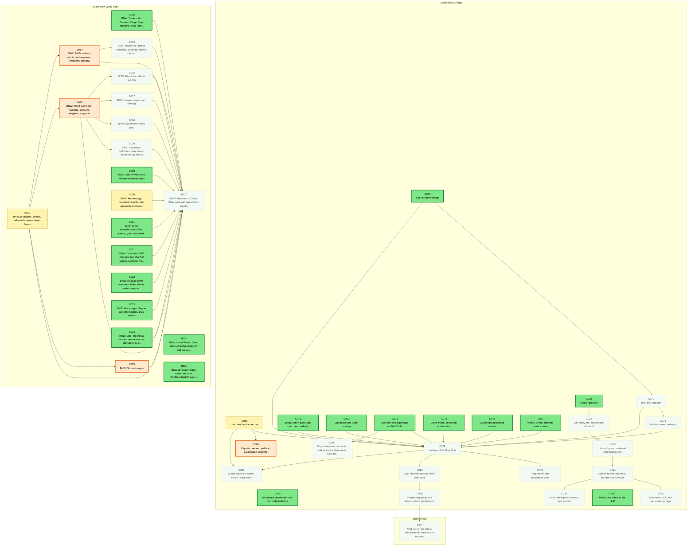
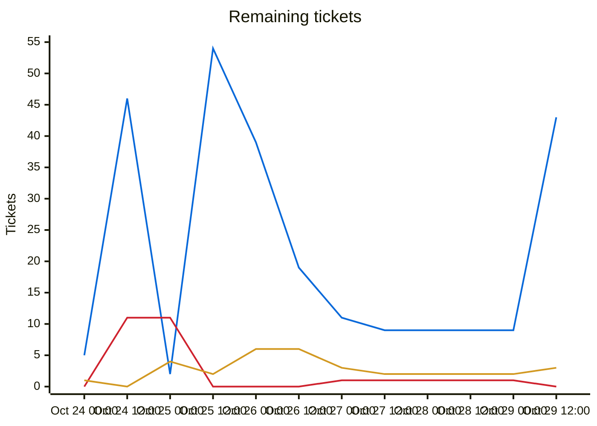
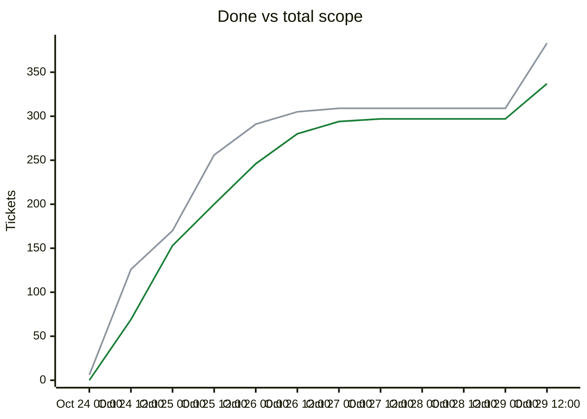

# Migration dependency map

## Delivery phases

Work is completed phase by phase (`phases.txt`; `ticket.py ready`/`next` list earlier phases first; later phases fill idle capacity).

| Phase | Done | Remaining | Ready | In flight | Remaining tickets |
|---|---|---|---|---|---|
| Phase 1: CLI (headless engine) | 228/228 | 0 | 0 | 0 | complete |
| Phase 2: single player (Godot client) | 57/57 | 0 | 0 | 0 | complete |
| Phase 3: multiplayer | 29/29 | 0 | 0 | 0 | complete |
| Phase 4: queued plans (UI redesign, unit models, BNW) | 20/66 | 46 | 19 | 3 | [B006](backlog/B006.md) [B009](backlog/B009.md) [B010](backlog/B010.md) [B011](backlog/B011.md) [B013](backlog/B013.md) [B014](backlog/B014.md) [B015](backlog/B015.md) [B016](backlog/B016.md) [B017](backlog/B017.md) [B018](backlog/B018.md) [B019](backlog/B019.md) [B020](backlog/B020.md) [B021](backlog/B021.md) [B022](backlog/B022.md) [B023](backlog/B023.md) [B024](backlog/B024.md) [B025](backlog/B025.md) [B026](backlog/B026.md) [B028](backlog/B028.md) [B029](backlog/B029.md) [C068](backlog/C068.md) [C069](backlog/C069.md) [C070](backlog/C070.md) [C071](backlog/C071.md) [C072](backlog/C072.md) [C073](backlog/C073.md) [C074](backlog/C074.md) [C075](backlog/C075.md) [C076](backlog/C076.md) [C077](backlog/C077.md) [C078](backlog/C078.md) [C079](backlog/C079.md) [C082](backlog/C082.md) [C083](backlog/C083.md) [C084](backlog/C084.md) [C085](backlog/C085.md) [C086](backlog/C086.md) [C087](backlog/C087.md) [C088](backlog/C088.md) [C089](backlog/C089.md) [C090](backlog/C090.md) [C091](backlog/C091.md) [C092](backlog/C092.md) [C093](backlog/C093.md) [C094](backlog/C094.md) [T247](backlog/T247.md) |

Generated by `tools/ticket.py` on every backlog change; do not edit by hand. Shows every incomplete ticket and the dependencies between them; completed tickets are hidden. An arrow `A --> B` means B depends on A.

| Colour | Meaning |
|---|---|
| bright green, thick border | Ready to start: Available and every dependency is Done |
| orange, thick border | On deck: Available, and every unfinished dependency is already in progress or in review, so it becomes ready when those finish |
| pale green, dotted border | Available but waiting on dependencies that are not started yet |
| yellow | In-Progress |
| blue | Needs-Review / In-Review |
| red | Blocked |

## Remaining tickets over time

Generated from the git history of `backlog/` (times are UTC; each point is the backlog as of that time, the last one the current backlog). Completed tickets (Done, Won't port) are not counted in this chart.

| Line | Meaning |
|---|---|
| blue (#0969da) | New: Available, not started yet |
| red (#cf222e) | Blocked |
| amber (#d29922) | Active: In-Progress, Needs-Review or In-Review |

## Progress and scope over time

| Line | Meaning |
|---|---|
| green (#1a7f37) | Done: Done or Won't port, cumulative |
| grey (#8c959f) | Total scope: every ticket that existed at that time; a rise here is new tickets, not lost progress |

## Incomplete tickets

| Ticket | State | Depends on | Unblocks | Title |
|---|---|---|---|---|
| C069 | **Ready to start** | C066 | 8 | City screen redesign |
| C074 | **Ready to start** | C066 | 7 | Overview and espionage on DataTable |
| C072 | **Ready to start** | C066 | 6 | Setup, nation picker and main menu redesign |
| C073 | **Ready to start** | C066 | 6 | Diplomacy and trade redesign |
| C075 | **Ready to start** | C066, C067 | 6 | Game menu, save/load and options |
| C076 | **Ready to start** | C066 | 6 | Civilopedia and tooltip content |
| C077 | **Ready to start** | C066, C067 | 6 | Victory, defeat and vote result screens |
| C083 | **Ready to start** | C081 | 5 | Unit art pipeline |
| B006 | **Ready to start** | B005 | 1 | BNW: Trade units: Caravan, Cargo Ship, rebasing, build restrictions, exotic goods |
| B009 | **Ready to start** | B008 | 1 | BNW: Culture victory and Victory milestone kinds |
| B011 | **Ready to start** | B007, B008 | 1 | BNW: Great Writer/Musician/Artist actions, guild specialists, GP faith purchase |
| B021 | **Ready to start** | B005, B004 | 1 | BNW: City-state BNW changes, Merchant of Venice purchase, Venice restrictions |
| B022 | **Ready to start** | B005, B004 | 1 | BNW: Religion BNW constants, belief effects, trade-route pressure |
| B023 | **Ready to start** | B004 | 1 | BNW: Warmonger, Sapper and other military data effects |
| B024 | **Ready to start** | B002 | 1 | BNW: Map: Indonesia luxuries, new resources, start along ocean |
| B028 | **Ready to start** | B007 | 0 | BNW: Great Works: Great Writer/Artist/Musician XP and per-work yields |
| B029 | **Ready to start** | B005 | 0 | BNW generator: trade-route data fixes (CityStateTradeChange /100, era food/production bonuses) |
| C082 | **Ready to start** | C081 | 0 | Articulated placeholder unit with code-built clips |
| C087 | **Ready to start** | C067, T181 | 0 | Rival stats ribbon in the HUD |
| B015 | **On deck** (after B013) | B003, B013 | 5 | BNW: World Congress: founding, sessions, delegates, proposals, voting |
| B014 | **On deck** (after B013) | B013, B008 | 2 | BNW: Public opinion, opinion unhappiness, switching, anarchy |
| B025 | **On deck** (after B013) | B007, B013 | 1 | BNW: Score changes |
| C088 | **On deck** (after C068) | C068 | 0 | City-site preview: yields at a candidate settle tile |
| B013 | In-Progress [Claude] | B012 | 9 | BNW: Ideologies: unlock, adopter bonuses, tenet levels |
| C068 | In-Progress [Claude] | C066, C067 | 7 | Unit panel and action bar |
| C070 | Available (waiting on C069) | C066, C069 | 7 | Tech tree redesign |
| C071 | Available (waiting on C070) | C066, C070 | 6 | Policies screen redesign |
| C078 | Available (waiting on C068, C069, C070, C071, C072, C073, C074, C075, C076, C077) | C067, C068, C069, C070, C071, C072, C073, C074, C075, C076, C077 | 5 | Hotkeys v2 and key hints |
| C084 | Available (waiting on C083) | C083 | 4 | Unit art by era: ancient and classical |
| C093 | Available (waiting on C084) | C084 | 3 | Unit art by era: medieval and renaissance |
| C089 | Available (waiting on C078) | C067, C078 | 2 | Map markers: private client-side tacks |
| C094 | Available (waiting on C093) | C093 | 2 | Unit art by era: industrial, modern and naval/air |
| B010 | In-Progress [Claude] | B007 | 1 | BNW: Archaeology: historical records, site spawning, Archaeologist, dig choices, Landmark |
| B016 | Available (waiting on B015) | B015 | 1 | BNW: Resolution effects (all 18) |
| B017 | Available (waiting on B015) | B015 | 1 | BNW: League projects and rewards |
| B018 | Available (waiting on B015) | B015 | 1 | BNW: Diplomatic victory (UN) |
| B019 | Available (waiting on B014) | B014 | 1 | BNW: happiness: graded penalties, uprisings, rebels, city revolt |
| B020 | Available (waiting on B015) | B008, B015 | 1 | BNW: Espionage: diplomats, coup levels, influence spy bonus |
| C090 | Available (waiting on C089) | C089, T181, T244, C045 | 1 | Shared map pings and team markers (multiplayer) |
| B026 | Available (waiting on B006, B009, B010, B011, B013, B014, B015, B016, B017, B018, B019, B020, B021, B022, B023, B024, B025) | B001, B002, B003, B004, B005, B006, B007, B008, B009, B010, B011, B012, B013, B014, B015, B016, B017, B018, B019, B020, B021, B022, B023, B024, B025 | 0 | BNW: Headless 300-turn BNW soak with replay/save equality |
| C079 | Available (waiting on C078) | C078 | 0 | Responsive and localization pass |
| C085 | Available (waiting on C094) | C094 | 0 | Unit model LOD and performance caps |
| C086 | Available (waiting on C094) | C094 | 0 | Unit combat polish: effects and sounds |
| C091 | Available (waiting on C068, C078) | C068, C078 | 0 | Group move and escort macro (client-side) |
| C092 | Available (waiting on C074) | C074 | 0 | City management at scale: bulk actions and reusable build queues |
| T247 | Available (waiting on C090) | T170, T181, C035, T244, C090 | 0 | Mod sync in the lobby: checksum diff, transfer and hot-load |
