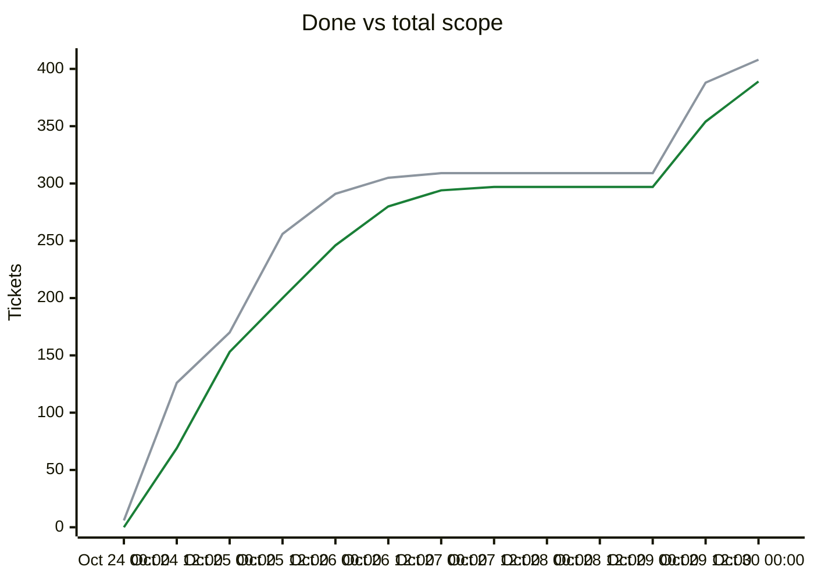

# Migration dependency map

<!-- toc -->
## Contents

- [Delivery phases](#delivery-phases)
- [Remaining tickets over time](#remaining-tickets-over-time)
- [Progress and scope over time](#progress-and-scope-over-time)
- [Incomplete tickets](#incomplete-tickets)
<!-- /toc -->

## Delivery phases

Work is completed phase by phase (`phases.txt`; `ticket.py ready`/`next` list earlier phases first; later phases fill idle capacity).

| Phase | Done | Remaining | Ready | In flight | Remaining tickets |
|---|---|---|---|---|---|
| Phase 1: CLI (headless engine) | 231/231 | 0 | 0 | 0 | complete |
| Phase 2: single player (Godot client) | 57/57 | 0 | 0 | 0 | complete |
| Phase 3: multiplayer | 29/29 | 0 | 0 | 0 | complete |
| Phase 4: queued plans (UI redesign, unit models, BNW) | 69/73 | 4 | 1 | 3 | [C079](backlog/C079.md) [C082](backlog/C082.md) [C091](backlog/C091.md) [T247](backlog/T247.md) |
| Phase 5: owner issue backlog (Android, performance, ultra graphics, dedicated server, resiliency) | 0/15 | 15 | 0 | 0 | [C096](backlog/C096.md) [C097](backlog/C097.md) [T258](backlog/T258.md) [T259](backlog/T259.md) [T260](backlog/T260.md) [T261](backlog/T261.md) [T262](backlog/T262.md) [T263](backlog/T263.md) [T264](backlog/T264.md) [T265](backlog/T265.md) [T266](backlog/T266.md) [T267](backlog/T267.md) [T268](backlog/T268.md) [T269](backlog/T269.md) [T270](backlog/T270.md) |

Generated by `tools/ticket.py` on every backlog change; do not edit by hand. Shows every incomplete ticket and the dependencies between them; completed tickets are hidden. An arrow `A --> B` means B depends on A.

| Colour | Meaning |
|---|---|
| bright green, thick border | Ready to start: Available and every dependency is Done |
| orange, thick border | On deck: Available, and every unfinished dependency is already in progress or in review, so it becomes ready when those finish |
| pale green, dotted border | Available but waiting on dependencies that are not started yet |
| yellow | In-Progress |
| blue | Needs-Review / In-Review |
| red | Blocked |

```mermaid
flowchart TD
  subgraph TTRACK["Engine track"]
    T247["T247<br/>Mod sync in the lobby: checksum diff, transfer and hot-load"]
    T258["T258<br/>Windows and macOS client release builds (packaged, smoke-tes..."]
    T259["T259<br/>Android client spike: Godot .NET Android export feasibility,..."]
    T260["T260<br/>Android APK build: export preset, debug-signed APK in CI, sm..."]
    T261["T261<br/>Turn-time profiling harness and baseline: where end-turn tim..."]
    T262["T262<br/>Optimise the top turn-time hotspots with proof of identical ..."]
    T263["T263<br/>Parallelism spike: which turn work can run in parallel witho..."]
    T264["T264<br/>Ultra graphics spike: what 'ray tracing / AAA shaders' can m..."]
    T265["T265<br/>Dedicated server executable A: Unciv.Server command line, lo..."]
    T266["T266<br/>Dedicated server distribution: self-contained Linux and Wind..."]
    T267["T267<br/>AI takeover of a departed player only at the end of the turn..."]
    T268["T268<br/>Host migration spike: automatic successor host when the host..."]
    T269["T269<br/>Automatic host migration: standby state replication, success..."]
    T270["T270<br/>Dedicated server executable B: graceful shutdown, persistenc..."]
  end
  subgraph CTRACK["Client track (Godot)"]
    C079["C079<br/>Responsive and localization pass"]
    C082["C082<br/>Articulated placeholder unit with code-built clips"]
    C091["C091<br/>Group move and escort macro (client-side)"]
    C096["C096<br/>Touch and small-screen client UI: gestures, hit targets, lay..."]
    C097["C097<br/>Graphics quality setting with an Ultra preset (effects chose..."]
  end
  T259 --> T260
  T261 --> T262
  T261 --> T263
  T270 --> T266
  T268 --> T269
  T267 --> T269
  T265 --> T270
  T259 --> C096
  T264 --> C097
  classDef waiting fill:#f3faf3,stroke:#9bc49b,color:#555,stroke-dasharray:2 2
  classDef ondeck fill:#ffe8cc,stroke:#e8590c,stroke-width:3px,color:#000
  classDef ready fill:#7ee787,stroke:#1a7f37,stroke-width:3px,color:#000
  classDef prog fill:#fff3b0,stroke:#b58900,color:#000
  classDef review fill:#cfe4ff,stroke:#1f6feb,color:#000
  classDef blocked fill:#ffd6d6,stroke:#c62828,color:#000
  classDef done fill:#eeeeee,stroke:#999999,color:#666,stroke-dasharray:4 3
  class C079 prog
  class C082 ready
  class C091 prog
  class C096 waiting
  class C097 waiting
  class T247 prog
  class T258 waiting
  class T259 waiting
  class T260 waiting
  class T261 waiting
  class T262 waiting
  class T263 waiting
  class T264 waiting
  class T265 waiting
  class T266 waiting
  class T267 waiting
  class T268 waiting
  class T269 waiting
  class T270 waiting
```

## Remaining tickets over time

Generated from the git history of `backlog/` (times are UTC; each point is the backlog as of that time, the last one the current backlog). Completed tickets (Done, Won't port) are not counted in this chart.

| Line | Meaning |
|---|---|
| blue (#0969da) | New: Available, not started yet |
| red (#cf222e) | Blocked |
| amber (#d29922) | Active: In-Progress, Needs-Review or In-Review |

## Progress and scope over time

| Line | Meaning |
|---|---|
| green (#1a7f37) | Done: Done or Won't port, cumulative |
| grey (#8c959f) | Total scope: every ticket that existed at that time; a rise here is new tickets, not lost progress |

## Incomplete tickets

| Ticket | State | Depends on | Unblocks | Title |
|---|---|---|---|---|
| C082 | **Ready to start** | C081 | 0 | Articulated placeholder unit with code-built clips |
| T259 | Available (waiting on ) | C042, T169, T249 | 2 | Android client spike: Godot .NET Android export feasibility, device requirements and the touch-UI gap list |
| T261 | Available (waiting on ) | T227, T178, T208, B026 | 2 | Turn-time profiling harness and baseline: where end-turn time goes (AI per civ, per phase, host delta build) |
| T265 | Available (waiting on ) | T178, T179, T204, T205 | 2 | Dedicated server executable A: Unciv.Server command line, lobby and game hosting over TCP+TLS |
| T264 | Available (waiting on ) | C002, C043 | 1 | Ultra graphics spike: what 'ray tracing / AAA shaders' can mean in Godot for this client, cost and fallbacks |
| T267 | Available (waiting on ) | T177, T202, T178, T180, T226 | 1 | AI takeover of a departed player only at the end of the turn (never mid-turn) |
| T268 | Available (waiting on ) | T178, T180, T176, T230, T173, T182, T179, T205 | 1 | Host migration spike: automatic successor host when the host leaves (design with acceptance criteria) |
| T270 | Available (waiting on T265) | T265, T176, T254 | 1 | Dedicated server executable B: graceful shutdown, persistence and resume, exit codes, subprocess test |
| C079 | In-Progress [Claude-C079] | C078 | 0 | Responsive and localization pass |
| C091 | In-Progress [Claude-C091] | C068, C078 | 0 | Group move and escort macro (client-side) |
| C096 | Available (waiting on T259) | T259, C043 | 0 | Touch and small-screen client UI: gestures, hit targets, layout for phone and tablet |
| C097 | Available (waiting on T264) | T264, C043, C002 | 0 | Graphics quality setting with an Ultra preset (effects chosen by the ultra graphics spike) |
| T247 | In-Progress [Claude-T247] | T170, T181, C035, T244, C090 | 0 | Mod sync in the lobby: checksum diff, transfer and hot-load |
| T258 | Available (waiting on ) | C042, T169 | 0 | Windows and macOS client release builds (packaged, smoke-tested, released) |
| T260 | Available (waiting on T259) | T259 | 0 | Android APK build: export preset, debug-signed APK in CI, smoke on an emulator or device |
| T262 | Available (waiting on T261) | T261 | 0 | Optimise the top turn-time hotspots with proof of identical game state |
| T263 | Available (waiting on T261) | T261 | 0 | Parallelism spike: which turn work can run in parallel without breaking determinism (go/no-go) |
| T266 | Available (waiting on T270) | T270 | 0 | Dedicated server distribution: self-contained Linux and Windows builds in releases and CI, run guide |
| T269 | Available (waiting on T268, T267) | T268, T267, T179, T205 | 0 | Automatic host migration: standby state replication, successor election and client redirect (as designed by the spike) |
