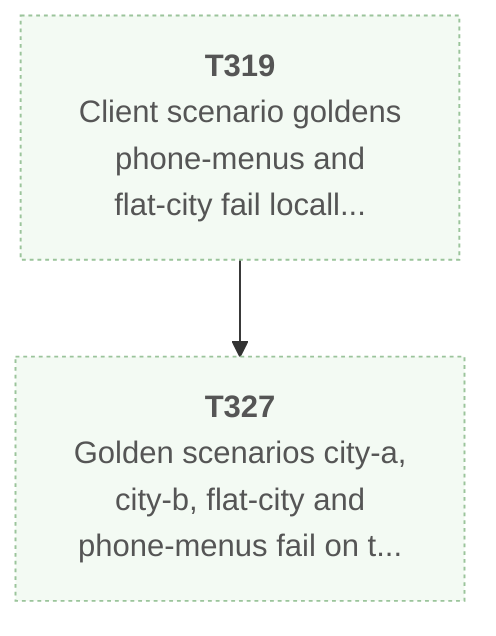
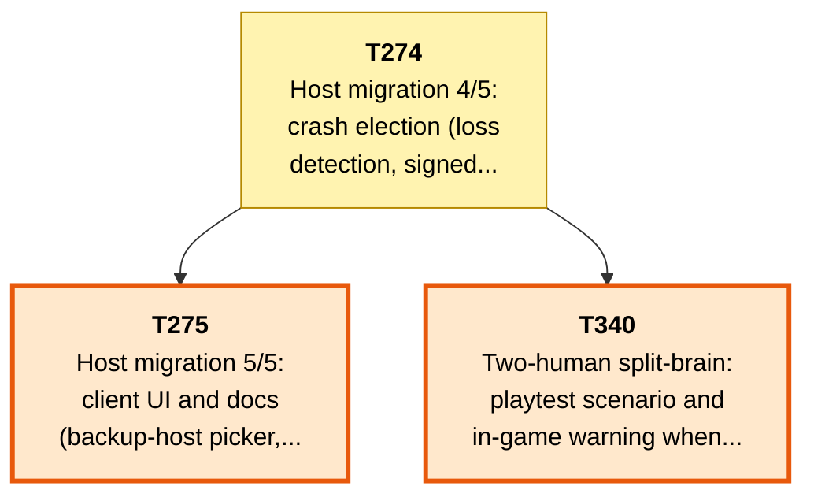
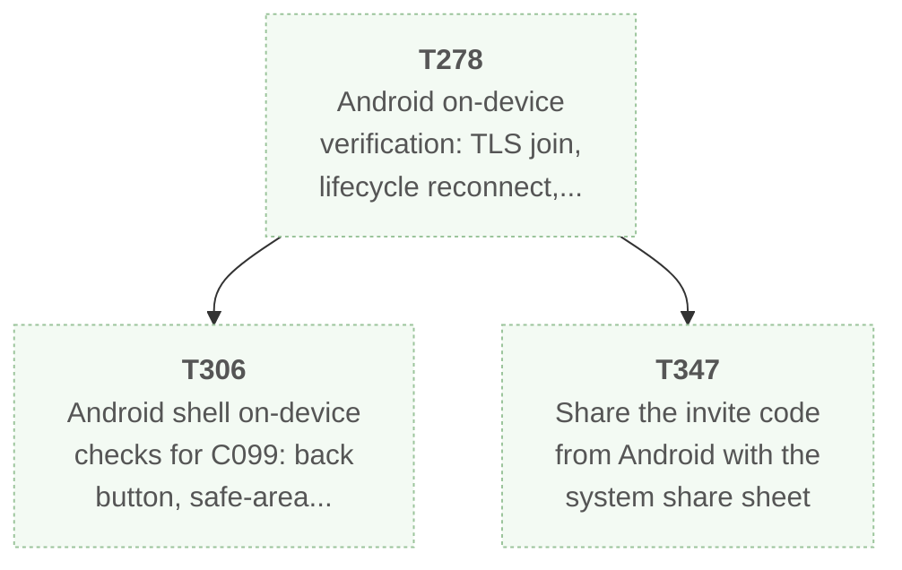
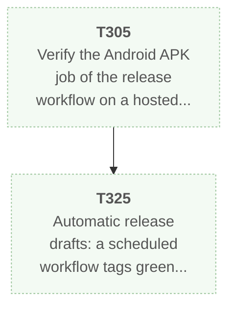
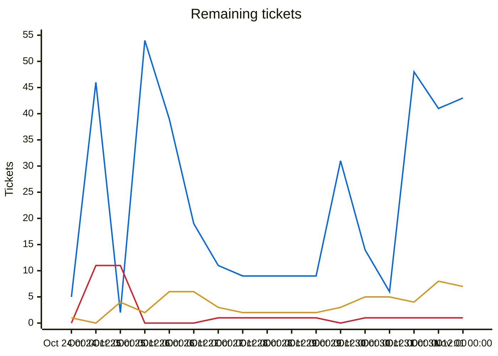
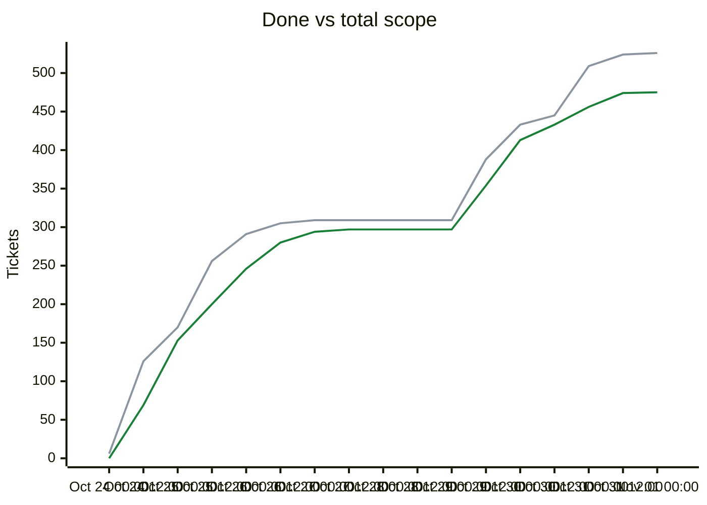

# Migration dependency map

<!-- toc -->
## Contents

- [Delivery phases](#delivery-phases)
- [Ready and on deck](#ready-and-on-deck)
- [Dependency diagrams](#dependency-diagrams)
  - [Group of T319: 2 tickets (phase 4, 5)](#group-of-t319-2-tickets-phase-4-5)
  - [Group of T274: 3 tickets (phase 5)](#group-of-t274-3-tickets-phase-5)
  - [Group of T278: 3 tickets (phase 5)](#group-of-t278-3-tickets-phase-5)
  - [Group of T305: 2 tickets (phase 5)](#group-of-t305-2-tickets-phase-5)
- [Remaining tickets over time](#remaining-tickets-over-time)
- [Progress and scope over time](#progress-and-scope-over-time)
- [Incomplete tickets](#incomplete-tickets)
<!-- /toc -->

## Delivery phases

Work is completed phase by phase (`phases.txt`; `ticket.py ready`/`next` list earlier phases first; later phases fill idle capacity).

| Phase | Done | Remaining | Ready | In flight | Remaining tickets |
|---|---|---|---|---|---|
| Phase 1: CLI (headless engine) | 231/231 | 0 | 0 | 0 | complete |
| Phase 2: single player (Godot client) | 57/58 | 1 | 0 | 0 | [T375](backlog/T375.md) |
| Phase 3: multiplayer | 55/64 | 9 | 6 | 3 | [T355](backlog/T355.md) [T356](backlog/T356.md) [T357](backlog/T357.md) [T361](backlog/T361.md) [T372](backlog/T372.md) [T381](backlog/T381.md) [T384](backlog/T384.md) [T385](backlog/T385.md) [T386](backlog/T386.md) |
| Phase 4: queued plans (UI redesign, unit models, BNW) | 75/82 | 7 | 0 | 0 | [T317](backlog/T317.md) [T318](backlog/T318.md) [T321](backlog/T321.md) [T326](backlog/T326.md) [T327](backlog/T327.md) [T328](backlog/T328.md) [T329](backlog/T329.md) |
| Phase 5: owner issue backlog (Android, performance, ultra graphics, dedicated server, resiliency) | 53/87 | 34 | 0 | 4 | [T274](backlog/T274.md) [T275](backlog/T275.md) [T278](backlog/T278.md) [T290](backlog/T290.md) [T300](backlog/T300.md) [T301](backlog/T301.md) [T303](backlog/T303.md) [T305](backlog/T305.md) [T306](backlog/T306.md) [T313](backlog/T313.md) [T314](backlog/T314.md) [T319](backlog/T319.md) [T325](backlog/T325.md) [T330](backlog/T330.md) [T331](backlog/T331.md) [T332](backlog/T332.md) [T333](backlog/T333.md) [T335](backlog/T335.md) [T340](backlog/T340.md) [T341](backlog/T341.md) [T342](backlog/T342.md) [T343](backlog/T343.md) [T344](backlog/T344.md) [T345](backlog/T345.md) [T346](backlog/T346.md) [T347](backlog/T347.md) [T348](backlog/T348.md) [T349](backlog/T349.md) [T350](backlog/T350.md) [T351](backlog/T351.md) [T352](backlog/T352.md) [T353](backlog/T353.md) [T362](backlog/T362.md) [T363](backlog/T363.md) |

Generated by `tools/ticket.py` on every backlog change; do not edit by hand. Lists every incomplete ticket; completed tickets are hidden. The diagrams show only tickets that are linked by an open dependency, one small diagram per linked group; an arrow `A --> B` means B depends on A. The tables list everything, including unlinked tickets.

| Colour | Meaning |
|---|---|
| bright green, thick border | Ready to start: Available and every dependency is Done |
| orange, thick border | On deck: Available, and every unfinished dependency is already in progress or in review, so it becomes ready when those finish |
| pale green, dotted border | Available but waiting on dependencies that are not started yet |
| yellow | In-Progress |
| blue | Needs-Review / In-Review |
| red | Blocked |

## Ready and on deck

| Ticket | Status | Unblocks | Title |
|---|---|---|---|
| T355 | **Ready to start** | 0 | Verify nested TLS and the relay path on Windows, macOS and Android (manual, UNVERIFIED until run) |
| T356 | **Ready to start** | 0 | Deploy the relay on the owner's server: concrete nginx config, manual connectivity matrix, result recorded |
| T357 | **Ready to start** | 0 | WebSocket gateway so the web export can join and host through the relay (optional) |
| T361 | **Ready to start** | 0 | Godot package.sh / run-scenario.sh / run-smoke.sh dotnet calls: apply the T360 memory settings |
| T385 | **Ready to start** | 0 | Remove or fold the always-visible 'Saves' button (bottom-right of the game screen) into the in-game menu |
| T386 | **Ready to start** | 0 | Remove dead entry points and dev leftovers: QuickStart/Main scenes, UNCIV_MENU_READY marker, dev-facing text; decide on the Developer Console |
| T275 | On deck (after T274) | 0 | Host migration 5/5: client UI and docs (backup-host picker, trust notice, standby status, rollback and host-changed notices, superseded-host screen) |
| T340 | On deck (after T274) | 0 | Two-human split-brain: playtest scenario and in-game warning when a partition could give each machine a host |

## Dependency diagrams

### Group of T319: 2 tickets (phase 4, 5)

### Group of T274: 3 tickets (phase 5)

### Group of T278: 3 tickets (phase 5)

### Group of T305: 2 tickets (phase 5)

Unlinked tickets (no open dependency in either direction), by state:

- ready: T355 T356 T357 T361 T385 T386
- in progress: T300 T301 T303 T384
- in review: T372 T381
- blocked: T290
- waiting: T313 T314 T317 T318 T321 T326 T328 T329 T330 T331 T332 T333 T335 T341 T342 T343 T344 T345 T346 T348 T349 T350 T351 T352 T353 T362 T363 T375

## Remaining tickets over time

Generated from the git history of `backlog/` (times are UTC; each point is the backlog as of that time, the last one the current backlog). Completed tickets (Done, Won't port) are not counted in this chart.

| Line | Meaning |
|---|---|
| blue (#0969da) | New: Available, not started yet |
| red (#cf222e) | Blocked |
| amber (#d29922) | Active: In-Progress, Needs-Review or In-Review |

## Progress and scope over time

| Line | Meaning |
|---|---|
| green (#1a7f37) | Done: Done or Won't port, cumulative |
| grey (#8c959f) | Total scope: every ticket that existed at that time; a rise here is new tickets, not lost progress |

## Incomplete tickets

| Ticket | State | Depends on | Unblocks | Title |
|---|---|---|---|---|
| T355 | **Ready to start** | T338 | 0 | Verify nested TLS and the relay path on Windows, macOS and Android (manual, UNVERIFIED until run) |
| T356 | **Ready to start** | T337, T338, T339 | 0 | Deploy the relay on the owner's server: concrete nginx config, manual connectivity matrix, result recorded |
| T357 | **Ready to start** | T337, T338 | 0 | WebSocket gateway so the web export can join and host through the relay (optional) |
| T361 | **Ready to start** | T360 | 0 | Godot package.sh / run-scenario.sh / run-smoke.sh dotnet calls: apply the T360 memory settings |
| T385 | **Ready to start** | none | 0 | Remove or fold the always-visible 'Saves' button (bottom-right of the game screen) into the in-game menu |
| T386 | **Ready to start** | none | 0 | Remove dead entry points and dev leftovers: QuickStart/Main scenes, UNCIV_MENU_READY marker, dev-facing text; decide on the Developer Console |
| T275 | **On deck** (after T274) | T274, C034, C035 | 0 | Host migration 5/5: client UI and docs (backup-host picker, trust notice, standby status, rollback and host-changed notices, superseded-host screen) |
| T340 | **On deck** (after T274) | T274 | 0 | Two-human split-brain: playtest scenario and in-game warning when a partition could give each machine a host |
| T274 | In-Progress [Claude-T274] | T273 | 2 | Host migration 4/5: crash election (loss detection, signed HostLossVote quorum, split-brain refusal, superseded-host mode, forced take-over, kill-the-host scenarios) |
| T278 | Available (waiting on ) | T260, T276 | 2 | Android on-device verification: TLS join, lifecycle reconnect, frame time and APK size on a mid-range phone |
| T305 | Available (waiting on ) | T280 | 1 | Verify the Android APK job of the release workflow on a hosted runner (first tag push) |
| T319 | Available (waiting on ) | none | 1 | Client scenario goldens phone-menus and flat-city fail locally at the base commit: find out whether stale or machine-dependent, then fix |
| T290 | Blocked | T271 | 0 | Real-device frame-time pass: Windows, macOS, Android phone |
| T300 | In-Progress [Claude] | none | 0 | Replace text-letter placeholder icons (resource chips etc.) with real pictorial icons |
| T301 | In-Progress [Claude] | none | 0 | Maximizing a windowed game freaks out and may crash |
| T303 | In-Progress [Claude] | T298 | 0 | Persist last-known tile ownership for fogged tiles across reconnect and load (server-side per-civ memory) |
| T306 | Available (waiting on T278) | C099, T278 | 0 | Android shell on-device checks for C099: back button, safe-area insets, orientation, lifecycle autosave, keyboard scroll, permissions |
| T313 | Available (waiting on ) | T311 | 0 | Verify OS display scale detection on Windows, macOS and X11 and follow a window moved between monitors (T311 follow-up) |
| T314 | Available (waiting on ) | none | 0 | Flaky tests: NetLobbyTests.ServerLobby_TwoRapidSameKeyReconnects... and server/CLI bench tests fail once under full-gate load, pass alone |
| T317 | Available (waiting on ) | T312 | 0 | Extend the layout matrix: alerts and popups, city Production tab, game over/victory/hotseat/vote screens, 640x360 minimum window, an automatic wasted-space check |
| T318 | Available (waiting on ) | T312 | 0 | Host, Join and Lobby screens on the ScreenFrame look: titled header, scaled controls, content width, consistent with New game and Options |
| T321 | Available (waiting on ) | T316 | 0 | Menu screens not covered by the T316 live-resize scenario: Saves dialog, popups other than the leave modal, in-game menus rebuilt on breakpoint change (SaveController compact flag is read once) |
| T325 | Available (waiting on T305) | T279, T280, T305 | 0 | Automatic release drafts: a scheduled workflow tags green csharp-migration when it has new Done work and creates a DRAFT GitHub release with generated notes; the owner publishes by hand |
| T326 | Available (waiting on ) | T323 | 0 | TooltipHost text width is re-measured on a live resize only while a tip is visible |
| T327 | Available (waiting on T319) | T323, T319 | 0 | Golden scenarios city-a, city-b, flat-city and phone-menus fail on the dev machine at the unmodified base (renderer differences) |
| T328 | Available (waiting on ) | T323 | 0 | Modal owners that use the width Fit() returns keep a stale body wrap width after a live resize (DecisionPickerView, VictoryStatusView, GameOverScreen, GameMenuView, VoteResultScreen) |
| T329 | Available (waiting on ) | T323 | 0 | Layout-matrix resize phase covers only menu screens: HUD, city and tech (and their shared widgets) are not resized live |
| T330 | Available (waiting on ) | none | 0 | GitHub Actions does not run for csharp-migration or csharp-v tags: diagnose (account, billing, rename to Kenmura/UncivSharp, settings), restore CI, then re-run the tag workflow |
| T331 | Available (waiting on ) | T279, T280 | 0 | Local release fallback: release.py --github-draft builds all four clients plus CLI and server archives from a tag and creates the draft release without GitHub Actions; notes flag --local |
| T332 | Available (waiting on ) | none | 0 | Verify Windows and macOS CLI and the Windows dedicated server on real systems, then drop the UNVERIFIED marks from the release notes |
| T333 | Available (waiting on ) | T322 | 0 | Full-width pages keep rows readable on 3840x2160: ScreenFrame MaxContentWidth is ~the whole 4K window, New game player rows put Human/AI 1500 px from the nation name; Host, Join, Lobby, Saves, Civilopedia at 4K not inspected for label/control gaps |
| T335 | Available (waiting on ) | T322 | 0 | Layout matrix screenshots only the Options Display tab: capture every Options tab (Keys, Advanced, Sound...) and open them at five sizes |
| T341 | Available (waiting on ) | none | 0 | Recurring soaks: mods and other rulesets, save-then-reload determinism at many points in a 300-turn game |
| T342 | Available (waiting on ) | T297 | 0 | Incremental host view diff: build per-recipient views from changes instead of full rebuilds (late-game turns with several humans) |
| T343 | Available (waiting on ) | none | 0 | Confirm dialog for destructive actions: disband unit, declare war, raze city (no undo) |
| T344 | Available (waiting on ) | none | 0 | Tooltips on every on-screen number (audit and fill gaps) |
| T345 | Available (waiting on ) | none | 0 | Progress overlay and cancel hint during long AI turns |
| T346 | Available (waiting on ) | none | 0 | Reconnect experience: connection status, rejoin button, visible 'waiting for player X' during simultaneous turns |
| T347 | Available (waiting on T278) | T278 | 0 | Share the invite code from Android with the system share sheet |
| T348 | Available (waiting on ) | none | 0 | Lobby comforts: chat, kick and ban, rejoin by name |
| T349 | Available (waiting on ) | none | 0 | Per-unit GetViewableTiles cache keyed on position, range and a terrain revision counter |
| T350 | Available (waiting on ) | none | 0 | Bench --repeat N reporting the median of several runs |
| T351 | Available (waiting on ) | T261 | 0 | Call-level profiling inside AI unit moves (AutomateUnitMoves) and the spike turns |
| T352 | Available (waiting on ) | none | 0 | Accessibility: colourblind-safe team colours and unit/tile cues, font size scaling, keyboard-only play |
| T353 | Available (waiting on ) | none | 0 | Sound and music: effects and a soundtrack from CC0 or original sources (no Civ 5 audio) |
| T362 | Available (waiting on ) | T334 | 0 | Two real client processes host and join on the real GPU (manual two-profile smoke) |
| T363 | Available (waiting on ) | none | 0 | QuickStart and harness scenario games still start on Vanilla/Gods & Kings: move them to BNW and regenerate goldens |
| T372 | Needs-Review [Claude] | T338 | 0 | Harness scenario: host and joiner through a local Unciv.Relay (Godot harness) |
| T375 | Available (waiting on ) | none | 0 | Re-record stale phone-menus goldens (main-menu, new-game, host, lobby, options, modal differ from the committed images at base) |
| T381 | Needs-Review [Claude] | none | 0 | Refresh stale harness goldens setup, options, phone-menus, proposals (mismatch master independent of borders) |
| T384 | In-Progress [Claude] | none | 0 | Unit legibility pass 3: mounted units, halo on thin weapons, rim width per figure scale, unrelated layout-matrix timeout |
