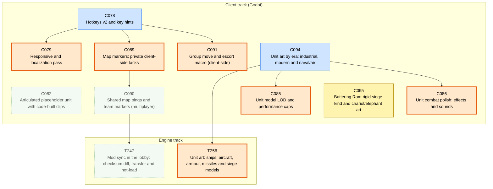
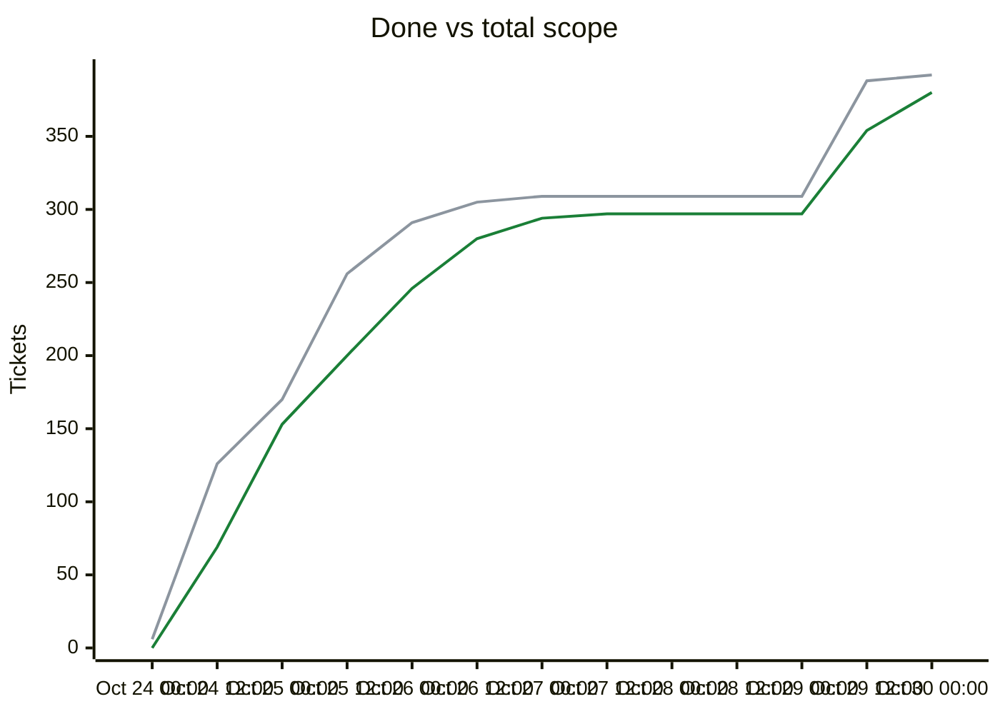

# Migration dependency map

## Delivery phases

Work is completed phase by phase (`phases.txt`; `ticket.py ready`/`next` list earlier phases first; later phases fill idle capacity).

| Phase | Done | Remaining | Ready | In flight | Remaining tickets |
|---|---|---|---|---|---|
| Phase 1: CLI (headless engine) | 229/230 | 1 | 0 | 0 | [T256](backlog/T256.md) |
| Phase 2: single player (Godot client) | 57/57 | 0 | 0 | 0 | complete |
| Phase 3: multiplayer | 29/29 | 0 | 0 | 0 | complete |
| Phase 4: queued plans (UI redesign, unit models, BNW) | 62/73 | 11 | 0 | 3 | [C078](backlog/C078.md) [C079](backlog/C079.md) [C082](backlog/C082.md) [C085](backlog/C085.md) [C086](backlog/C086.md) [C089](backlog/C089.md) [C090](backlog/C090.md) [C091](backlog/C091.md) [C094](backlog/C094.md) [C095](backlog/C095.md) [T247](backlog/T247.md) |

Generated by `tools/ticket.py` on every backlog change; do not edit by hand. Shows every incomplete ticket and the dependencies between them; completed tickets are hidden. An arrow `A --> B` means B depends on A.

| Colour | Meaning |
|---|---|
| bright green, thick border | Ready to start: Available and every dependency is Done |
| orange, thick border | On deck: Available, and every unfinished dependency is already in progress or in review, so it becomes ready when those finish |
| pale green, dotted border | Available but waiting on dependencies that are not started yet |
| yellow | In-Progress |
| blue | Needs-Review / In-Review |
| red | Blocked |

## Remaining tickets over time

Generated from the git history of `backlog/` (times are UTC; each point is the backlog as of that time, the last one the current backlog). Completed tickets (Done, Won't port) are not counted in this chart.

| Line | Meaning |
|---|---|
| blue (#0969da) | New: Available, not started yet |
| red (#cf222e) | Blocked |
| amber (#d29922) | Active: In-Progress, Needs-Review or In-Review |

## Progress and scope over time

| Line | Meaning |
|---|---|
| green (#1a7f37) | Done: Done or Won't port, cumulative |
| grey (#8c959f) | Total scope: every ticket that existed at that time; a rise here is new tickets, not lost progress |

## Incomplete tickets

| Ticket | State | Depends on | Unblocks | Title |
|---|---|---|---|---|
| C089 | **On deck** (after C078) | C067, C078 | 2 | Map markers: private client-side tacks |
| C079 | **On deck** (after C078) | C078 | 0 | Responsive and localization pass |
| C085 | **On deck** (after C094) | C094 | 0 | Unit model LOD and performance caps |
| C086 | **On deck** (after C094) | C094 | 0 | Unit combat polish: effects and sounds |
| C091 | **On deck** (after C078) | C068, C078 | 0 | Group move and escort macro (client-side) |
| T256 | **On deck** (after C094) | C094 | 0 | Unit art: ships, aircraft, armour, missiles and siege models |
| C078 | Needs-Review [Claude] | C067, C068, C069, C070, C071, C072, C073, C074, C075, C076, C077 | 5 | Hotkeys v2 and key hints |
| C094 | Needs-Review [Claude-C094] | C093 | 3 | Unit art by era: industrial, modern and naval/air |
| C090 | Available (waiting on C089) | C089, T181, T244, C045 | 1 | Shared map pings and team markers (multiplayer) |
| C082 | Available (waiting on ) | C081 | 0 | Articulated placeholder unit with code-built clips |
| C095 | In-Progress [Claude-C095] | C084 | 0 | Battering Ram rigid siege kind and chariot/elephant art |
| T247 | Available (waiting on C090) | T170, T181, C035, T244, C090 | 0 | Mod sync in the lobby: checksum diff, transfer and hot-load |
