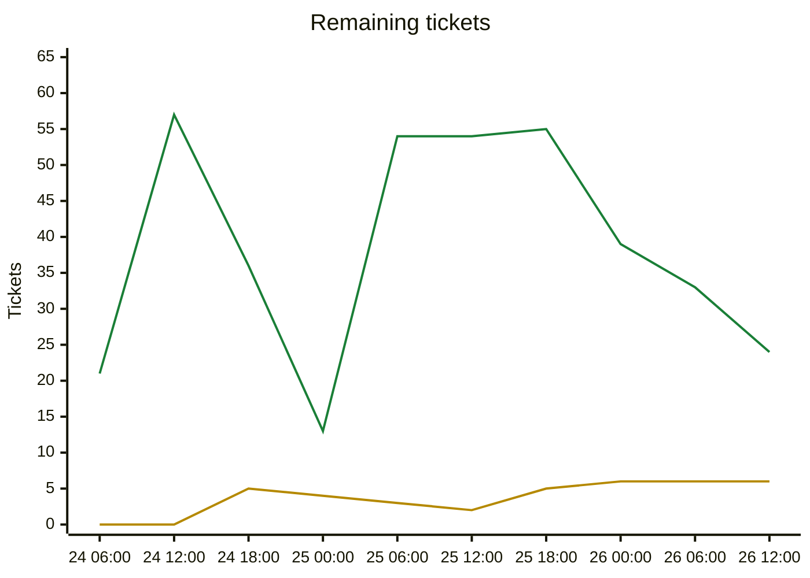

# Migration dependency map

## Delivery phases

Work is completed phase by phase (`phases.txt`; `ticket.py ready`/`next` list earlier phases first; later phases fill idle capacity).

| Phase | Done | Remaining | Ready | In flight | Remaining tickets |
|---|---|---|---|---|---|
| Phase 1: CLI (headless engine) | 215/215 | 0 | 0 | 0 | complete |
| Phase 2: single player (Godot client) | 48/55 | 7 | 1 | 6 | [C029](backlog/C029.md) [C051](backlog/C051.md) [C053](backlog/C053.md) [C054](backlog/C054.md) [C057](backlog/C057.md) [C058](backlog/C058.md) [T169](backlog/T169.md) |
| Phase 3: multiplayer | 6/29 | 23 | 6 | 0 | [C006](backlog/C006.md) [C034](backlog/C034.md) [C035](backlog/C035.md) [C036](backlog/C036.md) [C045](backlog/C045.md) [T176](backlog/T176.md) [T177](backlog/T177.md) [T178](backlog/T178.md) [T179](backlog/T179.md) [T180](backlog/T180.md) [T182](backlog/T182.md) [T201](backlog/T201.md) [T202](backlog/T202.md) [T203](backlog/T203.md) [T204](backlog/T204.md) [T205](backlog/T205.md) [T206](backlog/T206.md) [T207](backlog/T207.md) [T223](backlog/T223.md) [T224](backlog/T224.md) [T225](backlog/T225.md) [T226](backlog/T226.md) [T230](backlog/T230.md) |

Generated by `tools/ticket.py` on every backlog change; do not edit by hand. Shows every incomplete ticket. A ticket that still has an incomplete dependency also shows all its direct dependencies (completed ones are grey and dashed); once every dependency is Done, they are hidden. An arrow `A --> B` means B depends on A.

| Colour | Meaning |
|---|---|
| bright green, thick border | Ready to start: Available and every dependency is Done |
| orange, thick border | On deck: Available, and every unfinished dependency is already in progress or in review, so it becomes ready when those finish |
| pale green, dotted border | Available but waiting on dependencies that are not started yet |
| yellow | In-Progress |
| blue | Needs-Review / In-Review |
| red | Blocked |
| grey dashed | Done (shown as a direct dependency only) |

```mermaid
flowchart TD
  subgraph TTRACK["Engine track"]
    T012["T012<br/>Command layer design"]
    T164["T164<br/>Command infrastructure over GameInfo: GameCommand base, asse..."]
    T169["T169<br/>CI for the C# solution and Unciv.Godot (headless build, form..."]
    T172["T172<br/>Net protocol: message DTOs, versioning, ITransport and in-me..."]
    T173["T173<br/>Host identity and join auth: client ECDSA P-256 key bound to..."]
    T174["T174<br/>Visibility filter: ClientSnapshot builder from GameInfo via ..."]
    T175["T175<br/>Event stream: per-recipient event classifiers, TilesRevealed..."]
    T176["T176<br/>Game store: snapshot + append-only command log, hash checkpo..."]
    T177["T177<br/>Turn policy for simultaneous turns: injected clock, turn tim..."]
    T178["T178<br/>Headless host core: Unciv.Server project, GameHost actor, se..."]
    T179["T179<br/>Direct-connect transport: TCP + TLS 1.3 frames behind ITrans..."]
    T180["T180<br/>Client network library Unciv.Client.Net: ClientSession state..."]
    T182["T182<br/>Multi-client end-to-end: scripted 3-human + AI game over in-..."]
    T184["T184<br/>Human turn flow: phased turn API (EndPlayerTurn, RunAutoPlay..."]
    T187["T187<br/>Turn and decision commands: EndTurn, RunAiTurn, BeginTurn, M..."]
    T188["T188<br/>Movement and combat commands: MoveUnit, SetMoveOrder, SwapUn..."]
    T191["T191<br/>City commands: production queue, purchase, buy tile, worked ..."]
    T192["T192<br/>Research, policy, religion, great person, espionage and worl..."]
    T193["T193<br/>Diplomacy, trade and city-state commands: war, peace, friend..."]
    T194["T194<br/>Command log format, replay verifier and scripted-human repla..."]
    T199["T199<br/>Query API: new-game setup data (nations, difficulties, speed..."]
    T200["T200<br/>Concurrent human turns A: TurnState/TurnMode in GameInfo, ci..."]
    T201["T201<br/>Current-player readers: make rules civ-explicit (ReassignPop..."]
    T202["T202<br/>Simultaneous-turn commands: EndTurn/UndoEndTurn/ForceEndTurn..."]
    T203["T203<br/>Two-human determinism and conflict tests: interleaved Script..."]
    T204["T204<br/>Lobby: slots, nation pick, ready-up, host settings (LobbySet..."]
    T205["T205<br/>In-process host: run GameHost inside the client (Host button..."]
    T206["T206<br/>Optional: LAN discovery (UDP broadcast beacon, 'Games on you..."]
    T207["T207<br/>Optional: UPnP/NAT-PMP automatic port mapping for the host"]
    T223["T223<br/>Remote queries: Query/QueryResult wire messages, GameHost di..."]
    T224["T224<br/>Client mirror correctness: per-recipient snapshot-diff delta..."]
    T225["T225<br/>Network robustness: real TCP+TLS multi-client tests, backpre..."]
    T226["T226<br/>Multiplayer game-over and forced-end rules: One More Turn au..."]
    T230["T230<br/>Host-secret salt for state-based randomness in hosted multip..."]
  end
  subgraph CTRACK["Client track (Godot)"]
    C001["C001<br/>Godot project skeleton"]
    C005["C005<br/>Civ 5-style UI kit: theme, screen stack, popups, tooltip hos..."]
    C006["C006<br/>Networked play client: join screen (address:port / invite), ..."]
    C010["C010<br/>V1 vertical slice: unit blocks, select, move, end turn, AI t..."]
    C011["C011<br/>HUD: top bar yields, turn banner, next-action button"]
    C015["C015<br/>Main menu and game setup screen: nations, difficulty, speed,..."]
    C016["C016<br/>Save/load screen and autosave"]
    C029["C029<br/>Hotseat player switch screen"]
    C034["C034<br/>Host game screen: lobby settings, address list and Copy invi..."]
    C035["C035<br/>Lobby screen: slots, nation pick, ready-up, chat, kick, star..."]
    C036["C036<br/>Multiplayer turn bar: who has ended, deadline, End turn / Un..."]
    C037["C037<br/>IGameSession: client reads and writes only through a session..."]
    C045["C045<br/>In-game multiplayer social and admin: chat, player list, kic..."]
    C051["C051<br/>Espionage overview screen and spy coup/action buttons"]
    C053["C053<br/>Diplomatic vote result screen: engine vote-breakdown query a..."]
    C054["C054<br/>Tutorial tasks overlay (floating task card from ruleset Even..."]
    C057["C057<br/>Wire engine PlaySound triggers to the client SoundPlayer (IC..."]
    C058["C058<br/>Harness: other scenarios can capture stray hover tooltips un..."]
  end
  T172 --> T177
  T164 --> T177
  T184 --> T177
  T187 --> T177
  T200 --> T177
  T202 --> T177
  T226 --> T177
  T172 --> T178
  T173 --> T178
  T174 --> T178
  T175 --> T178
  T176 --> T178
  T177 --> T178
  T202 --> T178
  T223 --> T178
  T224 --> T178
  T230 --> T178
  T172 --> T179
  T173 --> T179
  T178 --> T179
  T172 --> T180
  T173 --> T180
  T174 --> T180
  T175 --> T180
  T179 --> T180
  T204 --> T180
  T223 --> T180
  T224 --> T180
  T178 --> T182
  T180 --> T182
  T204 --> T182
  T203 --> T182
  T202 --> T203
  T188 --> T203
  T191 --> T203
  T192 --> T203
  T193 --> T203
  T194 --> T203
  T174 --> T203
  T172 --> T204
  T173 --> T204
  T178 --> T204
  T199 --> T204
  T178 --> T205
  T179 --> T205
  T204 --> T205
  T176 --> T205
  T179 --> T206
  T179 --> T207
  T179 --> T225
  T180 --> T225
  T202 --> T226
  T012 --> C006
  C001 --> C006
  T164 --> C006
  T172 --> C006
  T173 --> C006
  T180 --> C006
  T179 --> C006
  C010 --> C006
  C016 --> C006
  T194 --> C006
  C035 --> C006
  C036 --> C006
  T225 --> C006
  C037 --> C006
  C005 --> C034
  C010 --> C034
  C015 --> C034
  T204 --> C034
  T205 --> C034
  C005 --> C035
  T180 --> C035
  T204 --> C035
  C010 --> C036
  C011 --> C036
  T180 --> C036
  T202 --> C036
  T175 --> C036
  C036 --> C045
  T178 --> C045
  T204 --> C045
  classDef waiting fill:#f3faf3,stroke:#9bc49b,color:#555,stroke-dasharray:2 2
  classDef ondeck fill:#ffe8cc,stroke:#e8590c,stroke-width:3px,color:#000
  classDef ready fill:#7ee787,stroke:#1a7f37,stroke-width:3px,color:#000
  classDef prog fill:#fff3b0,stroke:#b58900,color:#000
  classDef review fill:#cfe4ff,stroke:#1f6feb,color:#000
  classDef blocked fill:#ffd6d6,stroke:#c62828,color:#000
  classDef done fill:#eeeeee,stroke:#999999,color:#666,stroke-dasharray:4 3
  class C001 done
  class C005 done
  class C006 waiting
  class C010 done
  class C011 done
  class C015 done
  class C016 done
  class C029 prog
  class C034 waiting
  class C035 waiting
  class C036 waiting
  class C037 done
  class C045 waiting
  class C051 review
  class C053 prog
  class C054 prog
  class C057 prog
  class C058 prog
  class T012 done
  class T164 done
  class T169 ready
  class T172 done
  class T173 done
  class T174 done
  class T175 done
  class T176 ready
  class T177 waiting
  class T178 waiting
  class T179 waiting
  class T180 waiting
  class T182 waiting
  class T184 done
  class T187 done
  class T188 done
  class T191 done
  class T192 done
  class T193 done
  class T194 done
  class T199 done
  class T200 done
  class T201 ready
  class T202 ready
  class T203 waiting
  class T204 waiting
  class T205 waiting
  class T206 waiting
  class T207 waiting
  class T223 ready
  class T224 ready
  class T225 waiting
  class T226 waiting
  class T230 ready
```

## Remaining tickets over time

Generated from the git history of `backlog/` (UTC; each point is the backlog as of that time, the last one the current backlog). Completed tickets (Done, Won't port) are not counted.

| Line | Meaning |
|---|---|
| green | New: Available or Blocked, not started yet |
| yellow | Active: In-Progress, Needs-Review or In-Review |

## Incomplete tickets

| Ticket | State | Depends on | Unblocks | Title |
|---|---|---|---|---|
| T202 | **Ready to start** | T200, T187 | 17 | Simultaneous-turn commands: EndTurn/UndoEndTurn/ForceEndTurn semantics, ProcessEndTurn/StartNextTurn server commands, SetController, RequireActive gate and codes |
| T176 | **Ready to start** | T172, T164, T140, T194, T215, T208 | 14 | Game store: snapshot + append-only command log, hash checkpoints, crash recovery, resume (delta ring or snapshot) |
| T223 | **Ready to start** | T172, T174, T185, T220 | 14 | Remote queries: Query/QueryResult wire messages, GameHost dispatch, async queries in ClientSession, per-query exposure audit, rate limits |
| T224 | **Ready to start** | T174, T175, T220 | 14 | Client mirror correctness: per-recipient snapshot-diff deltas, popup alerts and pending decisions in ClientSnapshot |
| T230 | **Ready to start** | T174, T194, T200 | 14 | Host-secret salt for state-based randomness in hosted multiplayer (combat and other rolls not predictable by clients) |
| T169 | **Ready to start** | C001, C042 | 0 | CI for the C# solution and Unciv.Godot (headless build, format, tests, coverage check); export/packaging notes |
| T201 | **Ready to start** | T183, T200 | 0 | Current-player readers: make rules civ-explicit (ReassignPopulationDeferred, gift action, CityView/CivView gating, tutorial hooks) |
| T226 | Available (waiting on T202) | T202 | 15 | Multiplayer game-over and forced-end rules: One More Turn authority, defeated humans, default resolution of blocking decisions on ForceEndTurn |
| T177 | Available (waiting on T202, T226) | T172, T164, T184, T187, T200, T202, T226 | 14 | Turn policy for simultaneous turns: injected clock, turn timer, ForceEndTurn order, disconnect grace, AI takeover opt-in, resolve pump |
| T178 | Available (waiting on T176, T177, T202, T223, T224, T230) | T172, T173, T174, T175, T176, T177, T202, T223, T224, T230 | 13 | Headless host core: Unciv.Server project, GameHost actor, sessions bound to civs, command gate (RequireActive, rate, size, dedup, existence-oracle-safe errors) |
| T179 | Available (waiting on T178) | T172, T173, T178 | 11 | Direct-connect transport: TCP + TLS 1.3 frames behind ITransport, self-signed host key, invite code (host:port, fingerprint, token), TOFU known-hosts, port-forward and overlay-VPN docs |
| T204 | Available (waiting on T178) | T172, T173, T178, T199 | 9 | Lobby: slots, nation pick, ready-up, host settings (LobbySettings to GameSetupInfo), AI fill, ruleset hash check, join password, start game |
| T180 | Available (waiting on T179, T204, T223, T224) | T172, T173, T174, T175, T179, T204, T223, T224 | 6 | Client network library Unciv.Client.Net: ClientSession state machine, mirror state, delta apply, command retry, reconnect/resume (no Godot types) |
| C036 | Available (waiting on T180, T202) | C010, C011, T180, T202, T175 | 2 | Multiplayer turn bar: who has ended, deadline, End turn / Undo end turn, turn-resolving overlay, connection markers |
| C035 | Available (waiting on T180, T204) | C005, T180, T204 | 1 | Lobby screen: slots, nation pick, ready-up, chat, kick, start (host and joiner views) |
| T203 | Available (waiting on T202) | T202, T188, T191, T192, T193, T194, T174 | 1 | Two-human determinism and conflict tests: interleaved ScriptedHumans, same-tile move/attack/found-city, war vs peace, trade races, replay and visibility |
| T205 | Available (waiting on T178, T179, T204, T176) | T178, T179, T204, T176 | 1 | In-process host: run GameHost inside the client (Host button), loopback + TCP listener, clean shutdown saves the game, resume saved game |
| T225 | Available (waiting on T179, T180) | T179, T180 | 1 | Network robustness: real TCP+TLS multi-client tests, backpressure, ping timeout, large snapshots, resync rate limit, TLS platform matrix |
| C006 | Available (waiting on T180, T179, C035, C036, T225) | T012, C001, T164, T172, T173, T180, T179, C010, C016, T194, C035, C036, T225, C037 | 0 | Networked play client: join screen (address:port / invite), TOFU prompt, reconnect overlay, key storage |
| C029 | In-Progress [Claude] | C010, T164, T184, C037 | 0 | Hotseat player switch screen |
| C034 | Available (waiting on T204, T205) | C005, C010, C015, T204, T205 | 0 | Host game screen: lobby settings, address list and Copy invite, start hosting in-process, resume saved hosted game |
| C045 | Available (waiting on C036, T178, T204) | C036, T178, T204 | 0 | In-game multiplayer social and admin: chat, player list, kick, rebind a slot to a new device key |
| C051 | Needs-Review [Claude] | C038 | 0 | Espionage overview screen and spy coup/action buttons |
| C053 | In-Progress [Claude] | C038 | 0 | Diplomatic vote result screen: engine vote-breakdown query and acknowledge command, client screen |
| C054 | In-Progress [Claude] | C026 | 0 | Tutorial tasks overlay (floating task card from ruleset Events) |
| C057 | In-Progress [Claude] | C030 | 0 | Wire engine PlaySound triggers to the client SoundPlayer (IClientAudio) |
| C058 | In-Progress [Claude] | C055 | 0 | Harness: other scenarios can capture stray hover tooltips under load (real-time TooltipHost delay) |
| T182 | Available (waiting on T178, T180, T204, T203) | T178, T180, T204, T203 | 0 | Multi-client end-to-end: scripted 3-human + AI game over in-memory transport, kill/restart server, reconnect, hash agreement |
| T206 | Available (waiting on T179) | T179 | 0 | Optional: LAN discovery (UDP broadcast beacon, 'Games on your network') |
| T207 | Available (waiting on T179) | T179 | 0 | Optional: UPnP/NAT-PMP automatic port mapping for the host |
