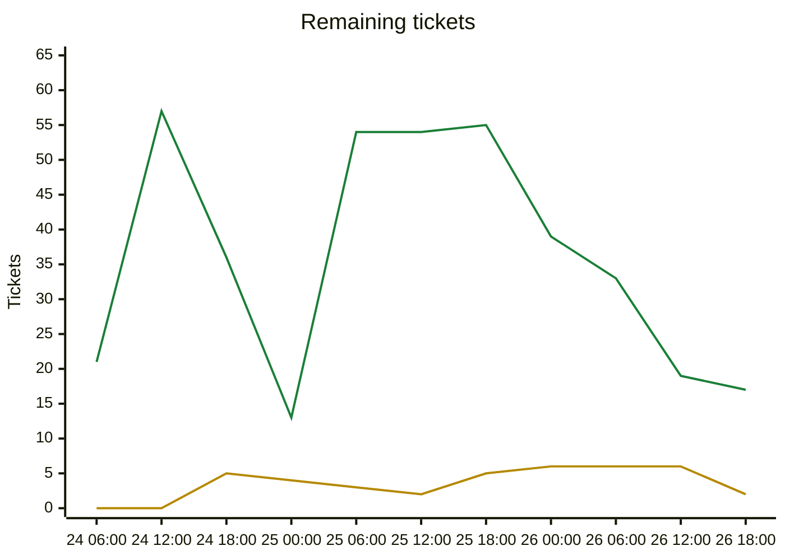

# Migration dependency map

## Delivery phases

Work is completed phase by phase (`phases.txt`; `ticket.py ready`/`next` list earlier phases first; later phases fill idle capacity).

| Phase | Done | Remaining | Ready | In flight | Remaining tickets |
|---|---|---|---|---|---|
| Phase 1: CLI (headless engine) | 216/220 | 4 | 1 | 2 | [T239](backlog/T239.md) [T241](backlog/T241.md) [T242](backlog/T242.md) [T243](backlog/T243.md) |
| Phase 2: single player (Godot client) | 57/57 | 0 | 0 | 0 | complete |
| Phase 3: multiplayer | 14/29 | 15 | 1 | 0 | [C006](backlog/C006.md) [C034](backlog/C034.md) [C035](backlog/C035.md) [C036](backlog/C036.md) [C045](backlog/C045.md) [T177](backlog/T177.md) [T178](backlog/T178.md) [T179](backlog/T179.md) [T180](backlog/T180.md) [T182](backlog/T182.md) [T204](backlog/T204.md) [T205](backlog/T205.md) [T206](backlog/T206.md) [T207](backlog/T207.md) [T225](backlog/T225.md) |

Generated by `tools/ticket.py` on every backlog change; do not edit by hand. Shows every incomplete ticket. A ticket that still has an incomplete dependency also shows all its direct dependencies (completed ones are grey and dashed); once every dependency is Done, they are hidden. An arrow `A --> B` means B depends on A.

| Colour | Meaning |
|---|---|
| bright green, thick border | Ready to start: Available and every dependency is Done |
| orange, thick border | On deck: Available, and every unfinished dependency is already in progress or in review, so it becomes ready when those finish |
| pale green, dotted border | Available but waiting on dependencies that are not started yet |
| yellow | In-Progress |
| blue | Needs-Review / In-Review |
| red | Blocked |
| grey dashed | Done (shown as a direct dependency only) |

```mermaid
flowchart TD
  subgraph TTRACK["Engine track"]
    T012["T012<br/>Command layer design"]
    T164["T164<br/>Command infrastructure over GameInfo: GameCommand base, asse..."]
    T172["T172<br/>Net protocol: message DTOs, versioning, ITransport and in-me..."]
    T173["T173<br/>Host identity and join auth: client ECDSA P-256 key bound to..."]
    T174["T174<br/>Visibility filter: ClientSnapshot builder from GameInfo via ..."]
    T175["T175<br/>Event stream: per-recipient event classifiers, TilesRevealed..."]
    T176["T176<br/>Game store: snapshot + append-only command log, hash checkpo..."]
    T177["T177<br/>Turn policy for simultaneous turns: injected clock, turn tim..."]
    T178["T178<br/>Headless host core: Unciv.Server project, GameHost actor, se..."]
    T179["T179<br/>Direct-connect transport: TCP + TLS 1.3 frames behind ITrans..."]
    T180["T180<br/>Client network library Unciv.Client.Net: ClientSession state..."]
    T182["T182<br/>Multi-client end-to-end: scripted 3-human + AI game over in-..."]
    T194["T194<br/>Command log format, replay verifier and scripted-human repla..."]
    T199["T199<br/>Query API: new-game setup data (nations, difficulties, speed..."]
    T202["T202<br/>Simultaneous-turn commands: EndTurn/UndoEndTurn/ForceEndTurn..."]
    T203["T203<br/>Two-human determinism and conflict tests: interleaved Script..."]
    T204["T204<br/>Lobby: slots, nation pick, ready-up, host settings (LobbySet..."]
    T205["T205<br/>In-process host: run GameHost inside the client (Host button..."]
    T206["T206<br/>Optional: LAN discovery (UDP broadcast beacon, 'Games on you..."]
    T207["T207<br/>Optional: UPnP/NAT-PMP automatic port mapping for the host"]
    T223["T223<br/>Remote queries: Query/QueryResult wire messages, GameHost di..."]
    T224["T224<br/>Client mirror correctness: per-recipient snapshot-diff delta..."]
    T225["T225<br/>Network robustness: real TCP+TLS multi-client tests, backpre..."]
    T230["T230<br/>Host-secret salt for state-based randomness in hosted multip..."]
    T239["T239<br/>Observe first green CI run after the workflow scope is grant..."]
    T241["T241<br/>Remote query exposure residuals: live stats of unmet civs, f..."]
    T242["T242<br/>Two-human conflict tests: one-per-game wonder race, ruins, r..."]
    T243["T243<br/>Real-started-game visibility test for two humans: B's mirror..."]
  end
  subgraph CTRACK["Client track (Godot)"]
    C001["C001<br/>Godot project skeleton"]
    C005["C005<br/>Civ 5-style UI kit: theme, screen stack, popups, tooltip hos..."]
    C006["C006<br/>Networked play client: join screen (address:port / invite), ..."]
    C010["C010<br/>V1 vertical slice: unit blocks, select, move, end turn, AI t..."]
    C011["C011<br/>HUD: top bar yields, turn banner, next-action button"]
    C015["C015<br/>Main menu and game setup screen: nations, difficulty, speed,..."]
    C016["C016<br/>Save/load screen and autosave"]
    C034["C034<br/>Host game screen: lobby settings, address list and Copy invi..."]
    C035["C035<br/>Lobby screen: slots, nation pick, ready-up, chat, kick, star..."]
    C036["C036<br/>Multiplayer turn bar: who has ended, deadline, End turn / Un..."]
    C037["C037<br/>IGameSession: client reads and writes only through a session..."]
    C045["C045<br/>In-game multiplayer social and admin: chat, player list, kic..."]
  end
  T172 --> T178
  T173 --> T178
  T174 --> T178
  T175 --> T178
  T176 --> T178
  T177 --> T178
  T202 --> T178
  T223 --> T178
  T224 --> T178
  T230 --> T178
  T172 --> T179
  T173 --> T179
  T178 --> T179
  T172 --> T180
  T173 --> T180
  T174 --> T180
  T175 --> T180
  T179 --> T180
  T204 --> T180
  T223 --> T180
  T224 --> T180
  T178 --> T182
  T180 --> T182
  T204 --> T182
  T203 --> T182
  T172 --> T204
  T173 --> T204
  T178 --> T204
  T199 --> T204
  T178 --> T205
  T179 --> T205
  T204 --> T205
  T176 --> T205
  T179 --> T206
  T179 --> T207
  T179 --> T225
  T180 --> T225
  T012 --> C006
  C001 --> C006
  T164 --> C006
  T172 --> C006
  T173 --> C006
  T180 --> C006
  T179 --> C006
  C010 --> C006
  C016 --> C006
  T194 --> C006
  C035 --> C006
  C036 --> C006
  T225 --> C006
  C037 --> C006
  C005 --> C034
  C010 --> C034
  C015 --> C034
  T204 --> C034
  T205 --> C034
  C005 --> C035
  T180 --> C035
  T204 --> C035
  C010 --> C036
  C011 --> C036
  T180 --> C036
  T202 --> C036
  T175 --> C036
  C036 --> C045
  T178 --> C045
  T204 --> C045
  classDef waiting fill:#f3faf3,stroke:#9bc49b,color:#555,stroke-dasharray:2 2
  classDef ondeck fill:#ffe8cc,stroke:#e8590c,stroke-width:3px,color:#000
  classDef ready fill:#7ee787,stroke:#1a7f37,stroke-width:3px,color:#000
  classDef prog fill:#fff3b0,stroke:#b58900,color:#000
  classDef review fill:#cfe4ff,stroke:#1f6feb,color:#000
  classDef blocked fill:#ffd6d6,stroke:#c62828,color:#000
  classDef done fill:#eeeeee,stroke:#999999,color:#666,stroke-dasharray:4 3
  class C001 done
  class C005 done
  class C006 waiting
  class C010 done
  class C011 done
  class C015 done
  class C016 done
  class C034 waiting
  class C035 waiting
  class C036 waiting
  class C037 done
  class C045 waiting
  class T012 done
  class T164 done
  class T172 done
  class T173 done
  class T174 done
  class T175 done
  class T176 done
  class T177 ready
  class T178 waiting
  class T179 waiting
  class T180 waiting
  class T182 waiting
  class T194 done
  class T199 done
  class T202 done
  class T203 done
  class T204 waiting
  class T205 waiting
  class T206 waiting
  class T207 waiting
  class T223 done
  class T224 done
  class T225 waiting
  class T230 done
  class T239 blocked
  class T241 ready
  class T242 prog
  class T243 prog
```

## Remaining tickets over time

Generated from the git history of `backlog/` (UTC; each point is the backlog as of that time, the last one the current backlog). Completed tickets (Done, Won't port) are not counted.

| Line | Meaning |
|---|---|
| green | New: Available or Blocked, not started yet |
| yellow | Active: In-Progress, Needs-Review or In-Review |

## Incomplete tickets

| Ticket | State | Depends on | Unblocks | Title |
|---|---|---|---|---|
| T177 | **Ready to start** | T172, T164, T184, T187, T200, T202, T226 | 14 | Turn policy for simultaneous turns: injected clock, turn timer, ForceEndTurn order, disconnect grace, AI takeover opt-in, resolve pump |
| T241 | **Ready to start** | T223 | 0 | Remote query exposure residuals: live stats of unmet civs, fogged-city names, spectator reach |
| T178 | Available (waiting on T177) | T172, T173, T174, T175, T176, T177, T202, T223, T224, T230 | 13 | Headless host core: Unciv.Server project, GameHost actor, sessions bound to civs, command gate (RequireActive, rate, size, dedup, existence-oracle-safe errors) |
| T179 | Available (waiting on T178) | T172, T173, T178 | 11 | Direct-connect transport: TCP + TLS 1.3 frames behind ITransport, self-signed host key, invite code (host:port, fingerprint, token), TOFU known-hosts, port-forward and overlay-VPN docs |
| T204 | Available (waiting on T178) | T172, T173, T178, T199 | 9 | Lobby: slots, nation pick, ready-up, host settings (LobbySettings to GameSetupInfo), AI fill, ruleset hash check, join password, start game |
| T180 | Available (waiting on T179, T204) | T172, T173, T174, T175, T179, T204, T223, T224 | 6 | Client network library Unciv.Client.Net: ClientSession state machine, mirror state, delta apply, command retry, reconnect/resume (no Godot types) |
| C036 | Available (waiting on T180) | C010, C011, T180, T202, T175 | 2 | Multiplayer turn bar: who has ended, deadline, End turn / Undo end turn, turn-resolving overlay, connection markers |
| C035 | Available (waiting on T180, T204) | C005, T180, T204 | 1 | Lobby screen: slots, nation pick, ready-up, chat, kick, start (host and joiner views) |
| T205 | Available (waiting on T178, T179, T204) | T178, T179, T204, T176 | 1 | In-process host: run GameHost inside the client (Host button), loopback + TCP listener, clean shutdown saves the game, resume saved game |
| T225 | Available (waiting on T179, T180) | T179, T180 | 1 | Network robustness: real TCP+TLS multi-client tests, backpressure, ping timeout, large snapshots, resync rate limit, TLS platform matrix |
| C006 | Available (waiting on T180, T179, C035, C036, T225) | T012, C001, T164, T172, T173, T180, T179, C010, C016, T194, C035, C036, T225, C037 | 0 | Networked play client: join screen (address:port / invite), TOFU prompt, reconnect overlay, key storage |
| C034 | Available (waiting on T204, T205) | C005, C010, C015, T204, T205 | 0 | Host game screen: lobby settings, address list and Copy invite, start hosting in-process, resume saved hosted game |
| C045 | Available (waiting on C036, T178, T204) | C036, T178, T204 | 0 | In-game multiplayer social and admin: chat, player list, kick, rebind a slot to a new device key |
| T182 | Available (waiting on T178, T180, T204) | T178, T180, T204, T203 | 0 | Multi-client end-to-end: scripted 3-human + AI game over in-memory transport, kill/restart server, reconnect, hash agreement |
| T206 | Available (waiting on T179) | T179 | 0 | Optional: LAN discovery (UDP broadcast beacon, 'Games on your network') |
| T207 | Available (waiting on T179) | T179 | 0 | Optional: UPnP/NAT-PMP automatic port mapping for the host |
| T239 | Blocked | T169 | 0 | Observe first green CI run after the workflow scope is granted; remove continue-on-error from client-scenarios |
| T242 | In-Progress [Claude] | T203 | 0 | Two-human conflict tests: one-per-game wonder race, ruins, religion founding and belief limits |
| T243 | In-Progress [Claude] | T203 | 0 | Real-started-game visibility test for two humans: B's mirror never holds A-only tiles/units across a simultaneous round |
