# UI screenshots of finished tickets

Generated by `tools/screenshots.py` from `screenshots.json`; do not edit by hand. Every image is a committed golden
(640x480, headless Godot, software GL, placeholder art) linked in place from `Unciv.Godot.Harness/golden/`.

## How screenshots are produced

Each client scenario (`Unciv.Godot.Harness/scenarios.txt`, code in `*Scenario.cs`) drives a seeded game through the real UI,
asserts engine state, then captures a PNG per `Capture` step and compares it with `golden/<scenario>/<step>.png`.
Run inside the `dotnet-dev` container from your worktree (setup: `GODOT.md`):

```
distrobox enter dotnet-dev -- bash -c 'cd <worktree>/csharp/Unciv.Godot.Harness && tools/run-scenario.sh <scenario>'
distrobox enter dotnet-dev -- bash -c 'cd <worktree>/csharp/Unciv.Godot.Harness && tools/run-scenario.sh <scenario> --update-golden'
distrobox enter dotnet-dev -- bash -c 'cd <worktree>/csharp/Unciv.Godot.Harness && tools/run-smoke.sh [--update-golden]'
```

`--update-golden` re-records the PNGs (open them before committing). Fresh frames also land in `out/<scenario>/` (git-ignored).

### Adding a screenshot when you finish a UI ticket

1. Give the ticket a scenario (or extend one) with `Capture` steps and record its goldens with `--update-golden`.
2. Open the PNGs and pick the 1-3 that show the finished feature.
3. Add an entry to `screenshots.json` (ticket id, scenario, `about`, `shots` with golden path and caption). A ticket with
   nothing to show gets `{"none": "reason"}`.
4. Regenerate: `cd csharp/migration && python3 -I tools/screenshots.py` and commit `SCREENSHOTS.md` with the mapping.

`python3 -I tools/screenshots.py --check` fails on a stale page or a missing golden; `ticket.py check` warns about Done
C-track tickets without an entry.

## C000 Headless Godot test & snapshot harness

Headless Godot render of one hex prism, the harness's own smoke test (not a game screen).

Scenario `smoke`.

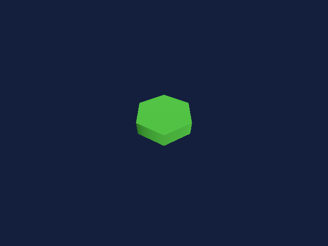

*A lit green hex prism on a navy background: proves Godot renders headlessly and the golden comparison works.* (`smoke.png`)

## C002 3D hex terrain rendering (elevation, materials, water depth)

3D terrain: elevation, per-terrain materials, water depth and shore, instanced grass tufts.

Scenario `terrain-3d`.

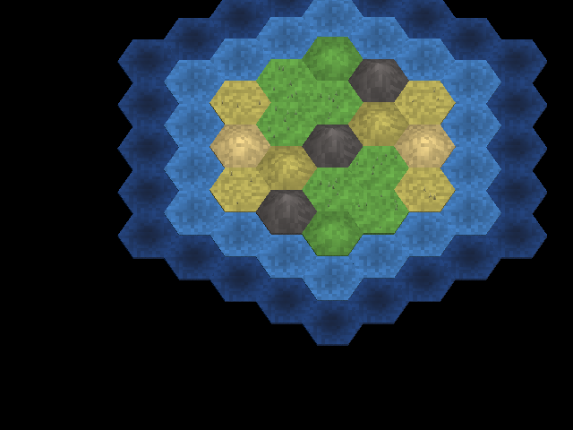

*Default tilt (55 degrees): grass, plains, hills, mountains (dark), shallow and deep water, tufts.* (`terrain-3d/angle-default.png`)

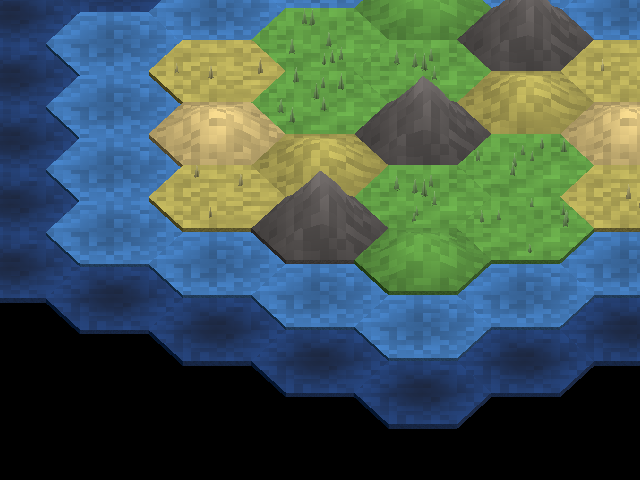

*Low oblique, zoomed in: hill domes and mountain peaks seen in silhouette.* (`terrain-3d/angle-low.png`)

## C003 Resource and improvement props

Procedural feature and resource props: forests, jungle, marsh, livestock herds, crops, ore, sea resources.

Scenario `props-3d`.

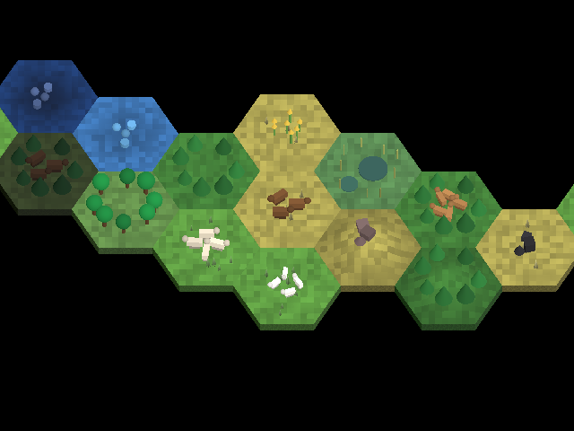

*Gallery map at the default tilt: horse herd in the centre, forests, marsh, crops, ore, sea resources.* (`props-3d/gallery-default.png`)

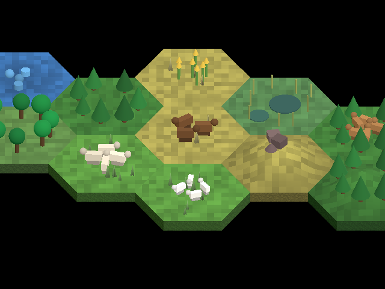

*Low close view of the herds and their neighbours.* (`props-3d/herd-close.png`)

## C004 Unit visuals: per-type models, formations, status icons

Unit visuals: per-type models, 1 to 4 figures by strength tier, civ colour, health bar, status marks.

Scenario `unit-visuals`.

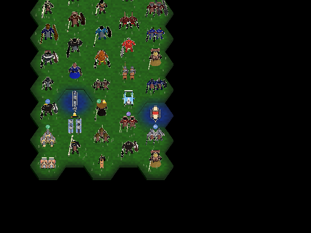

*Gallery of 15 units: civilians, land units by era (1 to 4 figures), ships and a plane; red and blue civs, health bars and status marks.* (`unit-visuals/gallery.png`)

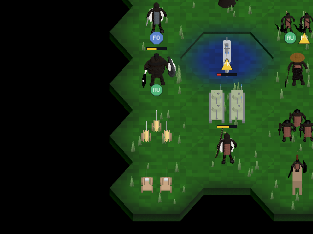

*Close view: Infantry (3 figures), Tank (4, hurt, promotion mark) and Cannon (3, automated mark).* (`unit-visuals/formations.png`)

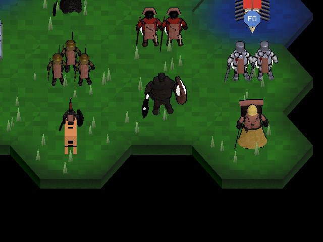

*Close view of the Warrior, now a CC0 animated model file in its idle pose with its TeamColor material tinted in the red civ's colour (C080).* (`unit-visuals/warrior.png`)

## C005 Civ 5-style UI kit: theme, screen stack, popups, tooltip host

Civ 5-style UI kit: theme, tab bar, scrolling icon list, tooltip host, popup queue, screen stack, UI scale.

Scenario `ui-kit`.

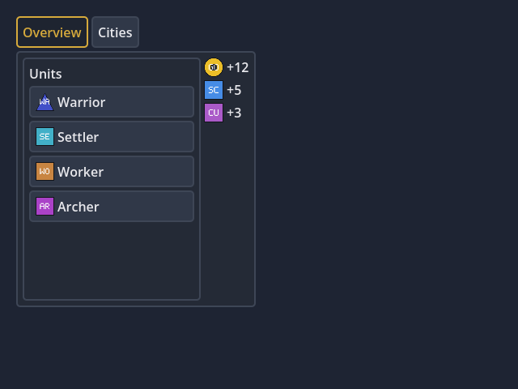

*A screen with the tab bar, a scrolling list with generated icons and yield labels.* (`ui-kit/screen.png`)

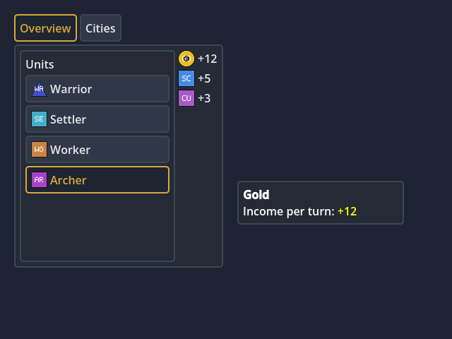

*The tooltip host showing a Gold tooltip beside the pointer after the delay.* (`ui-kit/tooltip.png`)

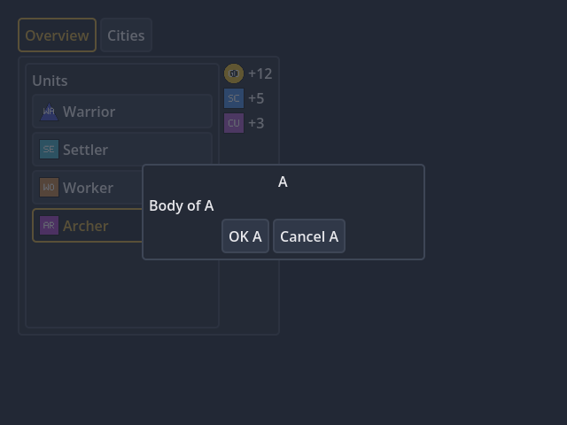

*Popup A over the dimmed screen (B and C are queued behind it).* (`ui-kit/popup.png`)

## C006 Networked play client: join screen (address:port / invite), TOFU prompt, reconnect overlay, key storage

Join screen (address or invite, password, known hosts), fingerprint prompt, host-key-changed hard stop and the reconnect overlay.

Scenario `join`.

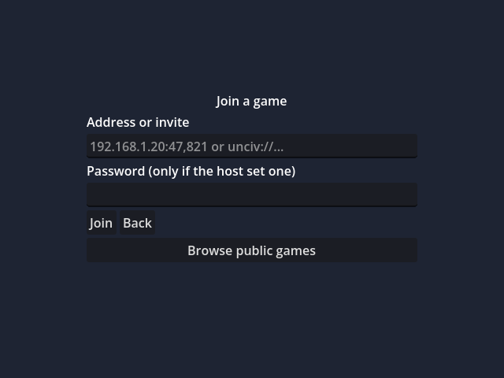

*The join screen as it opens: an address-or-invite field, a password field, Join and Back; no known hosts yet.* (`join/empty.png`)

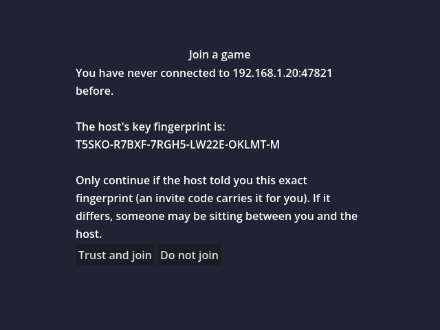

*First time at an address: the host's key fingerprint is shown with the advice to continue only if the host told you that fingerprint; nothing has been sent yet.* (`join/trust.png`)

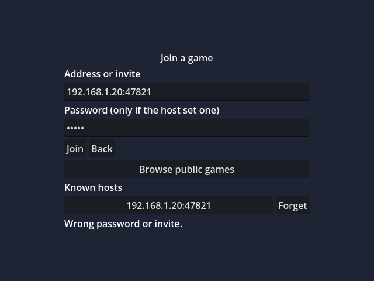

*After trusting, the host refused the wrong password with a plain sentence; the address is now listed under known hosts with Forget.* (`join/wrong-password.png`)

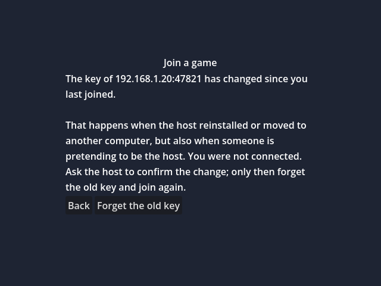

*The host's key differs from the pinned one: a hard stop explaining what it may mean and that nothing was sent; only Back and Forget the old key.* (`join/key-changed.png`)

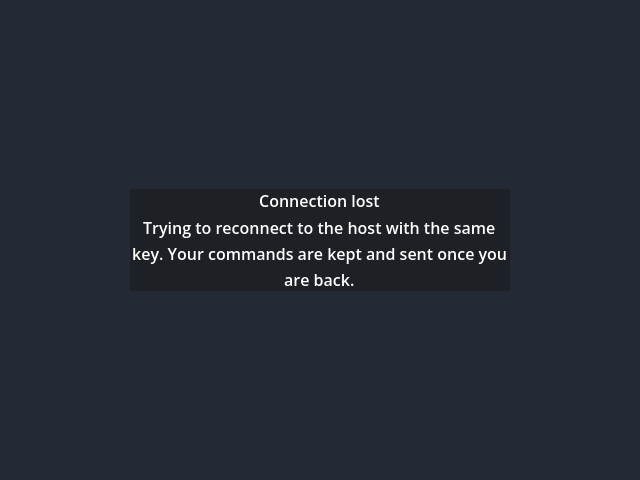

*Connection lost: the game is covered by a panel saying it retries with the same key and keeps commands; no buttons.* (`join/reconnecting.png`)

## C008 Client scenario runner and owner review sheet

Scenario runner demo: a trivial screen driven through real clicks and keys, golden per step.

Scenario `rename-city`.

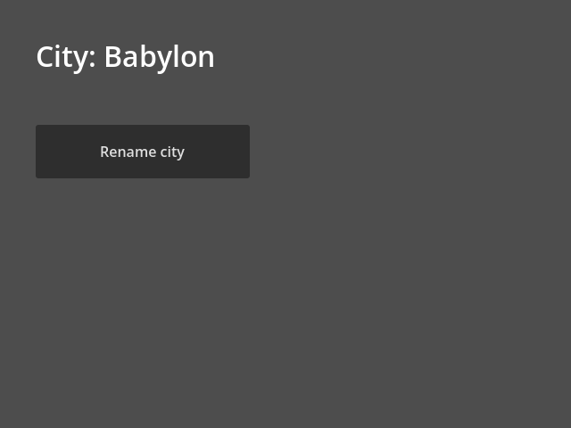

*Before any command: the founding city name.* (`rename-city/start.png`)

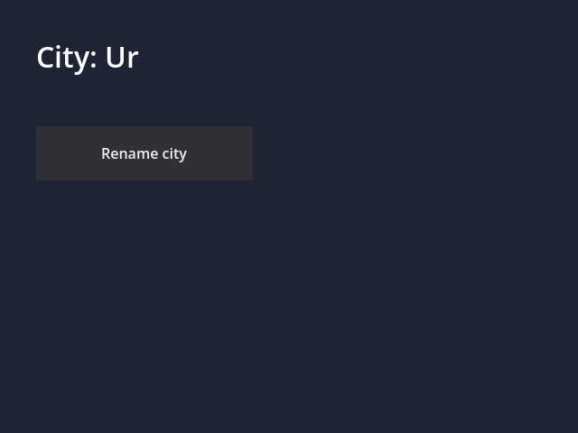

*After clicking the button: the city is now Ur.* (`rename-city/renamed.png`)

## C009 Map view v1: flat hex map from queries, camera, tile picking, fog tint

Flat hex map from queries: camera, tile picking, fog tint.

Scenario `map-v1`.


*Default camera: visible tiles in full colour, explored ring dimmed, unexplored black.* (`map-v1/default.png`)

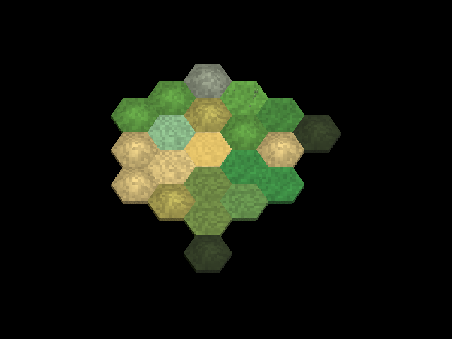

*The capital tile clicked: highlight on the selected hex.* (`map-v1/selected.png`)

## C010 V1 vertical slice: unit blocks, select, move, end turn, AI turns

V1 vertical slice: unit blocks, select, move, end turn, AI turns.

Scenario `v1-vertical`.

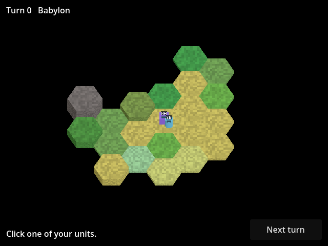

*Turn 1: the human's units as coloured blocks, nothing selected.* (`v1-vertical/start.png`)

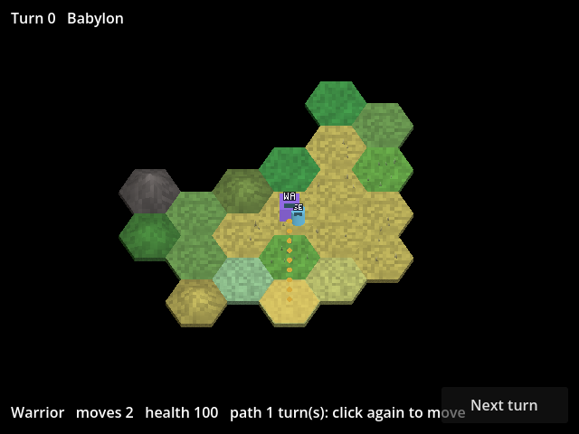

*Warrior selected and a path previewed to the destination (the panel and top bar are later tickets' UI, drawn in this golden).* (`v1-vertical/path.png`)

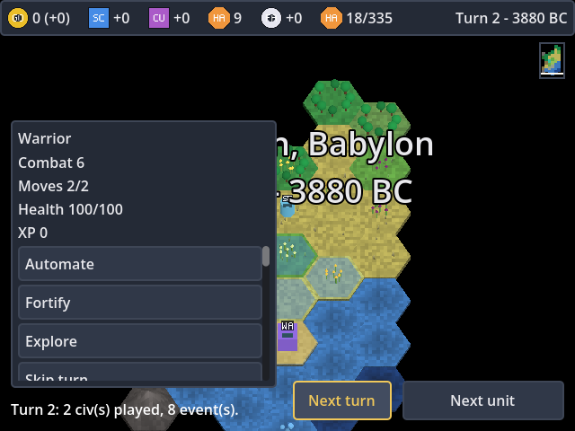

*Turn 2 after Next turn and a right-click move: the warrior has moved on.* (`v1-vertical/turn3.png`)

## C011 HUD: top bar yields, turn banner, next-action button

HUD: top bar with yields, turn banner, Next unit and Next turn buttons.

Scenario `hud`.

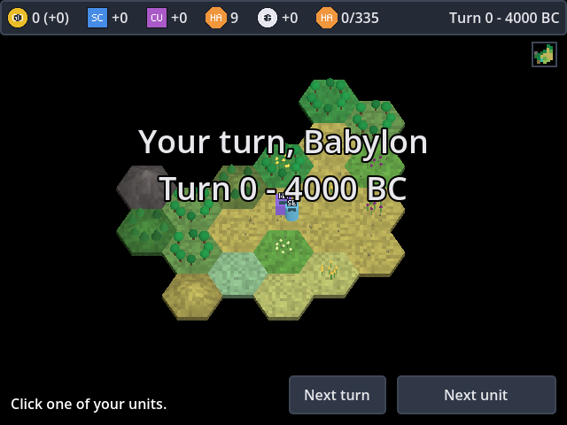

*Turn start: top bar, turn banner, Next unit button with a separate Next turn.* (`hud/start.png`)

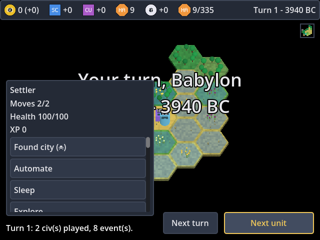

*After Next turn: new turn banner, updated top bar, units due again.* (`hud/next-turn.png`)

## C012 Unit panel and orders: attack, fortify, found city, workers, automate

Unit orders panel: selecting units, order buttons, attack preview, disband confirmation.

Scenario `unit-orders`.

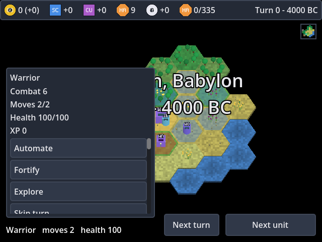

*Warrior selected: stats and order buttons (fortify, automate, explore).* (`unit-orders/warrior-selected.png`)

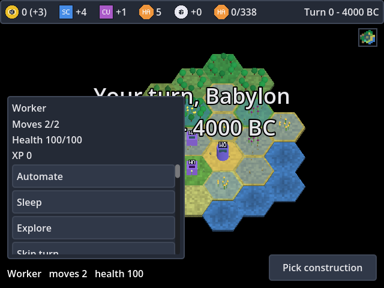

*Worker selected: worker-specific orders list.* (`unit-orders/worker-selected.png`)

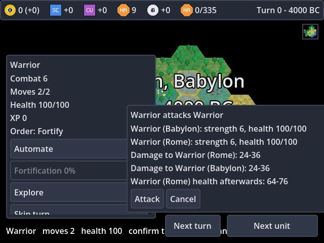

*Attack preview dialog with strength, health and damage ranges.* (`unit-orders/attack-preview.png`)

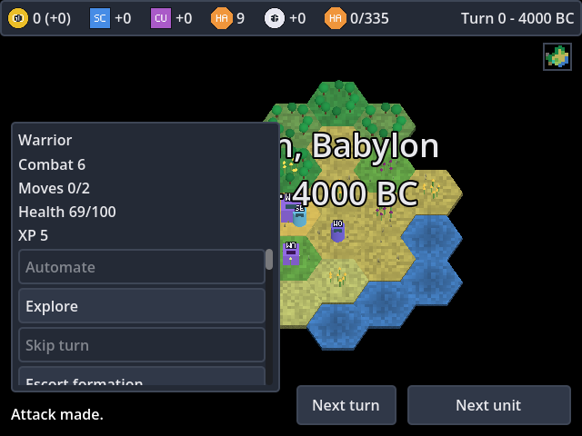

*Result after confirming the attack.* (`unit-orders/after-attack.png`)

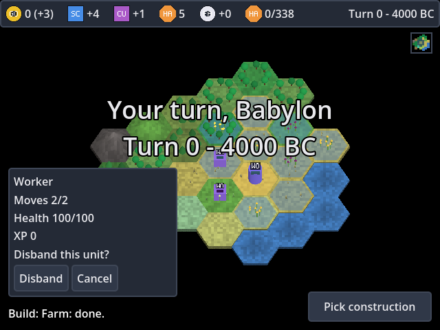

*Disband confirmation prompt.* (`unit-orders/disband-confirm.png`)

## C013 Notifications and popup alerts

Notification list and popup alerts: demand, city conquered, review of informational alerts, clickable notifications.

Scenario `alerts`.

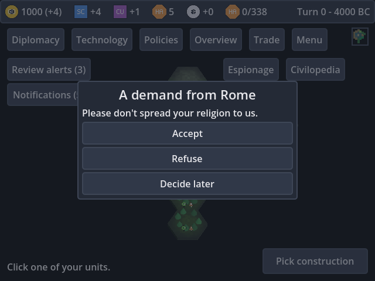

*Rome's demand as a modal popup: accept, refuse or decide later; informational alerts wait under Review alerts.* (`alerts/demand.png`)

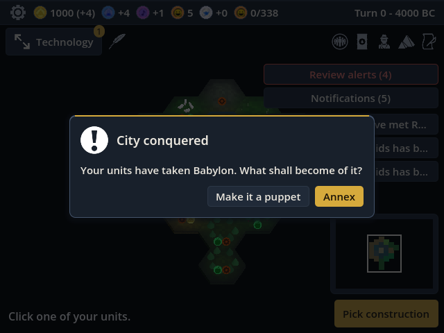

*A just-conquered city: only the engine's choices (annex, puppet) and no way to put it off.* (`alerts/city-conquered.png`)

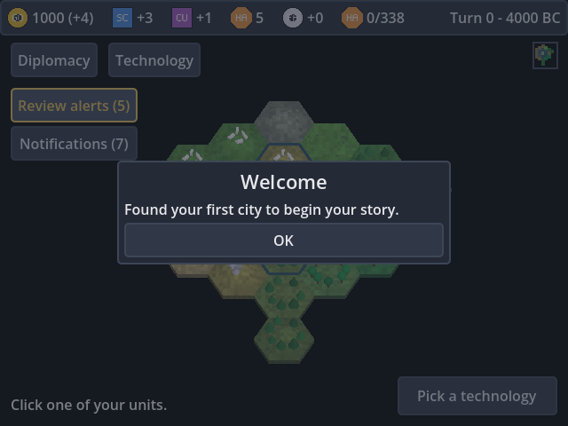

*Review alerts: the welcome alert, informational, with only an OK.* (`alerts/welcome.png`)

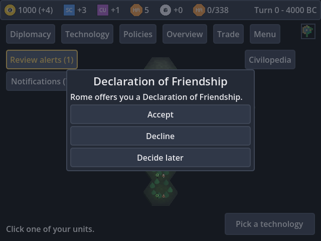

*A put-off friendship offer, back in the review with accept and decline.* (`alerts/friendship.png`)

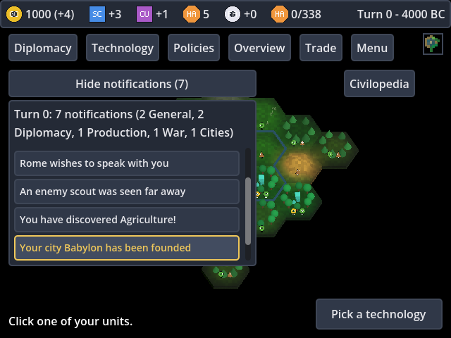

*The notification list open with its category summary; clicking the city row centred the camera on the city.* (`alerts/list.png`)

## C014 Minimap

Minimap in the top right corner with a camera rectangle; click to jump.

Scenario `minimap`.

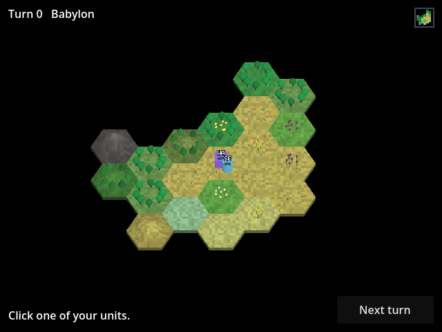

*Minimap top right: explored terrain, own border, white camera rectangle.* (`minimap/start.png`)

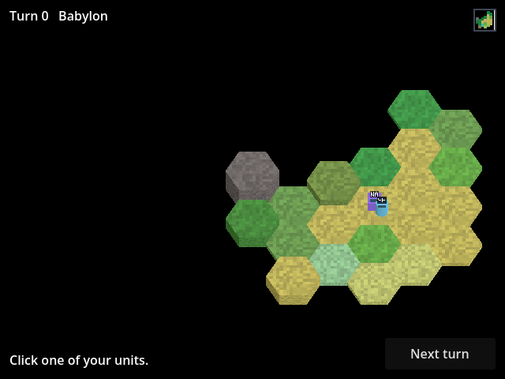

*After clicking the far corner of the minimap: the camera moved there.* (`minimap/jumped.png`)

## C015 Main menu and game setup screen: nations, difficulty, speed, map options

Main menu and new-game screen: players and nations, rules, game, map and advanced options, seed validation, then the started game.

Scenario `setup`.

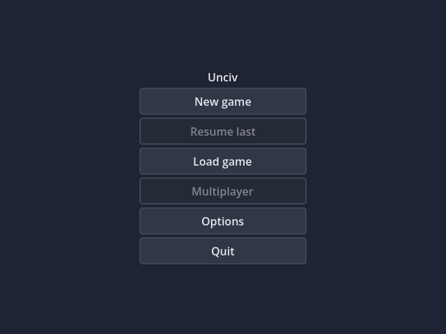

*Main menu on the dark backdrop: the Unciv logo over a brass rule, New game as the gold primary button, Resume last disabled, Load game, Multiplayer, Host game, Options, and Quit as a quiet ghost button.* (`setup/menu.png`)

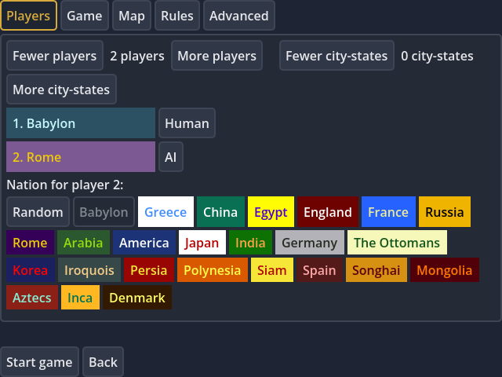

*Players tab: Babylon (human) and Rome (AI) slots with their emblems, the detail card of the selected nation (Rome: leader, unique ability, avoided start terrain), the emblem grid below, and the summary line in the footer above Back and the gold Start game.* (`setup/players.png`)

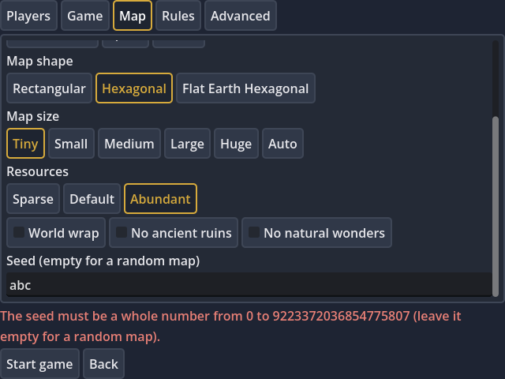

*Map tab with a non-numeric seed: the reason is shown in red under the tabs, above the summary line, and nothing starts.* (`setup/bad-seed.png`)

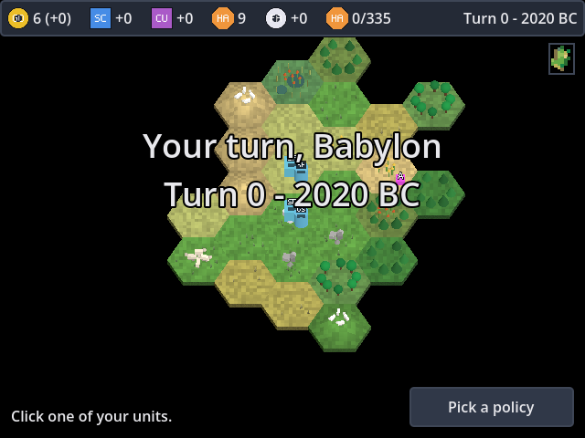

*The game started from the chosen options: Babylon, turn 0, tiny hexagonal map.* (`setup/started.png`)

## C016 Save/load screen and autosave

Save/load screen and autosave.

Scenario `saveload`.

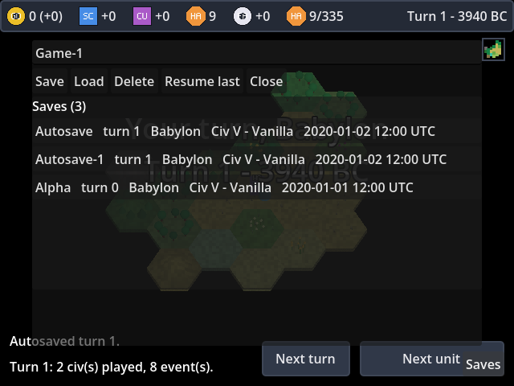

*The Saves dialog (a framed modal): a table of Alpha, the autosave and the numbered autosave with turn and civilization, a details card with the save name field, and Resume last, Load, Delete and Save in the footer.* (`saveload/list.png`)

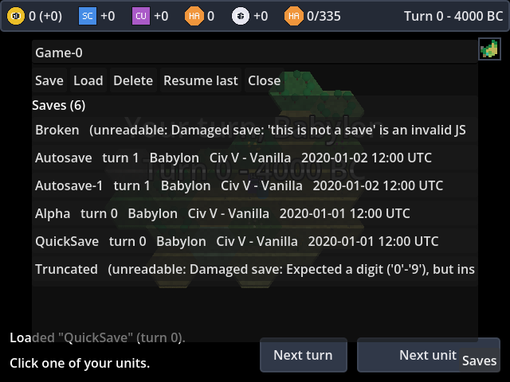

*The damaged and truncated files listed in the warning colour as Damaged next to the good saves.* (`saveload/damaged.png`)

## C017 City screen A: info, tiles, specialists, focus

City screen A: info, tile grid, specialists, focus.

Scenario `city-a`.


*The capital's city screen at 640x480: header with the Rename action, Citizens/Production tabs, food and border meters, stat chips, specialists and focus on the left, and the hexagon tile grid with worked tiles green, available tiles blue and the centre in brass, each yield an icon and a number.* (`city-a/open.png`)

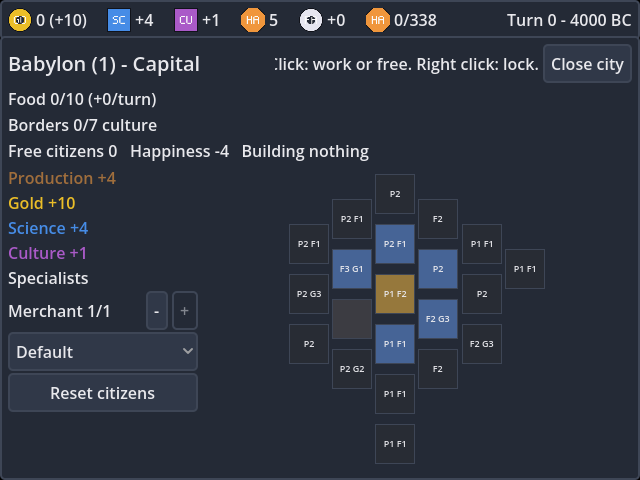

*A Merchant specialist at work: the specialist row reads 1/1 and the stats include it.* (`city-a/specialist.png`)

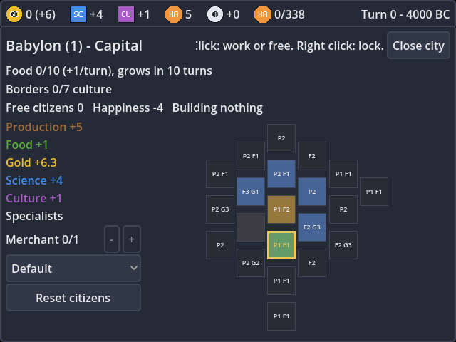

*A locked tile keeps a thick brass outline and a lock mark on its hexagon.* (`city-a/tile-locked.png`)

## C018 City screen B: production queue, purchase, buildings

City screen B: production queue, buildable list, purchase, buildings, puppet and razing states.

Scenario `city-b`.


*The Production tab with Warrior, Monument and a perpetual Nothing item queued as striped cards (icon, turns, progress, Top/Up/Down and a remove cross, Buy chip with the gold price), the buildable list as rows and the Buildings column with a red Raze city button.* (`city-b/queued.png`)

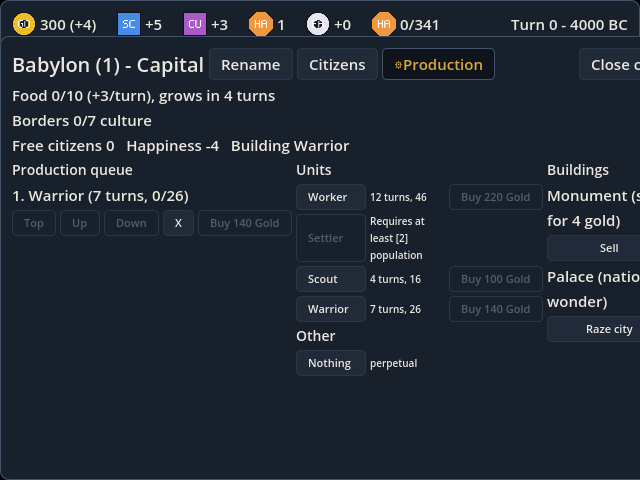

*After buying the Monument: it is listed under Buildings with its sell price and a Sell button; gold fell from 500 to 300.* (`city-b/bought.png`)

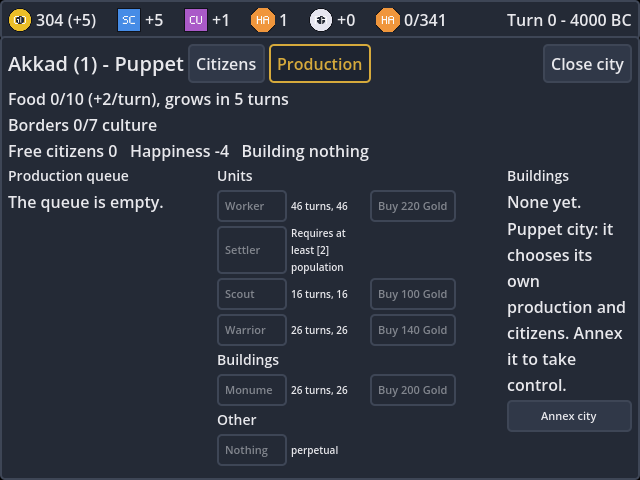

*A puppet city: the state is explained, Annex city is offered and every production button is disabled.* (`city-b/puppet.png`)

## C019 Tech screen

Tech screen (redesigned in C070): node cards by column and row with era bands, prerequisite elbows, search, unlock list, and research now / add to queue / remove from queue in the footer.

Scenario `tech`.

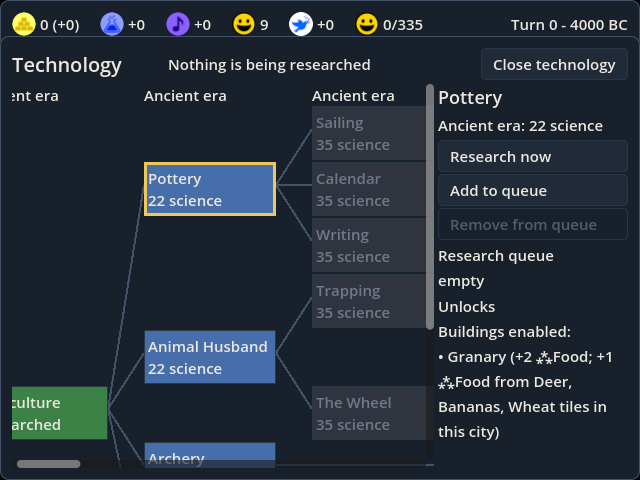

*First open at 640x480: one era band on top, node cards with tech icon, unlock icons and turns, Agriculture researched (green bar and check), Pottery selected, the highlighted path to it, details on the right and the actions in the footer.* (`tech/open.png`)

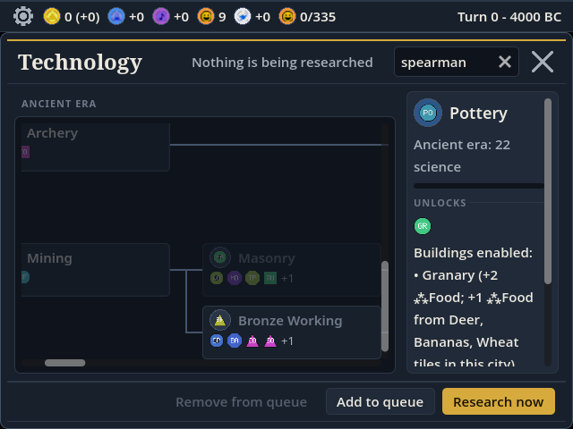

*Searching 'spearman': the techs that do not unlock it are dimmed and Bronze Working is scrolled into view.* (`tech/search.png`)

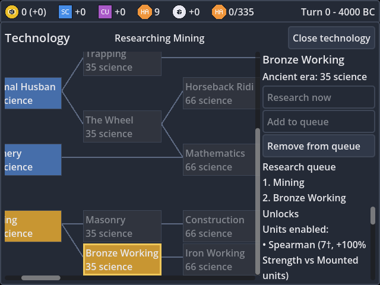

*Bronze Working chosen: it and Mining carry queue number badges (1, 2) in prerequisite order; the side panel lists the unlocks.* (`tech/chosen.png`)

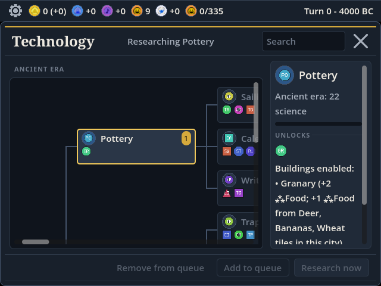

*Pottery researched instead: the queue holds only it (badge 1, accent border as the current research) and the footer buttons are disabled.* (`tech/replaced.png`)


*1280x720: the tree gets more room, with two era bands (Ancient, Classical), a wider detail panel with the unlocks and the research queue.* (`tech/wide.png`)

## C020 Policy screen

Policy screen (redesigned in C071): culture bar and golden-age line, one card per branch with icon nodes on the ruleset grid and connector lines (tabs per branch at 640x480, a flowing grid at 1280x720), search, Adopt right under the policy name, why a policy is locked or unaffordable.

Scenario `policy`.


*The policy screen as opened by Pick a policy at 640x480: culture bar 50 / 15 with 'You can adopt a policy now', the golden-age line, a tab per branch and the Tradition card (opener, members as icon nodes with connector lines), nothing chosen.* (`policy/open.png`)


*Searching 'legal': Legalism stays bright and the other policies are dimmed.* (`policy/search.png`)


*Tradition selected (bright ring): its effects on the right with the Adopt Tradition button directly under the name; nothing is adopted until it is pressed.* (`policy/selected.png`)


*Tradition and Legalism adopted (accent-tinted, lit connectors); Legalism is selected and its detail shows 'Adopted' with a disabled button.* (`policy/adopted.png`)


*Not enough culture (15 / 40): Landed Elite is open but Adopt is disabled and the hint gives the price.* (`policy/short.png`)


*1280x720: branch cards flow in one scrolled grid (one per row here) beside a wider detail panel; Landed Elite selected, Adopt disabled, Tradition's connectors lit.* (`policy/wide.png`)

## C021 Diplomacy screen

Diplomacy screen: civ list, status and attitude, treaty and city-state actions.

Scenario `diplomacy`.


*Declare war armed (C073 redesign): the red danger button now reads Confirm: Declare war, with a hint line at the top.* (`diplomacy/confirm.png`)


*At war with Rome: the status pill and the list row say War and peace is offered instead.* (`diplomacy/war.png`)


*Diplomacy in its screen frame: list rows with flag and status on the left, Rome's name, a status pill, attitude and the danger-styled declare war and denounce buttons.* (`diplomacy/peace.png`)


*City-state panel: influence, quests, gift buttons and bullying, with the reason shown under each button the engine refuses.* (`diplomacy/city-state.png`)


*After gifting 250 gold to the city-state: its influence went up.* (`diplomacy/gifted.png`)


*The player now protects the city-state (status Protector); revoking protection is not allowed yet, and the reason is shown under the greyed button.* (`diplomacy/protected.png`)

## C022 Trade screen

Trade screen: offer builder for both sides, incoming trade and demand from an AI civ, the engine's hint, propose and retract.

Scenario `trade`.


*Trade in its screen frame: Rome's proposal as a card with icon lines for what they give and ask and Accept / Decline / Counter, its demand beneath, then the partner list and both offer columns with icon rows.* (`trade/open.png`)


*A gift of 20 gold staged (the row is selected, less and more buttons beside it): the summary, a gold Likely pill from the engine's hint and the full sentence; Propose trade is the primary footer button.* (`trade/staged.png`)


*Our offer waits for Rome's turn: propose is off and a red Retract offer button appears in the footer.* (`trade/proposed.png`)


*The next turn: Rome answered the gift, nothing waits and the treasuries changed.* (`trade/answered.png`)

## C023 Overview screens: empire, cities, units, resources, ranking, religion, espionage

Empire overview (redesigned in C074 on ScreenFrame and DataTable): tabs for stats, cities, units, resources, ranking, religion, espionage and politics; Go to buttons jump to a city or unit.

Scenario `overview`.


*Stats tab (redesigned in C074): a two-column grid of cards (Empire, Economy, Progress, Score) with stat icons and the indented score breakdown, inside the screen frame with underline tabs.* (`overview/stats.png`)


*Cities tab: a DataTable of the capital and a puppet city, numbers right-aligned, with a Go to arrow button at the end of each row, and the bulk actions panel below it (nothing selected, so its actions are disabled).* (`overview/cities.png`)


*C092: both city rows selected (accent text, Selected: 2); the bulk panel offers a citizen focus with Set focus, a build item with Add to queue and Buy current production, and the build templates kept in the client settings (none yet).* (`overview/cities-bulk.png`)


*Units tab: own units only in a sortable table with position, health, moves (numbers right-aligned), order and a Go to button per row.* (`overview/units.png`)


*Ranking tab: one table per category side by side, best first with the rank right-aligned; unmet civs are shown as Unknown civilization.* (`overview/ranking.png`)

## C024 Victory and defeat screen, game over

Victory and defeat screens: a forced one-turn Domination conquest, the ranking and score history, One more turn, and the defeat screen with keep watching.

Scenario `victory`.


*The victory modal after a one-turn conquest: gold title, the victory paragraph, the ranking table with your row in the accent colour and the defeated civ last, the score graph with its value axis and turn axis, and Main menu with the primary One more turn.* (`victory/victory.png`)


*After One more turn the world is playable again on the next turn.* (`victory/continued.png`)


*The defeat modal (scenario defeat): red title, the defeat paragraph and the ranking with your own (defeated) row in the accent colour; the game goes on without you, so Keep watching is the primary button next to Main menu.* (`defeat/defeat.png`)

## C025 Localization: translations in the client, language picker, non-Latin fonts

Translations in the client: language picker, OFL fallback fonts for non-Latin scripts, right-to-left text.

Scenario `l10n-sheet`.


*German chosen in the picker: the settings page and the sample keys translated, umlauts and sharp s drawn.* (`l10n-sheet/latin.png`)


*Russian: Cyrillic text throughout.* (`l10n-sheet/cyrillic.png`)


*Japanese: kanji and kana from the CJK fallback font; untranslated strings stay English.* (`l10n-sheet/japanese.png`)


*Hindi (36% translated): Devanagari with conjuncts, the rest falling back to English.* (`l10n-sheet/devanagari.png`)


*Thai: tone marks above and below the line.* (`l10n-sheet/thai.png`)


*Arabic and Hebrew sample lines shaped and run right to left from their Noto fonts, each with a Latin word and digits inside (the settings page on the left is not mirrored here: the harness has no window to flip).* (`l10n-sheet/rtl.png`)

## C026 Tutorials

Tutorial popups from the ruleset's Tutorials.json: fired at game start and by game events, step by step, seen flags saved in the client settings.

Scenario `tutorial`.


*Game start: the Introduction tutorial over the map with its OK button.* (`tutorial/introduction.png`)


*Second of three steps of Culture and Policies: step counter 2 / 3 above OK.* (`tutorial/second-step.png`)


*Workers tutorial shown after tutorials were switched back on and the seen list was reset.* (`tutorial/workers.png`)

## C027 Tooltips and Civilopedia

Tile hover tooltip and the Civilopedia: categories, entries with icons, engine-worded pages, links, unit tooltips in the list.

Scenario `tooltips`.


*Tile tooltip beside the pointer: the capital's name, terrain, owner, units and yields, each yield followed by its sources and total.* (`tooltips/tile.png`)


*Civilopedia, Units (640x480): category icon sidebar, entry list with era heading, and the Archer's header card (icon, name, category, production cost chip) over the engine's text with info-coloured links.* (`tooltips/unit.png`)


*Hovering the Bowman entry: bold heading, the cost as a production-coloured stat line, the short description and a muted Requires footer.* (`tooltips/entry-tip.png`)


*Civilopedia, Buildings: the Granary's header card with its cost chip and the engine's page text.* (`tooltips/building.png`)


*Civilopedia, Wonders: Stonehenge's page, its Wonder heading drawn as a section header.* (`tooltips/wonder.png`)

## C028 Options screen, hotkeys, edge-pan

Options screen with vertical tabs (Display, Gameplay, Map, Sound, Keys, Advanced): engine options, UI scale stepper, sound, window mode, scroll speed, edge-scroll and map toggles, asset pack, key rebinding persisted and used on the game screen.

Scenario `options`.


*Options, Display tab: the vertical tabs on the left, the UI scale stepper and the window mode.* (`options/top.png`)


*The Keys tab while rebinding: the End turn key chip shows ... and the other actions keep their keys.* (`options/listening.png`)


*The Keys tab after rebinding: End turn now shows Q, the other actions keep their default keys (the Kotlin defaults since C078: F-keys for the screens, Period for the next unit, the unit action keys below).* (`options/rebound.png`)

## C029 Hotseat player switch screen

Hotseat hand-over: after a human ends the turn the map and UI are hidden behind an opaque pass-the-device cover until the next human presses Ready, then the game is shown as that player.

Scenario `hotseat`.


*Babylon's turn before ending it: its own map and units, no cover* (`hotseat/babylon.png`)


*Pass the device to Greece: opaque cover with a Ready button, nothing of Babylon's game visible* (`hotseat/cover.png`)


*After Ready: the game as Greece (its own units, 'Your turn, Greece' banner)* (`hotseat/greece.png`)

## C031 Terrain blending, fog of war polish, chunked meshes

Terrain blending, fog edge fade and chunked terrain meshes.

Scenario `terrain-blend`.


*Default tilt: grass, plains and desert melt into each other and into the coast; the ocean fades toward black at the edge of the explored area.* (`terrain-blend/blend-default.png`)


*Low oblique, zoomed in: blended edges between terrains while hills and mountains keep their cliff walls.* (`terrain-blend/blend-low.png`)

## C032 Improvements, roads, cities, borders and in-world yield icons

Improvement props, roads and rails, city models with civ flags, borders and in-world tile yield icons.

Scenario `improvements`.


*Gallery at the default camera: a prop per improvement, brown roads and a dark railroad, a village and a larger town with flags, blue and gold borders, and small yield icons with amounts on each tile.* (`improvements/gallery-default.png`)


*Low close view of the village: its model and flag, road links, neighbouring farms, pasture and mine with their yields.* (`improvements/village-close.png`)


*The same gallery with Show tile yields switched off: the icons are gone, everything else unchanged.* (`improvements/yields-off.png`)

## C033 Unit animation and combat presentation

Unit animation and combat presentation: step in, face the target, swing and hit clips with floating engine damage numbers, ranged draw and shot, bombard flash, death shrink; stepped by hand so every frame is deterministic.

Scenario `combat-presentation`.


*Mid-swing: our warrior has stepped in, turned to the enemy warrior and plays its attack clip (a real attack made through the UI).* (`combat-presentation/lunge.png`)


*Impact: the enemy plays its hit clip and the engine's damage numbers float up.* (`combat-presentation/impact.png`)


*A ranged shot in flight from our warrior (after its draw) toward a far tile.* (`combat-presentation/shot.png`)


*A city bombards: a flash at the city and a shot toward our warrior.* (`combat-presentation/bombard.png`)


*A dying worker plays its death clip on its tile.* (`combat-presentation/death.png`)

## C034 Host game screen: lobby settings, address list and Copy invite, start hosting in-process, resume saved hosted game

Host screen: game, map, rules and network settings, port-forward hint, Start hosting with the host in slot 1, invite with Copy invite, a friend joining, and resuming a saved hosted game.

Scenario `host-screen`.


*Network tab: turn timer (5 min chosen), the scale-with-the-game checkbox (on) and its shortest turn (1 min chosen), password and port.* (`host-screen/network.png`)


*Network tab scrolled down: the addresses of this computer (the internet address chosen) and the port-forward hint.* (`host-screen/network-address.png`)


*A port another program already uses is refused with the port number and what to do; nothing is hosted.* (`host-screen/port-in-use.png`)


*Hosting: the host in slot 1 and two open slots, the address the invite uses, the invite and Copy invite (copied), and the port-forward hint.* (`host-screen/hosting.png`)


*A friend joined with the invite over the network and sits in slot 2; the host's table updated and the invite now uses the other address.* (`host-screen/friend.png`)


*A saved hosted game resumed: it listens again with an invite, and shows the players who were in it.* (`host-screen/resumed.png`)

## C035 Lobby screen: slots, nation pick, ready-up, chat, kick, start (host and joiner views)

Lobby screen: slot table with colour and ready, nation and colour picker, read-only settings, chat, host controls (kick, close, AI, Start), the joiner's view and a refusal for different rules.

Scenario `lobby`.


*Host's lobby: Host, Friend A and Friend B seated, one open slot (AI or Close), nobody ready; Start is off and says who it waits for. Settings are read-only on the left, chat on the right.* (`lobby/waiting.png`)


*The host's nation picker: Random and every playable nation in its colours, then eight seat colours; the host chose Babylon and Blue and their row shows both.* (`lobby/picking.png`)


*Everybody is ready: all three show Ready with their nation and colour, the chat holds both lines, Start game is on.* (`lobby/ready.png`)


*Friend A's view: own seat marked (you), the host marked, the same settings read-only, no Kick, Close or Start; only Ready, Pick nation and chat.* (`lobby/joiner.png`)


*A joiner whose rules differ from the host's is refused with a plain sentence about base ruleset and mods; nothing else is shown and no seat is taken.* (`lobby/refused.png`)


*After the host kicked Friend B and closed the slot: slot 3 is Closed (Open undoes it), slot 4 is still Open and becomes AI at Start.* (`lobby/kicked.png`)

## C036 Multiplayer turn bar: who has ended, deadline, End turn / Undo end turn, turn-resolving overlay, connection markers

Multiplayer turn bar: who has ended, deadline countdown, connection marks, Next turn / Undo end turn, resolving overlay and toasts for other humans' actions.

Scenario `mp-turn`.


*Turn bar under the buttons: 'Waiting for Alice, Bob', countdown 1:05, both players green and Playing; Next turn and Next unit bottom right.* (`mp-turn/waiting.png`)


*Alice (you) has ended (green Ended) and the button reads Undo end turn; the bar says 'Waiting for Bob (offline)' with Bob's dot red.* (`mp-turn/ended-offline.png`)


*After Undo, Bob ends his turn: his row turns Ended, the bar says 'Waiting for Alice' and a toast reads 'Bob ended their turn'.* (`mp-turn/other-ended.png`)


*Both ended and the host is resolving: dimmed 'Resolving the turn / Waiting for the host' overlay, disabled 'Resolving turn...' button, and the refusal in the status line.* (`mp-turn/resolving.png`)

## C038 Decision pickers: promotion, free tech, free great person, pantheon and religion found/enhance/reform, spy assignment, diplomatic vote and vote result

Decision pickers: free great person, pantheon and promotion (religion founding/enhancing, spies and the World Congress vote use the same picker, covered by model tests).

Scenario `decisions`.


*The free great person picker: one button per great person the engine offers; Confirm is disabled and says to choose first.* (`decisions/great-person.png`)


*The pantheon picker with a belief chosen: its effects below the list and Found pantheon enabled.* (`decisions/pantheon.png`)


*The promotion picker for the warrior: experience line, promotions it may take, the default-promotion checkbox and Take promotion.* (`decisions/promotion.png`)

## C039 Incoming proposal popups: trade, peace and friendship requests from AI (and other humans), proposer's pending/declined/withdrawn state

Incoming proposal popups: peace and trade proposals from AI civs with accept, decline, counter and decide later, and the status of our own outstanding offers.

Scenario `proposals`.


*Rome's peace proposal as a popup: They give and They ask sections of icon lines, with accept, decline, ask for something else and decide later.* (`proposals/peace.png`)


*Greece's trade proposal after the peace was accepted: 50 gold and 20 gold, each with the gold icon.* (`proposals/trade.png`)


*How about something else: the trade screen opens on Greece with its offer staged the other way round for us to change.* (`proposals/counter.png`)


*Our own offer to Greece waits for its answer, listed under the notifications.* (`proposals/waiting.png`)


*The next turn: the outcomes of our offers are reported (taken back, accepted by Greece).* (`proposals/answered.png`)

## C040 Run end-turn processing and AI turns off the UI thread with a next-turn progress overlay

End turn is processed off the UI thread with a progress overlay (civ n of m) that blocks input while the window keeps drawing.

Scenario `next-turn`.


*Next turn in progress: dimmed screen, heading 'Processing the other civilizations', 'Rome - 3 of 10' and a progress bar* (`next-turn/overlay.png`)


*After the turn: overlay gone, Turn 1, status line reports 11 civs played* (`next-turn/after.png`)

## C041 Flat-map cities, borders, roads and improvements (before the 3D chain)

Flat-map cities, borders, roads and improvements.

Scenario `flat-city`.


*The founded city: block, banner (name, production) and the territory border.* (`flat-city/city.png`)


*A road next to the city and a trading post on the worker's tile (yield icons now show on every tile).* (`flat-city/improvement.png`)

## C043 Client settings model persisted under user:// (language, key bindings, UI scale, asset pack, autosave, tutorials seen, player name) and the engine PlayerSettings options

Client settings model persisted under user:// and the engine PlayerSettings options.

Scenario `settings`.


*The Gameplay tab of the settings after a click: automated units move on turn start is on.* (`settings/changed.png`)


*The Display tab after Bigger UI: the scale stepper reads 125%.* (`settings/display.png`)


*The Gameplay tab defaults: vertical tabs on the left, a switch per option.* (`settings/start.png`)

## C044 In-game menu: save, load, new game, resign, victory status, options, main menu

In-game menu (Escape or the Menu button): save, load, new game, victory status, options, resign and main menu, with confirmations before destructive actions.

Scenario `menu`.


*The game screen with the new Menu button after Trade, clear of the minimap at 640x480* (`menu/hud.png`)


*The in-game menu as a modal of icon rows with key hints: resume, save, load, new game, victory status, options, then Resign (danger) and main menu.* (`menu/menu.png`)


*Victory status as a modal: a section header per victory, your milestones coloured by state (done green, partly gold, open grey), each civ's progress with yours in the accent colour, and Close.* (`menu/victory-status.png`)


*Start new game with unsaved progress: the menu modal asks before the game is left, Cancel on the left and the confirmation on the right.* (`menu/unsaved.png`)


*Resign asks for confirmation in a modal with a danger button and says the AI takes over.* (`menu/resign-confirm.png`)


*After resigning: the same game-over modal says so and offers only the main menu as its primary button.* (`menu/resigned.png`)

## C045 In-game multiplayer social and admin: chat, player list, kick, rebind a slot to a new device key

In-game players and chat panel of a hosted game, host view: chat, host-only Kick and Rebind.

Scenario `mp-social`.


*The Players panel, top right: Alice (you) and Bob with green dots and 'Online'; only Bob's row has Kick and Rebind; the chat below is empty.* (`mp-social/players.png`)


*Two chat lines, 'Bob: Hello Alice!' and 'Alice: Hi Bob, ready when you are'; the sender is the name the host stamped.* (`mp-social/chat.png`)


*A rebind with a malformed key was refused: the notice under the chat reads 'Not done: that is not a player key' and Bob is still Online.* (`mp-social/refused.png`)

## C046 Dev console UI: console popup with history and autocomplete

Developer console popup (backtick) in a God-mode game: Tab completion, history with Up, the engine's response inline; a line that runs is one logged command.

Scenario `console`.


*Tab on the ambiguous word "ci" lists the matching completions (city, civ) in gold under the input.* (`console/choices.png`)


*After "civ addstat gold 777": the response says Done in green and the top bar shows 777 gold.* (`console/ran.png`)


*A refused line stays in the input and the engine's reason is shown in red.* (`console/error.png`)

## C047 AutoPlay UI: auto-play status button, turn count and stop, options

AutoPlay: an optional button with a menu (start N turns, AutoPlay End Turn), a Stop control with the turns left, and the AutoPlay options.

Scenario `autoplay`.


*The game screen with the AutoPlay option on: an AutoPlay button above Next turn.* (`autoplay/button.png`)


*The AutoPlay menu above the button: Start AutoPlay (5 turns) and AutoPlay End Turn (1 turn).* (`autoplay/menu.png`)


*AutoPlay running: the button reads Stop AutoPlay (4 left), Next unit is greyed and the turn counter has moved on.* (`autoplay/running.png`)


*After the five turns: the status line says AutoPlay finished after 5 turns, the button is idle again.* (`autoplay/finished.png`)


*After pressing Stop: the status line says AutoPlay stopped, the button is idle and the turn is the player's.* (`autoplay/stopped.png`)


*Options, Gameplay tab, AutoPlay section: show the button, play until victory, number of turns and full AutoPlay AI.* (`autoplay/options.png`)

## C048 Rename city popup

Rename a city from the city screen header: popup with live validation, Enter to confirm, Escape to cancel; the new name shows in the title, the map banner and the overview.

Scenario `city-rename`.


*The capital's city screen with the new Rename button in the header, at 640x480.* (`city-rename/header.png`)

![Rename popup over the dimmed city screen: a name with [ ] is refused with the reason shown and OK disabled.](../Unciv.Godot.Harness/golden/city-rename/refused.png)

*Rename popup over the dimmed city screen: a name with [ ] is refused with the reason shown and OK disabled.* (`city-rename/refused.png`)


*The overview's Cities tab lists the capital under its new name, Ur of the Chaldees.* (`city-rename/overview.png`)

## C050 Overview: global politics tab and espionage scenario coverage

Overview espionage and global politics tabs in a game with espionage on: spy moves, coup staging, and the relation with each met civ.

Scenario `overview-espionage`.


*Espionage tab: a table of the spies (rank, location, action) with a red Coup 35% button on the spy in the city-state, then a chip per destination the engine offers each spy.* (`overview-espionage/espionage.png`)


*The first spy was sent to Rome's capital; the page shows its new location.* (`overview-espionage/moved.png`)


*The resident spy is staging a coup; its button now says Call off.* (`overview-espionage/coup.png`)


*Politics tab: a table with status, attitude, influence, borders and peace treaty for each civ met (the unmet civ is absent) and the diplomatic vote line.* (`overview-espionage/politics.png`)

## C051 Espionage overview screen and spy coup/action buttons

Espionage screen: the spies and the places they can go, Move/Cancel/Move here, the coup button, and the multi-spy assignment picker.

Scenario `espionage`.


*The espionage screen in its frame: a table of the spies with rank, location, action, a Move button and, for the spy in the city-state, a red Coup 35% button; the places table below and the primary Assign spies button in the footer.* (`espionage/screen.png`)


*Move was pressed on the first spy: Move became Cancel and the places the engine offers it show a Move here button at the end of their rows.* (`espionage/selecting.png`)


*The first spy was sent to Rome's capital: its row and the city's Spy present column show it.* (`espionage/moved.png`)


*The spy in the city-state is staging a coup; its button now says Call off.* (`espionage/coup.png`)


*Assign spies: the multi-spy picker over the screen with the second spy chosen to return to the hideout.* (`espionage/assign.png`)

## C052 Scenario coverage for religion (found, enhance, reform), spy and vote pickers, and open pickers from notifications

Religion, spy and vote pickers: found and enhance a religion with the prophets' unit actions, the reform picker (scenario decisions-reform), the move-spies picker opened from a spy notification, the World Congress vote and the promotion picker opened from a notification.

Scenario `decisions-religion`.


*The move-spies picker, opened by clicking the spy report in the notification list: one slot per spy; Move spies is disabled until a destination is chosen.* (`decisions-religion/spies.png`)


*The found-religion picker: an icon, its name, a founder and a follower belief; Found religion is enabled.* (`decisions-religion/found.png`)


*The enhance picker: an enhancer and a follower belief chosen with its effects shown; Choose beliefs is enabled.* (`decisions-religion/enhance.png`)


*The reform picker with a free follower belief to choose: Choose beliefs is disabled and says to choose first.* (`decisions-reform/reform.png`)

## C053 Diplomatic vote result screen: engine vote-breakdown query and acknowledge command, client screen

World Congress vote result: each civ you know with its votes, the worth of its vote, whom it voted for, the verdict and Continue.

Scenario `vote-result`.


*The World Congress modal: a table with votes (right-aligned), civilization, vote worth (Rome's two votes with the United Nations on a second line) and whom each civ voted for or Abstained (an unnamed civ for Rome), then the verdict and the primary Continue button.* (`vote-result/result.png`)


*After Continue the world is back and the result does not return.* (`vote-result/continued.png`)

## C054 Tutorial tasks overlay (floating task card from ruleset Events)

Floating tutorial task card from the ruleset's Floating Events: shows the first available task under the top bar, folds to a ? button on a click, and moves on as the player does what it asks.

Scenario `tutorial-tasks`.


*Game start: the floating task card under the top bar asks to move a unit.* (`tutorial-tasks/move-unit.png`)


*The same card folded to its small ? button.* (`tutorial-tasks/collapsed.png`)


*After founding the city and opening it: the card now asks to pick a technology.* (`tutorial-tasks/pick-technology.png`)

## C055 Civilopedia hotkey and search, button visible under the unit panel

Civilopedia button reachable under the unit panel, F1 hotkey, and the entry search box.

Scenario `tooltips`.


*With a unit selected the Civilopedia button sits beside the minimap, clear of the unit panel.* (`tooltips/button.png`)


*Searching for 'arch': result rows with the category as subtitle, matches from every category, best matches first.* (`tooltips/search.png`)

## C056 Wire TooltipModel.StatBreakdown into city and tile screens

City stat and map tile tooltips show the shared per-source breakdown from the engine.

Scenario `tooltips`.


*Tile tooltip beside the pointer: the capital, its terrain, owner, yields and each yield's sources.* (`tooltips/tile.png`)

## C061 Harness: label-based Press and multi-resolution captures

Harness only (no game screen): a 1280x720 scenario that presses a text-less button by its ui_label metadata.

Scenario `viewport`.


*A 1280x720 capture: the label reads "Pressed by label" and an empty button sits bottom right (harness test, not a game screen).* (`viewport/pressed.png`)

## C062 UI design tokens and theme builder v2

Theme builder v2: every type variation of the UI theme on one sheet. All other goldens were re-recorded with the new theme (colours, fonts, padding and radii changed; some headers clip slightly differently).

Scenario `theme`.


*Every theme variation: type scale, switch and stat bars on the left, the button variants in the middle, card, inset, tooltip, modal, header and dock panels with a text field on the right.* (`theme/variations.png`)

## C063 Unciv icon pack and icon keys

Unciv's own icon pack is the default art: stat icons come from the bundled pack (all goldens with a top bar or stat labels were re-recorded), nation emblems sit on colour badges, and a key with no pack art (Atlantis) falls back to a generated badge.

Scenario `ui-kit`.


*Gold, Science and Culture stat icons from the pack, and four nation badges: Rome, Egypt and Greece with their emblems, Atlantis with the generated fallback (initials on a disc).* (`ui-kit/screen.png`)


*The top bar with the pack's stat icons (gold, science, culture, happiness, faith, golden age).* (`hud/start.png`)


*The city screen under the same top bar.* (`city-a/open.png`)

## C065 UI shared components

Shared UI components in every state: icon buttons with badges, steppers, segmented control, stat chips and bars, inline stat icons, key hints, underline tab bar with overflow arrows, list rows, data table and empty state. The tab bar of every screen now uses underline tabs.

Scenario `ui-kit`.


*Control components: a close icon button, a bell with a red count badge, a disabled undo button and a gold Next unit button with a count badge; two steppers (the second at its minimum, so its minus is dimmed); a segmented control with Medium chosen; stat chips with green +5, red -2 and muted 0 deltas; a thin and a labelled stat bar with captions; inline stat icons; T and Esc key hints; a tab bar that shows scroll arrows because its tabs do not fit.* (`ui-kit/components.png`)


*List rows (Warrior selected with the accent bar, Settler, and a greyed Galleon showing Requires Navigation), a data table with right-aligned City, Pop and Net columns and zebra rows, and an empty state with its Save game action.* (`ui-kit/components-data.png`)


*The same components at 1280x720: the control page on the left and the data page on the right.* (`ui-kit/wide.png`)

## C066 ScreenFrame, Modal and Tooltip

One frame for every popup and screen: Modal (scrim, centred panel with the brass hairline on its top edge, title, body and a right-aligned footer with the primary button right-most, stacked when there are more than three), ScreenFrame (header bar with hairline, title, close button, content, footer) and a styled tooltip that wraps at 340 px and never covers the HUD top bar. The alert, decision-picker, tutorial, trade-proposal, rename and hotseat popups now all use Modal.

Scenario `ui-kit`.


*A popup in the shared Modal frame over the scrim: brass hairline along the panel's top edge, the title, the body, and the footer with Cancel (secondary) left of OK (primary, gold).* (`ui-kit/popup.png`)


*A destructive confirmation: the consequence line, Cancel (secondary) on the left and Declare war (danger, red text and border) on the right; Escape chooses Cancel.* (`ui-kit/popup-danger.png`)


*A full-screen screen in a ScreenFrame: header bar with the brass hairline, the serif title on the left and the close button on the right, content below, and a footer bar with Reset (ghost) and Apply (primary, right-most).* (`ui-kit/pushed.png`)


*The tooltip: a raised Surface3 panel with border and shadow, as wide as its longest line.* (`ui-kit/tooltip.png`)


*Rome's demand in a Modal: Decide later (ghost) on the left, Refuse (secondary), Accept (primary, right-most); Escape does the same as Decide later.* (`alerts/demand.png`)


*Rome's peace proposal in a Modal: four answers stacked in a column (Accept primary, two secondary, Decide later ghost) because there are more than three.* (`proposals/peace.png`)


*A decision picker in the Modal frame: title, prompt, the option column, the reason Confirm is disabled in red, and Decide later (ghost) and Choose (primary, disabled) in the footer.* (`decisions/great-person.png`)


*A tutorial step in the Modal frame: title, text, the 2 / 3 counter and OK (primary); Escape dismisses it like OK.* (`tutorial/second-step.png`)


*The rename popup in the Modal frame: the name field, the refusal reason in the lightened danger red, Cancel and a disabled OK.* (`city-rename/refused.png`)


*The hotseat hand-over: an opaque scrim with the same Modal frame, the next player's name and Ready (primary).* (`hotseat/cover.png`)


*The tile tooltip in the new tooltip style, wrapped to the 340 px maximum and placed below the HUD top bar instead of over it.* (`tooltips/tile.png`)

## C067 World HUD layout

World HUD layout (WorldHud): top bar with stat chips updated in place and the menu button, research and policy pills, nav icon strip, notification column on the right (drop-down list, toasts for ambient alerts), minimap dock above the next-action dock at the bottom right, the turn banner as a toast. Containers only, no absolute positions; no HUD rectangle overlaps another at 640x480 or 1280x720 (harness assert).

Scenario `hud`.


*640x480 (Compact): top bar, Technology pill and Policies icon, nav icons on the right, turn banner toast, minimap dock and the Next unit button at the bottom right.* (`hud/start.png`)


*1280x720 (Regular) after resizing the window: the same structure with the Policies pill in full, the 200x140 minimap and the unit panel at the bottom left.* (`hud/wide.png`)


*The notification column with its drop-down list open under the toggle, floating over the map and the docks.* (`alerts/list.png`)

## C068 Unit panel and action bar

Unit panel and action bar: header with unit icon, name and standing order, stat chips (strength, moves, experience), health bar, an icon grid of at most two rows with a More popover for the rest, the inline danger confirm for Disband and the battle card (VS layout) for attacks. The duplicate permanent status line is gone: messages show briefly in a toast panel at the bottom.

Scenario `unit-orders`.


*Warrior selected: header with icon and name (and the standing order when set), chips for strength, moves and experience, health bar and the order icons (tooltips carry the names).* (`unit-orders/warrior-selected.png`)


*Settler selected: Found city leads the grid as the gold primary action; Disband is the red danger cell at the end.* (`unit-orders/settler-selected.png`)


*Worker selected: every worker action fits the two-row icon grid.* (`unit-orders/worker-selected.png`)


*A long action list: two rows of icons, the last cell is More and opens the rest as a popover above it.* (`unit-orders/more-popover.png`)


*Battle card: both fighters as columns around VS with strength numbers, predicted health bars (before > after range) and the damage lines; Attack is primary, Cancel ghost.* (`unit-orders/attack-preview.png`)


*Disband asks inline in the panel: a question with a red Disband button and Cancel.* (`unit-orders/disband-confirm.png`)

## C069 City screen redesign

City screen redesign: hex tiles drawn from theme variations, structured queue and buildable rows, keyboard and drag reorder, Raze as a confirmed Danger action.

Scenario `city-b`.


*Queue entries are cards with icon, turns and cost, and reorder by Ctrl+Up/Down or by dragging one onto another; buildable rows show icon, turns, cost and a gold Buy chip.* (`city-b/queued.png`)


*Raze city asks first: a modal names the city, the red Danger button confirms and Cancel has the focus; the screen behind is dimmed.* (`city-b/raze-confirm.png`)


*At 1280x720 the city screen keeps its structure: buildable list rows spread over the extra width, with cost and Buy chips at the right edge.* (`city-b/wide.png`)

## C072 Setup, nation picker and main menu redesign

Setup and main menu redesign: dark backdrop with logo and a primary/ghost button column; new-game screen in a ScreenFrame with Steppers for the counts, emblem slots and grid, a nation detail card and a summary footer.

Scenario `setup`.


*New game screen at the defaults: Steppers for players and city-states, four Random slots with a Human/AI chip, the detail card of the selected nation, the emblem grid (Random selected) and the summary line above Back and the gold Start game.* (`setup/defaults.png`)


*Rules tab inside the frame: Vanilla chosen as the base ruleset with the section headers as overlines.* (`setup/rules.png`)

## C076 Civilopedia and tooltip content

Civilopedia on a ScreenFrame (category sidebar, list rows, header card with cost chips, section headers, info-coloured links) and structured tooltip content (heading, stat lines, muted footer).

Scenario `tooltips`.


*Civilopedia, Units: the Archer's header card with its production cost over the engine's text; links are blue without underline.* (`tooltips/unit.png`)


*Civilopedia, Wonders: Stonehenge's page with its Wonder heading as a section header.* (`tooltips/wonder.png`)


*The Bowman's tooltip: heading, production-coloured cost, description and a muted Requires footer.* (`tooltips/entry-tip.png`)

## C080 Unit model loader and contract

The Warrior is a CC0 animated model file: textured TeamColor material tinted per civ, held in its idle pose.

Scenario `unit-visuals`.


*Close view of the Warrior model in its idle pose with its TeamColor material tinted in the red civ's colour.* (`unit-visuals/warrior.png`)

## C081 UnitAnimator, facing and re-timed combat cues

Clip-driven combat: attackers turn to their target, step in and play attack or attack_ranged, the struck unit plays hit; the clip time follows the presenter's clock.

Scenario `combat-presentation`.


*Mid-swing: the attacking warrior has turned to its target and plays its attack clip.* (`combat-presentation/lunge.png`)


*The hit lands at the swing's marker: the defender plays its hit clip and the damage number floats up.* (`combat-presentation/impact.png`)

## C083 Unit art pipeline

Unit art pipeline: a units pack of CC0 humanoids on one shared skeleton, a rider seated on a generated horse rig, and code-driven rigid motion for siege, armour, ships and aircraft.

Scenario `unit-visuals`.


*Close view of the Horseman, side on: a CC0 rider seated on the generated box horse (a placeholder shape), both in their idle pose.* (`unit-visuals/mounted.png`)


*Close view of the tank and its neighbours posed by the code-driven rigid motion mid-shot (hull kicked back, turret swung off the target line); the motion is small, the scenario asserts the exact poses.* (`unit-visuals/rigid.png`)


*The gallery (its first 20 units in frame, the ancient roster below it): humanoid units from the units pack (swordsmen, archers, scientist, knights on horses) beside the generated blocks of ships, siege, armour and aircraft.* (`unit-visuals/gallery.png`)

## C084 Unit art by era: ancient and classical

Ancient and classical unit art: 23 more units (axe, spear and sword infantry, throwers and bowmen, chariots, cavalry and elephants) from the units pack, built from data in attachments.json.

Scenario `unit-visuals`.


*The 23-unit ancient and classical roster (the top five rows; the gallery's lower rows show at the bottom): settler, axe infantry, spearmen and legionaries, throwers and bowmen, chariots, cavalry and elephants in the red and blue civ colours.* (`unit-visuals/ancient.png`)


*Close view, side on: the African Forest Elephant (left), War Elephant (back) and Cataphract (right), riders on the generated mount; the elephants have a larger pale grey one (a placeholder shape).* (`unit-visuals/elephants.png`)

## C087 Rival stats ribbon in the HUD

Rival stats ribbon in the world HUD: a collapsible block under the research pill with each known major rival's science (technologies), culture, gold and military strength; luxuries it could trade on hover.

Scenario `rival-ribbon`.


*Collapsed ribbon: a small Rivals 1 header under the research pill, the rest of the map free.* (`rival-ribbon/collapsed.png`)


*Open ribbon at 640x480: Rome with science, culture, gold and military strength in a two-by-two grid.* (`rival-ribbon/open.png`)


*1280x720: the same ribbon with the four figures in one row.* (`rival-ribbon/wide.png`)

## C088 City-site preview: yields at a candidate settle tile

City-site preview: with a settler selected, hovering a tile shows what a city founded there would work (yields, resources, natural wonders, unexplored count, or why it cannot be founded) and marks the work radius.

Scenario `unit-orders`.


*Settler selected, pointer on a nearby tile: the tooltip lists the site's total yields and the resources in range with a count of unexplored tiles; the gold hexes mark the work radius.* (`unit-orders/city-site.png`)

## C093 Unit art by era: medieval and renaissance

Medieval and renaissance unit art: 19 more units (pikemen, samurai, longbowmen, musketeers, lancers, camel archers and elephants) from the units pack, built from data in attachments.json.

Scenario `unit-visuals`.


*The lower rows of the gallery, the medieval and renaissance roster (the last rows are cut off by the frame): infantry, bowmen, musketeers and mounted units in the red and blue civ colours.* (`unit-visuals/medieval.png`)


*Close view, side on, left to right: the Camel Archer (sand-coloured mount), Naresuan's Elephant (larger, grey) and Hakkapeliitta, riders on the generated mount; front-on figures below are other roster units.* (`unit-visuals/medieval-mounts.png`)

## C094 Unit art by era: industrial, modern and naval/air

Industrial and modern unit art: 25 more units (26 with Infantry) (riflemen, marines, paratroopers, gun crews, cavalry, great people) from the units pack, built from data in attachments.json; ships, aircraft and armour stay generated blocks.

Scenario `unit-visuals`.


*The industrial and modern roster (the gallery's lower rows, the last one partly below the frame): riflemen, marines and gun crews as crossbow-armed placeholders, cavalry and the great people, in red and blue civ colours.* (`unit-visuals/modern.png`)


*Close view, side on: the Cavalry, Cossack and Hussar, riders on the generated mount.* (`unit-visuals/modern-mounts.png`)

## C095 Battering Ram rigid siege kind and chariot/elephant art

Battering Ram as a rigid siege model, a cart-and-wheels chariot and a trunked elephant (generated rigs of the units pack).

Scenario `unit-visuals`.


*Close view, side on: the Chariot Archer and War Chariot, a rider standing on a two-wheeled cart with a pole to the horse (placeholder shapes; the horse is hard to tell apart), and a War Elephant beside them.* (`unit-visuals/chariots.png`)


*Close view, side on: the Battering Ram posed mid-strike by the rigid motion: a wooden frame on four wheels, a team-coloured roof and an iron-headed log, kicked back along its facing (placeholder shapes).* (`unit-visuals/ram.png`)


*Close view, side on: the elephants are now their own grey rig with a head, tusks, ears and a hanging trunk (placeholder shape), beside the Cataphract.* (`unit-visuals/elephants.png`)

## T252 (ticket not Done or unknown)

Host screen dynamic turn timer: checkbox and shortest-turn choice under the turn timer; the host runs with the chosen policy.

Scenario `host-screen`.


*Turn timer 5 min with 'Scale each turn's time with the game' checked and the shortest turn set to 1 min.* (`host-screen/network.png`)

## T256 (ticket not Done or unknown)

Rigid unit art: 44 generated models for ships, submarines, siege, armour, aircraft, missiles and the helicopter in the units pack (code-generated, no clips; RigidMotion moves them).

Scenario `unit-visuals`.


*The ships of the gallery's lower rows: oared galleys with rams and sails, sailing ships with gun ports, the ironclad, submarines, battleship, missile cruiser and carrier, in red and blue civ colours.* (`unit-visuals/ships.png`)


*The lower gallery: siege engines (ballista, trebuchet, hwach'a, artillery, rocket artillery) and armour (landship, panzer, modern armor, giant death robot) with civ-coloured pennants, between the ships and the aircraft.* (`unit-visuals/siege-armour.png`)


*Aircraft, missiles and the helicopter: aircraft hover on a pole above their shadow, the helicopter stands on its skids.* (`unit-visuals/air.png`)

## Missing screenshots

Done tickets with nothing meaningful to show.

- **C001 Godot project skeleton**: Empty Main.tscn skeleton; there is nothing to look at.
- **C007 Asset registry and procedural placeholder generator**: Asset registry and procedural generator. Its gate (Unciv.Godot/tools/run-asset-sheet.sh) writes out/asset-sheet.png, but no golden is committed (C008 was to wrap it). Candidate for a follow-up: an asset-sheet scenario with a golden.
- **C030 Placeholder audio: UncivSound to generated tones**: Placeholder audio has nothing to look at; scenario audio asserts every UncivSound preset resolves to a non-empty generated stream.
- **C037 IGameSession: client reads and writes only through a session interface; LocalHost implements it**: IGameSession is an engine/client interface with no UI of its own; it is exercised by every scenario above.
- **C042 Client packaging: bundle rulesets and translations, user mods folder, export presets, third-party notices**: Packaging only (export presets, bundled data, notices, scripts); the exported build opens the existing main menu, whose goldens belong to C015.
- **C049 Translate PolicyScreen error and status messages through Tr()**: Message strings only; no visible change in English, the policy scenario goldens are unchanged.
- **C057 Wire engine PlaySound triggers to the client SoundPlayer (IClientAudio)**: Sound cues have nothing to look at; scenario audio asserts the PlaySound trigger reaches the viewer as one cue and only the viewer, and the game screen plays it.
- **C058 Harness: other scenarios can capture stray hover tooltips under load (real-time TooltipHost delay)**: Harness-only change: scenarios no longer depend on real frame time; no new UI and no golden changed.
- **C059 Espionage screen: coup button clipped at 640px width**: Layout fix (wrapping coup button) of the espionage screen shown under C051; its re-recorded goldens espionage/*.png are listed there, with the wrapped coup row in screen.png.
- **C060 Tutorial task completed-set: per-viewer and replay-safe (C054 review follow-up)**: Per-viewer, replay-safe tutorial-task state (no layout change); the card itself is shown under C054 (tutorial-tasks scenario) and the hotseat hand-over under C029.
- **C064 Unique display text and hidden uniques in UI models**: Model-level text fix (unique display text, hidden uniques filtered); the decisions, tooltips and policy scenario goldens are pixel-unchanged.
- **C070 Tech tree redesign**: Tech tree redesign: shown under C019 (tech/*), whose captions and goldens were re-recorded in C070.
- **C071 Policies screen redesign**: Policies redesign: shown under C020 (policy/*), whose captions and goldens were re-recorded in C071.
- **C073 Diplomacy and trade redesign**: Diplomacy and trade redesign: the redesigned screens are shown under C021 (diplomacy/*), C022 (trade/*) and C039 (proposals/*), whose goldens were re-recorded.
- **C074 Overview and espionage on DataTable**: Overview and espionage on DataTable: the redesigned screens are shown under C023 (overview/*), C050 (overview-espionage/*) and C051 (espionage/*), whose goldens were re-recorded.
- **C075 Game menu, save/load and options**: Game menu, save/load and options redesign: the redesigned screens are shown under C044 (menu/*), the save/load, options and settings entries, whose goldens were re-recorded.
- **C077 Victory, defeat and vote result screens**: Victory, defeat, resigned, victory status and World Congress result as Modals: shown under C024 (victory/*, defeat/*), C044 (menu/victory-status, menu/resigned) and C053 (vote-result/*), whose captions and goldens were re-recorded.
- **C092 City management at scale: bulk actions and reusable build queues**: Bulk city actions on the overview cities tab: shown under C023 (overview/cities, overview/cities-bulk).
