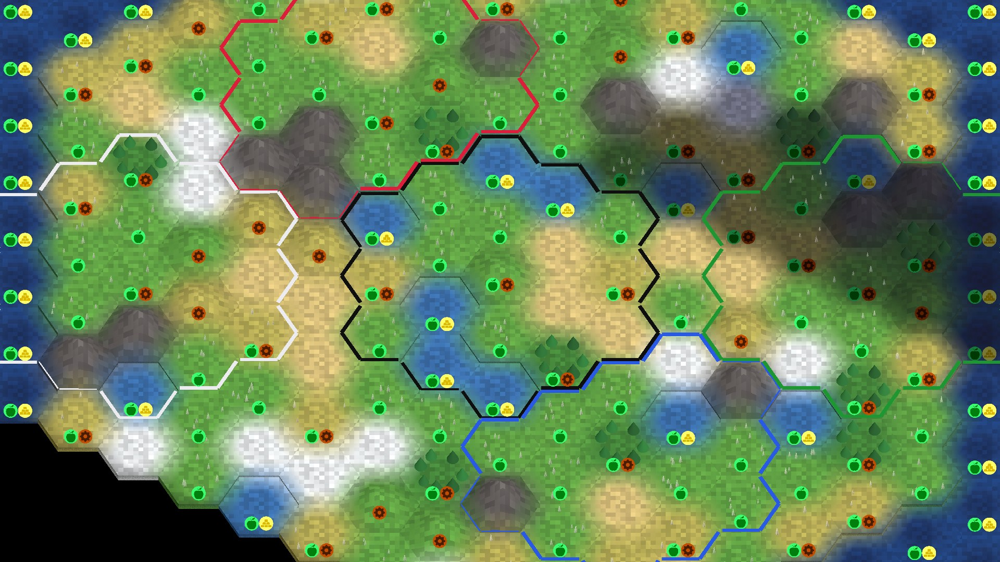
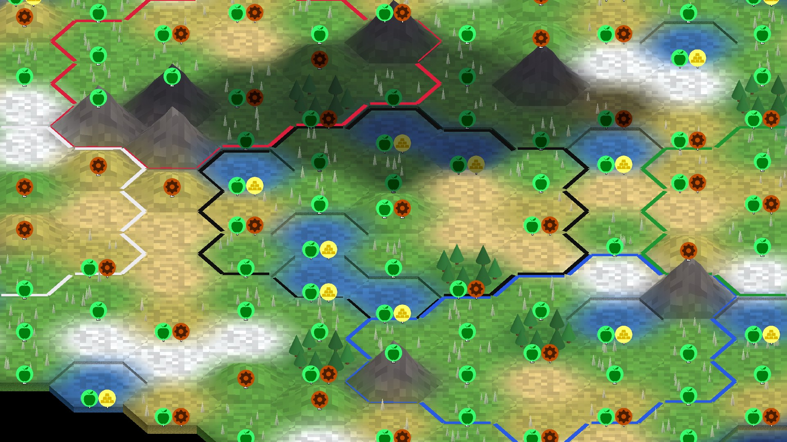
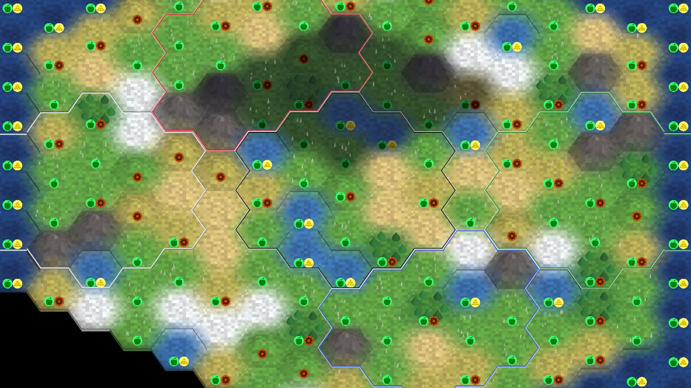
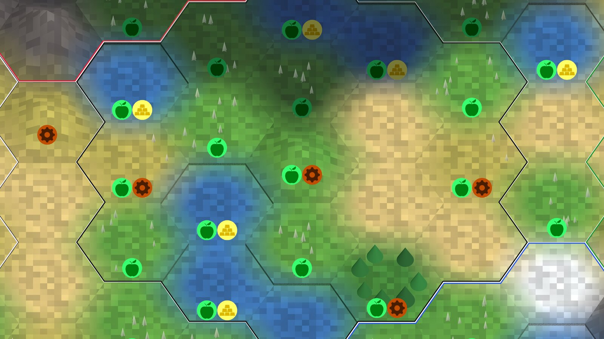

# Territory borders on the 3D map (T377)

<!-- toc -->
<!-- /toc -->

Status: PART 1 review, written before any implementation. Evidence images are real-GPU (RTX 5060 Ti, Vulkan, Forward+) renders of the `borders-sheet` scenario
(`Unciv.Godot.Harness/tools/borders-sheet.sh`), plus the owner's screenshot `design/images/bug-borders-2026-10-30.png`.

## What the owner saw and what is really wrong

The owner's screenshot shows territory outlines (black around Milan, red, white, green) that are drawn in pieces: single sides floating, corners that do not meet, outlines ending
short, uneven thickness. Reproduced on the real GPU with a mixed map (grass, plains, desert, snow, hills, mountains, forest, coast, five civs). Root causes in `MapOverlayLayer.Rebuild`
and `MapOverlays.BorderEdges` / `EdgeEnds`:

1. **No joins.** Every border side is its own rectangle (`Ribbon.Add`: four vertices, square ends) inset by half the width along the tile side. Two neighbouring rectangles of one outline
   share only a corner point of their centre lines, so at every convex corner a wedge is missing and at every concave corner the ends overlap in a notch. This is the "corners do not meet" look
   at every zoom (see the zoom 6 and zoom 14 renders: the notch is visible at each corner).
2. **Width is in world units, so it is not constant on screen.** `BorderWidth = 0.1` world units. The camera is orthographic and tilted (55 degrees by default), so a side that runs left-right
   (its width lies along the depth axis) is foreshortened by sin(tilt) about 0.82 (0.5 at a 30 degree tilt) while a side running up-down keeps its width: the horizontal sides look thinner than the
   slanted ones ("inconsistent thickness"). It also scales with zoom and ignores the UI scale: 3 px at zoom 40, 8 px at zoom 14 on 1080p, 16 px at 4K (`UiTokens.AutoScale` is not honoured).
3. **Depth-tested ribbons sit at rim height and are hidden by relief.** A ribbon lies 0.03 above the tile rim (0.2) and is an ordinary depth-tested surface. A mountain (apex 1.2) or hill
   (0.6) in front of it, as seen from the tilted camera, covers it: whole sides disappear (renders at 30 degrees tilt: red and blue outlines vanish behind mountains), and a ribbon on a mountain's
   own rim is half buried by the rising dome (the very thin red line in the zoom 14 render). Different rims of neighbouring tiles (coast 0.13, ocean 0.08, land 0.2) also put the two bands of a
   shared side at different heights.
4. **Gaps by design where the owner is unknown.** `BorderEdges` skips a side whose neighbour is fogged and has no remembered owner (T298 rule: never draw a border where only sight changes), and a
   fogged tile with no remembered owner gets no border of its own. `TileOwnerMemory` starts empty after a load, a reconnect or a map reveal, and the snapshot withholds owners of fogged tiles
   (fog-of-war rule), so large dark regions of the owner's screenshot have no outline at all and the lit part shows isolated sides. The result is a set of open fragments, with a hard cut at the end of
   each, not "a territory that continues into the unknown".
5. **One flat colour, no casing.** A black civ colour on a dark fogged brown tile (the owner's screenshot) is barely visible; white on snow or sand is not visible either. There is no contrast guarantee.

## What Kotlin does (core/.../TileLayerBorders.kt)

- Per owned tile and per *explored, existing* neighbouring tile (`getVisibleNeighbors()`) with a different owner, one border segment made of two tinted images: the **inner** image tinted with the
  nation's *outer* colour and the **outer** image tinted with the nation's *inner* colour (two-tone, so some part of it contrasts with any terrain).
- Segment shape depends on whether each of the two shared neighbours (left and right of the side) belongs to the same owner (a missing shared neighbour counts as the owner's own): `Concave`, `Convex`,
  `ConvexConcave`, `ConcaveConvex` pre-drawn images, which is how Kotlin makes the lines meet at the hex corners. Our client has no such join logic: root cause 1.
- A side is drawn per side, so two civs sharing a side get two adjacent bands. An unowned neighbour counts as a different owner. The border of a fogged explored tile is drawn too (the Kotlin client knows the
  real owner, `TileView.getOwner`; our snapshot withholds it, see 4). **No border is drawn against the map edge or an unexplored neighbour** (it is not in `getVisibleNeighbors`).
- Thickness is part of the tileset image, so it scales with the map zoom like the tiles (world-fixed). City-states, allies and enemies use the same style; no war or alliance marking, no territory fill by default.

Deliberate differences recorded for this ticket (parity is not required): width is screen-constant, not world-fixed; the join is computed geometry (miter, bevel past the clamp) instead of four pre-drawn shapes;
fogged borders are dimmed; open ends fade out; **sides against an unexplored tile or the map edge are drawn** (as the current client does, Kotlin leaves them open) so that every fully known territory is one closed
loop with no gap: the outline of what we know is complete.

## What the map shows

| Situation | Rule |
|---|---|
| Own, allied, at war, city-state, majors | Same style, the civ's own colours. Colour is the only identity; no war/peace marking (Kotlin has none). |
| Two civs share a side | Two bands, one on each side of the side, each inside its own tile. No overlap, no gap, same height. |
| Territory vs unowned (land, coast, ocean) | One band inside the owned tile. Owned water tiles are outlined like land. |
| Territory vs unexplored / outside the map | Outlined like unowned (deliberate deviation from Kotlin, see above). |
| Fogged owned tile, owner remembered | Same geometry, drawn at 65 % opacity so it reads as remembered. |
| Fogged tile, owner never seen | No band of its own and no band against it (T298), and the open end of the outline **fades out over one side** instead of cutting off. |
| Hills, mountains, forests | The border is drawn over relief: solid where visible, a 35 % "ghost" where terrain in front hides it (see Depth). |
| Units, props, improvements, banners | A unit or prop never loses pixels to the solid pass (depth tested); the ghost may tint it by 35 % where the border is occluded. Banners and chips are unaffected (no depth test, drawn later). |
| Religion / other overlays | Out of scope: no change to the border; a future overlay draws separately. |
| Territory fill | None (as Kotlin). Optional tint is not part of this ticket. |

## Geometry rules

1. **Loops.** The border of a territory is built as directed chains: all sides of one owner are oriented with the owned tile on the left and chained corner to corner (key: the corner position
   rounded to 1/1024). At a vertex with two outgoing sides (two tiles of one owner touching in a single corner) the left-most continuation is taken, so every side belongs to exactly one chain.
   Chains that cannot close (they run into an unknown-owner fogged tile) are open chains with a fade at the ends. Property tested: every side is in exactly one chain; every chain of a fully known
   territory is closed; consecutive points share exactly one corner.
2. **Vertex format (one mesh per civ, four vertices per side).** `Vertex` = the corner on the true side (x, lifted y, z); `UV` = unit ground normal, pointing into the owned tile, of the side arriving at the
   corner; `UV2` = the same for the side leaving it (equal at the end of an open chain); `COLOR` = (across 0 or 1, side opacity, end fade, unused). Uniforms: `band_px`, `casing_share`, `outer_colour`,
   `casing_colour`. Builtins: `VIEWPORT_SIZE`, `MODEL_MATRIX`, `VIEW_MATRIX`, `PROJECTION_MATRIX`, `POSITION`. The mesh's custom AABB is the corner bounds grown by 2 world units (the offset happens after
   culling data is made). Both Forward+ and Compatibility compile the same source (checked on the real GPU and on llvmpipe in the harness).
3. **Miter in screen space.** In the vertex shader the two inward normals are projected with the live camera into pixel space (y up), turned into the screen normals of the two sides (perpendicular to the
   projected side direction, sign chosen so it agrees with the projected inward normal), averaged to the miter and scaled by 1/(miter . normal) so both band edges stay `band_px` away from the sides. The
   factor is clamped to 3: a hexagon outline's ground turns are 60 degrees (factor 1.16) and, at a pinch, 120 degrees (2.0); a tilt of 25 to 80 degrees distorts the screen angles but stays below the clamp
   in the tested range. Where the clamp would still cut a corner the offset is limited instead (a bevel), which keeps the strip connected; tests sample every corner at tilts 25, 55 and 80.
4. **Inward band.** The band is offset **inward** from the true side (towards its own tile) by 0 to `band_px`, so the two civs' bands of a shared side touch and never overlap, whatever the zoom or tilt.
5. **Two tones.** Across the band the outer `casing_share` (30 %, at least 1 px) is the *casing* in the nation's inner colour, the rest the nation's outer colour (as Kotlin). Edges are anti-aliased by
   `fwidth` coverage.
6. **Width in screen pixels, honouring the UI scale.** `band_px = round(clamp(0.03 * tile_screen_width, 1.5 s, 4 s))`, at least 2, `s` the effective UI scale
   (`UiTheme.Scale` = `UiTokens.AutoScale` times the user scale, the number `UiTheme.Px` multiplies by), `tile_screen_width` = 2 world units times viewport height over camera size. Updated from `MapView.ViewChanged`
   and `UiTheme.ScaleChanged`, a uniform write, no rebuild.

   | Window | s | Zoom 6 | Zoom 14 (default) | Zoom 24 | Zoom 40 |
   |---|---|---|---|---|---|
   | 1366x768 | 1.0 | 4 px (clamp) | 3 px (tile 110 px) | 2 px (clamp) | 2 px (clamp) |
   | 1920x1080 | 1.5 | 6 px (clamp) | 5 px (tile 154 px) | 3 px (tile 90 px) | 2 px (clamp 2.25) |
   | 3840x2160 | 2.5 | 10 px (clamp) | 9 px (tile 308 px) | 5 px (tile 180 px) | 4 px (clamp 3.75) |

   (The previous constant 0.1 world units was 3 px at 1080p zoom 40 and 16 px at 4K zoom 14, and 0.82 of that on horizontal sides.)
7. **Depth: solid pass plus ghost pass.** Vertex height of a side = the higher rim of the tile on each side (`TerrainRelief.RimHeight`, flat land when a tile node is missing) plus 0.03, so both civs' bands of a
   shared side are level. Two draws of the same mesh with two materials: the **solid** material is depth tested, no depth write, with a small view-space bias (0.1) only against z-fighting with the terrain; the **ghost**
   material is drawn first with `depth_test_inverted` (only where terrain or a prop is in front of the border), 35 % opacity. So relief never removes a side from the outline, and no unit or prop loses a pixel to the
   solid pass. No `DEPTH` writes, so early-z is kept. If `depth_test_inverted` fails to compile on a renderer, the ghost falls back to no depth test below the solid pass (verified on both renderers during implementation).
   Both passes use blend mix with depth write off (the overlap of a miter at a pinch point blends twice, which is invisible at the opacities used).
8. **Performance.** One mesh and two materials per civ (two draws per civ), the border meshes rebuilt on snapshot change as now (roads, cities and improvements untouched). Chain building is linear in the
   number of sides; no per-frame work except the uniform update. Stress scenario: a 60x40 map with 12 civs.

## Colour

Both colours come from the ruleset nation (`GetOuterColor`/`GetInnerColor`). When their contrast is below 3:1 (`UiTokens.Contrast`) the casing is replaced by black or white, whichever contrasts
more with the outer colour, so the line has an edge on every terrain (snow, desert, dark fog) without the ruleset's author caring.

## Tests and evidence (PART 2)

- `BorderChains`, `BorderMesh`, `BorderStyle` (Unciv.Assets, engine-independent, Unciv.Core.Tests): closed loops, every side exactly once, holes, pinch points, open chains, determinism, inward normals,
  fade at open ends, width table above, casing fallback.
- Harness `borders` scenario (llvmpipe, goldens): five captures at tilts 25 to 80, yaws 0 to 60, zooms 6 to 20 and UI scales 1 to 2.5 plus the two older ones. At each view it renders the map with and
  without the strips and probes the difference (`BorderProbe`): every side (three points, 0.65 band inward) and every corner of every closed outline must be painted (no gaps, joined corners), and the band's
  median width across non-shared sides must be within 1 px of `BandPixels` with a spread of at most 3 px (slanted versus horizontal; the probe itself is accurate to about 1.5 px).
- `borders-stress` on a 60x40 map with 12 civs: every chain closed, four vertices and six indices per side, one solid and one ghost strip per civ, whole overlay built in under a second.
- Verified by eye only (not asserted): the ghost pass behind mountains and the casing contrast on snow, sand and dark fog, on the real GPU. The Compatibility renderer used by the goldens has not been
  checked for the ghost pass (see the ticket Notes).
- The real-GPU `borders-sheet` (RTX 5060 Ti, Vulkan) after the fix, at 1366x768 (3 px band), 1920x1080 (5 px) and 3840x2160 (10 px at zoom 6):

## Open questions for the owner (with the recommended answer)

1. **Line width.** Constant on screen (recommended: 3 px at 1366x768 and the default zoom, 5 px at 1080p, 9 px at 4K, bounded between 1.5 and 4 times the UI scale) or growing with the map zoom like Kotlin?
2. **Two-tone casing** (nation's outer colour inside, inner colour as a thin edge, as Kotlin) or one colour only? Recommended: two-tone.
3. **Hidden by relief.** Show a faint 35 % ghost of the border where a mountain or hill in front hides it (recommended), draw it fully over relief (also covers units), or let relief hide it like any solid object?
4. **Remembered borders in fog.** Draw at 65 % opacity (recommended) or exactly like visible ones?
5. **Unknown owners after a load/reconnect.** Fade the open ends (recommended, this ticket) and fix the cause in a separate ticket (persist the remembered owners with the save and the session, filed as T378), or
   let the server send owners of explored fogged tiles (Kotlin's behaviour, reveals what the civ could not know)?
6. **War / alliance / city-state marking** on the border (e.g. dashed for war)? Recommended: no, the colour alone, as Kotlin.
7. **Territory tint fill** (a 10 to 15 % wash inside the border)? Recommended: not now.
8. **Sides against unexplored tiles and the map edge.** Draw them so the known territory is a closed outline (recommended, differs from Kotlin) or leave them open as Kotlin?
