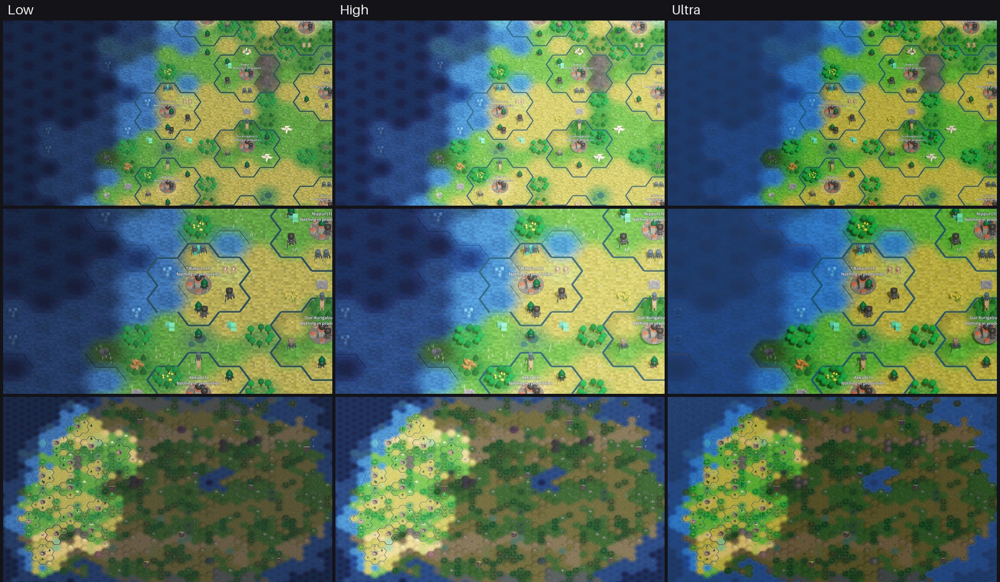
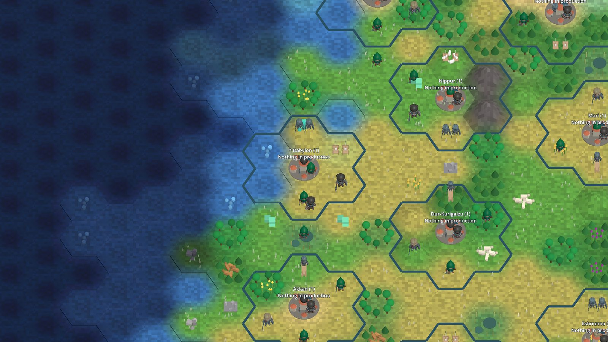
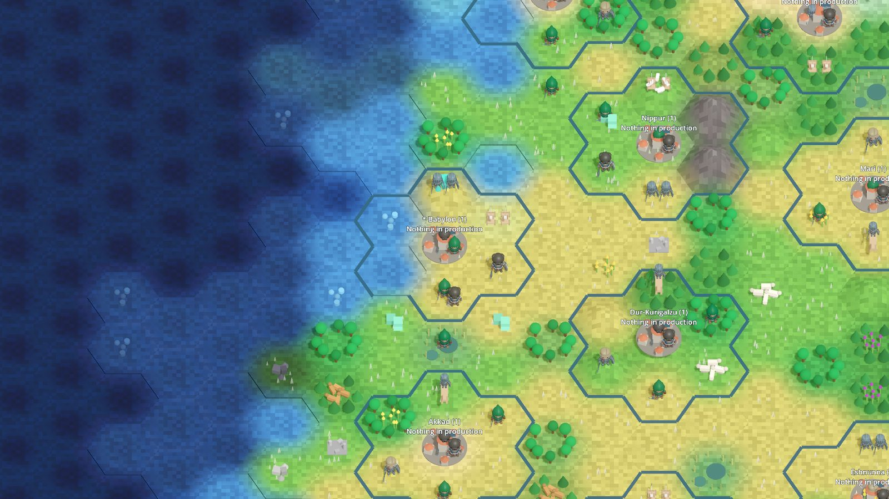
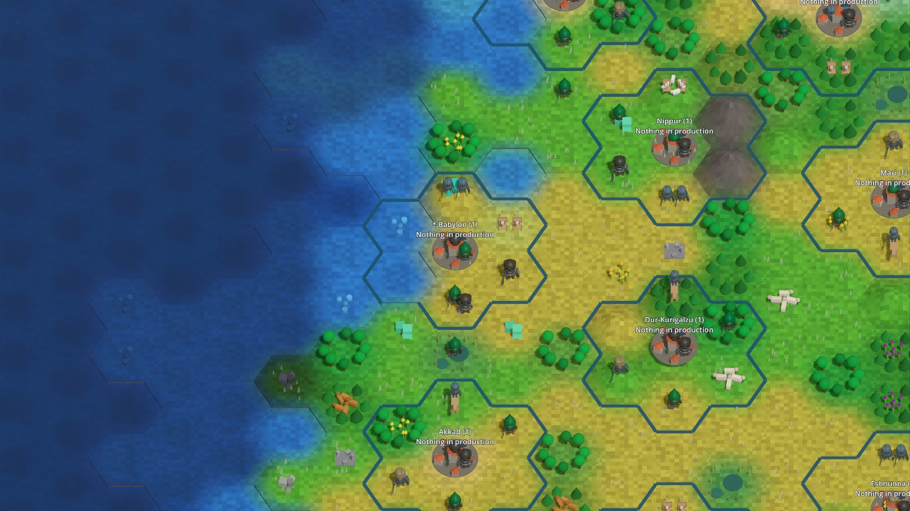
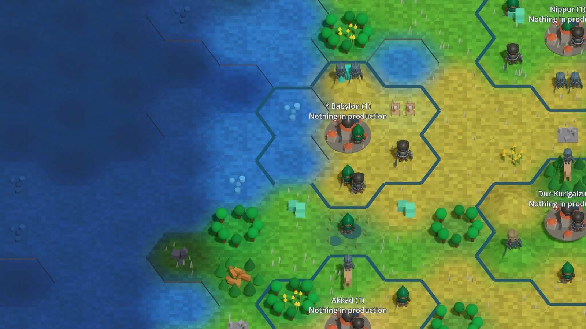
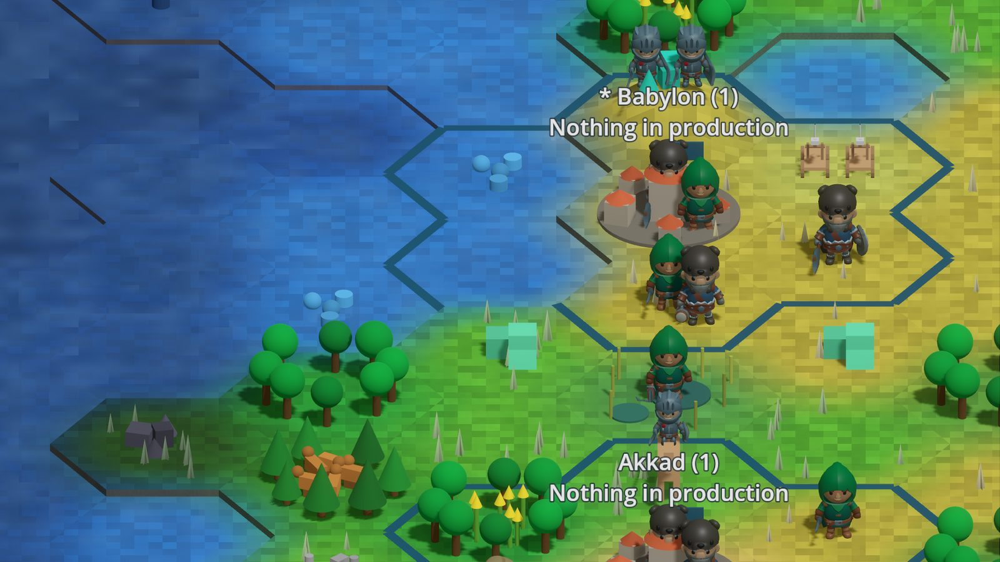
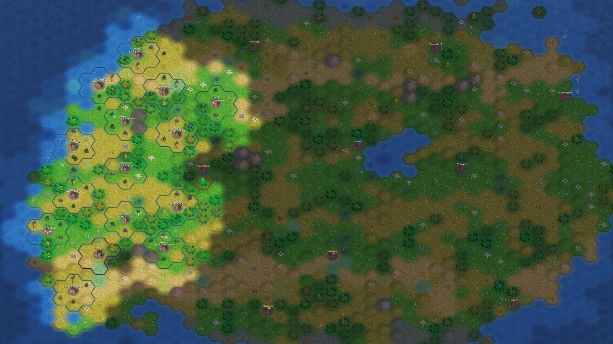

# Ultra graphics: what "ray tracing / AAA shaders" can mean for this client (T264)

<!-- toc -->
## Contents

- [0. How this was verified (and what was not)](#0-how-this-was-verified-and-what-was-not)
- [1. Feasibility of hardware ray tracing (honest answer)](#1-feasibility-of-hardware-ray-tracing-honest-answer)
- [2. Ranked effects: payoff versus cost](#2-ranked-effects-payoff-versus-cost)
- [3. Coexistence](#3-coexistence)
  - [Harness goldens (llvmpipe)](#harness-goldens-llvmpipe)
  - [Android (T259)](#android-t259)
  - [Quality setting model (C043)](#quality-setting-model-c043)
- [4. Recommended minimum-scope Ultra preset and fallback](#4-recommended-minimum-scope-ultra-preset-and-fallback)
- [5. Prototype evidence](#5-prototype-evidence)
- [6. Go/no-go and provisional ticket scope](#6-gono-go-and-provisional-ticket-scope)
- [7. Real-GPU pass (T271)](#7-real-gpu-pass-t271)
  - [Method](#method)
  - [Frame time per level](#frame-time-per-level)
  - [Cost per effect](#cost-per-effect)
  - [Look, colour calibration and animation](#look-colour-calibration-and-animation)
  - [Real-GPU pictures (T291)](#real-gpu-pictures-t291)
  - [Conclusions and follow-ups](#conclusions-and-follow-ups)
  - [Windows, macOS and Android (UNVERIFIED)](#windows-macos-and-android-unverified)
<!-- /toc -->

Source: GitHub issue #3 ("rtx on feature", owner unsure how feasible). This is a spike: it states what Godot 4.7.2 offers, what we could and could not verify, and recommends a minimum-scope preset. Ticket C097 implements it.

Decision: go, for a cheap Ultra preset on the Forward+ renderer (shadows, tone mapping, glow, SSAO, optional MSAA/TAA and water/terrain shader polish); no-go on hardware ray tracing.

## 0. How this was verified (and what was not)

- Pinned engine: Godot 4.7.2 .NET (`Unciv.Godot.Harness/tools/setup-godot.sh`). Project renderer: `gl_compatibility`, also for mobile (`project.godot`). Map scene: `Map/MapView.cs` (one `DirectionalLight3D`, flat ambient `Environment`, terrain chunk meshes with vertex colours, `Assets/MapMaterials.cs`).
- Prototype (evidence only, never merged): throw-away branch `proto/T264-ultra` (local, commit 86b640000c) adds env-var driven `Environment` effects to `MapView._Ready`. It was run through the existing `terrain-3d` scenario with the real client code, `--rendering-method` and `--rendering-driver` overridden by hand.
- **Every render below came from Mesa software rasterizers, never from a real GPU**: OpenGL 3 on llvmpipe for `gl_compatibility`, and Vulkan 1.4 on **lavapipe** (Mesa's CPU Vulkan driver, `lvp_icd`) for Forward+ (a Mobile-renderer run was started but not inspected). Godot reported `Forward+ - Using Device #1: Unknown - llvmpipe`. lavapipe proves the effects compile and run, nothing about speed or about hardware ray tracing.
- Not verified, because no GPU exists on this machine: frame cost of any effect (all numbers in the cost column are estimates from general experience and are labelled so), behaviour on real Vulkan/GL drivers, Android, macOS (MoltenVK), hardware ray tracing at all.
- Ray tracing API presence was checked by listing the symbols in the pinned `GodotSharp.dll`, not by running anything (see section 1).

## 1. Feasibility of hardware ray tracing (honest answer)

What exists in the pinned engine:

- `RenderingDevice` (the low-level Vulkan/D3D12/Metal abstraction, not available on `gl_compatibility`) in 4.7.2 has ray tracing entry points: `BlasCreate/BlasBuild`, `TlasCreate/TlasBuild`, `RaytracingPipelineCreate`, `RaytracingList*` and `RaytracingListTraceRays`, plus acceleration-structure flag enums (present in `GodotSharp.dll`; we did not call them, so their semantics, required device feature checks and stability are **unverified**). It is a compute-style API: we would write our own ray-generation/closest-hit shaders and our own renderer pass, then composite the result into the viewport.
- Godot's built-in renderers do not use it for lighting. Nothing in `Environment`, `WorldEnvironment`, `LightmapGI`, `VoxelGI` or the standard materials is "ray traced": global illumination is baked (LightmapGI, VoxelGI) or real-time probe/SDF based (SDFGI), reflections are screen-space (SSR) or probe based, shadows are shadow-mapped.
- It would need a GPU and driver exposing Vulkan ray tracing (KHR extensions; roughly RTX 20+, RDNA2+, Arc, recent Apple GPUs are the usual set, which we cannot confirm per vendor here), the Forward+ renderer, and does not exist on `gl_compatibility` or Android's default path. lavapipe does not offer it (assumed, not tested).
- The ticket forbids vendor-only RT extensions and proprietary SDKs, and "own the renderer pass" is a large, test-hostile project for a hex-tile strategy game whose camera is mostly orthogonal and top-down.

Conclusion: real hardware ray tracing is technically reachable only as custom RenderingDevice work, is unverifiable in CI and on this machine, and has near-zero visible payoff on a flat tile map with small figures. **No-go.** "Ultra" should mean the cheaper effects below, honestly labelled; the UI must not say "ray tracing".

What Godot does provide (all built-in, no vendor code): shadow-mapped directional/omni/spot shadows, tone mapping (Filmic/ACES/AgX), glow/bloom, SSAO and SSIL (screen-space, Forward+ only), SSR (Forward+ only), SDFGI and VoxelGI (Forward+ only, expensive), volumetric fog (Forward+ only), depth-of-field and auto-exposure (camera attributes), MSAA/FXAA/TAA/FSR2 (availability depends on renderer), custom `.gdshader` materials (all renderers, with feature subsets).

## 2. Ranked effects: payoff versus cost

Cost classes are estimates for a mid-range GPU at 1080p, **not measured** (no GPU here). Prototype column says what the llvmpipe/lavapipe render showed on the `terrain-3d` scene (a small flat island; mean absolute RGB difference per pixel against the matching baseline, 0-765 scale).

| Rank | Effect | Visual payoff for this game | Est. cost | Renderer needed | Prototype observation |
|---|---|---|---|---|---|
| 1 | Directional shadows (4-split, soft filtering) | High once figures, props and forest stand on terrain (grounds units) | low-medium | works in `gl_compatibility`, Mobile, Forward+ | rendered in compat (diff 15.9); terrain is flat so only figures/relief cast |
| 2 | Tone mapping (ACES/AgX) plus mild glow | High, cheap "film look" | low | compat (glow in compat since 4.3; unverified for 4.7.2 mobile GPUs), Mobile, Forward+ | rendered in compat (tone diff 15.8, glow diff 2.2) |
| 3 | Custom water shader (animated normal, fresnel, depth tint, shoreline foam) | High: most of the map is ocean/coast | low-medium | all renderers (spatial shader) | not prototyped; payoff by reasoning only |
| 4 | Terrain shader polish (triplanar noise detail, slope blend, wind on vegetation) | Medium-high | low | all renderers | not prototyped |
| 5 | SSAO (and SSIL) | Medium on figures/props, little on flat terrain | medium | Forward+ only (not Mobile, not compat) | rendered under Forward+/lavapipe but the change on flat terrain was tiny (0.09 / 0.24 against the Forward+ baseline); needs a scene with props to judge. In compat the flag had no visible intent (a 1.8 difference appeared that we did not explain) |
| 6 | MSAA 2x/4x or TAA | Medium: hex edges, thin lines | low (MSAA) to medium | MSAA: compat/Mobile/Forward+; TAA/FSR2: Forward+ | not prototyped |
| 7 | SSR on water | Medium-low at top-down angles | medium | Forward+ only | not prototyped |
| 8 | Volumetric fog / god rays | Low for the game, risky | high | Forward+ only | washed the whole scene to grey with density 0.02 (render diff 217); needs real tuning, looks wrong on an orthogonal map camera |
| 9 | SDFGI / VoxelGI | Low: static lit tiles, no interiors | very high | Forward+ only | not tried, rejected on cost/benefit |
| 10 | Hardware ray tracing (section 1) | Very low here | very high | custom RenderingDevice, Vulkan RT GPUs | not possible to test |

Platform notes: Forward+ is Vulkan/D3D12/Metal on desktop, it is not offered on mobile defaults and not on web; Android (T259) and any browser build stay on `gl_compatibility`. macOS runs Vulkan via MoltenVK or Godot's Metal driver (unverified here).

## 3. Coexistence

### Harness goldens (llvmpipe)

- Goldens are recorded with `--rendering-driver opengl3` on llvmpipe under the compat renderer. Ultra effects **must be off in every scenario**: scenarios construct their scene with the low preset explicitly (C097 requirement) so no scenario reads user settings for graphics, and goldens stay unchanged.
- Important measured finding: just switching `gl_compatibility` to Forward+ **changes the colours of the unchanged scene** (mean difference 50.7 per pixel with no effects enabled, versus compat). Linear colour and default tonemapping/ambient handling differ per renderer, so the placeholder palette and the Civ-colours legibility guarantees were tuned on compat. An Ultra renderer therefore needs its own colour check, and a screen comparison of Ultra versus Low must never be a golden tolerance test.
- Ultra-look golden: possible only on lavapipe (it worked here in about 5 s for `terrain-3d`) and is not byte-stable across Mesa versions; keep it a non-gating, separately recorded image (C097 already calls it optional). Recommendation: do not add it to CI.
- CI runners differ in blending (see `GODOT.md`); Vulkan on lavapipe is a second moving part, so do not gate on it.

### Android (T259)

Soft link only. The Android build uses `gl_compatibility`; Ultra is unavailable there and the setting shows the "not supported on this device" note. The compat-safe subset (shadows, tone mapping, glow, shaders, MSAA) is a candidate "High" level there, subject to T259's frame-budget measurements.

### Quality setting model (C043)

`ClientSettings` is versioned JSON under `user://`; add `GraphicsQuality` (Low / High / Ultra) with a settings migration, default Low. It also feeds the C085 LOD caps (Done): Low = tighter caps, higher levels looser.

## 4. Recommended minimum-scope Ultra preset and fallback

Levels:

- **Low** (default; harness scenarios): today's look, compat renderer, no shadows.
- **High** (compat-safe, can ship on every platform including Android if T259 allows): directional shadows, tone mapping plus glow, MSAA 2x, water and terrain shader polish (shader polish ended up Ultra-only, see the C098 outcome in section 6).
- **Ultra** (Forward+ only): everything in High, plus SSAO, MSAA 4x or TAA, SSR on water. Not included: volumetric fog, SDFGI/VoxelGI, ray tracing.

Renderer switch: Godot picks the renderer once at start, so choosing Ultra saves the setting and offers a **restart** (`OS.SetRestartOnExit` with `--rendering-method forward_plus`); picking Low/High restarts back to `gl_compatibility`. The `Main` scene must read the setting before building the scene; first-run behaviour is unchanged.

Fallback, in order: if the renderer after restart is not Forward+ (driver refused, `RenderingServer.GetCurrentRenderingMethod()` mismatch, software adapter name such as llvmpipe), apply High and show a visible, localised note in the settings screen ("Ultra needs a Vulkan or Direct3D 12 GPU; showing High"). Never crash, and persist an "ultra failed" flag so we do not restart-loop. A real-GPU check of the restart path is not verified.

Colour: add a per-level exposure/ambient constant so Ultra's palette matches Low within an agreed tolerance (the measured Forward+ shift above is the reason).

## 5. Prototype evidence

Four renders of the existing `terrain-3d` `angle-high` step (640x480), from the throw-away branch, all on software rasterizers (see section 0):

| File | Renderer / driver | Effects |
|---|---|---|
| `ultra-graphics/compat-baseline.png` | `gl_compatibility`, OpenGL 3, llvmpipe | none (today) |
| `ultra-graphics/compat-glow-shadow-tonemap.png` | same | shadows, ACES, glow |
| `ultra-graphics/forwardplus-no-effects.png` | Forward+, Vulkan, lavapipe | none |
| `ultra-graphics/forwardplus-ssao-glow-shadow-tonemap.png` | same | SSAO, glow, shadows, ACES |

What the images show: effects run; Forward+ with no effects is noticeably brighter and paler (lower contrast) than compat (the colour-shift finding); ACES plus glow brightens and softens the island. They do not show a convincing AAA gain on this tiny flat scene; SSAO is nearly invisible here. No GPU timing exists.

## 6. Go/no-go and provisional ticket scope

Decision: go (cheap Ultra only; hardware ray tracing no-go).

C097 scope after this spike (also updated in the backlog):

1. Setting model: `GraphicsQuality` Low/High/Ultra in `ClientSettings`, migration, default Low, tests for the model and preset mapping (a pure mapping table: level to {shadows, tonemap, glow, msaa, ssao, ssr, shaderTier}).
2. Preset applier in the client: sets `Environment`, light shadows, `Viewport.Msaa3D` for Low/High/Ultra; scenarios and harness pin Low.
3. Renderer-switch flow with restart, the fallback to High, the visible note, and the persisted failure flag.
4. Shader polish (water, terrain) as a separate follow-up ticket because it needs art tuning; High and Ultra work without it.
5. Settings screen entry and scenario `settings-graphics` (renderer independent), as already specified.
6. Colour calibration per level, using renders from a real GPU before shipping the Ultra label.

Follow-ups worth filing: shader polish ticket; a real-GPU measurement pass (frame time per effect on Linux, Windows and macOS, and a mid-range Android phone with T259); optional Ultra-look lavapipe render outside CI.

C098 outcome (shader polish): implemented as `ShaderTier` 1, drawn at **Ultra only** (the level table in section 4 lists it under High too; held back so Low and High pictures stay exactly as they are). One spatial shader (`Unciv.Godot/Assets/MapShaders.cs`) replaces the terrain chunk material: land gets world-space noise detail and a slope-to-rock blend; water (recognised as an upward-facing surface below the coast height, so the meshes and baked colours are unchanged) gets an animated normal, a sky fresnel tint and a specular glint. Not done: shoreline foam (needs a distance-to-land signal the merged meshes do not carry), wind on vegetation. Verified only that it compiles and draws on llvmpipe OpenGL (`tools/run-scenario.sh terrain-ultra`, not in CI); look, colour match and cost on a real GPU are unverified (T271).

## 7. Real-GPU pass (T271)

Everything above was verified on Mesa software rasterizers only. T271 ran the client on real hardware on this Linux machine and measured. Not measured: Windows, macOS and an Android phone (no such hardware here, see the last subsection).

### Method

- Tool: harness scenario `gpu-bench` (`Unciv.Godot.Harness/GpuBenchScenario.cs`, deliberately not in `scenarios.txt`, never in CI; output is never a golden) run by `Unciv.Godot.Harness/tools/gpu-bench.sh <forward_plus|gl_compatibility> <out-dir> [gpu-index|nvidia|intel]` on the host (the dotnet-dev container has no NVIDIA userspace; Godot .NET needs a dotnet runtime, `DOTNET_ROOT` pointing at a copy of the container's `/usr/lib64/dotnet`). Build first inside dotnet-dev.
- Scene: the real `GameScreen` over a generated Large Pangaea map (2838 tiles, 11 civs plus 4 city-states, 24 cities, 84 units, whole map explored for the human, yield chips on), window 1920x1080, the three levels applied with `MapView.ApplyGraphics` using the preset table (Ultra on the compatibility renderer drops SSAO and SSR, which that renderer rejects, and is labelled `Ultra-no-ssao-ssr`).
- Views: `overview` (camera size 40 = the whole map in view, the stress case), `mid` (14, the default), `close` (6, tilt 60), `coast` (9) and `coastlow` (5, tilt 28, over a shoreline), `pan` (mid zoom, the camera pans every frame). 45 warm-up frames, then 300 frames per measurement.
- Per frame: wall time = Godot's process delta with `--disable-vsync` (so it includes everything the frame does, not only rendering); GPU time and CPU render time = `RenderingServer.ViewportGetMeasuredRenderTimeGpu/Cpu` (timestamp queries; on the compatibility renderer the GPU figure includes driver stalls, treat it as an upper bound); draw calls = `Performance.RenderTotalDrawCallsInFrame`. The renderer and adapter are read back from Godot (`info.txt`).
- Noise: the machine is shared (20 cores, other agents running builds; load average 5-12 during the quoted runs, 40-120 during discarded ones, which inflated CPU time up to 2x and made wall time useless). GPU time is stable under load (spread under 0.1 ms on the NVIDIA runs); wall and CPU time vary, so each cell is the mean of N runs with the min-max range. The NVIDIA numbers are 3 runs, Intel 2 runs.
- Hardware: NVIDIA GeForce RTX 5060 Ti (proprietary driver 615.71.09, Vulkan 1.4.351, OpenGL 3.3.0 NVIDIA); Intel Arrow Lake iGPU (Mesa 26.2.4, Vulkan 1.4.354, OpenGL 4.6 Core). Wayland session with XWayland (`DISPLAY=:0`).

### Frame time per level

Forward+ (Vulkan), ms, mean [min-max] over runs. wall / GPU / CPU render. Draw calls per frame are the same on every GPU.

| View | Draws L/H/U | RTX 5060 Ti Low | High | Ultra |
|---|---|---|---|---|
| overview (zoom 40) | 13.3k / 26.1k / 26.1k | 21.0 [19.9-22.7] / 2.65 / 12.6 | 26.3 [25.3-27.4] / 4.8 / 16.6 | 28.2 [27.8-28.6] / 5.9 / 18.1 |
| mid (zoom 14) | 2.0k / 6.2k / 6.2k | 3.9 [3.4-4.6] / 0.64 / 1.3 | 5.2 [4.9-5.6] / 1.7 / 2.7 | 7.5 [5.3-11.2] / 2.5 / 3.8 |
| close (zoom 6) | 0.4k / 2.0k / 2.0k | 2.1 / 0.39 / 0.3 | 3.1 / 0.99 / 0.8 | 5.8 [2.4-12.4] / 1.6 / 1.4 |
| coast | 1.0k / 3.4k / 3.4k | 3.0 / 0.48 / 0.6 | 3.9 / 1.3 / 1.4 | 4.9 / 1.8 / 1.7 |
| pan (see note) | 2.0k / 1.7k / 5.8k | 4.4 / 0.67 / 1.5 | 3.5 / 0.78 / 0.9 | 6.9 / 2.5 / 3.3 |

| View | Intel iGPU Low | High | Ultra |
|---|---|---|---|
| overview | 59.4 / 56.4 / 24.1 | 60.3 / 57.8 / 24.5 | 73.2 / 70.4 / 36.4 |
| mid | 9.9 / 9.2 / 3.4 | 21.0 / 20.2 / 7.7 | 31.7 / 31.3 / 10.1 |
| close | 6.7 / 6.1 / 0.9 | 14.0 / 13.2 / 2.8 | 21.7 / 21.2 / 4.1 |
| coast | 7.0 / 6.6 / 1.8 | 18.3 / 17.5 / 4.6 | 26.4 / 25.7 / 6.7 |
| pan | 10.0 / 9.4 / 2.9 | 11.3 / 10.8 / 2.8 | 33.2 / 32.7 / 10.3 |

Note on `pan`: the camera moves every frame, so the visible set (and the shadow-caster count) varies with the path; High drawing fewer calls than Low there is a culling artefact of the path, not a speed-up, so do not compare that row across levels.

Compatibility renderer (OpenGL 3), the path Low and High ship on, wall / GPU / CPU ms:

| View | RTX 5060 Ti Low | High | Ultra-no-ssao-ssr | Intel iGPU Low | High |
|---|---|---|---|---|---|
| overview | 32.7 [28.8-40.4] / 23.0 / 31.6 | 39.3 / 34.0 / 38.2 | 43.9 / 38.0 / 42.7 | 80.8 / 73.3 / 77.5 | 116.9 / - / 124.2 |
| mid | 4.8 / 0.42 / 3.5 | 6.9 / 3.6 / 6.2 | 6.9 / 3.6 / 6.0 | 24.2 / 21.3 / 16.2 | 33.4 / 32.6 / 25.9 |
| close | 3.2 / 0.19 / 0.8 | 3.7 / 0.72 / 1.7 | 4.4 / 0.78 / 2.0 | 16.3 / 12.1 / 4.5 | 17.3 / 16.6 / 8.9 |

(The Intel compatibility runs shared the machine with heavy builds; their spread is 20-30%. Intel High overview GPU has one run with a timer glitch and is left out.)

Reading:
- On the discrete GPU every level runs far above 30 fps in every view, including the Large map zoomed all the way out: the slowest cell is 28 ms (35 fps, Forward+ Ultra, overview) and the typical play view (mid) is 4-8 ms. Nothing needs its default adjusted; Low stays the default and nothing is too slow there.
- The cost is **CPU/draw-call bound**, not GPU bound, on the discrete card. The overview view issues 13.3k draw calls at Low (yield chips and their labels, prop models, unit bars) and the sun shadow pass doubles that to 26.1k, so the CPU render time goes from 12.6 to 16.6-18 ms and Forward+ GPU time stays under 6 ms. The compatibility renderer is about 1.5-2x slower on CPU for the same scene and its GPU timer shows 23-38 ms at overview (driver cost per draw). Follow-up T287 (far-zoom draw-call reduction) is filed.
- On the Intel iGPU (integrated, shared memory) the picture is GPU bound: at 1080p Low is 10 ms at the default zoom, High 21 ms, Ultra 32 ms (about 31 fps); at overview Ultra is 73 ms (14 fps). Ultra is a discrete-GPU level; the note the settings screen shows when Ultra cannot run does not cover "runs but slowly on an integrated GPU" (follow-up T288). The levels that ship on the compatibility renderer are slower still on the iGPU: High 33 ms at mid (under 30 fps, one noisy run set) and 117 ms at overview, Low 81 ms at overview; on both GPUs the compatibility renderer is slower than Forward+ for the same level, and the default stays Low.

### Cost per effect

GPU ms added by each effect alone to Low on the RTX 5060 Ti, Forward+, 1080p, one ablation run (GPU time is stable under load; the CPU effect of the shadow pass is in the draw-call figures above). Views overview / mid / coast, Low = 2.64 / 0.65 / 0.49 ms.

| Effect | overview | mid | coast |
|---|---|---|---|
| shadows (4 splits) | +1.7 | +0.7 | +0.4 |
| tone map | 0.0 | 0.0 | 0.0 |
| glow | +0.2 | +0.2 | +0.2 |
| MSAA 2x / 4x | +0.3 / +0.5 | +0.2 / +0.4 | +0.2 / +0.2 |
| SSAO | +0.4 | +0.15 | +0.1 |
| SSR | +0.5 | +0.2 | +0.2 |
| C098 shader | +0.05 | +0.05 | +0.03 |
| all of High / of Ultra | +2.2 / +3.4 | +1.0 / +1.6 | +0.8 / +1.5 |

On this card no single effect costs more than the shadows, and the whole of Ultra is under 4 ms of GPU time. Shadows are the only effect with a visible CPU cost (they re-submit every shadow caster for each of the 4 splits).

### Look, colour calibration and animation

Pictures were rendered and viewed for all three levels at five views (the PNGs themselves stayed outside the repository; a curated set was re-rendered and published as documentation images, see "Real-GPU pictures" below; real-GPU output must not become a golden). Findings:

- **Forward+ is much brighter and paler than the compatibility renderer for the same scene and settings** (measured as mean pixel value over the map area, 0-255): compatibility Low 56, High 80 (mid view); Forward+ Low 86, High 108, Ultra with the old provisional constants (0.9 / 0.5) 111. Ultra was about 38% brighter than High, with washed-out blue-grey water. Compatibility Low draws the deep ocean nearly black (the palette the CI goldens were tuned on) and High is neon-saturated; both are today's behaviour and were left alone.
- **Calibration applied** (`GraphicsModel.Preset(Ultra)`): exposure 0.9 -> 0.6, ambient 0.5 -> 0.3, and a new `Saturation` 1.3 (Environment adjustment, Ultra only; Low and High keep 1.0 so they are untouched). Result, mean pixel value Ultra versus compatibility High: mid 85 vs 80, coast 89 vs 84, close 103 vs 105, overview 73 vs 62 (the overview gap is the near-black compatibility forests). The picture keeps natural, saturated land and blue water. Ultra is therefore matched to High, not to Low: Low is deliberately the old dark look, and High/Ultra are the "film look" levels.
- **Ultra water/terrain shader (C098)**: compiles and draws on both NVIDIA (Vulkan) and Intel (Vulkan); no artefacts on shorelines, hills, or under SSAO/SSR (viewed at full resolution at `coast` and `coastlow`). The water animates (frame-to-frame mean difference 0.1-0.5 per channel between two shots 40 frames apart, zero at High) and shows a soft depth tint; the ripples and fresnel are subtle at the game's steep camera angles and there is no visible sun glint (the sun is at -60 degrees). It reads as "clean, slightly lit water", not as a strong effect; judged acceptable, a stronger ripple is a tuning follow-up (T289). Not verified: shoreline foam, vegetation wind (not implemented).
- **SSAO / SSR on Forward+**: SSAO grounds the tree and figure props (contact darkening) with no halos; SSR shows nothing visible on the shader water at the usual tilt (the cost is small, +0.2-0.5 ms). No interaction artefacts with the shader's animated normals were seen.
- **C085 LOD and C086 combat effects**: the `unit-visuals` (including `far`) and `combat-presentation` scenarios were run on the RTX 5060 Ti compatibility renderer against the committed llvmpipe goldens with the cross-renderer tolerance: all 17 + 5 captures match with a mean difference of 0.0001-0.0004 (hash distance 0-2), i.e. the CI goldens are what a real GPU draws; the pictures were viewed (one figure per formation at far zoom, damage number, shot flash, bombard burst, death marker all present). On Forward+ the same scenarios differ from the goldens (mean 0.03-0.14), the known renderer colour shift. The scenarios pin the Low level, so C085/C086 under High and Ultra (shadows, glow on the effect sprites) were not exercised.

### Real-GPU pictures (T291)

Documentation images (not goldens; nothing reads them in CI) rendered on the RTX 5060 Ti, Forward+, 1920x1080, 2026-10-29, from the T271 fixture with the HUD and yield chips hidden (`UNCIV_BENCH_CLEAN=1`). Method, caption table and regeneration command: [`images/ultra/README.md`](images/ultra/README.md).

| Default play view: Low | High | Ultra |
|---|---|---|
|  |  |  |

| Ultra coast | Ultra water close-up | Ultra overview |
|---|---|---|
|  |  |  |

### Conclusions and follow-ups

1. The C097 defaults stand: Low default, High and Ultra opt-in; no level is too slow on a discrete GPU.
2. Ultra's colour constants are calibrated (above); the tests pin the calibration direction, not the exact numbers.
3. Follow-ups filed in the backlog: T287 far-zoom draw-call reduction (13.3k draw calls at the maximum zoom-out, the CPU bound on every GPU); T288 an integrated-GPU note for Ultra; T289 stronger water ripples/glint tuning; T290 real-device passes on Windows, macOS and a mid-range Android phone.

### Windows, macOS and Android (UNVERIFIED)

No such hardware was available; nothing below was run. Procedure for whoever has it (about 20 minutes per device):

1. Build the client for the platform (`Unciv.Godot/tools/package.sh <windows|macos|android>`, GODOT.md) or open `Unciv.Godot.Harness` in the matching Godot 4.7.2 .NET editor.
2. Desktop (Windows, macOS): run `Godot --path Unciv.Godot.Harness --rendering-method <forward_plus|gl_compatibility> --disable-vsync res://ScenarioRunner.tscn -- --scenario=gpu-bench --out=<dir> --golden-dir=<dir>/none` with `UNCIV_BENCH_OUT=<dir>` set, once per renderer (Forward+ is D3D12/Vulkan on Windows, Metal on macOS), once with `UNCIV_BENCH_MODE=ablation`; copy `results.csv`, `info.txt` and the PNGs. Check the renderer and adapter in `info.txt`.
3. Phone: Android is compatibility only. Export the harness with the Android template (T260), start the `gpu-bench` scenario with `UNCIV_BENCH_RES=1080x2400` or the device's own, set the `UNCIV_BENCH_*` variables through the app's launch intent or a `bench.env` read at start (a small change to `GpuBenchScenario` is needed: environment variables are not settable on a stock phone), pull the CSV with `adb pull`. Record the device model, SoC, thermal state and battery saver. Phones throttle: repeat three times with a cool-down and report the spread.
4. Record in this section: hardware, driver, renderer reported, the three tables above for that device, and whether Low/High hold 30 fps at `mid`.
