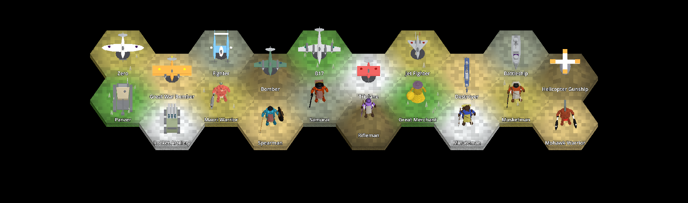
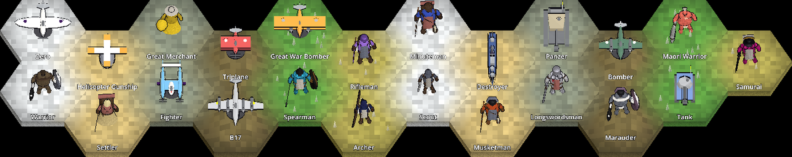
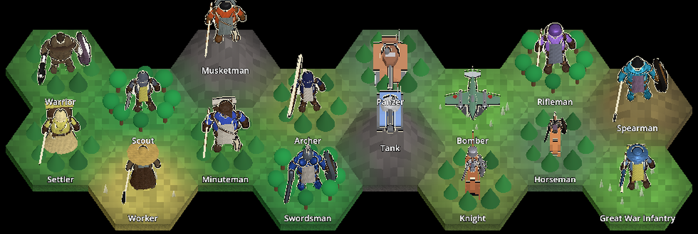
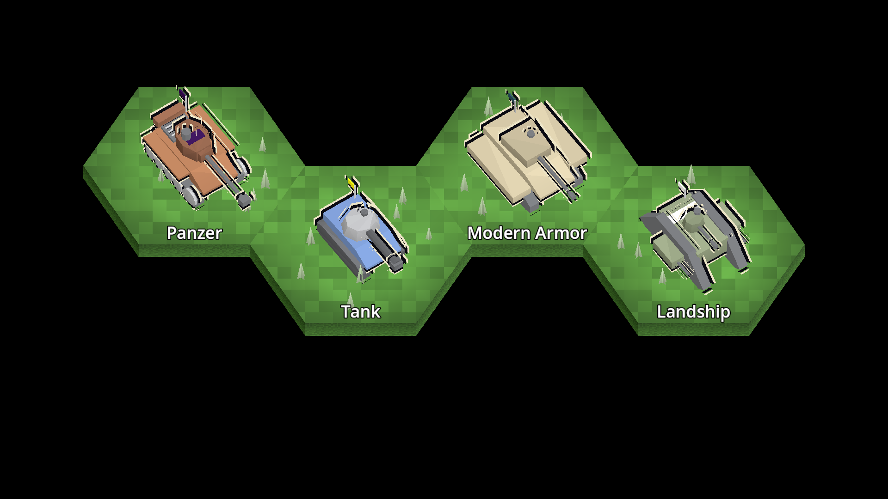
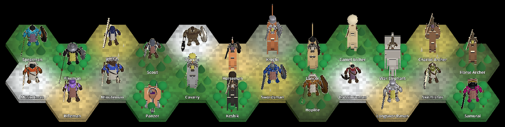
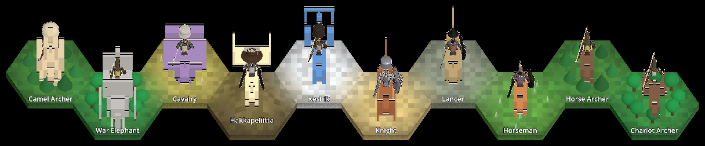
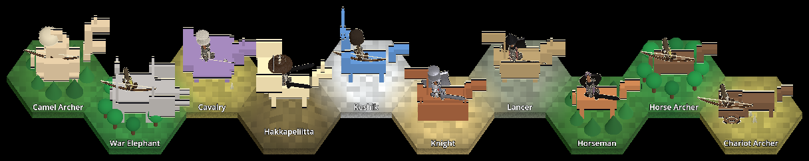
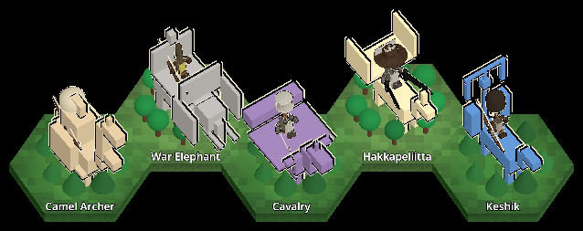

# Gritty, realistic unit style: Warrior design options (T294)

<!-- toc -->
## Contents

- [1. Decision needed](#1-decision-needed)
- [2. The comparison sheet](#2-the-comparison-sheet)
- [3. Why the current units look chibi, and what the pipeline can change](#3-why-the-current-units-look-chibi-and-what-the-pipeline-can-change)
- [4. The six designs](#4-the-six-designs)
  - [Option 1: Proportions only](#option-1-proportions-only)
  - [Option 2: Worn leather and bronze](#option-2-worn-leather-and-bronze)
  - [Option 3: Fur barbarian](#option-3-fur-barbarian)
  - [Option 4: Bronze hoplite](#option-4-bronze-hoplite)
  - [Option 5: Battle-damaged](#option-5-battle-damaged)
  - [Option 6: Painterly realism](#option-6-painterly-realism)
- [5. Recommendation](#5-recommendation)
- [6. Cross-cutting findings and risks](#6-cross-cutting-findings-and-risks)
- [7. How it was built and licences](#7-how-it-was-built-and-licences)
- [8. What was not verified](#8-what-was-not-verified)
- [9. Roll-out (T295)](#9-roll-out-t295)
<!-- /toc -->

The owner asked for units that look more gritty and real and less chibi. This page shows six clearly different Warrior designs next to the current one so the owner can pick one or two baselines. The roll-out to the other ~40 units is ticket T295 and is blocked on that choice. Nothing here changes the shipped game: the current `unit/Warrior` and every CI golden are untouched.

## 1. Decision needed

**Which design (or two designs) is the baseline for all units?** See the recommendation in section 5. Reply with the number(s), plus any "more of this, less of that" notes (for example "2, but with a plain helmet"). T295 then rolls the chosen style out.

## 2. The comparison sheet

Columns: CURRENT, 1 Proportions, 2 Worn leather, 3 Fur barbarian, 4 Bronze hoplite, 5 Battle-damaged, 6 Painterly. Rows 1 and 2 are a studio turntable (not in-game lighting); rows 3 and 4 are the real game at Ultra on the RTX 5060 Ti (default play view and the closest zoom the game allows, 4). All pictures, their capture method and the GPU are in [`images/units/warrior-options/README.md`](images/units/warrior-options/README.md). They are documentation images, not goldens.

## 3. Why the current units look chibi, and what the pipeline can change

What the current Warrior (`Unciv.Godot/Packs/units/models/unit/Warrior.glb`, see [UNIT-MODELS.md](UNIT-MODELS.md)) is made of:

- **Proportions.** The KayKit Adventurers body is built as a toy: about 2 heads tall (the head is about half of the body height), legs about 24 percent of the height, thick torso and arms, hands as spheres. That alone is most of the "chibi" read.
- **Flat toy shading.** One `TeamColor` material and one 1024 px palette-swatch texture: saturated flat colours with a soft gradient, no surface detail, no wear, no metal.
- **Whole-figure tinting.** `MapMaterials.TeamTint` lerps white towards the civilisation colour at 0.5 over the whole model, so every unit is tinted a saturated blue, red or green all over.
- **Small and rounded.** The figure is scaled to 0.7 tile units high with a big head, so at the default zoom the head is the most visible part.

What the pipeline can change **without engine code**:

| Lever | Used by | Notes |
|---|---|---|
| Bone and mesh proportion scaling (legs longer, head smaller, shoulders wider) | 1 to 6 | The animation clips keep working because translation keys are rescaled with the bones (checked, `animation-check.jpg`). |
| Several materials, only cloth named `TeamColor` | 2 to 6 | Only materials named `TeamColor` are civ-tinted (`MapMaterials`), so metal, leather, skin and fur keep their own colour and the team colour shows only on the cloth and crest. |
| Vertex colours (linear in glTF) for wear, grime, blood | 2 to 5 | Free at runtime; subtle at game zoom. |
| Tiling albedo and normal textures (box-projected UVs, 128 px tiles: leather, fur, hammered metal, wool) | 2 to 6 | Reads at zoom 4 to 8; invisible at the default zoom. |
| Extra generated geometry (armour plates, greaves, fur collar, ragged cape, spear, hoplon, bandages, beard) | 2 to 5 | Costs triangles and draw calls. |
| Taller figure (0.85 against 0.7, inside the contract maximum of 1.0) | 1 to 6 | Realistic proportions at the same height would make the figure thin and unreadable from above. |

What **needs code** (not done here): a rim light or outline shader for silhouettes, a reflection environment or probe so metal looks like metal (without one, steel and bronze read dark or matte under the present lighting, see the risks below), and tint masks per part.

## 4. The six designs

Polygon counts are triangles of the whole Warrior glb; the current Warrior is **5335 triangles, 10 primitives, 1 material, 1 texture, 532 KB**. The budget of UNIT-MODELS.md is 2 to 5k triangles per figure at 512 to 1024 px, so options 2 to 5 stay near that budget; the real new cost is draw calls (see section 6). All options keep the shared "Rig" skeleton and the six clips (idle, walk, attack, attack_ranged, hit, death) and the hand and head slots, so **no rig change is needed**. The contract (height 0.4 to 1.0, `TeamColor` material, feet at y=0) holds for all six.

### Option 1: Proportions only

- **Look.** The same flat palette and the same props, but a human build: 7.8 heads tall, smaller head, long legs, narrower torso. Still reads as a cartoon (the face is the KayKit face) but no longer a toy.
- **Build.** `reproportion` of the existing mesh and rig only; no new geometry, no textures.
- **Source and licence.** KayKit Adventurers (Kay Lousberg), CC0 1.0, reduced as the current Warrior; the script is original MPL-2.0 work.
- **Cost.** 5335 triangles, 10 primitives, 1 material (same as today), 532 KB.
- **Roll-out effort.** Smallest: one proportion table applied to every body of `attachments.json`, 1 to 2 days including checking every unit's attachments.
- **Risks.** Does not deliver "gritty": the colours stay toy colours. Useful as a base layer under another option.

### Option 2: Worn leather and bronze

- **Look.** A weathered fighter: bronze-capped helmet, leather jerkin with a studded belt, bronze-faced round shield, leather bracers and fur-trimmed boots, a worn cloak. Muted earth colours; team colour only on the cloth. At the default zoom it reads as a dark brown man at arms with a gold dot for the helmet, clearly less cute than today.
- **Build.** Proportions 7.7 heads tall, 0.85 high; generated cuirass plates, greaves, fur collar and ragged cape; 12 materials with tiling leather, fur, hammered-metal and wool textures (128 px tiles) and vertex-colour wear.
- **Source and licence.** KayKit CC0 1.0 base mesh and animation; every added mesh, texture and vertex-colour pass is generated by `build-warrior-options.py` (MPL-2.0, no third-party art, no Firaxis art).
- **Cost.** 4899 triangles, 36 primitives, 12 materials, 22 texture images, 1.5 MB.
- **Roll-out effort.** Medium: per-body configs for about 10 body types and a shared material set; the weapon and shield node mapping is the same as the Warrior's. Estimate 4 to 6 days for the ~40 units, plus a draw-call merge (section 6).
- **Risks.** Metal looks matte without a reflection environment; the cuirass is boxy; textures are barely visible at the default zoom (the silhouette and colours carry the look).

### Option 3: Fur barbarian

- **Look.** A big, broad northern raider: bear-pelt shoulders and collar, a bare chest, a heavy dark axe and a battered wooden shield. The most "barbarian" of the six and the most different silhouette (a wide shoulder mass).
- **Build.** Proportions 7.0 heads tall (the stockiest realistic build), fur ring shoulders, skin material with tiling normal map.
- **Source and licence.** As option 2.
- **Cost.** 5775 triangles (over the 5k soft budget), 47 primitives, 12 materials, 22 images, 1.65 MB.
- **Roll-out effort.** Medium to high: the style suits barbarians and a few units; for disciplined troops (Spearman, Legion, Musketman) it needs a different base, so it is not a good universal baseline.
- **Risks.** The bare chest shows blue-ish patches (the team-coloured material leaks through the skin texture, a bug to fix before use); the fur reads as a brown blob at the default zoom.

### Option 4: Bronze hoplite

- **Look.** A classical bronze-age soldier: gleaming bronze breastplate, plumed bronze helmet, big round hoplon, a spear, a short kilt of leather strips. The cleanest and most "historical" read and the most readable silhouette, thanks to the shield disc and the spear.
- **Build.** 8.2 heads tall, generated cuirass, hoplon and spear (thin shaft), pteruges strips.
- **Source and licence.** As option 2.
- **Cost.** 5593 triangles, 36 primitives, 12 materials, 22 images, 1.54 MB.
- **Roll-out effort.** Medium: it is a different weapon loadout, so it also changes what the "Warrior" unit carries (spear, not axe); good for the ancient era units (Spearman, Hoplite, Immortal) and a natural template for the classical ones.
- **Risks.** The spear is thin and nearly invisible at the default zoom; the warrior gets an era feel that may not suit the later units in the same style.

### Option 5: Battle-damaged

- **Look.** The darkest and grimmest: dirty steel helmet, soot-black leather, blood stains on the cloak and arms, a dented shield and a ragged cape. The most "gritty".
- **Build.** As option 2 with heavy wear, dirt and blood in vertex colours, a darker palette and no bright metal.
- **Source and licence.** As option 2.
- **Cost.** 5339 triangles, 47 primitives, 12 materials, 22 images, 1.58 MB.
- **Roll-out effort.** Medium, as option 2 (it is the same builder with different parameters); the blood and dirt are per-unit settings.
- **Risks.** Dark on a dark map: at the default zoom the figure is the least visible and the civ colour barely shows; it would need a lighter rim or outline to hold on forests and hills. Blood is a content-rating question for the owner.

### Option 6: Painterly realism

- **Look.** A halfway house: proportions 4.9 heads tall (a stocky stylised hero rather than a toy), a lighter hand-painted palette with some leather and wool texture, the bear hat kept.
- **Build.** A moderate `reproportion` plus the texture set; fewer extra parts.
- **Source and licence.** As option 2.
- **Cost.** 5335 triangles, 35 primitives, 12 materials, 22 images, 1.6 MB.
- **Roll-out effort.** Low to medium.
- **Risks.** Still reads as cartoon (the KayKit face and bear hat); probably not what "gritty and real" means.

## 5. Recommendation

- **Baseline A: option 2 (worn leather and bronze).** It is the best balance: it is clearly more realistic and grittier than today, readable at the default zoom (a dark figure with a bright metal highlight and a round shield), keeps the same loadout (axe, shield) so every existing unit's attachment mapping carries over, and stays near the triangle budget.
- **Baseline B (optional second): option 4 (bronze hoplite)** for the ancient and classical infantry, because it has the best silhouette and the most obvious historical identity. It could be used as the "armour set" of the same pipeline rather than a different style.
- **Not recommended as a baseline:** 3 (too specific, a bug in the skin material), 5 (too dark on the map, use its dirt settings as an optional "veteran" look), 1 and 6 (not gritty enough; 1 is useful as the first stage of any choice).

## 6. Cross-cutting findings and risks

- **Draw calls.** The current Warrior is 10 primitives, 1 material; options 2 to 6 are 35 to 47 primitives and 12 materials. With three figures per unit and dozens of units on screen that multiplies draw calls. **No frame time was measured with the options.** Before the roll-out the figure should be merged into one atlas (plus the separate `TeamColor` material), which brings it back to 2 to 4 draw calls; the builder already works with a 128 px tile set so the atlas fits in 1024 px.
- **File size.** 1.5 to 1.65 MB per model against 0.5 MB today (the 22 small PNGs dominate). Across 40+ units that is 60 MB of models before atlas merging, about 15 MB after it.
- **Lighting.** The pictures show that metal needs a reflection source: a small reflection probe or sky radiance in the Ultra and High environments (code, owner approval wanted) would make steel and bronze read properly. Without it, a bronze material looks like orange paint and steel like dark grey.
- **Silhouette at map scale.** At the far zoom (30 and beyond) all units show only the lead figure as a small mark, so these designs change colour and size, not shape. At the default zoom the silhouette differences (helmet, shield disc, shoulders) are what carry the look.
- **Team colour.** In 2 to 6 only cloth is tinted, so civilisations are distinguished less strongly than today (everything is tinted now). Likely needs a coloured crest, tabard or shield paint.
- **Contract.** All options keep one `TeamColor` material, feet at y=0, height 0.85, and the six clips, and none is wired into the game: they are in [`models/warrior-options/`](models/warrior-options/), outside every pack.

## 7. How it was built and licences

- Generator: `Unciv.Godot/tools/build-warrior-options.py` (stdlib only, imports `build-unit-models.py`). Input: the KayKit Adventurers Character Pack 1.0 (Kay Lousberg, https://kaylousberg.com, CC0 1.0). Everything added (geometry, tiling textures, vertex-colour wear) is generated by the script: original work of this project under MPL-2.0. No Firaxis or Civ 5 art and no other third-party art. The asset is recorded in `csharp/migration/ASSETS.md`.
- Models: [`models/warrior-options/`](models/warrior-options/) (`1-proportions.glb` .. `6-painterly.glb`). Not under `Unciv.Godot/Packs/`, so the game never loads them.

## 8. What was not verified

- The projections of section 6 (2 to 4 draw calls and about 15 MB after an atlas merge) and the roll-out effort estimates of section 4: they are estimates, not measurements.
- The blue patches on option 3's skin (a known defect, not fixed).
- Frame time or draw-call cost with the options in the game (the renders prove they load and draw; see section 6).
- The turntable pictures use a studio scene; the in-game crops use the real game but are small (the figure is about 70 px high at the closest zoom, 1920x1080).
- High and Ultra were rendered; Low and the compatibility renderer were not.
- Walk, attack and death were checked by eye on single poses (`animation-check.jpg`), not as a full playback; the other two clips (attack_ranged, hit) were not looked at.
- Android and the phone profile.

## 9. Roll-out (T295)

Option 3 "Fur barbarian" is rolled out to every humanoid and mounted unit by `Unciv.Godot/tools/build-unit-style.py`, selected per unit with a `"style"` key in `Unciv.Godot/Packs/units/attachments.json` (axe, sword, spear, bow, crossbow, javelin, scout, musket, rifle, crew, settler, worker and one style per great person). `build-unit-models.py` calls it; the generated geometry is parented under the hand slots like the KayKit weapons it replaces.

Risks fixed first: the team-colour material only covers cloth pieces (tabard, kilt, cape, hat band), never the skin texture, so no blue patches; fur and gear get their own contrasting palette and a clearly different outline so it does not read as a brown blob at the default zoom.

Recognisability: each class has its own silhouette (held item, headgear, size and posture): spear and pike long shaft, bow and crossbow, javelin bundle, musket and rifle long guns, crew weapon, hooded civilians with a sack or tool, tall or wide hats for the great people. Civilians carry no weapon and are shorter and stooped. Rule enforced by `UnitSilhouetteTests` (rasterised bind-pose silhouettes from four yaws, Jaccard distance), over ALL pairs of foot units (T310): different styles at least 0.18, the same style at least 0.10, civilian against soldier 0.30, any two riders 0.15, the three war elephants 0.16.

T310 (units of one class told apart; no shrunken figures): every unit has a `"look"` in `attachments.json` selecting an entry of `LOOKS[style][look]` in `build-unit-style.py` (hat, back load, gun or weapon parameters, proportion set). Riders also get a `mount.variant` (horse trappings joined with `+`: plain, caparison, barded, cataphract, plumed, pennant, saddlecloth, cantle, camel); the elephants have a tower, blanket or rails and their own colour. The figure scale now comes from the plain body, before any gear, and gear is shortened or tilted to fit the contract caps (bind radius 0.62, height 0.98); the result `fit = scale / scale-with-gear` is written to `asset.extras.bodyFit` and `NoGearShrinksAFootFigure` requires at least 0.96 for every foot unit (it was 0.62 to 0.94, which shrank the modern infantry). T315 (polish): the contract caps are 1.35 high and 1.1 sideways (were 1.0 and 0.65; in the bind pose a held spear lies forward at full length, it stands up in the idle clip), so spears are 1.85 long (hoplite 1.6), the pike 2.55 (1.4 times the spearman's reach, asserted) and the lancer's lance 2.4. Crew guns are no longer held: each stands on its own tripod (machine gun), wheeled carriage (Gatling, anti-tank), pedestal (anti-aircraft) or truck (SAM) in front of the gunner, one rigid part on the root joint. Rider hats are drawn 2.1 times (was 1.55) the foot size, the Mohawk crest is 0.55 tall and 0.14 thick, the radio antenna is 3 times thicker. Because a horse fills most of a rider's outline (riders differ by 0.15 to 0.3 in the mask metric), every horse unit now has its own coat (`mount.colour` in attachments.json: black, bay, chestnut, rust, dun, palomino, grey, white and the Khan's red roan) and `RidersWithAlikeOutlinesHaveMountsOfDifferentCoats` demands a coat distance of 0.2 for any two riders whose outlines differ by less than 0.30. Known limits: the siege engines (Cannon, Catapult, Ballista, Trebuchet, Hwacha) are rigid boxes outside this pipeline (T307); the mask test still measures the bind pose at 40x56 pixels, not the real zoom (T309).

Contact sheet on the real GPU (RTX 5060 Ti, `Unciv.Godot.Harness/tools/unit-sheet.sh <out-dir> [zoom]`; T309: one figure per unit, two pages fitted to the screen, grass only, camera size fitted to the page: pass 14 for the game's default zoom): `images/units/unit-sheet/unit-sheet-1.png` and `-2.png` (documentation, not goldens).

T307 (the rigid models): the 45 rigid units (ships, siege, armour, aircraft, missiles, helicopter; the Battering Ram moved into `build-rigid-models.py` as the archetype `ram`) were restyled in `Unciv.Godot/tools/build-rigid-models.py`. Gritty look: every non-team surface carries vertex colours (a patchy brightness per triangle, soot and mud darkening of the lowest parts, a little extra light on up-facing faces; 4 bytes per vertex, no textures, the models stay 20 to 50 KB so the pack does not grow), the `TeamColor` surfaces stay clean. Siege engines are big (0.9 long) and each has its own colour and top-down outline: the ram is a hide-and-thatch gabled shed on wheels with the iron-capped log sticking out and the civ colour only as side shields and a ridge stripe (it was a flat team-coloured roof), the catapult a red-brown frame with a long arm and a stone boulder, the ballista a green carriage with a wide dark bow, the trebuchet a stone-weighted lever on splayed legs, the hwach'a a teal rocket box with a yellow band and a long push pole, the cannon a long black barrel on a red-brown carriage with big wheels. Tank (blue, short, round turret), Panzer (grey, long, flat turret, engine deck, muzzle brake), Modern Armor (sand, wide skirts) and Landship (rhomboid with sponsons) differ in length, width and turret; the frigate, privateer, sea beggar, caravel and galleass differ in hull colour, beam, sail span and oars; the aircraft differ in wing outline (swept, straight, elliptical) and colour. Rule enforced by `UnitSilhouetteTests`: every pair of the 45 rigid units at least 0.18 apart in the mask metric (measured minimum 0.188), the civ colour at most 0.35 of a model's surface, every siege engine at least 500 mask pixels (the old Cannon and Catapult were 300 to 400) and a main colour of its own. The contract build limits of the generator are height 1.1 and radius 0.85 (the contract itself allows 1.35 and 1.1). Real-GPU sheet re-rendered; the unit-visuals goldens air, far, formations, gallery, ram, rigid, ships and siege-armour were re-recorded.

T309 (sheet and test hardening): the sheet draws one figure per unit (the far-zoom lone figure; `UNCIV_SHEET_FORMATIONS=1` draws the formations), two pages of 62 and 61 units fitted to the screen on plain grass, with wrapped labels; `unit-sheet.sh` fails fast when no dotnet is found. `UnitSilhouetteTests` now also checks: every humanoid and mounted entry of attachments.json has a style and every model file belongs to exactly one entry (57 + 21 + 45 = 123); every foot unit against every rider and every rigid unit at least 0.34 (measured minimum 0.348); all the foot, rider and rigid rules again at three times the mask resolution (120x168, thin props visible; rigid pairs at least 0.17, measured 0.175); and for rigid units the fine outline distance plus the distance of the mean material colour (civ colour left out) at least 0.20. Honest judgement of the sheet at the game's zoom (14): the classes are recognisable (settler against archer is clear: round hood and cloak against a thin bow), but within a class many units differ mostly by a thin prop or a hat: Warrior, Marauder, Brute, Jaguar and Pictish Warrior; Spearman, Hoplite, Legion, Persian Immortal, Swordsman and Knight; Galley, Dromon, Quinquereme and Galleass; the great people and the missionary and inquisitor. Those are tracked in the tickets named in T309's Notes.

T369 (look-alike groups told apart, also covers T320): a look can now carry `paint` ({material: target rgb}, `repaint` in `build-unit-style.py`), which recolours every vertex of that material while keeping the vertex's own light and dark. The units of every group the owner named now differ in broad colour first, which is what survives at the default zoom (14): the barbarian raiders (Warrior brown, Marauder white wolf-fur with a grey body, Brute black fur, Jaguar orange, Pictish Warrior woad blue, Maori Warrior turquoise, Mohawk Warrior copper and red, Berserker blue-grey), the armoured shield infantry (Spearman cyan, Hoplite dark bronze, Legion crimson, Persian Immortal blue and gold, Swordsman blue steel, Longswordsman white steel, Samurai purple lacquer, Landsknecht yellow, Pikeman black), the great people (blue, magenta, purple, orange, white, crimson, teal and black robes; the Settler a cream robe), the modern riflemen (Rifleman lilac, Infantry khaki, Great War Infantry horizon blue, Marine navy, Foreign Legion sand, Paratrooper olive, Mehal Sefari ochre, Ski Infantry white, Mechanized black) and the foot bowmen, javelineers and musketeers; the five ancient galleys get their own hull colours (Trireme ash, Galley brown, Quinquereme teal, Dromon crimson, Galleass blue). `UnitSilhouetteTests` gained a colour-aware check (`PictureDistance`: z-buffered vertex-colour pictures of the four views at 40x56, the civ colour neutral): every foot pair at least 0.23 (measured minimum 0.238, Archer and Composite Bowman), the named groups at least 0.27, the galleys outline plus colour at least 0.30; the outline thresholds are unchanged. No figure is grass green any more (the reviewer found Maori, Spearman, Archer, Rifleman and the Merchant blending into the tiles; Archer is navy now). Judged on the real-GPU sheet at zoom 14 (`unit-sheet.sh <dir> 14`; `UNCIV_SHEET_ONLY="A,B"` renders just the named units): the groups above are told apart at a glance by hue; T320's five (Swordsman blue, Longswordsman white, Musketman orange, Rifleman lilac, Minuteman buff) too. Still honestly similar: the riders (mostly coat colour and a hat), Archer against Scout and Composite Bowman (small figures with a bow in similar greens and browns), Infantry against Rifleman and Mechanized Infantry (a helmet on the civ-coloured tabard, the body colour only shows on arms), and the saturated toy-like palette itself (recognisability over realism, owner priority).

T324 (rigid models second pass): the Ballista has a broad bed, stock and bow arms (it read as a thin bat), the Trebuchet is brown (plinth and counterweight were stone grey like the Panzer), the Panzer is olive and the Giant Death Robot yellow with crimson legs, the Work Boats are bigger and stubbier (0.7 x 0.5, the smallest figure of the sheet before), the Destroyer is longer (1.25) with a blue hull, the Submarine larger (r 0.12), the Helicopter Gunship has dark rotor blades and an olive body (no white cross), the Guided and Nuclear Missile are 1.4 and 1.13 times bigger. The aircraft are still close in outline (Zero, Great War Bomber, Fighter, Bomber; the Fighter was also restyled, length 1.15, span 0.6: restyling the biplane or the Zero moved the minimum to another pair, 0.168 to 0.174 in several tries), so they stay told apart mostly by colour (cream, tan, blue, olive). `MinRigidDistance` 0.18 to 0.185 and `MinOutlinePlusColour` 0.20 to 0.23 (measured minimum 0.239, Battleship and Nuclear Submarine); `MinFineRigidDistance` stays 0.17 (measured 0.182). Known weak spots at zoom 14: the Destroyer pale blue and the Helicopter thin rotors are low contrast on grass. Cannon was already a single fat barrel on a carriage after T307.

T373 (recognizability third pass): the aircraft now differ in outline AND hue: Zero a white ellipse wing, Great War Bomber an orange long-winged biplane, Fighter a sky-blue twin boom (a new `twin_boom` archetype in `build-rigid-models.py`: an H seen from above, the only two-fuselage outline), Bomber dark pine green, B17 silver with swept wings and four engines (it was straight-winged and 0.16 from the Great War Bomber), Triplane red. The Destroyer hull is navy (was pale blue), the Helicopter Gunship has a dark body and fat white rotor blades with orange tips (thin dark blades were lost on grass), the Panzer an iron-black hull with a sand turret (it was olive like the Rocket Artillery). Same-hue pairs: Maori Warrior coral (Spearman keeps cyan), Great Merchant gold, Samurai vermilion lacquer, Rifleman a brighter lilac, Minuteman a blue coat. New `UnitSilhouetteTests` rules: any two aircraft at least 0.18 apart in outline at 120x168 (measured minimum 0.182, Zero and Bomber) and 0.42 outline plus mean colour (measured 0.43), Destroyer, Helicopter Gunship, Panzer and Fighter at least 0.25 (linear RGB) from the grass colour, Panzer at least 0.15 from the Rocket Artillery in colour, and Maori Warrior, Spearman, Samurai, Rifleman, Great Merchant and Minuteman at least 0.45 apart as pictures (measured 0.486). The stale-comment item of the ticket was already consistent when T373 checked (the T369 group comment and constant both say 0.27; the 0.25 values left are the `InlineData` bars of the T310 pairs). The sheet scenario gained `UNCIV_SHEET_TERRAIN` (base terrains cycled over the tiles) and `UNCIV_SHEET_NATIONS` (real nation outer colours): `images/units/unit-sheet/t373-live-terrain.png` shows the changed units at zoom 14 on plains, desert, tundra, hills, grass and snow with real civ colours. Honest findings there: every changed unit is told apart on grass and plains; white and yellow units (Zero, the helicopter's blades, the Great Merchant) lose contrast on snow and desert, the Rifleman and Minuteman are still small figures, the Destroyer is a thin needle and the Panzer reads as a boxy bunker; these are filed as T382. `unit-visuals` goldens air, ancient, gallery, medieval-mounts, modern-mounts, modern, ram, rigid, ships and siege-armour were re-recorded (medieval-mounts, modern-mounts and ram were already outside tolerance on this tree before the change). The two sheet pages were re-rendered.

T382 (contrast on pale terrain): every mesh of every unit figure now has a dark rim, an inverted hull drawn as the mesh's overlay material (`MapMaterials.OutlineUnit`: front faces culled, vertices pushed 0.03 along their normals in the vertex shader, unshaded, near-black blue; about 1.5 px at zoom 14, so it also follows skinned and animated figures). It is applied to every figure in `UnitNode.Build`, so white, yellow and pale units (Zero, Helicopter Gunship rotor, Great Merchant, Ski Infantry, the white-furred Marauder) keep an outline on snow and desert, and dark ones (Bomber, Minuteman) keep one on grass. Other changes: Rifleman and Minuteman are built at 1.0 tall instead of 0.85 (a per-unit `"height"` in `attachments.json`, read by `build-unit-models.py`), the Samurai's lacquer is magenta (it was vermilion, close to the coral Maori Warrior), the Destroyer is longer (1.42) and wider (beam 0.17) with three single turrets (widening it to 0.22 made it 0.11 from the Missile Cruiser). `UnitSilhouetteTests` gained `TheSmallFiguresOfT382AreBigEnough` (Rifleman and Minuteman at least 520 mask pixels, measured 577 and 722; Destroyer at least 320, measured 357) and the same-hue picture bar rose from 0.45 to 0.48 (measured 0.496); no threshold was lowered. The harness scenario `unit-visuals` asserts the rim on every mesh and its goldens were re-recorded. Real-GPU sheet on snow, desert, tundra, hills, grass and plains with real civ colours at zoom 14 (`images/units/unit-sheet/t382-live-terrain.png`; the two full sheet pages were re-rendered). Honest judgement: the rim fixes the white and yellow units, the aircraft and the ships on pale ground; the Maori Warrior (coral) and Samurai (magenta) are clearly different; the Rifleman is now as big as the Spearman. Still weak: a black rim does not help a dark unit on dark ground (only tested on the pale and mid terrains of the sheet), the Panzer is still a boxy grey and sand slab, the Scout and Musketman are small grey and orange figures, and all foot figures stay small at zoom 14 (about 40 px high on a 1080p screen). These are filed as T383.

T383 (legibility pass 2: Panzer, foot figures, dark ground): (1) the Panzer is a new archetype `panzer` in `build-rigid-models.py` (it was the `tank` archetype in grey Iron and a flat Sand turret slab, a boxy bunker): rust-brown hull (new fixed materials `Rust` and `RustDark`, apart from the blue Tank, the sand Modern Armor, the olive Landship and Rocket Artillery), a sloped nose, narrow fenders, five road wheels and a drive sprocket on each side, an angular six-sided turret with a rear bustle, a mantlet, a tall commander's cupola, an engine grille, a stowage box on the rear deck and a long gun with a muzzle brake. (2) Foot figures (a skeleton and no mount) are drawn `UnitVisuals.FootFigureBoost` = 1.3 times larger (applied in `UnitNode.Build`, also to the far-zoom lone figure; mounted units and rigid models keep their size): the KayKit source files are not in the repository, so the scale is applied at run time instead of in `build-unit-models.py`. A zoom-dependent scale was not needed: at zoom 14 the boosted figures are about 52 px high on a 1080p screen (were about 40). (3) The rim got a light halo: the dark inverted hull of T382 now carries a second, wider inverted hull as its `NextPass` (warm off-white, 0.05 from the figure, 0.03 of it the dark rim), so a dark figure on dark ground (Archer, Scout, Warrior on forest, jungle, mountain) has a light outline, a pale figure on snow keeps the dark one. This is terrain independent on purpose: it needs no terrain lookup when a unit moves. All figures share ONE rim material (`MapMaterials.SharedRim`, T382 built one per figure). The rim width is in the figure's model units, so a boosted foot figure's rim is 1.3 times wider than a ship's. (4) The sheet scenario takes `UNCIV_SHEET_FEATURES` (comma separated terrain features in step with `UNCIV_SHEET_TERRAIN`, `-` for none), so Forest and Jungle draw their trees and dark units can be judged on wooded ground. Tests (nothing lowered): `ThePanzerOfT383IsABrownTankWithDetailNotAGreyAndSandSlab` (colour at least 0.12 from the other tanks, measured 0.129; at least 5 materials), `EveryFootFigureAsDrawnIsBigEnough` (mask pixels times the boost squared at least 600, measured minimum 634), `FootFiguresAreDrawnLargerThanTheyAreModelled`; the harness scenario `unit-visuals` asserts the shared rim with its halo and the boosted foot figures, its goldens were re-recorded.

T384 (legibility pass 3: mounted units, halo on thin weapons, rim width per figure scale): (1) Mounted figures (a skeleton on a `HorseMesh`: horses, camels, elephants, chariots) are drawn `UnitVisuals.MountedFigureBoost` = 1.5 times larger (T383 boosted only walkers and left riders the smallest figures on the sheet: a horse is long and low and seen from above the rider hides in it); the boost is applied in `UnitNode.Build` like the walkers' 1.3, for the same reason (no KayKit sources in the repository). (2) The rim width is now per figure scale: `MapMaterials.RimFor(figureScale, thin)` divides the grow amount by the drawn scale of the figure (formation scale times boost), so the dark rim is 0.03 world units wide on a boosted walker, a rider, a shrunken group figure and a ship alike (T383 left it in model units, so a 1.3 times boosted figure had a 1.3 times wider rim than a ship). Materials are shared by figures of the same scale (rounded to 0.01), and `UnitNode.ApplyLod` swaps the lead figure's rim when it grows to the far-zoom lone figure. (3) Thin hand-held parts of a skeleton figure (a mesh without a skin whose two smaller sides are both under 0.16 model units: spears, javelins, staffs, picks, swords, axes) get a narrow rim (0.012) and a narrow halo (0.022 total) instead of 0.03 and 0.05; the full halo made a spear a cream bar five times its own width, and no halo at all lost it on forest, so it is a thin pale-edged line now. Bodies, shields and rigid models keep the full rim and halo. (4) Tests, nothing lowered: `EveryMountedFigureAsDrawnIsBigEnough` (mask pixels times the boost squared at least 1000, measured minimum 1123, Horse Archer; unboosted it was 499) and `MountedFiguresAreDrawnLargerThanFootFigures`; the harness scenario `unit-visuals` asserts the per-scale rim, the thin-part rim and the mounted boost, goldens elephants, medieval, medieval-mounts, modern-mounts, chariots, ram and gallery were re-recorded (the others still matched). (5) The layout-matrix timeout of the T383 sweep could not be reproduced: on the base tip (cb3b67458f) the whole matrix (5 sizes, 170 PNGs, 0 problems) passes in 134 s and on this branch in 136 s, both with the machine at load 10 to 17; it needs no unit on screen and this ticket does not touch it, so the T383 timeouts were a loaded machine (the sweep ran next to other agents' builds), not a regression. Real-GPU sheet at zoom 14 on forest, jungle, plains, hills, snow, desert and tundra with real civ colours (`images/units/unit-sheet/t384-live-terrain.png`; both full sheet pages were re-rendered). Honest judgement: riders are now as present as the walkers, spears and swords read as weapons and not as bars, and a dark Keshik or Archer on forest keeps a light edge; still weak: from above a rider is a vertical stack on a flat brown, grey or cream box (Camel Archer, War Elephant, Cavalry, Hakkapeliitta are hard to tell from each other except by colour), the Keshik is a black slab, and at the fitted-zoom sheet the larger mounted figures reach the next row's label (the tiles are packed tighter than the units). These are filed as T387.

T387 (legibility pass 4: mounted figures from above, Keshik, sheet crowding): (1) A horse seen from the front or the back is a narrow stack under its rider, so the five worst mounted figures now differ by SHAPE and not only by colour, each by a trapping that spreads sideways or upwards (new `HORSE_VARIANTS` in `build-unit-models.py`): the Camel Archer a taller swayed neck with a raised head, a taller hump and two hanging pannier bags (`camel2`, scale 1.1, a sandy coat), the Cavalry a broad flat saddle blanket, a wide bedroll across the rump and a front bar (`barded+blanket2`, a slate-purple coat: the grey of the Cavalry was the colour of the elephant and the Sipahi), the Hakkapeliitta two upright wings behind the rider, a V from the front (`wings`, a pale palomino coat), the Keshik a tall standard with a crossbar and hanging tails and two wide quivers (`tuq`, a royal-blue coat: the black caparison made a slab on forest and snow alike), the War Elephant bigger (scale 1.12, wider and taller ears, a mid-grey coat). (2) The sheet scenario leaves an empty tile row between unit rows (`RowStep`, at most 12x4 = 48 units a page, so the gallery is three pages now): a mounted figure 1.5 times larger reached the label of the unit above it (T384 hand-back); with the gap no head touches a label. (3) `UnitSilhouetteTests.TheMountedFiguresOfT387DifferByShapeNotJustColour` (nothing lowered): the five figures' outlines (average of the four sides) at least 0.28 apart (measured minimum 0.284, Cavalry and Hakkapeliitta; before the pass 0.244, Camel Archer and Cavalry) and their mounts' coats at least 0.25 apart in linear RGB (the old Cavalry and War Elephant coats were 0.04 apart). The harness golden `unit-visuals/medieval-mounts` was re-recorded (the other goldens still matched). The baked-in boosts of T383/T384 stay at run time: the KayKit sources are not in the repository (they were found in an agent scratch folder to rebuild the five models, whose output was verified byte for byte against the committed models first), see T389. Real-GPU sheets (RTX 5060 Ti, Vulkan, zoom 14, real civ colours): front, side (yaw 90) and a forest and jungle sheet at yaw 35, plus all three pages of the whole gallery. Honest judgement: the five are now told apart at a glance from the front (a broad purple slab, a pale V, a tall blue T, a pale tall camel, a big grey elephant) and from the side (a camel with a head high above the rider, a standard, wings, a blanket); the Keshik is no longer black on forest. Still weak: the camel's neck is a thin pale post that vanishes on pale ground, the plain horses (Horseman, Horse Archer, Lancer, Knight, Cossack, Khan) are still narrow stacks that differ mostly by coat from the front, and the riders themselves are small against their mounts (T389).

