# Gritty, realistic unit style: Warrior design options (T294)

<!-- toc -->
## Contents

- [1. Decision needed](#1-decision-needed)
- [2. The comparison sheet](#2-the-comparison-sheet)
- [3. Why the current units look chibi, and what the pipeline can change](#3-why-the-current-units-look-chibi-and-what-the-pipeline-can-change)
- [4. The six designs](#4-the-six-designs)
  - [Option 1: Proportions only](#option-1-proportions-only)
  - [Option 2: Worn leather and bronze](#option-2-worn-leather-and-bronze)
  - [Option 3: Fur barbarian](#option-3-fur-barbarian)
  - [Option 4: Bronze hoplite](#option-4-bronze-hoplite)
  - [Option 5: Battle-damaged](#option-5-battle-damaged)
  - [Option 6: Painterly realism](#option-6-painterly-realism)
- [5. Recommendation](#5-recommendation)
- [6. Cross-cutting findings and risks](#6-cross-cutting-findings-and-risks)
- [7. How it was built and licences](#7-how-it-was-built-and-licences)
- [8. What was not verified](#8-what-was-not-verified)
<!-- /toc -->

The owner asked for units that look more gritty and real and less chibi. This page shows six clearly different Warrior designs next to the current one so the owner can pick one or two baselines. The roll-out to the other ~40 units is ticket T295 and is blocked on that choice. Nothing here changes the shipped game: the current `unit/Warrior` and every CI golden are untouched.

## 1. Decision needed

**Which design (or two designs) is the baseline for all units?** See the recommendation in section 5. Reply with the number(s), plus any "more of this, less of that" notes (for example "2, but with a plain helmet"). T295 then rolls the chosen style out.

## 2. The comparison sheet

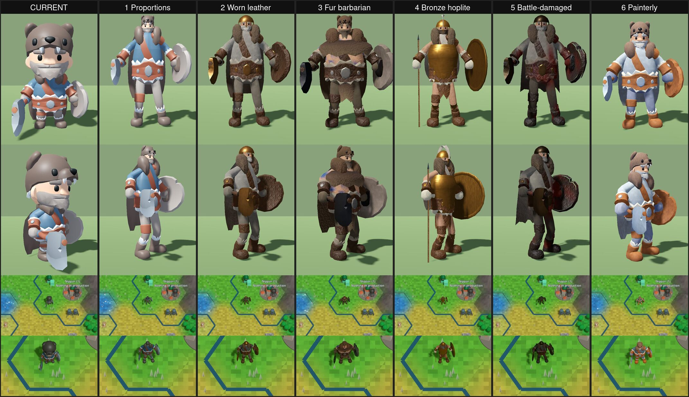

Columns: CURRENT, 1 Proportions, 2 Worn leather, 3 Fur barbarian, 4 Bronze hoplite, 5 Battle-damaged, 6 Painterly. Rows 1 and 2 are a studio turntable (not in-game lighting); rows 3 and 4 are the real game at Ultra on the RTX 5060 Ti (default play view and the closest zoom the game allows, 4). All pictures, their capture method and the GPU are in [`images/units/warrior-options/README.md`](images/units/warrior-options/README.md). They are documentation images, not goldens.

## 3. Why the current units look chibi, and what the pipeline can change

What the current Warrior (`Unciv.Godot/Packs/units/models/unit/Warrior.glb`, see [UNIT-MODELS.md](UNIT-MODELS.md)) is made of:

- **Proportions.** The KayKit Adventurers body is built as a toy: about 2 heads tall (the head is about half of the body height), legs about 24 percent of the height, thick torso and arms, hands as spheres. That alone is most of the "chibi" read.
- **Flat toy shading.** One `TeamColor` material and one 1024 px palette-swatch texture: saturated flat colours with a soft gradient, no surface detail, no wear, no metal.
- **Whole-figure tinting.** `MapMaterials.TeamTint` lerps white towards the civilisation colour at 0.5 over the whole model, so every unit is tinted a saturated blue, red or green all over.
- **Small and rounded.** The figure is scaled to 0.7 tile units high with a big head, so at the default zoom the head is the most visible part.

What the pipeline can change **without engine code**:

| Lever | Used by | Notes |
|---|---|---|
| Bone and mesh proportion scaling (legs longer, head smaller, shoulders wider) | 1 to 6 | The animation clips keep working because translation keys are rescaled with the bones (checked, `animation-check.jpg`). |
| Several materials, only cloth named `TeamColor` | 2 to 6 | Only materials named `TeamColor` are civ-tinted (`MapMaterials`), so metal, leather, skin and fur keep their own colour and the team colour shows only on the cloth and crest. |
| Vertex colours (linear in glTF) for wear, grime, blood | 2 to 5 | Free at runtime; subtle at game zoom. |
| Tiling albedo and normal textures (box-projected UVs, 128 px tiles: leather, fur, hammered metal, wool) | 2 to 6 | Reads at zoom 4 to 8; invisible at the default zoom. |
| Extra generated geometry (armour plates, greaves, fur collar, ragged cape, spear, hoplon, bandages, beard) | 2 to 5 | Costs triangles and draw calls. |
| Taller figure (0.85 against 0.7, inside the contract maximum of 1.0) | 1 to 6 | Realistic proportions at the same height would make the figure thin and unreadable from above. |

What **needs code** (not done here): a rim light or outline shader for silhouettes, a reflection environment or probe so metal looks like metal (without one, steel and bronze read dark or matte under the present lighting, see the risks below), and tint masks per part.

## 4. The six designs

Polygon counts are triangles of the whole Warrior glb; the current Warrior is **5335 triangles, 10 primitives, 1 material, 1 texture, 532 KB**. The budget of UNIT-MODELS.md is 2 to 5k triangles per figure at 512 to 1024 px, so options 2 to 5 stay near that budget; the real new cost is draw calls (see section 6). All options keep the shared "Rig" skeleton and the six clips (idle, walk, attack, attack_ranged, hit, death) and the hand and head slots, so **no rig change is needed**. The contract (height 0.4 to 1.0, `TeamColor` material, feet at y=0) holds for all six.

### Option 1: Proportions only

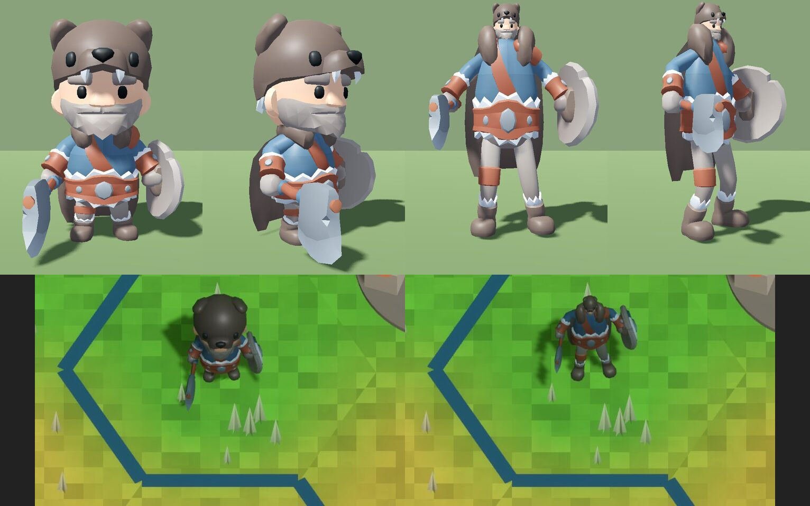

- **Look.** The same flat palette and the same props, but a human build: 7.8 heads tall, smaller head, long legs, narrower torso. Still reads as a cartoon (the face is the KayKit face) but no longer a toy.
- **Build.** `reproportion` of the existing mesh and rig only; no new geometry, no textures.
- **Source and licence.** KayKit Adventurers (Kay Lousberg), CC0 1.0, reduced as the current Warrior; the script is original MPL-2.0 work.
- **Cost.** 5335 triangles, 10 primitives, 1 material (same as today), 532 KB.
- **Roll-out effort.** Smallest: one proportion table applied to every body of `attachments.json`, 1 to 2 days including checking every unit's attachments.
- **Risks.** Does not deliver "gritty": the colours stay toy colours. Useful as a base layer under another option.

### Option 2: Worn leather and bronze

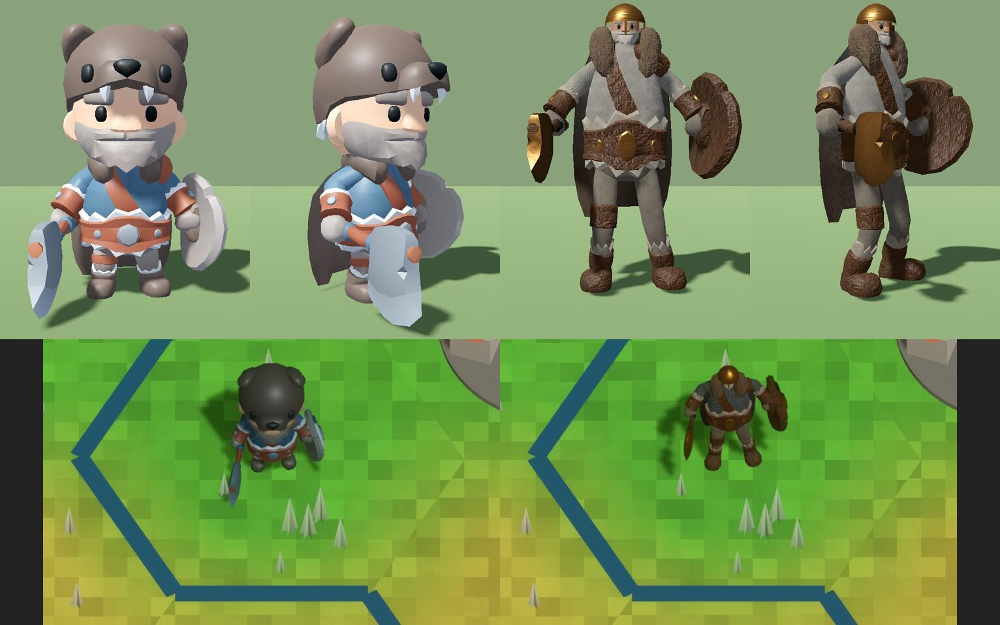

- **Look.** A weathered fighter: bronze-capped helmet, leather jerkin with a studded belt, bronze-faced round shield, leather bracers and fur-trimmed boots, a worn cloak. Muted earth colours; team colour only on the cloth. At the default zoom it reads as a dark brown man at arms with a gold dot for the helmet, clearly less cute than today.
- **Build.** Proportions 7.7 heads tall, 0.85 high; generated cuirass plates, greaves, fur collar and ragged cape; 12 materials with tiling leather, fur, hammered-metal and wool textures (128 px tiles) and vertex-colour wear.
- **Source and licence.** KayKit CC0 1.0 base mesh and animation; every added mesh, texture and vertex-colour pass is generated by `build-warrior-options.py` (MPL-2.0, no third-party art, no Firaxis art).
- **Cost.** 4899 triangles, 36 primitives, 12 materials, 22 texture images, 1.5 MB.
- **Roll-out effort.** Medium: per-body configs for about 10 body types and a shared material set; the weapon and shield node mapping is the same as the Warrior's. Estimate 4 to 6 days for the ~40 units, plus a draw-call merge (section 6).
- **Risks.** Metal looks matte without a reflection environment; the cuirass is boxy; textures are barely visible at the default zoom (the silhouette and colours carry the look).

### Option 3: Fur barbarian

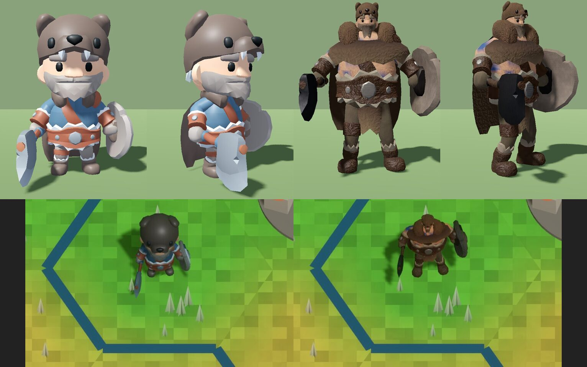

- **Look.** A big, broad northern raider: bear-pelt shoulders and collar, a bare chest, a heavy dark axe and a battered wooden shield. The most "barbarian" of the six and the most different silhouette (a wide shoulder mass).
- **Build.** Proportions 7.0 heads tall (the stockiest realistic build), fur ring shoulders, skin material with tiling normal map.
- **Source and licence.** As option 2.
- **Cost.** 5775 triangles (over the 5k soft budget), 47 primitives, 12 materials, 22 images, 1.65 MB.
- **Roll-out effort.** Medium to high: the style suits barbarians and a few units; for disciplined troops (Spearman, Legion, Musketman) it needs a different base, so it is not a good universal baseline.
- **Risks.** The bare chest shows blue-ish patches (the team-coloured material leaks through the skin texture, a bug to fix before use); the fur reads as a brown blob at the default zoom.

### Option 4: Bronze hoplite

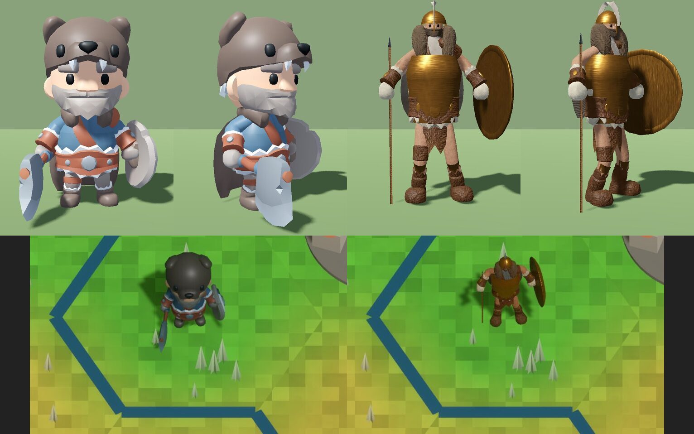

- **Look.** A classical bronze-age soldier: gleaming bronze breastplate, plumed bronze helmet, big round hoplon, a spear, a short kilt of leather strips. The cleanest and most "historical" read and the most readable silhouette, thanks to the shield disc and the spear.
- **Build.** 8.2 heads tall, generated cuirass, hoplon and spear (thin shaft), pteruges strips.
- **Source and licence.** As option 2.
- **Cost.** 5593 triangles, 36 primitives, 12 materials, 22 images, 1.54 MB.
- **Roll-out effort.** Medium: it is a different weapon loadout, so it also changes what the "Warrior" unit carries (spear, not axe); good for the ancient era units (Spearman, Hoplite, Immortal) and a natural template for the classical ones.
- **Risks.** The spear is thin and nearly invisible at the default zoom; the warrior gets an era feel that may not suit the later units in the same style.

### Option 5: Battle-damaged

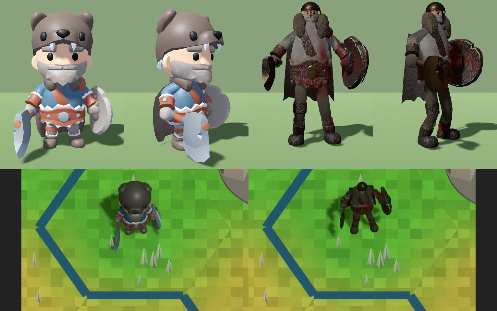

- **Look.** The darkest and grimmest: dirty steel helmet, soot-black leather, blood stains on the cloak and arms, a dented shield and a ragged cape. The most "gritty".
- **Build.** As option 2 with heavy wear, dirt and blood in vertex colours, a darker palette and no bright metal.
- **Source and licence.** As option 2.
- **Cost.** 5339 triangles, 47 primitives, 12 materials, 22 images, 1.58 MB.
- **Roll-out effort.** Medium, as option 2 (it is the same builder with different parameters); the blood and dirt are per-unit settings.
- **Risks.** Dark on a dark map: at the default zoom the figure is the least visible and the civ colour barely shows; it would need a lighter rim or outline to hold on forests and hills. Blood is a content-rating question for the owner.

### Option 6: Painterly realism

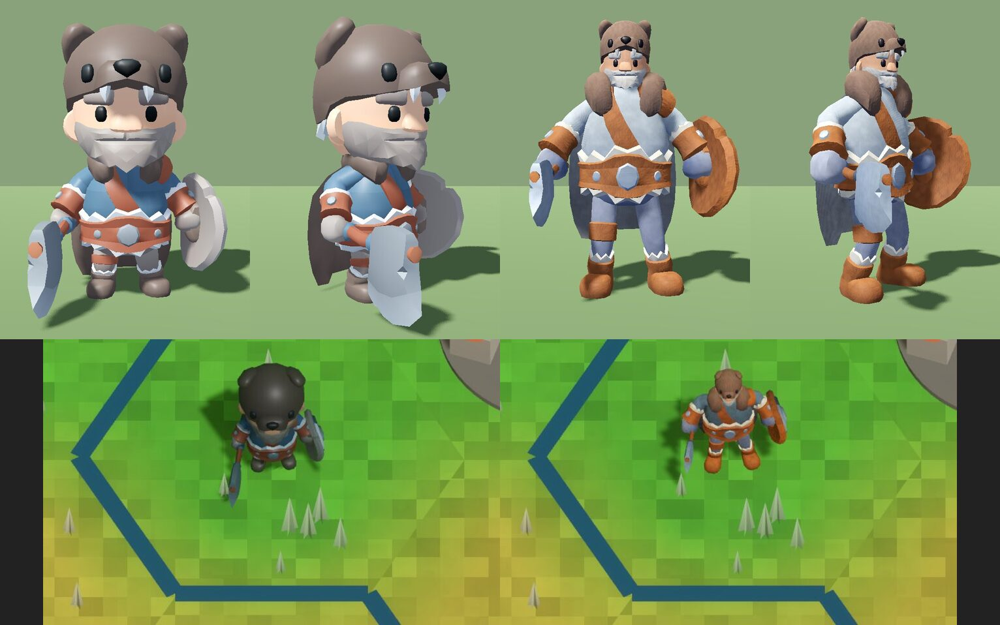

- **Look.** A halfway house: proportions 4.9 heads tall (a stocky stylised hero rather than a toy), a lighter hand-painted palette with some leather and wool texture, the bear hat kept.
- **Build.** A moderate `reproportion` plus the texture set; fewer extra parts.
- **Source and licence.** As option 2.
- **Cost.** 5335 triangles, 35 primitives, 12 materials, 22 images, 1.6 MB.
- **Roll-out effort.** Low to medium.
- **Risks.** Still reads as cartoon (the KayKit face and bear hat); probably not what "gritty and real" means.

## 5. Recommendation

- **Baseline A: option 2 (worn leather and bronze).** It is the best balance: it is clearly more realistic and grittier than today, readable at the default zoom (a dark figure with a bright metal highlight and a round shield), keeps the same loadout (axe, shield) so every existing unit's attachment mapping carries over, and stays near the triangle budget.
- **Baseline B (optional second): option 4 (bronze hoplite)** for the ancient and classical infantry, because it has the best silhouette and the most obvious historical identity. It could be used as the "armour set" of the same pipeline rather than a different style.
- **Not recommended as a baseline:** 3 (too specific, a bug in the skin material), 5 (too dark on the map, use its dirt settings as an optional "veteran" look), 1 and 6 (not gritty enough; 1 is useful as the first stage of any choice).

## 6. Cross-cutting findings and risks

- **Draw calls.** The current Warrior is 10 primitives, 1 material; options 2 to 6 are 35 to 47 primitives and 12 materials. With three figures per unit and dozens of units on screen that multiplies draw calls. **No frame time was measured with the options.** Before the roll-out the figure should be merged into one atlas (plus the separate `TeamColor` material), which brings it back to 2 to 4 draw calls; the builder already works with a 128 px tile set so the atlas fits in 1024 px.
- **File size.** 1.5 to 1.65 MB per model against 0.5 MB today (the 22 small PNGs dominate). Across 40+ units that is 60 MB of models before atlas merging, about 15 MB after it.
- **Lighting.** The pictures show that metal needs a reflection source: a small reflection probe or sky radiance in the Ultra and High environments (code, owner approval wanted) would make steel and bronze read properly. Without it, a bronze material looks like orange paint and steel like dark grey.
- **Silhouette at map scale.** At the far zoom (30 and beyond) all units show only the lead figure as a small mark, so these designs change colour and size, not shape. At the default zoom the silhouette differences (helmet, shield disc, shoulders) are what carry the look.
- **Team colour.** In 2 to 6 only cloth is tinted, so civilisations are distinguished less strongly than today (everything is tinted now). Likely needs a coloured crest, tabard or shield paint.
- **Contract.** All options keep one `TeamColor` material, feet at y=0, height 0.85, and the six clips, and none is wired into the game: they are in [`models/warrior-options/`](models/warrior-options/), outside every pack.

## 7. How it was built and licences

- Generator: `Unciv.Godot/tools/build-warrior-options.py` (stdlib only, imports `build-unit-models.py`). Input: the KayKit Adventurers Character Pack 1.0 (Kay Lousberg, https://kaylousberg.com, CC0 1.0). Everything added (geometry, tiling textures, vertex-colour wear) is generated by the script: original work of this project under MPL-2.0. No Firaxis or Civ 5 art and no other third-party art. The asset is recorded in `csharp/migration/ASSETS.md`.
- Models: [`models/warrior-options/`](models/warrior-options/) (`1-proportions.glb` .. `6-painterly.glb`). Not under `Unciv.Godot/Packs/`, so the game never loads them.

## 8. What was not verified

- The projections of section 6 (2 to 4 draw calls and about 15 MB after an atlas merge) and the roll-out effort estimates of section 4: they are estimates, not measurements.
- The blue patches on option 3's skin (a known defect, not fixed).
- Frame time or draw-call cost with the options in the game (the renders prove they load and draw; see section 6).
- The turntable pictures use a studio scene; the in-game crops use the real game but are small (the figure is about 70 px high at the closest zoom, 1920x1080).
- High and Ultra were rendered; Low and the compatibility renderer were not.
- Walk, attack and death were checked by eye on single poses (`animation-check.jpg`), not as a full playback; the other two clips (attack_ranged, hit) were not looked at.
- Android and the phone profile.

## 9. Roll-out (T295)

Option 3 "Fur barbarian" is rolled out to every humanoid and mounted unit by `Unciv.Godot/tools/build-unit-style.py`, selected per unit with a `"style"` key in `Unciv.Godot/Packs/units/attachments.json` (axe, sword, spear, bow, crossbow, javelin, scout, musket, rifle, crew, settler, worker and one style per great person). `build-unit-models.py` calls it; the generated geometry is parented under the hand slots like the KayKit weapons it replaces.

Risks fixed first: the team-colour material only covers cloth pieces (tabard, kilt, cape, hat band), never the skin texture, so no blue patches; fur and gear get their own contrasting palette and a clearly different outline so it does not read as a brown blob at the default zoom.

Recognisability: each class has its own silhouette (held item, headgear, size and posture): spear and pike long shaft, bow and crossbow, javelin bundle, musket and rifle long guns, crew weapon, hooded civilians with a sack or tool, tall or wide hats for the great people. Civilians carry no weapon and are shorter and stooped. Rule enforced by `UnitSilhouetteTests` (rasterised bind-pose silhouettes from four yaws, Jaccard distance; different styles at least 0.10, riders 0.06, civilian against soldier 0.16).

Contact sheet at the default zoom on the real GPU (RTX 5060 Ti, `Unciv.Godot.Harness/tools/unit-sheet.sh <out-dir>`): `images/units/unit-sheet/unit-sheet-1.png` to `-4.png` (documentation, not goldens).

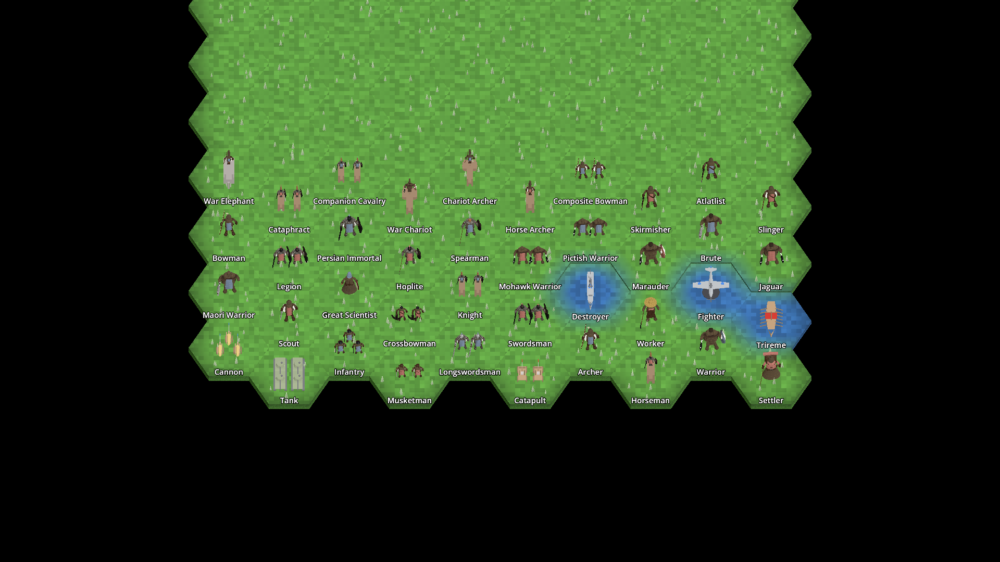
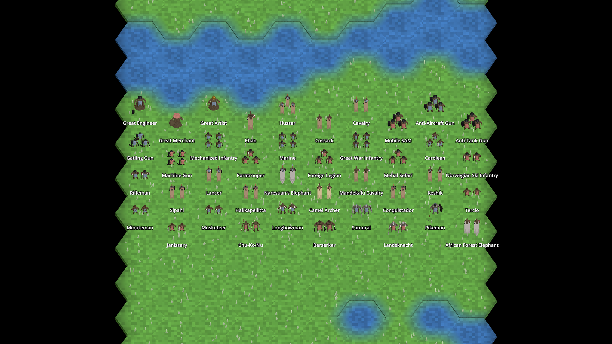
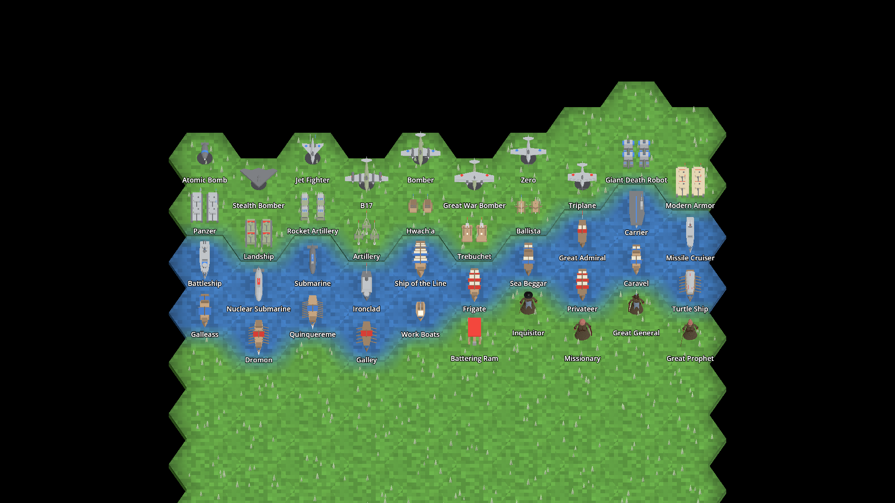
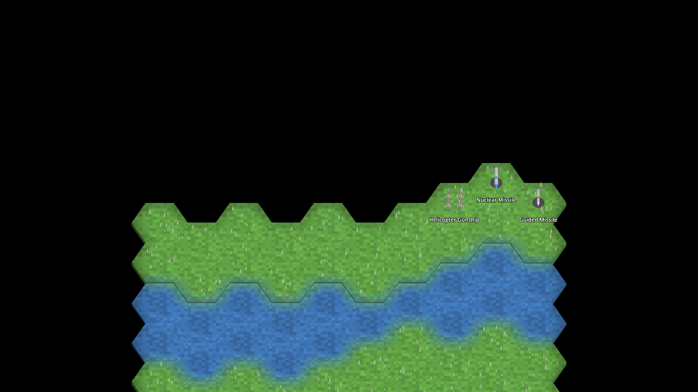

Not done: the 44 rigid models (ships, siege, armour, aircraft) keep their T256 look (see the follow-up ticket). The units pack grew from 41 MB to 78 MB (64 px textures, vertex colours).
